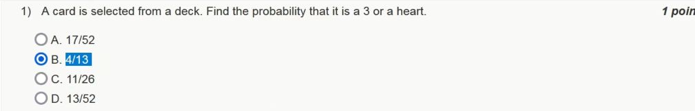
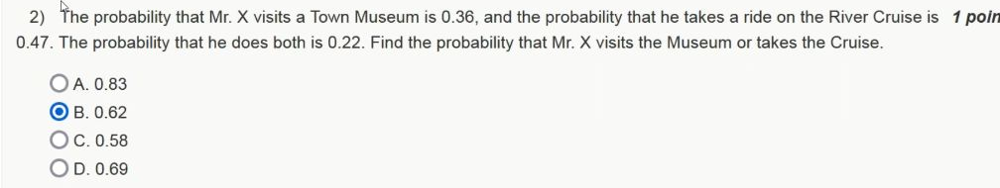
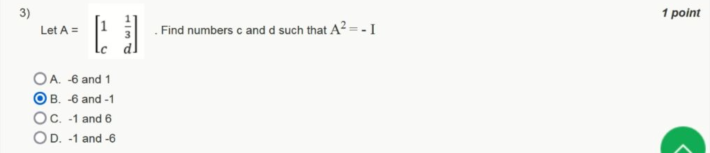
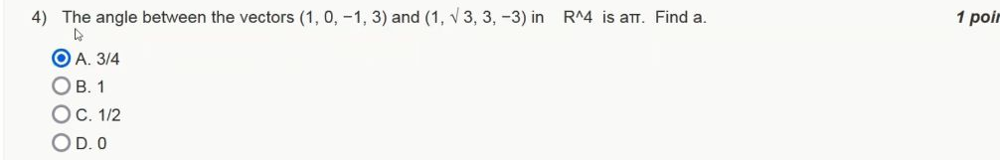
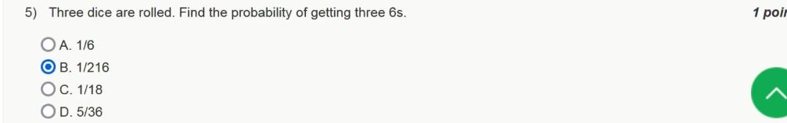
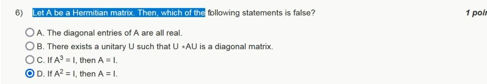
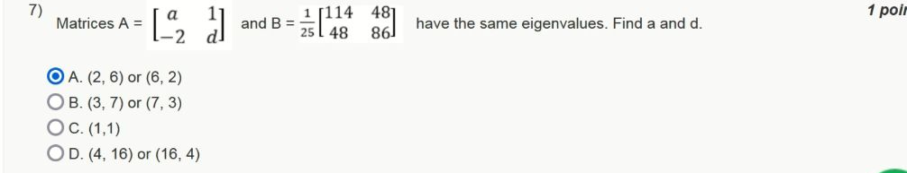
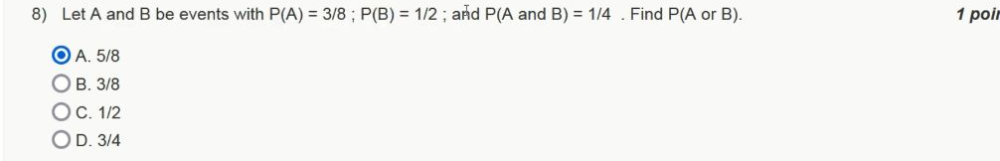
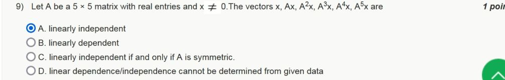
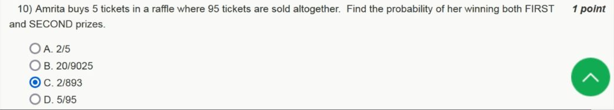

# Week 0 — New questions from 2023

[Found index](../README.md) · [Sources checked](../Sources%20checked.md)

These ten prerequisite questions are absent from the main Week 01–12 collection. The original question images below are cropped from JANAK TRIVEDI's [2023 Assignment 0 video](https://www.youtube.com/watch?v=lfhGtpQGyRs). The selected radio buttons belong to the uploader; they are **not official grading feedback**. All solutions below were derived independently. Q2 and Q7 have no correct printed option, and the selected answer for Q9 is wrong.

## Question index

| Question | Topic | Correct answer |
|---|---|---|
| [Q1](#q1--a-three-or-a-heart) | Overlapping card events | B — $4/13$ |
| [Q2](#q2--museum-or-cruise) | Inclusion–exclusion | $0.61$; no printed option |
| [Q3](#q3--a-matrix-whose-square-is-minus-the-identity) | Matrix multiplication | B — $c=-6$, $d=-1$ |
| [Q4](#q4--angle-between-two-vectors) | Dot product and angle | A — $3/4$ |
| [Q5](#q5--three-sixes) | Independent events | B — $1/216$ |
| [Q6](#q6--the-false-hermitian-matrix-statement) | Hermitian matrices | D |
| [Q7](#q7--matrices-with-the-same-eigenvalues) | Trace and determinant | $4\pm\sqrt6$; no printed option |
| [Q8](#q8--union-of-two-events) | Inclusion–exclusion | A — $5/8$ |
| [Q9](#q9--six-vectors-in-five-dimensions) | Linear dependence | B — Linearly dependent |
| [Q10](#q10--winning-both-raffle-prizes) | Sampling without replacement | C — $2/893$ |

## Q1 — A three or a heart

**Answer: B — $4/13$.** In a standard deck, four cards have rank three and thirteen cards are hearts. The three of hearts belongs to both groups, so adding their sizes counts it twice.

$$
P(\text{three or heart})
=\frac{4+13-1}{52}
=\frac{16}{52}
=\frac4{13}.
$$

The word “or” includes the card satisfying both descriptions. Option A, $17/52$, forgets to subtract that overlap. Counting the thirteen hearts first and then the three non-heart threes gives the same sixteen favourable cards.

[Video frame, 0:35](https://www.youtube.com/watch?v=lfhGtpQGyRs&t=35s) · [Question index](#question-index)

## Q2 — Museum or cruise

**Correct result: $0.61$ — none of the printed options.** Let $M$ mean a museum visit and $C$ mean a cruise. The supplied values are $P(M)=0.36$, $P(C)=0.47$, and $P(M\cap C)=0.22$.

$$
P(M\cup C)
=P(M)+P(C)-P(M\cap C)
=0.36+0.47-0.22
=0.61.
$$

The same result follows by splitting the possibilities into disjoint groups: museum only has probability $0.36-0.22=0.14$, cruise only has probability $0.47-0.22=0.25$, and both has probability $0.22$. Their sum is $0.61$.

The video selects B, $0.62$, but the literal numbers in the screenshot do not produce that value. This is a question/option inconsistency, not a rounding issue. Adding $0.36+0.47$ without subtracting the intersection would instead produce option A, $0.83$.

[Video frame, 0:35](https://www.youtube.com/watch?v=lfhGtpQGyRs&t=35s) · [Question index](#question-index)

## Q3 — A matrix whose square is minus the identity

**Answer: B — $c=-6$ and $d=-1$.** The condition is $A^2=-I$, where

$$
A=\begin{bmatrix}
1&1/3\\
c&d
\end{bmatrix}.
$$

Multiply the rows of $A$ by its columns:

$$
A^2=
\begin{bmatrix}
1+c/3 &(1+d)/3\\
c(1+d)&c/3+d^2
\end{bmatrix}
=\begin{bmatrix}
-1&0\\
0&-1
\end{bmatrix}.
$$

The upper-right entry gives $1+d=0$, hence $d=-1$. The upper-left entry gives $1+c/3=-1$, hence $c=-6$. Substitution checks the other two entries: $c(1+d)=0$ and $c/3+d^2=-2+1=-1$.

Squaring a matrix means matrix multiplication; squaring its individual entries would lose the cross terms and give the wrong equations.

[Video frame, 0:45](https://www.youtube.com/watch?v=lfhGtpQGyRs&t=45s) · [Question index](#question-index)

## Q4 — Angle between two vectors

**Answer: A — $\alpha=3/4$.** Write the vectors as $u=(1,0,-1,3)$ and $v=(1,\sqrt3,3,-3)$. Their angle is $\theta=\alpha\pi$.

$$
u\cdot v=1+0-3-9=-11,
\qquad
\lVert u\rVert=\sqrt{11},
\qquad
\lVert v\rVert=\sqrt{22}.
$$

Therefore

$$
\cos\theta
=\frac{u\cdot v}{\lVert u\rVert\lVert v\rVert}
=\frac{-11}{\sqrt{11}\sqrt{22}}
=-\frac1{\sqrt2}.
$$

The angle between nonzero real vectors lies in $[0,\pi]$, so $\theta=3\pi/4$ and $\alpha=3/4$. The negative dot product already tells us the angle must be obtuse, ruling out the right-angle and zero-angle choices.

[Video frame, 1:05](https://www.youtube.com/watch?v=lfhGtpQGyRs&t=65s) · [Question index](#question-index)

## Q5 — Three sixes

**Answer: B — $1/216$.** Under the usual assumption of three independent fair dice, each die shows six with probability $1/6$. All three conditions must hold together:

$$
P(6,6,6)=\frac16\times\frac16\times\frac16=\frac1{216}.
$$

Equivalently, there are $6^3=216$ equally likely ordered outcomes and exactly one favourable outcome, $(6,6,6)$. Adding three probabilities would describe neither this event nor a valid treatment of its intersection; multiplication is justified here by independence.

[Video frame, 1:05](https://www.youtube.com/watch?v=lfhGtpQGyRs&t=65s) · [Question index](#question-index)

## Q6 — The false Hermitian matrix statement

**Answer: D — $A^2=I$ does not force $A=I$.** A counterexample is $A=-I$: it is Hermitian and its square is $I$, but it differs from $I$.

A matrix is Hermitian when $A^*=A$, where the star denotes conjugate transpose. Its diagonal entries satisfy $a_{ii}=\overline{a_{ii}}$, which makes them real, so A is true. The spectral theorem gives a unitary matrix $U$ and a real diagonal matrix $D$ such that $U^*AU=D$, so B is true. See [MIT's discussion of the Hermitian spectral theorem](https://www.ocw.mit.edu/ans7870/18/18.013a/textbook/HTML/chapter32/section07.html).

For C, suppose $A^3=I$. In the diagonal representation, every real eigenvalue $\lambda$ satisfies $\lambda^3=1$. The only real solution is $\lambda=1$, so $D=I$ and consequently $A=I$. Thus C is true.

For D, the corresponding equation is $\lambda^2=1$, which permits both $1$ and $-1$. Hermitian matrices can therefore square to the identity while having negative eigenvalues. This is exactly why D fails.

[Video frame, 1:35](https://www.youtube.com/watch?v=lfhGtpQGyRs&t=95s) · [Question index](#question-index)

## Q7 — Matrices with the same eigenvalues

**Correct result: $(a,d)=(4+\sqrt6,4-\sqrt6)$ or the swapped pair — none of the printed options.** The literal matrices shown are

$$
A=\begin{bmatrix}
a&1\\
-2&d
\end{bmatrix},
\qquad
B=\frac1{25}\begin{bmatrix}
114&48\\
48&86
\end{bmatrix}.
$$

For a $2\times2$ matrix, its characteristic polynomial is $\lambda^2-\mathrm{tr}(A)\lambda+\det(A)$. Having the same eigenvalues, counted with multiplicity, therefore gives equal traces and determinants.

$$
\mathrm{tr}(B)=\frac{114+86}{25}=8,
\qquad
\det(B)=\frac{114\cdot86-48^2}{25^2}
=\frac{7500}{625}=12.
$$

For $A$, the trace is $a+d$ and the determinant is $ad+2$. Therefore

$$
a+d=8,\qquad ad+2=12,\qquad ad=10.
$$

The two numbers $a$ and $d$ are the roots of $z^2-8z+10=0$, so

$$
z=\frac{8\pm\sqrt{64-40}}2=4\pm\sqrt6.
$$

The video selects A, $(2,6)$ or $(6,2)$. Those pairs have the required trace but give $\det(A)=2\cdot6+2=14$, which disagrees with $\det(B)=12$. Matching the trace alone is insufficient. As a further check, both corrected matrices have characteristic polynomial $\lambda^2-8\lambda+12=(\lambda-2)(\lambda-6)$.

[Video frame, 1:35](https://www.youtube.com/watch?v=lfhGtpQGyRs&t=95s) · [Question index](#question-index)

## Q8 — Union of two events

**Answer: A — $5/8$.** The given values are $P(A)=3/8$, $P(B)=1/2$, and $P(A\cap B)=1/4$.

$$
P(A\cup B)=\frac38+\frac12-\frac14
=\frac38+\frac48-\frac28
=\frac58.
$$

The intersection is counted in both $P(A)$ and $P(B)$, so it must be subtracted once. Independence is neither stated nor needed: the intersection probability is supplied directly.

[Video frame, 2:05](https://www.youtube.com/watch?v=lfhGtpQGyRs&t=125s) · [Question index](#question-index)

## Q9 — Six vectors in five dimensions

**Answer: B — Linearly dependent.** With $A$ a real $5\times5$ matrix and $x$ a nonzero vector, every vector in

$$
x,\ Ax,\ A^2x,\ A^3x,\ A^4x,\ A^5x
$$

belongs to $\mathbb R^5$. This is a list of six vectors in a space of dimension five. At most five vectors in that space can be linearly independent, so there must be scalars $c_0,\ldots,c_5$, not all zero, with

$$
c_0x+c_1Ax+c_2A^2x+c_3A^3x+c_4A^4x+c_5A^5x=0.
$$

The uploader's selected A is incorrect. The assumption $x\ne0$ does not increase the dimension or guarantee independence of its subsequent images. Symmetry of $A$ cannot change this dimension bound either. The vectors can become dependent even earlier—for example, if $A=I$, they are all equal to $x$.

[Video frame, 2:05](https://www.youtube.com/watch?v=lfhGtpQGyRs&t=125s) · [Question index](#question-index)

## Q10 — Winning both raffle prizes

**Answer: C — $2/893$.** Amrita holds five of the ninety-five tickets. With the standard raffle rule that the two prizes are drawn on distinct tickets, the first winning ticket is hers with probability $5/95$. Conditional on that win, she has four tickets among the remaining ninety-four.

$$
P(\text{both prizes})=\frac5{95}\times\frac4{94}
=\frac{20}{8930}
=\frac2{893}.
$$

The same result follows from unordered pairs: $\binom52/\binom{95}2=10/4465=2/893$. The second probability changes because the first ticket is not replaced. The event is winning **both** prizes; winning at least one would require a different calculation. The source does not spell out replacement, so the distinct-ticket assumption is stated explicitly here.

[Video frame, 2:35](https://www.youtube.com/watch?v=lfhGtpQGyRs&t=155s) · [Question index](#question-index) · [Found index](../README.md)
