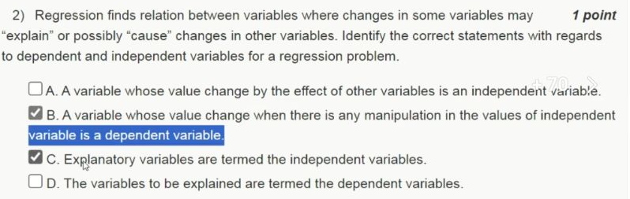

# Week 11 — New question from 2023

[Found index](../README.md) · [Existing Week 11 collection](../../Week%2011.md) · [Sources checked](../Sources%20checked.md)

This question comes from **2023 Assignment 11, Q2**, shown in JANAK TRIVEDI's [Week 11 video at 1:10](https://www.youtube.com/watch?v=1G9YWY29qIs&t=70s). It tests the roles of regression variables, rather than asking which technique performs regression. The video supplies unofficial selections, not accepted grading feedback.

## Question index

| New question | Answer |
|---|---|
| [Q2 — Dependent and explanatory variables](#q2--dependent-and-explanatory-variables) | B, C, and D in the intended introductory sense; B needs a qualification |

## Q2 — Dependent and explanatory variables

**Answer: B, C, and D in the question's intended introductory sense.** C and D state the terminology directly. B describes the intended response-variable role, although its claim about manipulation is too strong if read as a universal guarantee. The video selects B and C but omits D, which is plainly correct.

The task is to classify four statements about dependent and independent variables:

| Choice | Statement, paraphrased | Assessment |
|---|---|---|
| A | A variable affected by other variables is called independent. | False in the intended terminology: this reverses the response and predictor roles. |
| B | A variable responding when an independent variable is manipulated is called dependent. | Intended to be true; the response role is correct, but manipulation and an actual change are not necessary parts of its statistical definition. |
| C | Explanatory variables are called independent variables. | True. Predictor and explanatory are the corresponding regression terms. |
| D | Variables being explained are called dependent variables. | True. Response and outcome are the corresponding terms. |

### Identify the roles in a model

In a simple regression model,

$$
Y=\beta_0+\beta_1X+\varepsilon,
$$

$Y$ is the response being modelled, while $X$ is the predictor used to explain or predict it. These roles determine the terminology. For example, when predicting a house's price from its floor area, price is the dependent variable and area is the explanatory variable. This is why both C and D belong in the answer. Penn State's [variable definitions](https://online.stat.psu.edu/stat500/Lesson01) give these corresponding names and explain that a variable can have different roles in different studies.

### Read B carefully

A regression can use observational measurements: the analyst does not have to manipulate the predictor. It also does not follow that every change in $X$ forces a change in an individual observed $Y$. A zero slope, random variation, or other explanatory factors can prevent that interpretation.

Calling $X$ explanatory does not, by itself, establish that an intervention on $X$ causes $Y$ to change. Penn State's [regression lesson](https://online.stat.psu.edu/stat501/Lesson01) distinguishes statistical from deterministic relationships and discusses the limits of causal conclusions from observational data. Consequently, **C and D are unqualified definitional truths; B is acceptable only with the course's intended response-variable meaning**.

The original assessment's accepted checkbox combination is not visible in this source. The additional selection D follows from the definitions, while the qualification on B preserves the distinction between regression terminology and a causal guarantee.

[Back to question index](#question-index) · [Found index](../README.md)
