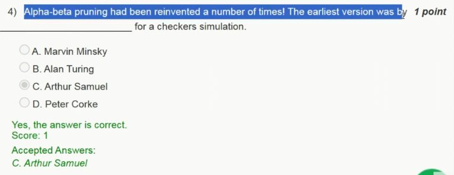
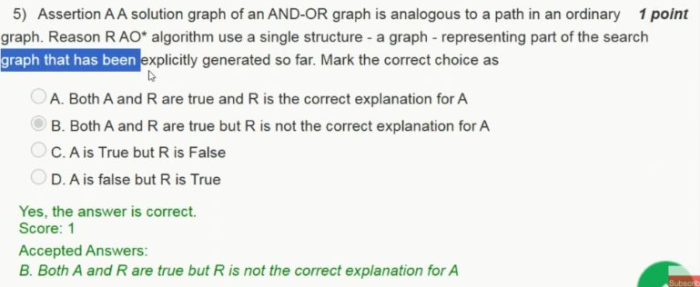
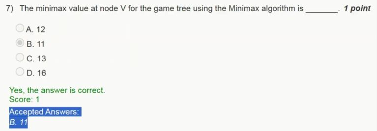
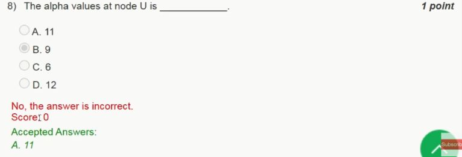
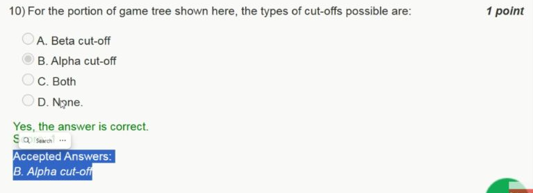

# Week 3 — New questions from 2023

[Found index](../README.md) · [Existing Week 3 collection](../../Week%2003.md) · [Sources checked](../Sources%20checked.md)

Five questions from **2023 Assignment 3** add material absent from the main collection. The screenshots come from JANAK TRIVEDI's [scored follow-up video](https://www.youtube.com/watch?v=mY0jKapeCDw), which visibly displays accepted-answer feedback. The unobstructed game tree comes from the [original assignment video](https://www.youtube.com/watch?v=18WufMMOwag&t=155s). The displayed feedback agrees with the worked game-tree calculations below. In Q8, the uploader's selected answer is marked incorrect and the accepted answer is visible.

## Question index

| Original question | New task | Answer |
|---|---|---|
| [Q4](#q4--early-pruning-in-a-checkers-program) | Identify the researcher in a checkers-specific history question | C — Arthur Samuel, as accepted in the source |
| [Q5](#q5--solution-graphs-and-aos-working-graph) | Evaluate an assertion, a reason, and their explanatory relationship | B — Both true, but the reason does not explain the assertion |
| [Q7](#q7--the-minimax-value-at-v) | Back up the values in a different game tree | B — $11$ |
| [Q8](#q8--the-alpha-bound-at-u) | Distinguish an inherited bound from a subtree's value | A — $11$ |
| [Q10](#q10--which-cutoff-occurs-in-this-tree) | Identify the cutoff produced by this tree and order | B — Alpha cutoff |

## Q4 — Early pruning in a checkers program

**Source's accepted answer: C — Arthur Samuel.** The question asks about an early version of alpha–beta pruning used for a checkers simulation. The listed alternatives are Marvin Minsky, Alan Turing, Arthur Samuel, and Peter Corke.

Samuel's checkers research is documented in his [1959 IBM paper, “Some Studies in Machine Learning Using the Game of Checkers”](https://ieeexplore.ieee.org/abstract/document/5392560/authors). The association the question tests is **Samuel → checkers**, rather than identifying a bound or performing a pruning calculation.

The word “earliest” in the question is an oversimplification of priority. The historical discussion in the authors' [AIMA chapter on adversarial search](https://aima.cs.berkeley.edu/4th-ed/pdfs/newchap06.pdf) describes several independent origins of alpha–beta search, including McCarthy and the Newell–Shaw–Simon program, as well as Samuel's checkers work. Retain C as the displayed accepted answer to this checkers-specific item; do not infer that the screenshot establishes a unique invention history.

[Source frame, 1:20](https://www.youtube.com/watch?v=mY0jKapeCDw&t=80s) · [Question index](#question-index)

## Q5 — Solution graphs and AO*'s working graph

**Answer: B — Both statements are true, but the reason is not the explanation of the assertion.** The two claims are:

- **Assertion:** A solution graph in an AND/OR graph plays a role analogous to a solution path in an ordinary search graph.
- **Reason:** AO* maintains a graph representing the part of the search space generated so far.

The assertion concerns **what constitutes a solution**. In ordinary search, a path gives one sequence from the start to a goal. In an AND/OR problem, an OR node permits a selected alternative, while an AND node requires all of its required successor subproblems to be solved. A solution may therefore branch, so a solution graph generalises the role of a path.

The reason concerns **what the algorithm stores during search**. AO* maintains generated nodes, dependencies, estimates, and solved information in its working graph. That representation can contain alternatives that will not belong to the final solution.

Keeping a working graph does not explain why a solution can require several branches; the AND/OR semantics explain that. Thus the reason can be true without supplying the requested explanation. The source visibly accepts B.

[Source frame, 1:45](https://www.youtube.com/watch?v=mY0jKapeCDw&t=105s) · [Question index](#question-index)

## Shared game tree for Q7, Q8, and Q10

The root $V$ is MAX. Its children $P$ and $U$ are MIN. $Q$, $R$, and $T$ are MAX, while $S$ is MIN. Terminal numbers are the supplied utilities. The source specifies left-to-right traversal; that order is used for the pruning discussion.

| Node | Children, from left to right | Choice rule | Backed-up value |
|---|---|---|---|
| $S$ | $5,10$ | MIN | $5$ |
| $Q$ | $4,13$ | MAX | $13$ |
| $R$ | $S,11$ | MAX | $11$ |
| $P$ | $Q,R,16$ | MIN | $11$ |
| $T$ | $9,6$ | MAX | $9$ |
| $U$ | $T,12$ | MIN | $9$ |
| $V$ | $P,U$ | MAX | $11$ |

[Original graph frame, 2:35](https://www.youtube.com/watch?v=18WufMMOwag&t=155s)

## Q7 — The minimax value at V

**Answer: B — $11$.** Back up each completed subtree using the MAX or MIN rule assigned to its node:

$$
\begin{aligned}
S&=\min(5,10)=5,\\
Q&=\max(4,13)=13,\\
R&=\max(S,11)=\max(5,11)=11,\\
P&=\min(Q,R,16)=\min(13,11,16)=11,\\
T&=\max(9,6)=9,\\
U&=\min(T,12)=\min(9,12)=9,\\
V&=\max(P,U)=\max(11,9)=11.
\end{aligned}
$$

At the root, MAX prefers the $P$ branch. Although that branch contains a terminal $16$, MIN controls $P$ and can choose the $R$ branch worth $11$. Selecting the largest leaf anywhere in the tree would ignore the opponent's intervening decisions. The displayed accepted value is $11$.

[Source frame, 2:40](https://www.youtube.com/watch?v=mY0jKapeCDw&t=160s) · [Question index](#question-index)

## Q8 — The alpha bound at U

**Answer: A — $\alpha(U)=11$.** The source marks the selected B, $9$, incorrect and explicitly accepts A, $11$.

With left-to-right depth-first evaluation, the search finishes $P$ before entering $U$. The root $V$ already has a guaranteed alternative worth $11$, so its alpha bound becomes $11$. The call exploring $U$ inherits that bound.

$$
P=11
\quad\Longrightarrow\quad
\alpha(V)=11
\quad\Longrightarrow\quad
\alpha(U)=11.
$$

The number $9$ is the minimax value of $U$ in the full tree. It is not the inherited alpha bound. At a MIN node, new child results tighten **beta**, while alpha records what the relevant MAX ancestor can already obtain elsewhere.

After $T$ returns $9$, the search has $\beta(U)=9\le\alpha(U)=11$. MAX at $V$ already prefers its completed left branch, so the remaining child of $U$ cannot improve the root's choice. This supplies the cutoff analysed in Q10.

[Source frame, 2:45](https://www.youtube.com/watch?v=mY0jKapeCDw&t=165s) · [Question index](#question-index)

## Q10 — Which cutoff occurs in this tree?

**Answer: B — Alpha cutoff.** For the supplied utilities and left-to-right order, the only pruned branch is $U$'s terminal child $12$.

| Stage | Relevant bound or value | Consequence |
|---|---|---|
| Complete $Q$ | $Q=13$; $\beta(P)=13$ | Continue with $R$. |
| Complete $R$ | $R=11$; $\beta(P)=11$ | The root has no earlier completed alternative, so $P$'s terminal $16$ is still examined. |
| Return from $P$ | $P=11$; $\alpha(V)=11$ | Enter $U$ with alpha $11$. |
| Complete $T$ | $T=9$; $\beta(U)=9$ | Since $9\le11$, skip $U$'s remaining child $12$. |

This is an alpha cutoff at a **MIN** node: its upper bound is already no better than an alternative available to a MAX ancestor. No MAX node in this traversal reaches the inherited beta threshold needed for a beta cutoff.

The visited terminal values, in order, are $4,13,5,10,11,16,9,6$. The ninth leaf, $12$, is not visited. Full minimax and alpha–beta both return $V=11$; pruning saves an evaluation without changing the root result. The answer is specific to this tree and traversal order, rather than a claim that all game trees permit only alpha cutoffs.

[Source frame, 3:10](https://www.youtube.com/watch?v=mY0jKapeCDw&t=190s) · [Question index](#question-index) · [Found index](../README.md)
