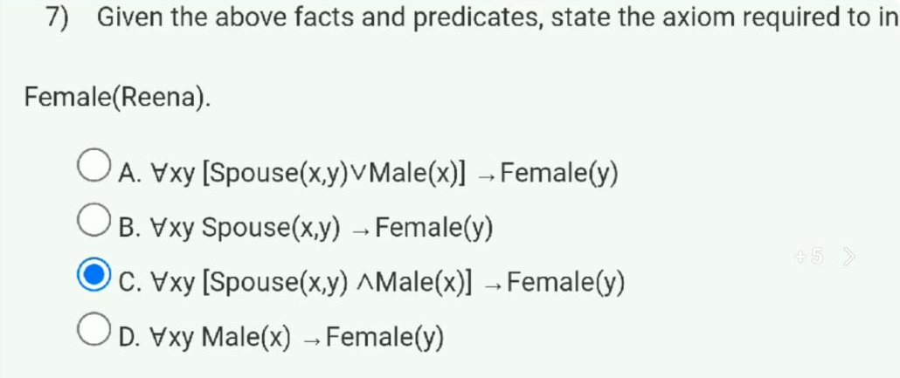
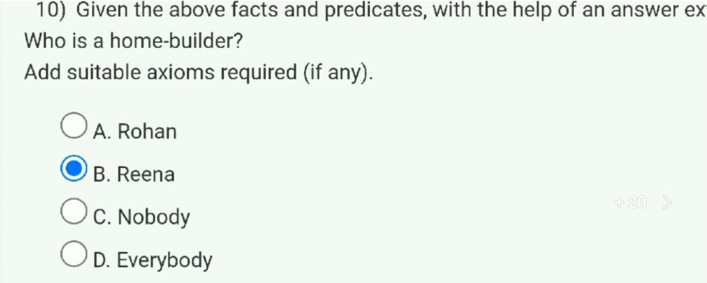

# Week 6 — New questions from 2022

[Found index](../README.md) · [Existing Week 6 collection](../../Week%2006.md) · [Sources checked](../Sources%20checked.md)

Two questions from Coding Solutions' [2022 Week 6 assignment video](https://www.youtube.com/watch?v=SeLKa6CYCHQ), uploaded 7 September 2022, add tasks absent from the main collection: choosing an additional axiom for a particular conclusion, and extracting a home-builder's identity. The video's selected answers are unofficial; the solutions below are independently derived. The recording cuts off the far-right end of some introductory lines, but the required facts, target statements, and all answer choices are readable.

## Question index

| Original question | Task | Answer |
|---|---|---|
| [Q7](#q7--an-additional-axiom-for-a-conclusion) | Select an axiom supporting $Female(Reena)$ | C is the intended, least overbroad choice; the wording is not logically unique |
| [Q10](#q10--extracting-the-home-builders-identity) | Find a home-builder using the supplied facts | A — Rohan; the video selects B |

## Shared facts

The exercise supplies five statements: Rohan is male; a husband's definition combines being male with being a spouse; Rohan is Reena's spouse; Rohan owns a house; and every house owner is a home-builder. The source defines $Spouse(x,y)$ as “$x$ is the spouse of $y$.” These are the following knowledge-base sentences:

$$
\begin{aligned}
&Male(Rohan),\\
&\forall x\forall y\,[Husband(x,y)\leftrightarrow(Male(x)\land Spouse(x,y))],\\
&Spouse(Rohan,Reena),\\
&\exists h\,[House(h)\land Owns(Rohan,h)],\\
&\forall x\,[(\exists h\,[House(h)\land Owns(x,h)])\rightarrow HomeBuilder(x)].
\end{aligned}
$$

The last sentence gives a sufficient condition for home-building. It neither transfers ownership between spouses nor says that every home-builder must own a house.

[Shared-facts frame, about 0:38](https://www.youtube.com/watch?v=SeLKa6CYCHQ&t=38s)

## Q7 — An additional axiom for a conclusion

**Intended answer: C**, with a qualification about the question's wording. The target is $Female(Reena)$, and choice C supplies

$$
\forall x\forall y\,[(Spouse(x,y)\land Male(x))\rightarrow Female(y)].
$$

Instantiate $x$ with Rohan and $y$ with Reena. Both antecedent facts are explicitly supplied: $Spouse(Rohan,Reena)$ and $Male(Rohan)$. Modus ponens therefore yields $Female(Reena)$.

This is an additional rule of the exercise's model. It does not follow from first-order logic, from the names Rohan and Reena, or from the definition of $Husband$ alone. Without such a rule, an interpretation can satisfy all the shared premises while interpreting $Female$ as empty. That countermodel establishes that the desired conclusion was not already entailed.

### Why C is the intended choice

| Choice | Rule, with its quantifier scope made explicit | Consequence |
|---|---|---|
| A | $\forall x\forall y\,[(Spouse(x,y)\lor Male(x))\rightarrow Female(y)]$ | The disjunction allows either condition alone to trigger the conclusion. With Rohan male, it makes every object female. |
| B | $\forall x\forall y\,[Spouse(x,y)\rightarrow Female(y)]$ | It ignores the first person's male condition and classifies every spouse's partner as female. |
| C | $\forall x\forall y\,[(Spouse(x,y)\land Male(x))\rightarrow Female(y)]$ | It requires the two conditions relevant to this exercise. |
| D | $\forall x\forall y\,[Male(x)\rightarrow Female(y)]$ | With one male individual, it makes every object female, without any spouse relationship. |

**Wording issue:** If “required to infer” means only “sufficient to derive this one target,” all four options suffice given the shared facts. C is the least overbroad rule among the offered choices and is the uploader's intended answer, but it is not the only logically sufficient additional axiom. A question asking for the rule that expresses the intended spouse-and-male condition would identify C unambiguously.

[Question frame, about 0:53](https://www.youtube.com/watch?v=SeLKa6CYCHQ&t=53s) · [Question index](#question-index)

## Q10 — Extracting the home-builder's identity

**Answer: A — Rohan.** The video selects B, Reena, but the supplied house-ownership fact concerns Rohan. The premises already establish the answer; no additional ownership or home-building axiom is needed.

| Step | Statement | Justification |
|---|---|---|
| 1 | $\exists h\,[House(h)\land Owns(Rohan,h)]$ | Supplied fact |
| 2 | $\forall x\,[(\exists h\,[House(h)\land Owns(x,h)])\rightarrow HomeBuilder(x)]$ | Supplied rule |
| 3 | $(\exists h\,[House(h)\land Owns(Rohan,h)])\rightarrow HomeBuilder(Rohan)$ | Universal instantiation of step 2 |
| 4 | $HomeBuilder(Rohan)$ | Modus ponens from steps 1 and 3 |

### Extract the answer through resolution

Let $k$ be a fresh Skolem constant naming a house that Rohan owns. Clause conversion gives

$$
\begin{aligned}
C_1&: House(k),\\
C_2&: Owns(Rohan,k),\\
C_3&: \neg House(h)\lor\neg Owns(x,h)\lor HomeBuilder(x).
\end{aligned}
$$

To carry the requested person's identity through the proof, use the answer literal in

$$
C_4:\ \neg HomeBuilder(z)\lor Answer(z).
$$

Resolving the home-builder literals in $C_3$ and $C_4$, then resolving the remaining conditions with $C_1$ and $C_2$, produces

$$
\begin{aligned}
&\neg House(h)\lor\neg Owns(x,h)\lor Answer(x)\\
&\qquad\Longrightarrow\ \neg Owns(x,k)\lor Answer(x)\\
&\qquad\Longrightarrow\ Answer(Rohan).
\end{aligned}
$$

The final substitution binds the answer variable to Rohan. Reena's spouse relationship supplies no ownership fact about her. Her being a home-builder is therefore **not established**, which differs from proving that she is not one. “Nobody” contradicts the witness Rohan, and “everybody” is stronger than the premises support.

[Question frame, about 1:13](https://www.youtube.com/watch?v=SeLKa6CYCHQ&t=73s) · [Question index](#question-index) · [Found index](../README.md)
