# Week 01 — AI and AI Problem Solving

[All weeks](README.md) · [Next](Week%2002.md)

[2026](#2026) · [2025](#2025) · [2024](#2024) · [2023](#2023) · [2022](#2022) · [2019](#2019)

Screenshots appear inline. Each question has a short recap, answer, and explanation below the relevant page.

## 2026

Official solution linked from the enrolled 2026 course; checked against the live weekly assessment.

[Source](https://drive.google.com/file/d/1g6smCReoueMZy2HR0dVnTpUbHbLvj84y/view)

Jump to discussion: [Q1](#2026-q1) · [Q2](#2026-q2) · [Q3](#2026-q3) · [Q4](#2026-q4) · [Q5](#2026-q5) · [Q6](#2026-q6) · [Q7](#2026-q7) · [Q8](#2026-q8) · [Q9](#2026-q9) · [Q10](#2026-q10)

### 2026 — Page 01

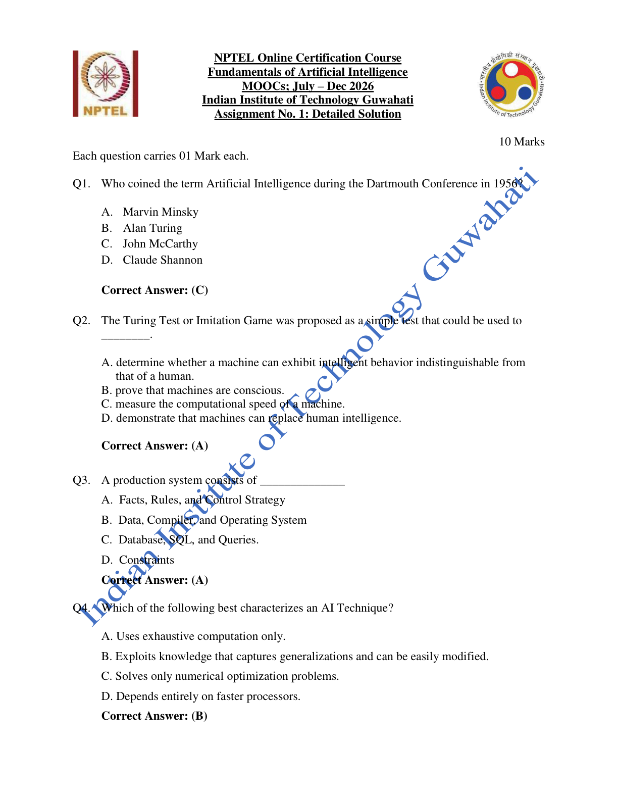

#### 2026 Q1

**Question recap:** Who introduced the term artificial intelligence?

**Answer:** C — John McCarthy.

**Why:** McCarthy introduced the term for the 1956 Dartmouth project. Remember the name separately from Turing, who proposed the imitation game.

#### 2026 Q2

**Question recap:** What does the Turing Test assess?

**Answer:** A — Human-like intelligent behaviour.

**Why:** A judge compares conversational behaviour. Passing the test concerns observable performance; it does not establish consciousness or measure processing speed.

#### 2026 Q3

**Question recap:** What are the components of a production system?

**Answer:** A — Facts, rules, and a control strategy.

**Why:** Facts describe the current state, rules describe possible changes, and the control strategy chooses which applicable rule to use next.

#### 2026 Q4

**Question recap:** What makes an AI technique useful?

**Answer:** B — Modifiable knowledge that captures generalisations.

**Why:** Representing reusable knowledge lets the same method handle many cases and adapt when facts change. Faster exhaustive computation alone does not provide that property.

### 2026 — Page 02

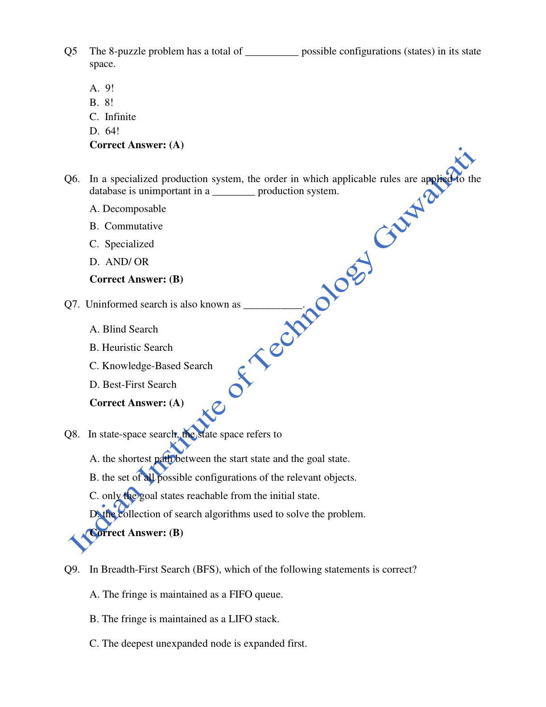

#### 2026 Q5

**Question recap:** How many configurations does the 8-puzzle have?

**Answer:** A — $9! = 362{,}880$.

**Why:** Arrange eight tiles and the blank in nine positions. This counts all arrangements; only $9!/2$ are reachable from any particular legal starting configuration because of the parity invariant.

#### 2026 Q6

**Question recap:** When does rule order not matter?

**Answer:** B — A commutative production system.

**Why:** Applying an applicable rule does not prevent the remaining required rules from eventually producing the solution. An unsuitable ordering can delay progress without destroying reachability.

#### 2026 Q7

**Question recap:** What is another name for uninformed search?

**Answer:** A — Blind search.

**Why:** It uses the problem definition and search structure rather than a domain-specific estimate of closeness to a goal.

#### 2026 Q8

**Question recap:** What is a state space?

**Answer:** B — The set of possible configurations.

**Why:** A state is one arrangement of the relevant objects. Transitions connect states; a solution is a path through this space, rather than the space itself.

### 2026 — Page 03

#### 2026 Q9

**Question recap:** How does BFS maintain its fringe?

**Answer:** A — A FIFO queue.

**Why:** Older frontier nodes leave first, so all nodes at one depth are processed before deeper nodes. A LIFO stack instead gives depth-first behaviour.

#### 2026 Q10

**Question recap:** Which bidirectional-search claim is false?

**Answer:** B — It is always optimal.

**Why:** Optimality requires appropriate search methods, costs, and a correct stopping condition. Merely running searches from both ends does not guarantee a cheapest path.

[Back to year index](#2026) · [All weeks](README.md)

---

## 2025

Public copy of 2025 assignment solutions. Highlights are preserved; corrections and wording issues are identified below.

[Source](https://www.scribd.com/document/937061874/NPTEL)

Jump to discussion: [Q1](#2025-q1) · [Q2](#2025-q2) · [Q3](#2025-q3) · [Q4](#2025-q4) · [Q5](#2025-q5) · [Q6](#2025-q6) · [Q7](#2025-q7) · [Q8](#2025-q8) · [Q9](#2025-q9) · [Q10](#2025-q10)

### 2025 — Page 01

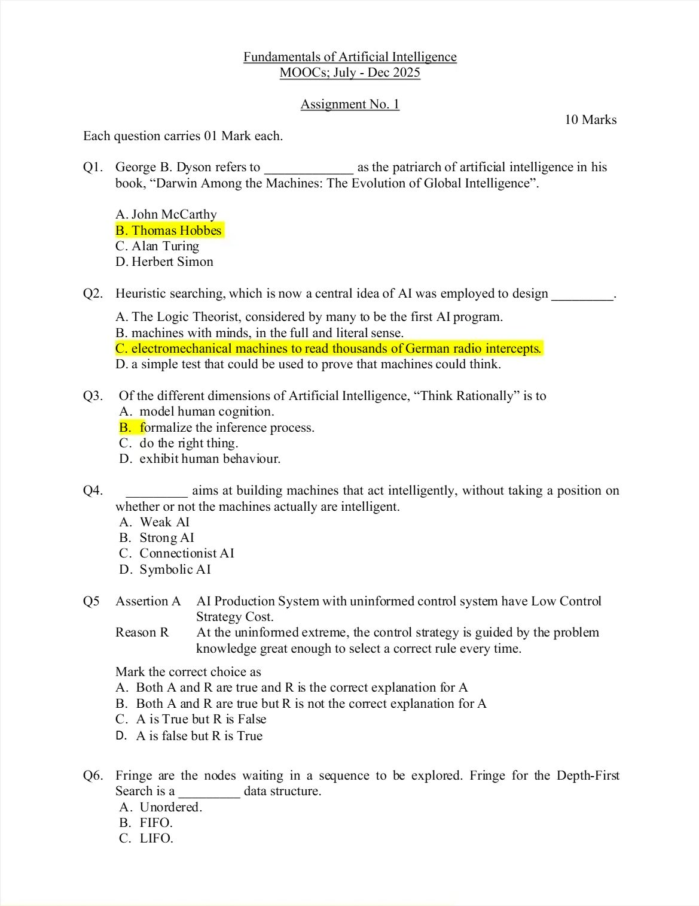

#### 2025 Q1

**Question recap:** Whom does Dyson call a patriarch of AI?

**Answer:** B — Thomas Hobbes.

**Why:** This question concerns Hobbes's early view of reasoning as a form of computation. Do not substitute John McCarthy, whose different distinction is naming the field in 1956.

#### 2025 Q2

**Question recap:** Which historical application is intended for heuristic search?

**Answer:** C — Electromechanical cryptanalysis of German radio messages, according to the source key.

**Why:** The course-associated key links the idea to guided wartime codebreaking. Logic Theorist is also a classic heuristic program, so retain the historical wording of this particular question rather than treating that example as impossible.

#### 2025 Q3

**Question recap:** What does “think rationally” emphasise?

**Answer:** B — Formalising inference.

**Why:** This is the laws-of-thought approach: derive valid conclusions through formal reasoning. “Act rationally” instead concerns choosing appropriate actions.

#### 2025 Q4

**Question recap:** Which position requires intelligent behaviour without claiming a real mind?

**Answer:** A — Weak AI.

**Why:** It treats the machine as a useful simulation or tool. Strong AI makes the stronger claim that an appropriately programmed machine genuinely has a mind.

#### 2025 Q5

**Question recap:** Does uninformed control have low control-strategy cost?

**Answer:** C — The assertion is true, but the reason is false.

**Why:** A blind rule choice is relatively cheap, but it is not guided by enough knowledge to choose the correct rule every time. More failed rule applications can increase total search work.

### 2025 — Page 02

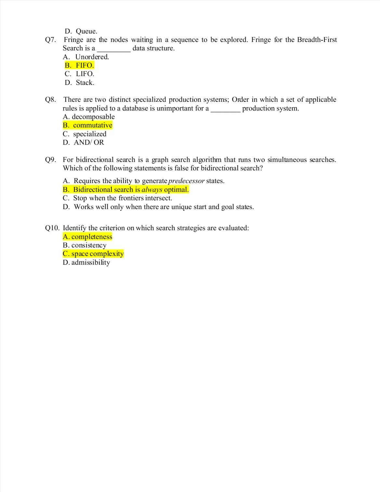

#### 2025 Q6

**Question recap:** What fringe discipline does DFS use?

**Answer:** C — LIFO.

**Why:** The latest generated node is explored first, usually through a stack or recursion. This drives search down a branch before returning to alternatives.

#### 2025 Q7

**Question recap:** What fringe discipline does BFS use?

**Answer:** B — FIFO.

**Why:** Nodes generated earlier are expanded earlier. This preserves level order and finds the shallowest solution when all moves have equal cost.

#### 2025 Q8

**Question recap:** Which production system makes rule order unimportant?

**Answer:** B — Commutative.

**Why:** The order of applicable rules does not change eventual solvability. “Decomposable” instead refers to splitting a problem into independent subproblems.

#### 2025 Q9

**Question recap:** Which bidirectional-search claim is false?

**Answer:** B — It is always optimal.

**Why:** Two simultaneous searches require suitable expansion and stopping rules to guarantee a shortest or cheapest solution. Meeting in the middle alone is insufficient.

#### 2025 Q10

**Question recap:** Which listed criteria evaluate a search strategy?

**Answer:** A and C — Completeness and space complexity.

**Why:** Standard criteria also include time complexity and optimality. Admissibility and consistency describe heuristics rather than the listed general performance criteria.

[Back to year index](#2025) · [All weeks](README.md)

---

## 2024

Question screenshots captured from MY SWAYAM’s public 2024 assignment video, linked to course noc24_ge47. The uploader’s unsubmitted choices, annotations, and occasional overlay text are preserved. They are not an official answer key; corrections and ambiguous wording are discussed below.

The frames overlap. The solution table directly below each screenshot covers every visible question, including cropped continuations.

[Source](https://www.youtube.com/watch?v=Ihoz1RHUQ0Y&t=25s)

Jump to discussion: [Q1](#2024-q1) · [Q2](#2024-q2) · [Q3](#2024-q3) · [Q4](#2024-q4) · [Q5](#2024-q5) · [Q6](#2024-q6) · [Q7](#2024-q7) · [Q8](#2024-q8) · [Q9](#2024-q9) · [Q10](#2024-q10)

### 2024 — Page 01

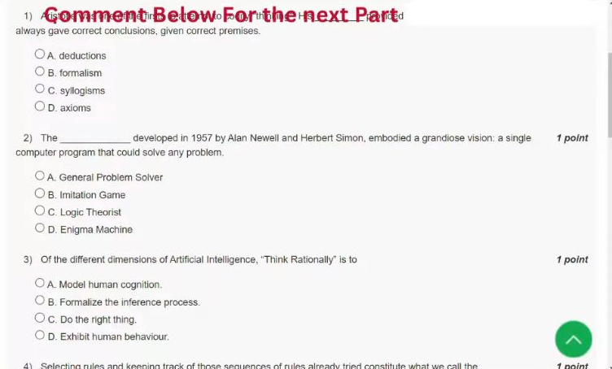

| Question visible in this screenshot | Solution |
|---|---|
| Q1 — Aristotle's argument patterns | **C — Syllogisms.** A valid syllogism derives a conclusion from its premises. |
| Q2 — Newell and Simon's 1957 program | **A — General Problem Solver.** GPS used means–ends analysis to work towards a goal. |
| Q3 — “Think Rationally” | **B — Formalize the inference process.** This approach focuses on valid reasoning. |
| Q4 — Question begins at the bottom | **B — Control Strategy.** It selects rules and keeps track of rule sequences already tried. |

[Source video at 0:25](https://www.youtube.com/watch?v=Ihoz1RHUQ0Y&t=25s)

#### 2024 Q1

**Question recap:** What argument patterns did Aristotle formalise?

**Answer:** C — Syllogisms.

**Why:** A syllogism is an argument form whose conclusion follows from its premises. For example: all humans are mortal; Socrates is human; therefore Socrates is mortal. A valid form preserves truth when its premises are true; it does not make false premises true.

### 2024 — Page 02

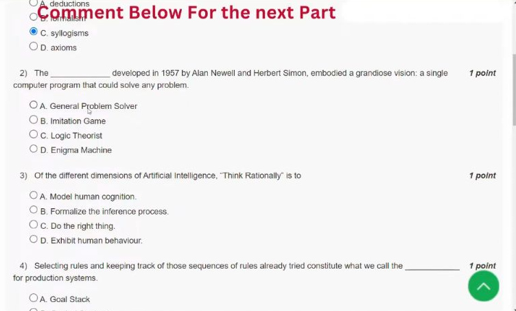

| Question visible in this screenshot | Solution |
|---|---|
| Q1 — Remaining options at the top | **C — Syllogisms.** This is the answer to the Aristotle question in the previous frame. |
| Q2 — Newell and Simon's 1957 program | **A — General Problem Solver.** It aimed at general problem solving through means–ends analysis. |
| Q3 — “Think Rationally” | **B — Formalize the inference process.** “Do the right thing” instead describes acting rationally. |
| Q4 — Rule selection and search history; options continue in the next frame | **B — Control Strategy.** It decides which rule to try next and records earlier attempts. |

[Source video at 0:35](https://www.youtube.com/watch?v=Ihoz1RHUQ0Y&t=35s)

#### 2024 Q2

**Question recap:** Which 1957 Newell–Simon program pursued general problem solving?

**Answer:** A — General Problem Solver.

**Why:** GPS tried to solve formally represented problems through means–ends analysis: compare the current state with the goal and choose an operator that reduces a difference. Logic Theorist was their earlier theorem-proving program; the imitation game is Turing's test.

#### 2024 Q3

**Question recap:** What does thinking rationally emphasise?

**Answer:** B — Formalising inference.

**Why:** This is the laws-of-thought approach: use valid reasoning rules to reach conclusions. Keep the four perspectives distinct: thinking humanly concerns cognition, acting humanly concerns human-like behaviour, and acting rationally concerns appropriate action.

### 2024 — Page 03

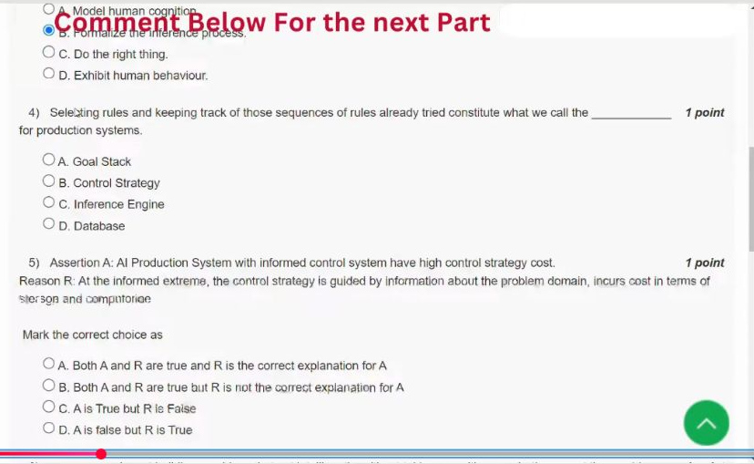

| Question visible in this screenshot | Solution |
|---|---|
| Q3 — Remaining options at the top | **B — Formalize the inference process.** This is the “Think Rationally” answer. |
| Q4 — Rule selection and search history | **B — Control Strategy.** The database holds facts; the strategy chooses rules and tracks attempts. |
| Q5 — Informed control: assertion and reason | **A — Both A and R are true, and R correctly explains A.** Storing and evaluating domain knowledge adds control-strategy cost. |

[Source video at 1:00](https://www.youtube.com/watch?v=Ihoz1RHUQ0Y&t=60s)

#### 2024 Q4

**Question recap:** What chooses rules and tracks attempted rule sequences?

**Answer:** B — The control strategy.

**Why:** The database records current facts and production rules specify available transformations. The control strategy selects among applicable rules and manages the search history. It determines which possible reasoning step is tried next.

#### 2024 Q5

**Question recap:** Why can informed control have a higher selection cost?

**Answer:** A — Both statements are true and the reason explains the assertion.

**Why:** Heuristic guidance must store and evaluate domain knowledge before selecting a rule. That extra selection effort can save many later rule applications. The distinction is selection cost versus total search cost; informed control need not make the whole solution slower.

### 2024 — Page 04

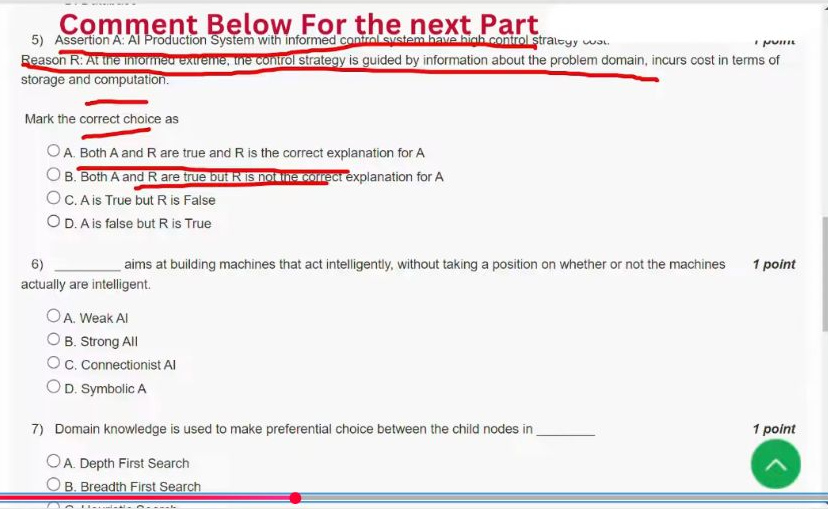

| Question visible in this screenshot | Solution |
|---|---|
| Q5 — Informed control: assertion and reason | **A — Both A and R are true, and R correctly explains A.** Domain knowledge requires storage and computation, explaining the possible higher selection cost. |
| Q6 — Intelligent behaviour without a claim about a real mind | **A — Weak AI.** It requires intelligent performance without taking a position on genuine mentality. |
| Q7 — Domain knowledge; options continue in the next frame | **C — Heuristic Search.** Domain knowledge helps choose promising child nodes. |

[Source video at 1:20](https://www.youtube.com/watch?v=Ihoz1RHUQ0Y&t=80s)

#### 2024 Q6

**Question recap:** Which AI position requires intelligent performance without a claim of a real mind?

**Answer:** A — Weak AI.

**Why:** Weak AI treats a program as a tool or simulation of intelligent behaviour. Strong AI adds a claim about genuine mentality. Whether an implementation is symbolic or connectionist is a separate design question.

### 2024 — Page 05

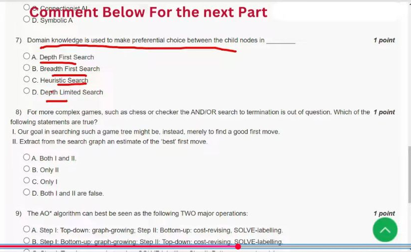

| Question visible in this screenshot | Solution |
|---|---|
| Q6 — Remaining options at the top | **A — Weak AI.** The complete question and option A appear in the previous frame. |
| Q7 — Domain knowledge chooses child nodes | **C — Heuristic Search.** A heuristic ranks successors using knowledge about the problem. |
| Q8 — Practical game-tree search goals | **A — Both I and II.** Search can aim to find a good first move and estimate the best first move without reaching terminal positions. |
| Q9 — AO* operations; options continue in the next frame | **A — Top-down graph-growing, then bottom-up cost-revising and SOLVE-labelling.** Expand subproblems, then update their ancestors. |

[Source video at 1:40](https://www.youtube.com/watch?v=Ihoz1RHUQ0Y&t=100s)

#### 2024 Q7

**Question recap:** Which search uses domain knowledge to rank children?

**Answer:** C — Heuristic search.

**Why:** A heuristic estimates how promising a successor is relative to the goal. DFS follows depth and BFS follows generation depth; neither basic ordering uses a domain-specific estimate. A heuristic can save work without guaranteeing the best solution.

#### 2024 Q8

**Question recap:** What is a practical aim of searching a complex game tree?

**Answer:** A — Both I and II.

**Why:** Search only as far as resources permit, evaluate the resulting positions, and back those estimates up to choose a good first move. The agent can repeat the process after observing the opponent's response. It need not solve chess to termination before moving.

### 2024 — Page 06

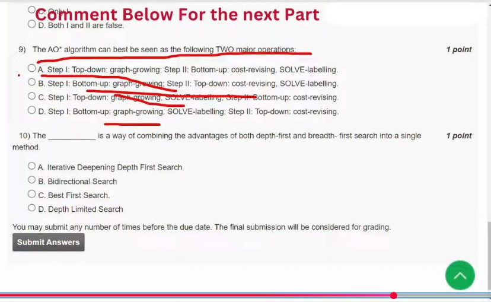

| Question visible in this screenshot | Solution |
|---|---|
| Q8 — Remaining options at the top | **A — Both I and II.** Both statements about selecting a first move are true. |
| Q9 — AO*'s two major operations | **A — Top-down graph-growing, then bottom-up cost-revising and SOLVE-labelling.** Costs and solved status propagate back towards the root. |
| Q10 — Combining advantages of DFS and BFS | **C — Best First Search**, for this course's broad wording. The distinction from iterative deepening is explained below. |

[Source video at 2:00](https://www.youtube.com/watch?v=Ihoz1RHUQ0Y&t=120s)

#### 2024 Q9

**Question recap:** What are AO*'s two main operations?

**Answer:** A — Top-down graph growth, then bottom-up cost revision and solved labelling.

**Why:** Expansion reveals promising subproblems; the resulting costs and solved status propagate back to ancestors. At OR alternatives take the best option; grouped AND alternatives require all selected subproblems. Updating ancestors can change which partial solution is most promising.

#### 2024 Q10

**Question recap:** Which method combines BFS and DFS in this course's broad wording?

**Answer:** C — Best-first search, matching the repeated course question.

**Why:** Best-first search retains competing frontier branches while pursuing a promising one. This is broad descriptive wording. When a question specifically asks for BFS's shallowest-solution guarantee with DFS-like memory, iterative deepening is the usual answer; do not transfer this letter to that different question.

[Back to year index](#2024) · [All weeks](README.md)

---

## 2023

Public copy of the 2023 assignment displaying course accepted answers.

[Source](https://www.scribd.com/document/672687254/Fundamentals-Of-Artificial-Intelligence-Unit-3-Week-1-AI-and-AI-Problem-Solving)

Jump to discussion: [Q1](#2023-q1) · [Q2](#2023-q2) · [Q3](#2023-q3) · [Q4](#2023-q4) · [Q5](#2023-q5) · [Q6](#2023-q6) · [Q7](#2023-q7) · [Q8](#2023-q8) · [Q9](#2023-q9) · [Q10](#2023-q10)

### 2023 — Page 01

#### 2023 Q1

**Question recap:** Who is Dyson's named patriarch of AI?

**Answer:** B — Thomas Hobbes.

**Why:** The question concerns the historical idea of reasoning as computation. McCarthy is instead the answer to who coined the field's name.

#### 2023 Q2

**Question recap:** Which historical heuristic-search example does the course accept?

**Answer:** C — Electromechanical machines for German-message cryptanalysis.

**Why:** This accepted-answer line agrees with the public 2025 key. Treat it as the course's particular historical example; Logic Theorist is another well-known heuristic-search application.

### 2023 — Page 02

#### 2023 Q3

**Question recap:** Which component is not essential to a basic production system?

**Answer:** C — A learning element.

**Why:** The essential parts are a database of facts, production rules, and a control strategy. A system can apply its rules without learning new ones.

#### 2023 Q4

**Question recap:** What is translating a problem into production-system components called?

**Answer:** C — The representation problem.

**Why:** It requires choosing suitable facts, states, rules, and goals. A good representation makes the available reasoning method effective.

#### 2023 Q5

**Question recap:** Is uninformed rule selection cheap and perfectly guided?

**Answer:** C — The assertion is true, but the reason is false.

**Why:** Uninformed control has relatively low selection overhead precisely because it lacks strong guidance. That can lead to many expensive unsuccessful rule applications.

### 2023 — Page 03

#### 2023 Q6

**Question recap:** What does the archive accept for the commutative-system assertion–reason question?

**Answer:** B — Both statements are true, but the reason is not accepted as the explanation.

**Why:** The archive's grading is preserved. The statements are closely related: commutativity permits rule-order flexibility and inappropriate ordering need not destroy solvability. Their asserted explanation relationship is debatable, so remember the concept separately from this source key.

#### 2023 Q7

**Question recap:** Which unique nodes occur two steps from S under BFS?

**Answer:** B — Q, R, H, C, and B.

**Why:** The first level is D, E, and P. Their new successors are B and C from D, H and R from E, and Q from P; E is already discovered and is not counted again.

#### 2023 Q8

**Question recap:** Which BFS solution path is shown?

**Answer:** C — S–E–R–F–G.

**Why:** BFS prioritises the number of edges, not the sum of their weights. This is a four-edge route and its cost is $9+9+5+5=28$.

### 2023 — Page 04

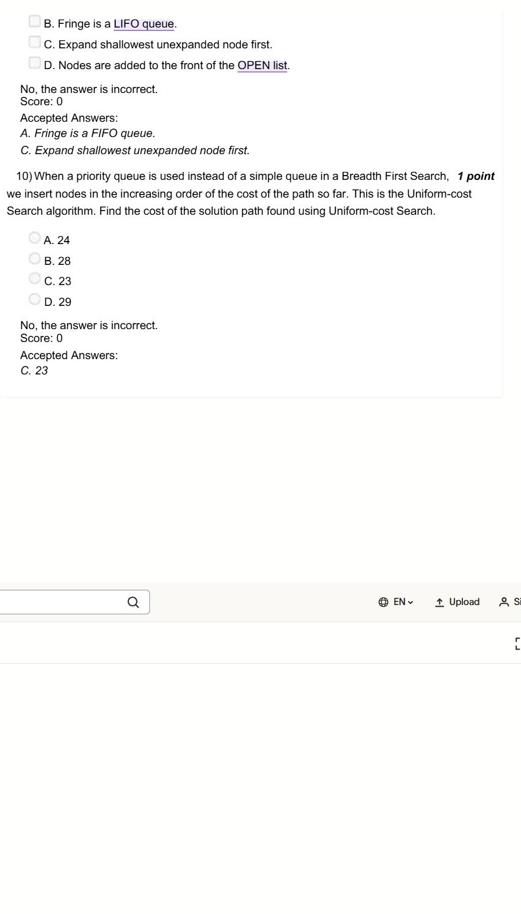

#### 2023 Q9

**Question recap:** Which BFS properties are correct?

**Answer:** A and C — FIFO fringe and shallowest-node expansion.

**Why:** A queue enforces level order. Newly discovered nodes go to the back of the queue, not the front.

#### 2023 Q10

**Question recap:** What is the uniform-cost solution cost?

**Answer:** C — 23.

**Why:** Uniform-cost search returns a goal when its cheapest frontier path is selected. S–D–E–H–Q–R–F–G costs $3+2+1+4+3+5+5=23$. The four-edge BFS route S–E–R–F–G costs 28. Thus fewer edges need not mean lower cost when weights differ; using FIFO instead of accumulated path cost changes the objective.

[Back to year index](#2023) · [All weeks](README.md)

---

## 2022

Public 2022 question-and-answer webpage. Its answer key contains errors; read the checks below.

[Source](https://uniquejankari.in/fundamentals-of-artificial-intelligence-assignment-1-answers/)

Jump to discussion: [Q1](#2022-q1) · [Q2](#2022-q2) · [Q3](#2022-q3) · [Q4](#2022-q4) · [Q5](#2022-q5) · [Q6](#2022-q6) · [Q7](#2022-q7) · [Q8](#2022-q8) · [Q9](#2022-q9) · [Q10](#2022-q10)

### 2022 — Page 01

#### 2022 Q1

**Question recap:** What did Aristotle use to codify valid argument patterns?

**Answer:** C — Syllogisms.

**Why:** A valid syllogistic structure preserves truth from its premises to its conclusion. The guarantee requires both a valid argument form and true premises.

#### 2022 Q2

**Question recap:** What was the Turing Test intended to assess?

**Answer:** A in the source — Whether a machine could think, tested through behaviour.

**Why:** More precisely, it asks whether an interrogator can distinguish the machine's conversation from a human's. It does not establish consciousness or measure computational speed.

### 2022 — Page 02

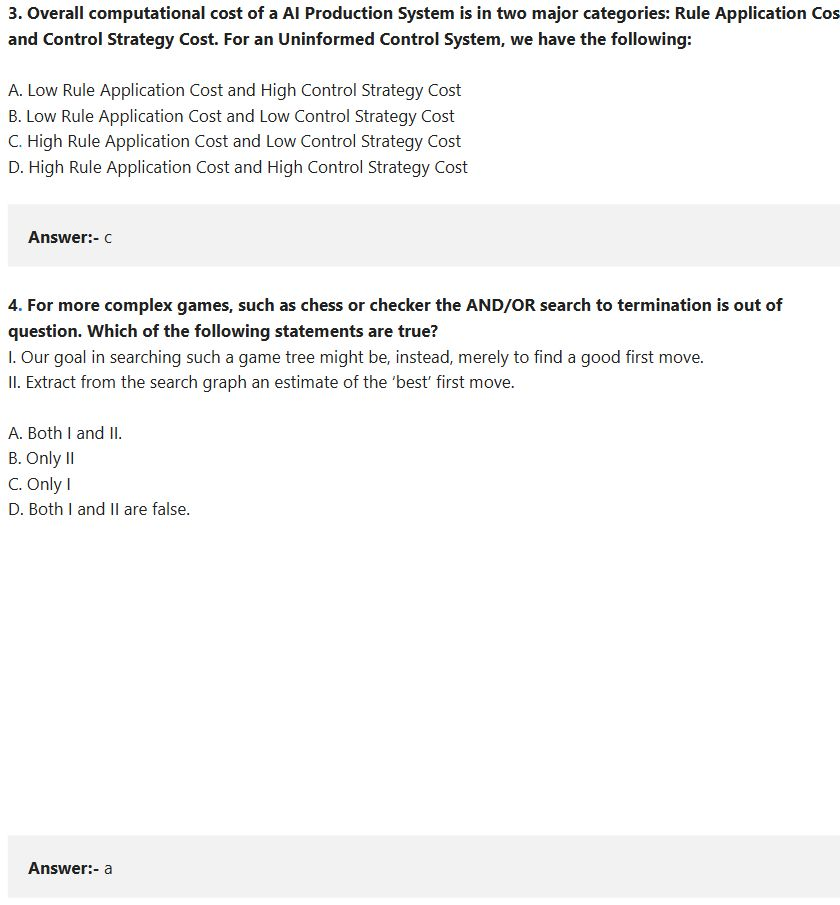

#### 2022 Q3

**Question recap:** What cost pattern does uninformed control have?

**Answer:** C — High rule-application cost and low control-strategy cost.

**Why:** Little effort is spent selecting each rule, but many unproductive choices may need to be tried. A stronger heuristic trades extra selection work for less search.

#### 2022 Q4

**Question recap:** What is the practical aim of complex game-tree search?

**Answer:** A — Both I and II.

**Why:** A bounded search estimates a good next move rather than proving an entire game outcome. Heuristic position evaluation supports this choice.

### 2022 — Page 03

#### 2022 Q5

**Question recap:** Which BFS fringe statement is correct?

**Answer:** A — FIFO queue.

**Why:** Expand older frontier nodes before newer ones. This gives shallowest-first exploration, unlike a DFS stack.

#### 2022 Q6

**Question recap:** Which bidirectional-search claim is false?

**Answer:** B — It is always optimal.

**Why:** The guarantee requires appropriate algorithms, costs, and stopping rules. Two directions alone do not provide it.

### 2022 — Page 04

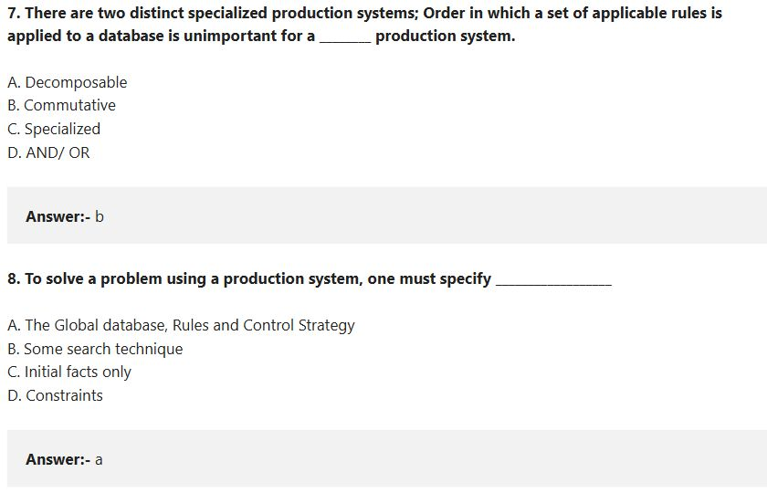

#### 2022 Q7

**Question recap:** Which production system is insensitive to applicable-rule order?

**Answer:** B — Commutative.

**Why:** Order may change the time taken while preserving eventual solvability. This differs from decomposability into independent subproblems.

#### 2022 Q8

**Question recap:** What must a production system specify?

**Answer:** A — Global database, rules, and control strategy.

**Why:** These supply the current facts, legal transformations, and rule-selection procedure. Initial facts alone do not define the whole problem-solving process.

### 2022 — Page 05

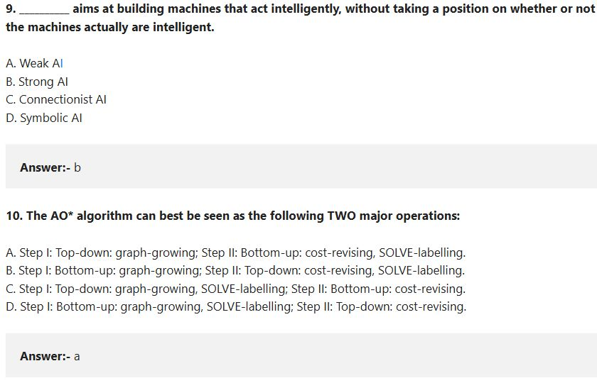

#### 2022 Q9

**Question recap:** Which AI stance does not claim that a machine really has a mind?

**Answer:** A — Weak AI; the webpage's B is wrong.

**Why:** Weak AI requires intelligent performance without the stronger claim of genuine mentality. The official 2019 Week 1 Q8 key also accepts Weak AI.

#### 2022 Q10

**Question recap:** What are AO*'s two operations?

**Answer:** A — Grow the graph top-down, then revise costs and solved labels bottom-up.

**Why:** Expansion creates promising subproblems; backward updates propagate their estimated costs and solution status to the root.

[Back to year index](#2022) · [All weeks](README.md)

---

## 2019

Official NPTEL archive with accepted answers. Any discrepancy between a printed formula and its key is identified below.

[Source](https://archive.nptel.ac.in/content/storage2/courses/downloads_new/112103280/Week_01_Assignment_1.pdf)

Jump to discussion: [Q1](#2019-q1) · [Q2](#2019-q2) · [Q3](#2019-q3) · [Q4](#2019-q4) · [Q5](#2019-q5) · [Q6](#2019-q6) · [Q7](#2019-q7) · [Q8](#2019-q8) · [Q9](#2019-q9) · [Q10](#2019-q10)

### 2019 — Page 01

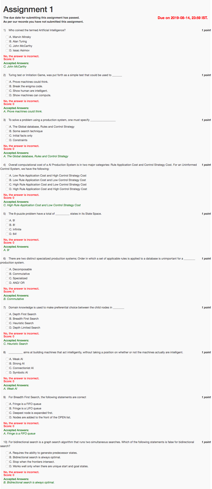

#### 2019 Q1

**Question recap:** Who coined the field's name?

**Answer:** C — John McCarthy.

**Why:** Associate McCarthy with the 1956 naming of artificial intelligence. Turing is associated with the imitation game, which is a separate historical contribution.

#### 2019 Q2

**Question recap:** What was the imitation game intended to test?

**Answer:** A in the source — Whether machines could think, operationalised through behaviour.

**Why:** The modern precise interpretation is whether conversational performance can be distinguished from a human's. It does not prove consciousness or internal human-like thought.

#### 2019 Q3

**Question recap:** What must a production-system problem specify?

**Answer:** A — A global database, rules, and a control strategy.

**Why:** The database stores the current facts, rules define permitted transformations, and the strategy determines which rule to apply.

#### 2019 Q4

**Question recap:** How does uninformed control divide computational cost?

**Answer:** C — High rule-application cost and low control-strategy cost.

**Why:** Choosing a rule blindly is cheap, but poor choices can cause many additional applications. More informed control spends effort choosing rules to reduce later search.

#### 2019 Q5

**Question recap:** How many 8-puzzle arrangements are counted?

**Answer:** $9!$ — option A in the source.

**Why:** Eight tiles plus a blank can be permuted in nine positions. For a fixed starting arrangement, parity permits reaching only half of all arrangements, $9!/2$.

#### 2019 Q6

**Question recap:** Which production system does not depend on rule order?

**Answer:** B — Commutative.

**Why:** Applying one applicable rule does not irreversibly destroy the ability to reach the solution through other required rules. Order can affect effort without changing solvability.

#### 2019 Q7

**Question recap:** Which search uses domain knowledge to rank successors?

**Answer:** C — Heuristic search.

**Why:** A domain-specific heuristic estimates how promising a state is. BFS and DFS instead follow structural ordering rules without such an estimate.

#### 2019 Q8

**Question recap:** Which AI position only requires intelligent behaviour?

**Answer:** A — Weak AI.

**Why:** It does not require a claim that the machine literally possesses a mind. This is distinct from the philosophical claim associated with strong AI.

#### 2019 Q9

**Question recap:** Which BFS statement is correct?

**Answer:** A — The fringe is a FIFO queue.

**Why:** Processing the oldest frontier node first gives level-order exploration. A stack would explore recently generated deeper nodes first.

#### 2019 Q10

**Question recap:** Which bidirectional-search statement is false?

**Answer:** B — It is always optimal.

**Why:** The guarantee depends on edge costs, the searches used, and when they terminate. Two search directions alone do not ensure a cheapest path.

[Back to year index](#2019) · [All weeks](README.md)

---
