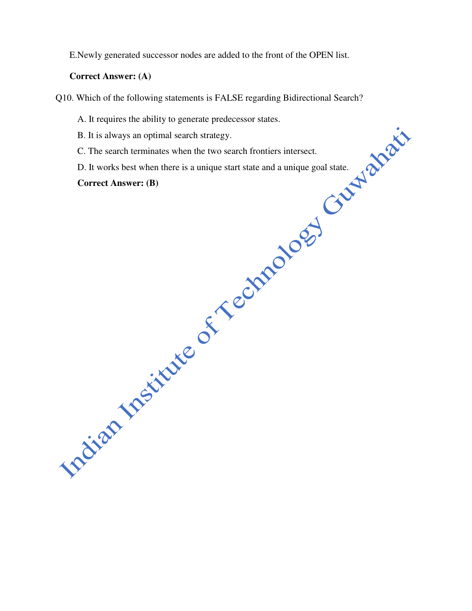
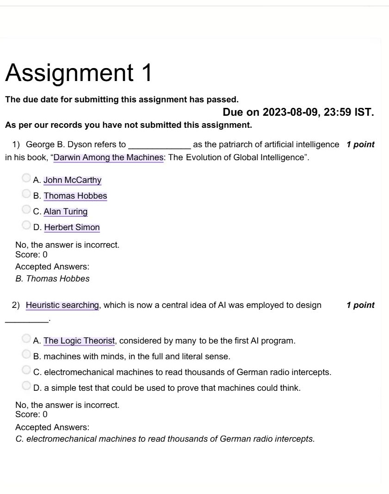
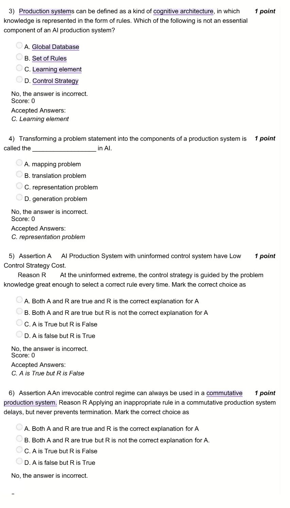
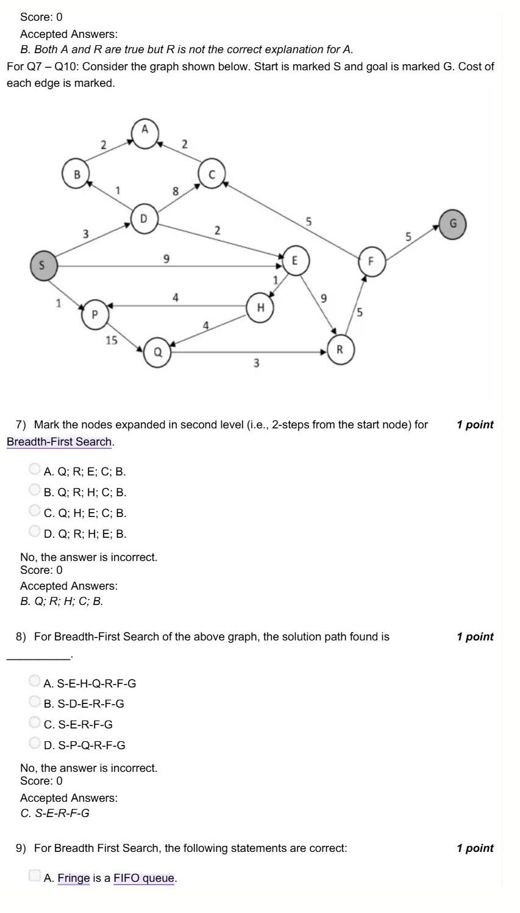
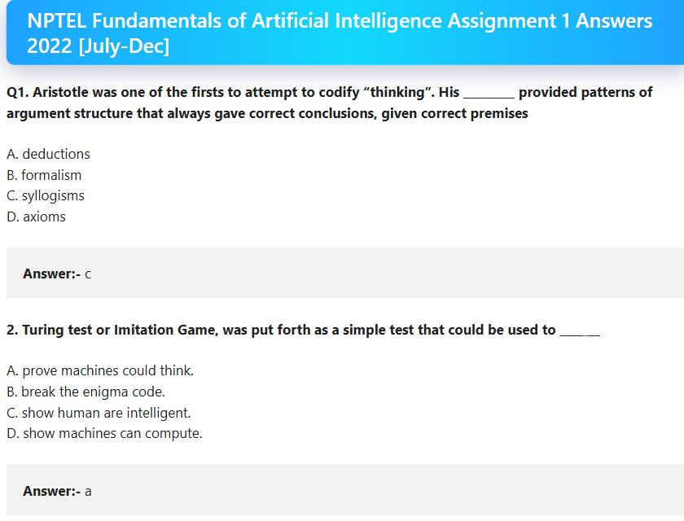
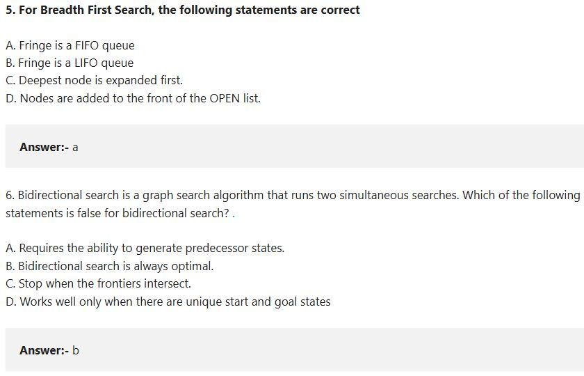

# Week 01 — AI and AI Problem Solving

[All weeks](README.md) · [Next](Week%2002.md)

[2026](#2026) · [2025](#2025) · [2023](#2023) · [2022](#2022) · [2019](#2019)

Screenshots appear inline. Each question has a short recap, answer, and explanation below the relevant page.

## 2026

Official solution linked from the enrolled 2026 course; checked against the live weekly assessment.

[Source](https://drive.google.com/file/d/1g6smCReoueMZy2HR0dVnTpUbHbLvj84y/view)

Jump to discussion: [Q1](#2026-q1) · [Q2](#2026-q2) · [Q3](#2026-q3) · [Q4](#2026-q4) · [Q5](#2026-q5) · [Q6](#2026-q6) · [Q7](#2026-q7) · [Q8](#2026-q8) · [Q9](#2026-q9) · [Q10](#2026-q10)

### 2026 — Page 01

#### 2026 Q1

**Question recap:** Who introduced the term artificial intelligence?

**Answer:** C — John McCarthy.

**Why:** McCarthy introduced the term for the 1956 Dartmouth project. Remember the name separately from Turing, who proposed the imitation game.

#### 2026 Q2

**Question recap:** What does the Turing Test assess?

**Answer:** A — Human-like intelligent behaviour.

**Why:** A judge compares conversational behaviour. Passing the test concerns observable performance; it does not establish consciousness or measure processing speed.

#### 2026 Q3

**Question recap:** What are the components of a production system?

**Answer:** A — Facts, rules, and a control strategy.

**Why:** Facts describe the current state, rules describe possible changes, and the control strategy chooses which applicable rule to use next.

#### 2026 Q4

**Question recap:** What makes an AI technique useful?

**Answer:** B — Modifiable knowledge that captures generalisations.

**Why:** Representing reusable knowledge lets the same method handle many cases and adapt when facts change. Faster exhaustive computation alone does not provide that property.

### 2026 — Page 02

#### 2026 Q5

**Question recap:** How many configurations does the 8-puzzle have?

**Answer:** A — $9! = 362{,}880$.

**Why:** Arrange eight tiles and the blank in nine positions. This counts all arrangements; only $9!/2$ are reachable from any particular legal starting configuration because of the parity invariant.

#### 2026 Q6

**Question recap:** When does rule order not matter?

**Answer:** B — A commutative production system.

**Why:** Applying an applicable rule does not prevent the remaining required rules from eventually producing the solution. An unsuitable ordering can delay progress without destroying reachability.

#### 2026 Q7

**Question recap:** What is another name for uninformed search?

**Answer:** A — Blind search.

**Why:** It uses the problem definition and search structure rather than a domain-specific estimate of closeness to a goal.

#### 2026 Q8

**Question recap:** What is a state space?

**Answer:** B — The set of possible configurations.

**Why:** A state is one arrangement of the relevant objects. Transitions connect states; a solution is a path through this space, rather than the space itself.

### 2026 — Page 03

#### 2026 Q9

**Question recap:** How does BFS maintain its fringe?

**Answer:** A — A FIFO queue.

**Why:** Older frontier nodes leave first, so all nodes at one depth are processed before deeper nodes. A LIFO stack instead gives depth-first behaviour.

#### 2026 Q10

**Question recap:** Which bidirectional-search claim is false?

**Answer:** B — It is always optimal.

**Why:** Optimality requires appropriate search methods, costs, and a correct stopping condition. Merely running searches from both ends does not guarantee a cheapest path.

[Back to year index](#2026) · [All weeks](README.md)

---

## 2025

Public copy of 2025 assignment solutions. Highlights are preserved; corrections and wording issues are identified below.

[Source](https://www.scribd.com/document/937061874/NPTEL)

Jump to discussion: [Q1](#2025-q1) · [Q2](#2025-q2) · [Q3](#2025-q3) · [Q4](#2025-q4) · [Q5](#2025-q5) · [Q6](#2025-q6) · [Q7](#2025-q7) · [Q8](#2025-q8) · [Q9](#2025-q9) · [Q10](#2025-q10)

### 2025 — Page 01

#### 2025 Q1

**Question recap:** Whom does Dyson call a patriarch of AI?

**Answer:** B — Thomas Hobbes.

**Why:** This question concerns Hobbes's early view of reasoning as a form of computation. Do not substitute John McCarthy, whose different distinction is naming the field in 1956.

#### 2025 Q2

**Question recap:** Which historical application is intended for heuristic search?

**Answer:** C — Electromechanical cryptanalysis of German radio messages, according to the source key.

**Why:** The course-associated key links the idea to guided wartime codebreaking. Logic Theorist is also a classic heuristic program, so retain the historical wording of this particular question rather than treating that example as impossible.

#### 2025 Q3

**Question recap:** What does “think rationally” emphasise?

**Answer:** B — Formalising inference.

**Why:** This is the laws-of-thought approach: derive valid conclusions through formal reasoning. “Act rationally” instead concerns choosing appropriate actions.

#### 2025 Q4

**Question recap:** Which position requires intelligent behaviour without claiming a real mind?

**Answer:** A — Weak AI.

**Why:** It treats the machine as a useful simulation or tool. Strong AI makes the stronger claim that an appropriately programmed machine genuinely has a mind.

#### 2025 Q5

**Question recap:** Does uninformed control have low control-strategy cost?

**Answer:** C — The assertion is true, but the reason is false.

**Why:** A blind rule choice is relatively cheap, but it is not guided by enough knowledge to choose the correct rule every time. More failed rule applications can increase total search work.

### 2025 — Page 02

#### 2025 Q6

**Question recap:** What fringe discipline does DFS use?

**Answer:** C — LIFO.

**Why:** The latest generated node is explored first, usually through a stack or recursion. This drives search down a branch before returning to alternatives.

#### 2025 Q7

**Question recap:** What fringe discipline does BFS use?

**Answer:** B — FIFO.

**Why:** Nodes generated earlier are expanded earlier. This preserves level order and finds the shallowest solution when all moves have equal cost.

#### 2025 Q8

**Question recap:** Which production system makes rule order unimportant?

**Answer:** B — Commutative.

**Why:** The order of applicable rules does not change eventual solvability. “Decomposable” instead refers to splitting a problem into independent subproblems.

#### 2025 Q9

**Question recap:** Which bidirectional-search claim is false?

**Answer:** B — It is always optimal.

**Why:** Two simultaneous searches require suitable expansion and stopping rules to guarantee a shortest or cheapest solution. Meeting in the middle alone is insufficient.

#### 2025 Q10

**Question recap:** Which listed criteria evaluate a search strategy?

**Answer:** A and C — Completeness and space complexity.

**Why:** Standard criteria also include time complexity and optimality. Admissibility and consistency describe heuristics rather than the listed general performance criteria.

[Back to year index](#2025) · [All weeks](README.md)

---

## 2023

Public copy of the 2023 assignment displaying course accepted answers.

[Source](https://www.scribd.com/document/672687254/Fundamentals-Of-Artificial-Intelligence-Unit-3-Week-1-AI-and-AI-Problem-Solving)

Jump to discussion: [Q1](#2023-q1) · [Q2](#2023-q2) · [Q3](#2023-q3) · [Q4](#2023-q4) · [Q5](#2023-q5) · [Q6](#2023-q6) · [Q7](#2023-q7) · [Q8](#2023-q8) · [Q9](#2023-q9) · [Q10](#2023-q10)

### 2023 — Page 01

#### 2023 Q1

**Question recap:** Who is Dyson's named patriarch of AI?

**Answer:** B — Thomas Hobbes.

**Why:** The question concerns the historical idea of reasoning as computation. McCarthy is instead the answer to who coined the field's name.

#### 2023 Q2

**Question recap:** Which historical heuristic-search example does the course accept?

**Answer:** C — Electromechanical machines for German-message cryptanalysis.

**Why:** This accepted-answer line agrees with the public 2025 key. Treat it as the course's particular historical example; Logic Theorist is another well-known heuristic-search application.

### 2023 — Page 02

#### 2023 Q3

**Question recap:** Which component is not essential to a basic production system?

**Answer:** C — A learning element.

**Why:** The essential parts are a database of facts, production rules, and a control strategy. A system can apply its rules without learning new ones.

#### 2023 Q4

**Question recap:** What is translating a problem into production-system components called?

**Answer:** C — The representation problem.

**Why:** It requires choosing suitable facts, states, rules, and goals. A good representation makes the available reasoning method effective.

#### 2023 Q5

**Question recap:** Is uninformed rule selection cheap and perfectly guided?

**Answer:** C — The assertion is true, but the reason is false.

**Why:** Uninformed control has relatively low selection overhead precisely because it lacks strong guidance. That can lead to many expensive unsuccessful rule applications.

### 2023 — Page 03

#### 2023 Q6

**Question recap:** What does the archive accept for the commutative-system assertion–reason question?

**Answer:** B — Both statements are true, but the reason is not accepted as the explanation.

**Why:** The archive's grading is preserved. The statements are closely related: commutativity permits rule-order flexibility and inappropriate ordering need not destroy solvability. Their asserted explanation relationship is debatable, so remember the concept separately from this source key.

#### 2023 Q7

**Question recap:** Which unique nodes occur two steps from S under BFS?

**Answer:** B — Q, R, H, C, and B.

**Why:** The first level is D, E, and P. Their new successors are B and C from D, H and R from E, and Q from P; E is already discovered and is not counted again.

#### 2023 Q8

**Question recap:** Which BFS solution path is shown?

**Answer:** C — S–E–R–F–G.

**Why:** BFS prioritises the number of edges, not the sum of their weights. This is a four-edge route and its cost is $9+9+5+5=28$.

### 2023 — Page 04

#### 2023 Q9

**Question recap:** Which BFS properties are correct?

**Answer:** A and C — FIFO fringe and shallowest-node expansion.

**Why:** A queue enforces level order. Newly discovered nodes go to the back of the queue, not the front.

#### 2023 Q10

**Question recap:** What is the uniform-cost solution cost?

**Answer:** C — 23.

**Why:** A cheapest route is S–D–E–H–Q–R–F–G, with cost $3+2+1+4+3+5+5=23$. It has more edges than the BFS route but a lower total weight.

[Back to year index](#2023) · [All weeks](README.md)

---

## 2022

Public 2022 question-and-answer webpage. Its answer key contains errors; read the checks below.

[Source](https://uniquejankari.in/fundamentals-of-artificial-intelligence-assignment-1-answers/)

Jump to discussion: [Q1](#2022-q1) · [Q2](#2022-q2) · [Q3](#2022-q3) · [Q4](#2022-q4) · [Q5](#2022-q5) · [Q6](#2022-q6) · [Q7](#2022-q7) · [Q8](#2022-q8) · [Q9](#2022-q9) · [Q10](#2022-q10)

### 2022 — Page 01

#### 2022 Q1

**Question recap:** What did Aristotle use to codify valid argument patterns?

**Answer:** C — Syllogisms.

**Why:** A valid syllogistic structure preserves truth from its premises to its conclusion. The guarantee requires both a valid argument form and true premises.

#### 2022 Q2

**Question recap:** What was the Turing Test intended to assess?

**Answer:** A in the source — Whether a machine could think, tested through behaviour.

**Why:** More precisely, it asks whether an interrogator can distinguish the machine's conversation from a human's. It does not establish consciousness or measure computational speed.

### 2022 — Page 02

#### 2022 Q3

**Question recap:** What cost pattern does uninformed control have?

**Answer:** C — High rule-application cost and low control-strategy cost.

**Why:** Little effort is spent selecting each rule, but many unproductive choices may need to be tried. A stronger heuristic trades extra selection work for less search.

#### 2022 Q4

**Question recap:** What is the practical aim of complex game-tree search?

**Answer:** A — Both I and II.

**Why:** A bounded search estimates a good next move rather than proving an entire game outcome. Heuristic position evaluation supports this choice.

### 2022 — Page 03

#### 2022 Q5

**Question recap:** Which BFS fringe statement is correct?

**Answer:** A — FIFO queue.

**Why:** Expand older frontier nodes before newer ones. This gives shallowest-first exploration, unlike a DFS stack.

#### 2022 Q6

**Question recap:** Which bidirectional-search claim is false?

**Answer:** B — It is always optimal.

**Why:** The guarantee requires appropriate algorithms, costs, and stopping rules. Two directions alone do not provide it.

### 2022 — Page 04

#### 2022 Q7

**Question recap:** Which production system is insensitive to applicable-rule order?

**Answer:** B — Commutative.

**Why:** Order may change the time taken while preserving eventual solvability. This differs from decomposability into independent subproblems.

#### 2022 Q8

**Question recap:** What must a production system specify?

**Answer:** A — Global database, rules, and control strategy.

**Why:** These supply the current facts, legal transformations, and rule-selection procedure. Initial facts alone do not define the whole problem-solving process.

### 2022 — Page 05

#### 2022 Q9

**Question recap:** Which AI stance does not claim that a machine really has a mind?

**Answer:** A — Weak AI; the webpage's B is wrong.

**Why:** Weak AI requires intelligent performance without the stronger claim of genuine mentality. The official 2019 Week 1 Q8 key also accepts Weak AI.

#### 2022 Q10

**Question recap:** What are AO*'s two operations?

**Answer:** A — Grow the graph top-down, then revise costs and solved labels bottom-up.

**Why:** Expansion creates promising subproblems; backward updates propagate their estimated costs and solution status to the root.

[Back to year index](#2022) · [All weeks](README.md)

---

## 2019

Official NPTEL archive with accepted answers. Any discrepancy between a printed formula and its key is identified below.

[Source](https://archive.nptel.ac.in/content/storage2/courses/downloads_new/112103280/Week_01_Assignment_1.pdf)

Jump to discussion: [Q1](#2019-q1) · [Q2](#2019-q2) · [Q3](#2019-q3) · [Q4](#2019-q4) · [Q5](#2019-q5) · [Q6](#2019-q6) · [Q7](#2019-q7) · [Q8](#2019-q8) · [Q9](#2019-q9) · [Q10](#2019-q10)

### 2019 — Page 01

#### 2019 Q1

**Question recap:** Who coined the field's name?

**Answer:** C — John McCarthy.

**Why:** Associate McCarthy with the 1956 naming of artificial intelligence. Turing is associated with the imitation game, which is a separate historical contribution.

#### 2019 Q2

**Question recap:** What was the imitation game intended to test?

**Answer:** A in the source — Whether machines could think, operationalised through behaviour.

**Why:** The modern precise interpretation is whether conversational performance can be distinguished from a human's. It does not prove consciousness or internal human-like thought.

#### 2019 Q3

**Question recap:** What must a production-system problem specify?

**Answer:** A — A global database, rules, and a control strategy.

**Why:** The database stores the current facts, rules define permitted transformations, and the strategy determines which rule to apply.

#### 2019 Q4

**Question recap:** How does uninformed control divide computational cost?

**Answer:** C — High rule-application cost and low control-strategy cost.

**Why:** Choosing a rule blindly is cheap, but poor choices can cause many additional applications. More informed control spends effort choosing rules to reduce later search.

#### 2019 Q5

**Question recap:** How many 8-puzzle arrangements are counted?

**Answer:** $9!$ — option A in the source.

**Why:** Eight tiles plus a blank can be permuted in nine positions. For a fixed starting arrangement, parity permits reaching only half of all arrangements, $9!/2$.

#### 2019 Q6

**Question recap:** Which production system does not depend on rule order?

**Answer:** B — Commutative.

**Why:** Applying one applicable rule does not irreversibly destroy the ability to reach the solution through other required rules. Order can affect effort without changing solvability.

#### 2019 Q7

**Question recap:** Which search uses domain knowledge to rank successors?

**Answer:** C — Heuristic search.

**Why:** A domain-specific heuristic estimates how promising a state is. BFS and DFS instead follow structural ordering rules without such an estimate.

#### 2019 Q8

**Question recap:** Which AI position only requires intelligent behaviour?

**Answer:** A — Weak AI.

**Why:** It does not require a claim that the machine literally possesses a mind. This is distinct from the philosophical claim associated with strong AI.

#### 2019 Q9

**Question recap:** Which BFS statement is correct?

**Answer:** A — The fringe is a FIFO queue.

**Why:** Processing the oldest frontier node first gives level-order exploration. A stack would explore recently generated deeper nodes first.

#### 2019 Q10

**Question recap:** Which bidirectional-search statement is false?

**Answer:** B — It is always optimal.

**Why:** The guarantee depends on edge costs, the searches used, and when they terminate. Two search directions alone do not ensure a cheapest path.

[Back to year index](#2019) · [All weeks](README.md)

---
