# Week 02 — Problem Solving by Search I

[All weeks](README.md) · [Previous](Week%2001.md) · [Next](Week%2003.md)

[2026](#2026) · [2025](#2025) · [2024](#2024) · [2023](#2023) · [2022](#2022) · [2019](#2019)

Screenshots appear inline. Each question has a short recap, answer, and explanation below the relevant page.

## 2026

Official solution linked from the enrolled 2026 course; checked against the live weekly assessment.

[Source](https://drive.google.com/file/d/14etz73IROgdu2NSreSdrhvH6Dh2bqPGY/view)

Jump to discussion: [Q1](#2026-q1) · [Q2](#2026-q2) · [Q3](#2026-q3) · [Q4](#2026-q4) · [Q5](#2026-q5) · [Q6](#2026-q6) · [Q7](#2026-q7) · [Q8](#2026-q8) · [Q9](#2026-q9) · [Q10](#2026-q10)

### 2026 — Page 01

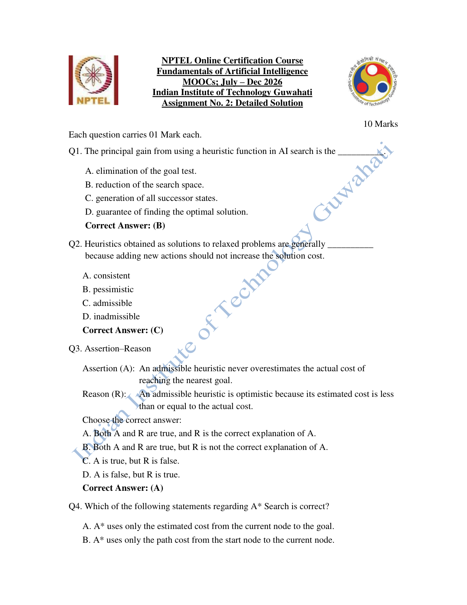

#### 2026 Q1

**Question recap:** What is the main benefit of a heuristic?

**Answer:** B — Reducing the effective search space.

**Why:** A useful estimate prioritises promising states and avoids many unnecessary expansions. It does not remove goal testing or automatically guarantee optimality.

#### 2026 Q2

**Question recap:** Why do relaxed problems give admissible heuristics?

**Answer:** C — Their optimal costs are lower bounds.

**Why:** Removing restrictions cannot make the best solution more expensive. Therefore the relaxed optimum cannot exceed the original optimum.

#### 2026 Q3

**Question recap:** Are admissible heuristics optimistic?

**Answer:** A — Both statements are true, and the reason explains the assertion.

**Why:** Admissibility means $h(n)\leq h^*(n)$. The estimate never exceeds the true remaining minimum cost, which is precisely the sense in which it is optimistic.

### 2026 — Page 02

#### 2026 Q4

**Question recap:** What evaluation function does A* use?

**Answer:** C — $f(n)=g(n)+h(n)$.

**Why:** The path cost already paid is $g(n)$ and the estimated remaining cost is $h(n)$. A* chooses the frontier node with the smallest estimated total.

#### 2026 Q5

**Question recap:** When does A* give an optimal solution?

**Answer:** A — Both statements are true, with the stated explanation.

**Why:** An admissible heuristic supports optimal tree search; consistency supports graph search that closes nodes without reopening them. With reopening, admissibility can also suffice for graph search.

#### 2026 Q6

**Question recap:** Why can simulated annealing accept a worse state?

**Answer:** A — Both statements are true, and the reason explains the assertion.

**Why:** Occasional worsening moves allow escape from a local optimum. Their acceptance probability falls as temperature falls, so the search becomes more selective.

### 2026 — Page 03

#### 2026 Q7

**Question recap:** What is the displayed puzzle's Hamming distance?

**Answer:** A — 5.

**Why:** Count misplaced numbered tiles, excluding the blank. Tiles 2, 3, 4, 5, and 6 are not at their goal positions.

#### 2026 Q8

**Question recap:** What is its Manhattan distance?

**Answer:** C — 6.

**Why:** Tile 2 contributes two grid steps; tiles 3, 4, 5, and 6 contribute one each. Tiles 1, 7, and 8 contribute zero. Thus $h=2+1+1+1+1=6$. Count horizontal plus vertical displacement and exclude the blank. This is a lower bound on moves, not automatically the exact solution length for every puzzle.

#### 2026 Q9

**Question recap:** How many moves solve this particular puzzle?

**Answer:** C — 6.

**Why:** A six-move route moves the blank down, right, up, up, left, down. In row-separated notation, the first state is `134/8_5/726` and the goal is `123/8_4/765`. The route attains the Manhattan lower bound of six, proving optimality for this instance. A path of six moves contains seven states including its endpoints.

### 2026 — Page 04

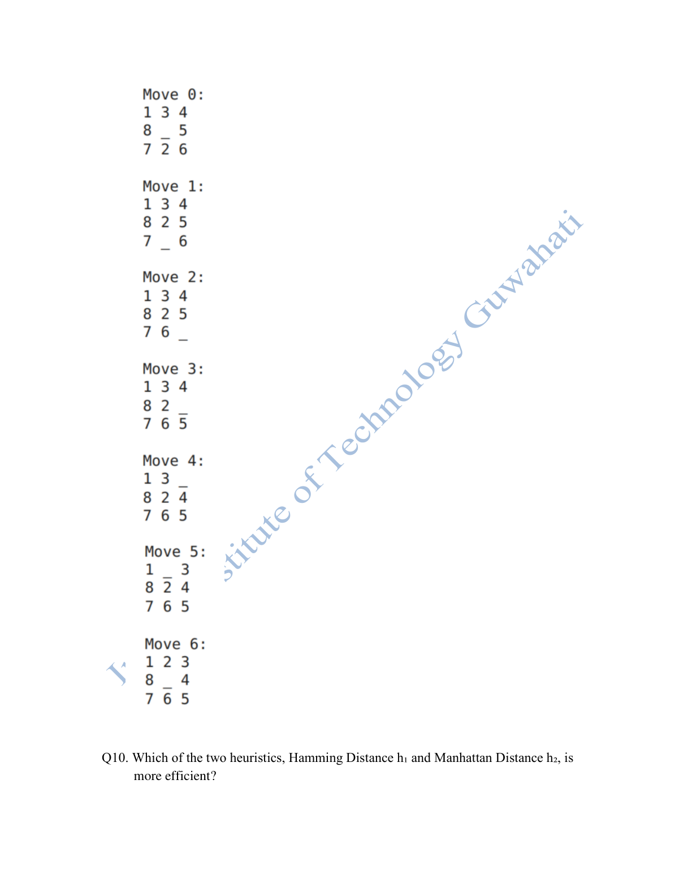

### 2026 — Page 05

#### 2026 Q10

**Question recap:** Which of these two heuristics is more informative?

**Answer:** B — Manhattan distance.

**Why:** Every misplaced tile contributes at least one unit to Manhattan distance, so it dominates Hamming distance while remaining admissible for unit-cost moves. This generally reduces A* expansions, subject to tie behaviour.

[Back to year index](#2026) · [All weeks](README.md)

---

## 2025

Public copy of 2025 assignment solutions. Highlights are preserved; corrections and wording issues are identified below.

[Source](https://www.scribd.com/document/937061874/NPTEL)

Jump to discussion: [Q1](#2025-q1) · [Q2](#2025-q2) · [Q3](#2025-q3) · [Q4](#2025-q4) · [Q5](#2025-q5) · [Q6](#2025-q6) · [Q7](#2025-q7) · [Q8](#2025-q8) · [Q9](#2025-q9) · [Q10](#2025-q10)

### 2025 — Page 01

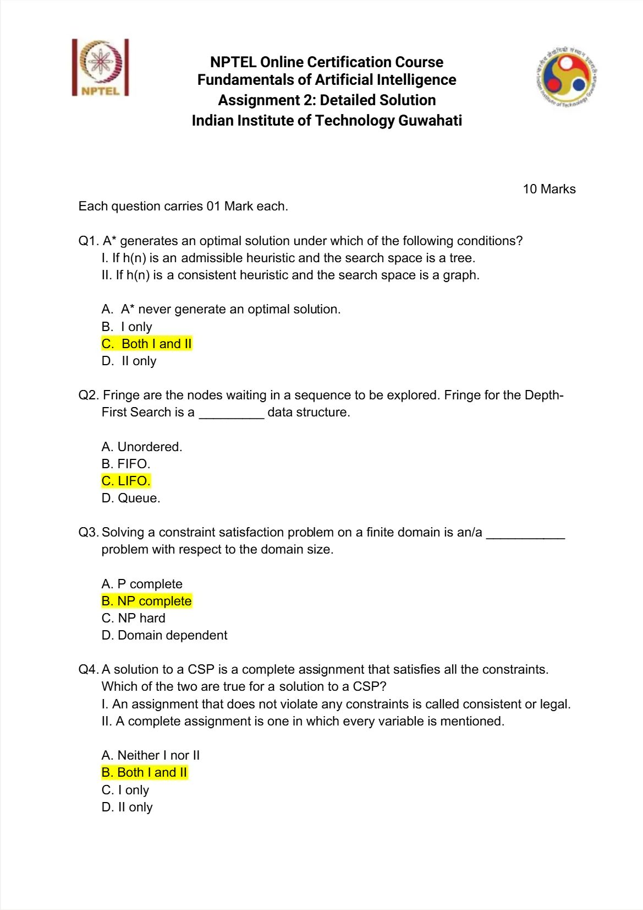

#### 2025 Q1

**Question recap:** Which conditions support A* optimality?

**Answer:** C — Both I and II.

**Why:** Admissibility suffices for tree search; consistency supports graph search without reopening closed nodes. This prevents a prematurely closed state from hiding a cheaper route.

#### 2025 Q2

**Question recap:** Which data discipline does DFS need?

**Answer:** C — LIFO.

**Why:** Push successors onto a stack and expand the most recently pushed one. FIFO would explore a level at a time instead.

#### 2025 Q3

**Question recap:** What is the complexity of general finite-domain CSP decision?

**Answer:** B — NP-complete.

**Why:** A complete assignment can be checked efficiently, but finding one may require exponential search. Particular restricted CSP families can be easier; the claim is about the general problem.

#### 2025 Q4

**Question recap:** What makes a CSP assignment a solution?

**Answer:** B — Both I and II.

**Why:** It must assign every variable and violate no constraint. A consistent partial assignment alone is not yet a complete solution.

### 2025 — Page 02

#### 2025 Q5

**Question recap:** Why use conflict-directed backjumping?

**Answer:** D — Statement II only.

**Why:** It records which assignments caused the conflict and jumps to a relevant earlier decision. Returning merely to the latest choice point is chronological backtracking.

#### 2025 Q6

**Question recap:** What search family includes A*?

**Answer:** C — Best-first search.

**Why:** A* prioritises frontier nodes using an evaluation score, specifically estimated total path cost. BFS and DFS use different fixed ordering disciplines.

### 2025 — Page 03

#### 2025 Q7

**Question recap:** Which node is expanded after A?

**Answer:** D — F, because its evaluation is lower than B's.

**Why:** Compare $f=g+h$, including the edge already travelled. The graph gives $f(F)=3+6=9$ and $f(B)=6+8=14$, so choose F.

#### 2025 Q8

**Question recap:** Which successor of I is most promising?

**Answer:** C — J.

**Why:** At I the best path cost is $g(I)=7$. The new alternatives have $f(J)=7+3+0=10$, $f(H)=7+2+3=12$, and $f(E)=7+5+3=15$, so J is selected. G has already been expanded; returning from I would give it a worse path and is ignored by graph A*. Counting G as an eligible fresh node would confuse this comparison.

#### 2025 Q9

**Question recap:** Which successor of I is least promising?

**Answer:** A — E.

**Why:** For the remaining eligible neighbours of I, E has $f(E)=12+3=15$, compared with H at 12 and J at 10. G is already closed with a better known path. If one instead recomputes the return route I–G as a fresh path, G also has $f=10+5=15$; E is not uniquely worst under that different convention. The source key assumes graph A* discards the worse revisit.

#### 2025 Q10

**Question recap:** What route does A* select to J?

**Answer:** D — A–F–G–I–J.

**Why:** The route A–F–G–I–J costs $3+1+3+3=10$, independently confirmed as a shortest path. These are edge costs, not a sum of heuristic estimates. The displayed heuristic is not consistent on G–I: $h(G)=5>3+h(I)=4$. That does not prevent this particular run from finding an optimal route; it means consistency cannot be claimed as the reason for this instance.

[Back to year index](#2025) · [All weeks](README.md)

---

## 2024

Question screenshots captured from MY SWAYAM’s public 2024 assignment video, linked to course noc24_ge47. The uploader’s unsubmitted choices, annotations, and occasional overlay text are preserved. They are not an official answer key; corrections and ambiguous wording are discussed below.

[Source](https://www.youtube.com/watch?v=HaLXXqT2R9I&t=25s)

Jump to discussion: [Q1](#2024-q1) · [Q2](#2024-q2) · [Q3](#2024-q3) · [Q4](#2024-q4) · [Q5](#2024-q5) · [Q6](#2024-q6) · [Q7](#2024-q7) · [Q8](#2024-q8) · [Q9](#2024-q9) · [Q10](#2024-q10)

### 2024 — Page 01

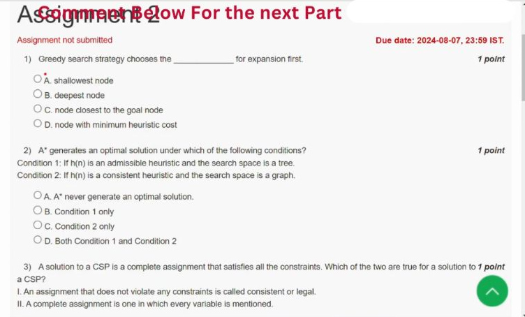

[Source video at 0:25](https://www.youtube.com/watch?v=HaLXXqT2R9I&t=25s)

#### 2024 Q1

**Question recap:** What score does greedy best-first search minimise?

**Answer:** D — The heuristic estimate to a goal.

**Why:** Greedy search chooses the smallest $h(n)$ and ignores the accumulated path cost $g(n)$. A* instead minimises $g(n)+h(n)$. “Closest” is only an estimate here; a small heuristic need not identify the actually cheapest complete route.

#### 2024 Q2

**Question recap:** Which listed conditions guarantee A* optimality?

**Answer:** D — Both conditions, under the standard search assumptions.

**Why:** Admissibility is sufficient for tree A*. For graph A* that never reopens closed states, consistency is the standard sufficient condition. An admissible but inconsistent heuristic can require reopening a state reached later through a cheaper path. Test for the goal when selecting a node, not merely when generating it.

### 2024 — Page 02

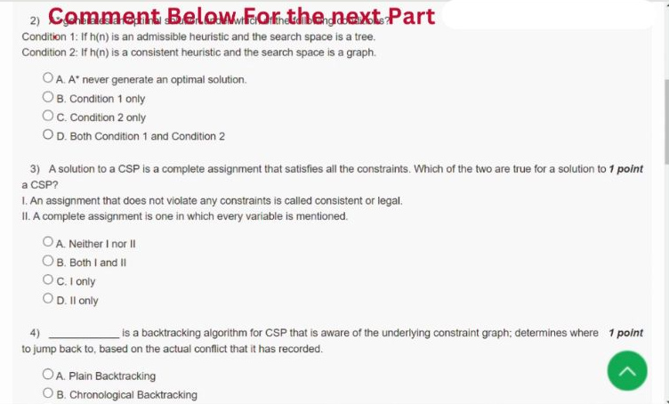

[Source video at 0:35](https://www.youtube.com/watch?v=HaLXXqT2R9I&t=35s)

#### 2024 Q3

**Question recap:** What makes a CSP assignment a solution?

**Answer:** B — Both I and II.

**Why:** Completeness means every variable receives a value; consistency means no constraint is violated. Both are required. A partial assignment may be legal while still requiring further decisions, and a full assignment can still violate a constraint.

### 2024 — Page 03

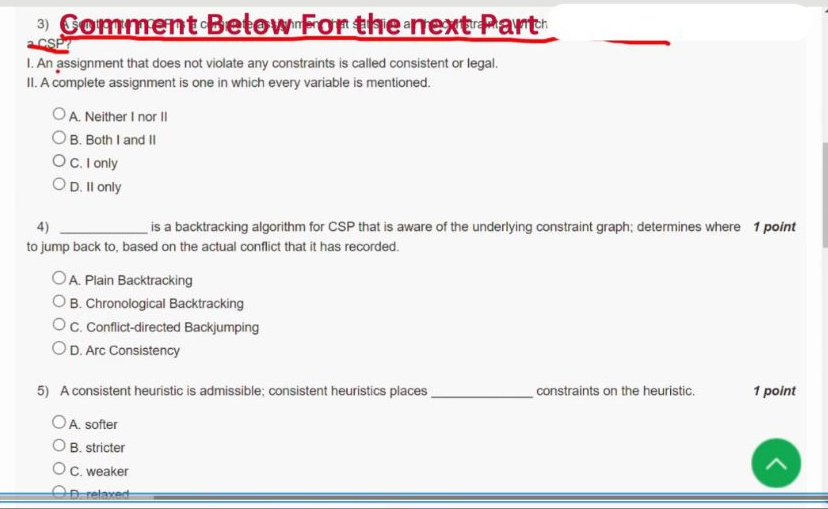

[Source video at 0:50](https://www.youtube.com/watch?v=HaLXXqT2R9I&t=50s)

#### 2024 Q4

**Question recap:** Which CSP algorithm jumps back according to a recorded conflict?

**Answer:** C — Conflict-directed backjumping.

**Why:** A conflict set records earlier assignments responsible for the dead end. The algorithm returns to a relevant decision instead of undoing every intervening choice. Ordinary chronological backtracking always returns to the latest choice point.

### 2024 — Page 04

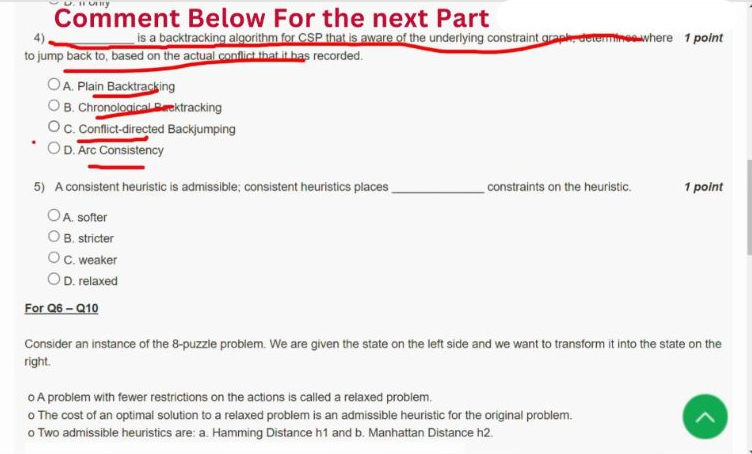

[Source video at 1:05](https://www.youtube.com/watch?v=HaLXXqT2R9I&t=65s)

#### 2024 Q5

**Question recap:** How restrictive is consistency compared with admissibility?

**Answer:** B — Stricter.

**Why:** Admissibility requires $h(n)\leq h^*(n)$. Consistency additionally imposes $h(n)\leq c(n,n')+h(n')$ on every edge. With zero heuristic at a goal, applying these inequalities along a path gives the admissible lower-bound property.

### 2024 — Page 05

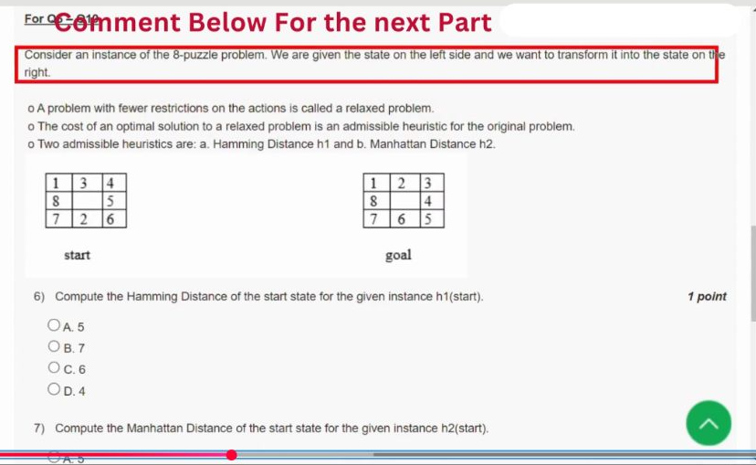

[Source video at 1:20](https://www.youtube.com/watch?v=HaLXXqT2R9I&t=80s)

This diagram supports Q6–Q10; the question frames and worked answers follow.

### 2024 — Page 06

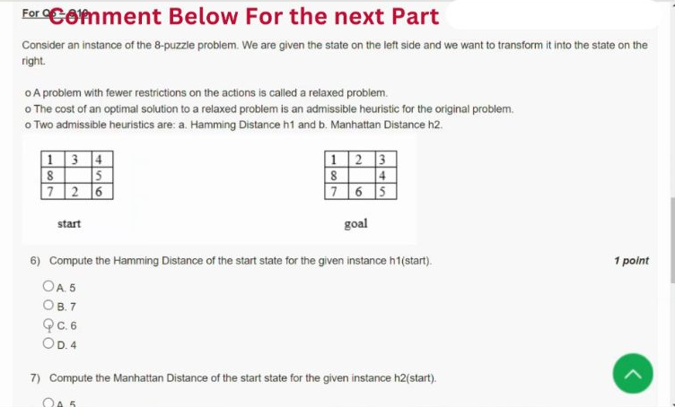

[Source video at 1:35](https://www.youtube.com/watch?v=HaLXXqT2R9I&t=95s)

#### 2024 Q6

**Question recap:** What is the puzzle's Hamming distance?

**Answer:** A — 5.

**Why:** Compare each numbered tile with its goal position; tiles 2, 3, 4, 5, and 6 are misplaced. Tiles 1, 7, and 8 are already correct. Exclude the blank, which is a move mechanism rather than a numbered tile.

### 2024 — Page 07

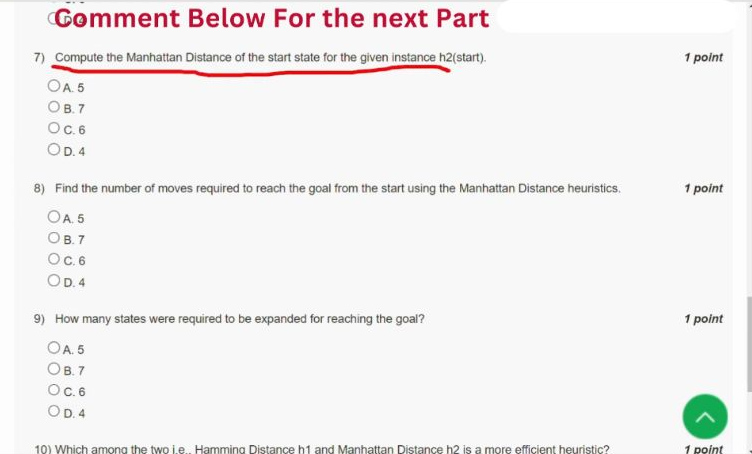

[Source video at 1:40](https://www.youtube.com/watch?v=HaLXXqT2R9I&t=100s)

#### 2024 Q7

**Question recap:** What is the puzzle's Manhattan distance?

**Answer:** C — 6.

**Why:** Tile 2 is two grid steps from its target; tiles 3, 4, 5, and 6 contribute one each. Thus $h=2+1+1+1+1=6$. Count horizontal plus vertical displacement and exclude the blank; diagonals are not legal puzzle moves.

### 2024 — Page 08

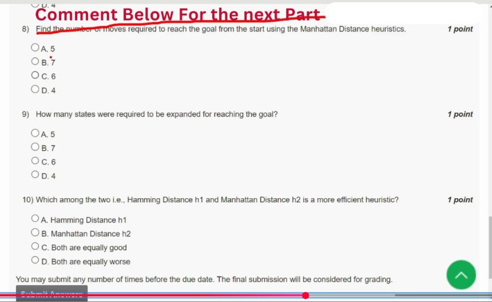

[Source video at 1:50](https://www.youtube.com/watch?v=HaLXXqT2R9I&t=110s)

#### 2024 Q8

**Question recap:** What is the shortest solution length?

**Answer:** C — 6 moves.

**Why:** Move the blank down, right, up, up, left, down. This reaches the displayed goal in six moves. Since Manhattan distance supplies a lower bound of six and the route attains it, the route is optimal. This equality is specific to this instance.

#### 2024 Q9

**Question recap:** How many states are expanded in this puzzle search?

**Answer:** C — 6 non-goal expansions for standard A*; the public video selects A — 5.

**Why:** With Manhattan distance, each next state on the six-move route has $f=6$, while the other available detours have larger scores. Goal testing on removal gives six expanded non-goal states and seven removed path states including the goal. Five counts only the intermediate path states. The prompt does not define its counting convention, so preserve that distinction.

#### 2024 Q10

**Question recap:** Which of the two heuristics is more informative?

**Answer:** B — Manhattan distance.

**Why:** Every misplaced numbered tile contributes at least one Manhattan step, so Manhattan dominates Hamming while remaining admissible for unit-cost moves. It usually guides A* more effectively. Dominance concerns information and expansion guarantees under suitable tie handling, not a promise of a smaller running time in every implementation.

[Back to year index](#2024) · [All weeks](README.md)

---

## 2023

Public 2023 assignment-video frames from Ateeq10. The recorded course URL is noc23_ge40 and the assignment is due 9 August 2023. Selections are unsubmitted choices, not an official key; errors and ambiguous wording are discussed below.

[Source](https://www.youtube.com/watch?v=ZwCa_iuvKwM&t=20s)

Jump to discussion: [Q1](#2023-q1) · [Q2](#2023-q2) · [Q3](#2023-q3) · [Q4](#2023-q4) · [Q5](#2023-q5) · [Q6](#2023-q6) · [Q7](#2023-q7) · [Q8](#2023-q8) · [Q9](#2023-q9) · [Q10](#2023-q10)

### 2023 — Page 01

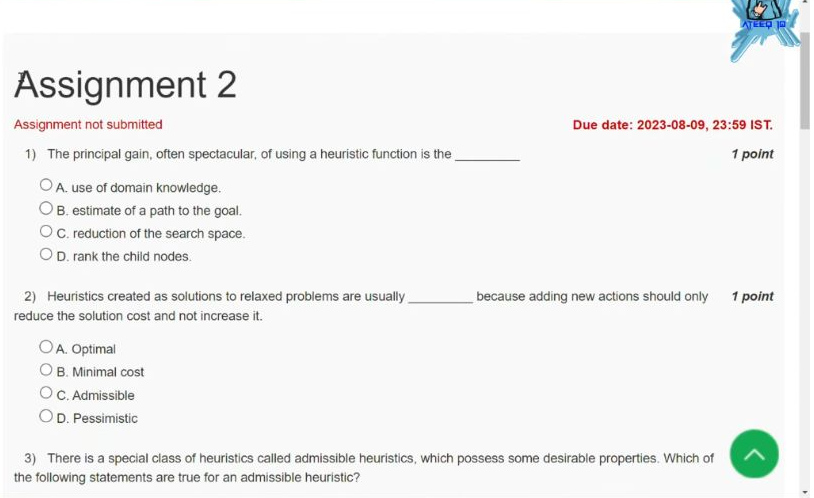

[Source video at 0:20](https://www.youtube.com/watch?v=ZwCa_iuvKwM&t=20s)

#### 2023 Q1

**Question recap:** What is the principal gain from a useful heuristic?

**Answer:** C — Reduction of the search space; the video later selects D.

**Why:** Ranking children is an operation used to guide search, while the gain asked for is avoiding many unpromising expansions. Domain knowledge supplies the estimate. A heuristic does not physically delete valid states; it can reduce the part of the space explored before reaching a solution.

#### 2023 Q2

**Question recap:** What kind of heuristic comes from a relaxed problem?

**Answer:** C — Admissible.

**Why:** Removing restrictions makes a problem easier, so its optimal solution cost cannot exceed the original optimum. That cost is a lower bound on the remaining work in the original problem. The relaxed optimum need not itself be a legal solution of the original problem.

### 2023 — Page 02

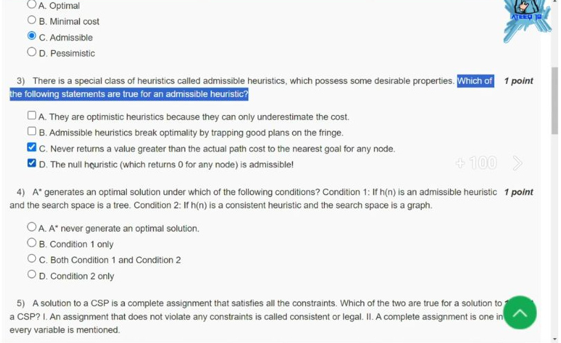

[Source video at 1:40](https://www.youtube.com/watch?v=ZwCa_iuvKwM&t=100s)

#### 2023 Q3

**Question recap:** Which admissible-heuristic statements hold?

**Answer:** A, C, and D under the standard non-overestimation reading; the video selects only C and D.

**Why:** Admissibility means $h(n)\leq h^*(n)$. A describes this as optimism and C states the inequality in words; equality is permitted. The null heuristic is also admissible when remaining path costs are nonnegative. B falsely claims that admissibility itself destroys the standard A* optimality guarantee.

#### 2023 Q4

**Question recap:** Which listed conditions support A* optimality?

**Answer:** C — Both Condition 1 and Condition 2.

**Why:** An admissible heuristic supports optimal tree A*. Consistency is sufficient for graph A* without reopening closed states. With an admissible but inconsistent heuristic, graph search may need to reopen a state when a cheaper route is found. Apply the goal test when the goal is selected for expansion.

### 2023 — Page 03

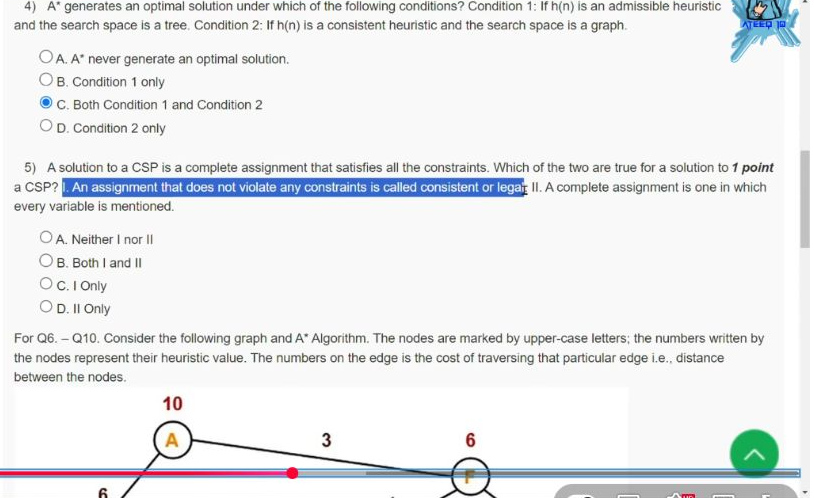

[Source video at 2:20](https://www.youtube.com/watch?v=ZwCa_iuvKwM&t=140s)

#### 2023 Q5

**Question recap:** What makes a CSP assignment a solution?

**Answer:** B — Both I and II.

**Why:** A complete assignment gives every variable a value, and a consistent assignment violates no constraint. A solution needs both properties. A partial assignment can be legal without solving the entire problem, while a full assignment can still be inconsistent.

### 2023 — Page 04

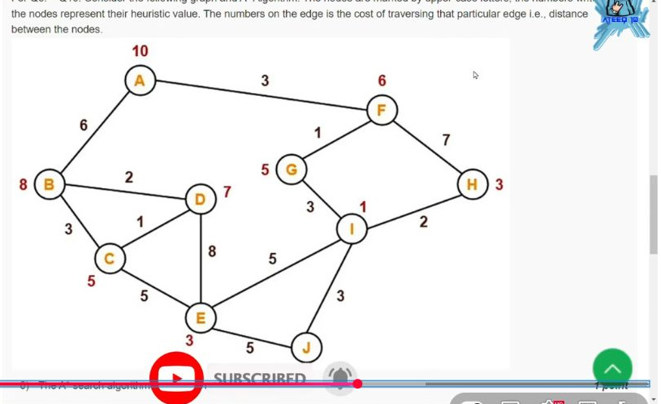

[Source video at 3:00](https://www.youtube.com/watch?v=ZwCa_iuvKwM&t=180s)

This diagram supports Q6–Q10; the question frames and worked answers follow.

### 2023 — Page 05

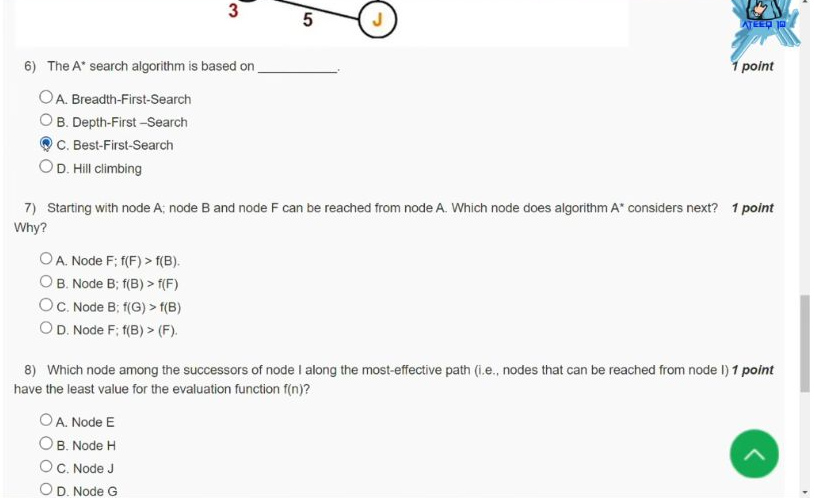

[Source video at 3:25](https://www.youtube.com/watch?v=ZwCa_iuvKwM&t=205s)

#### 2023 Q6

**Question recap:** Which search family contains A*?

**Answer:** C — Best-first search.

**Why:** A* selects a frontier node with the smallest $f(n)=g(n)+h(n)$. Here $g$ is the cost already paid and $h$ estimates the remaining cost. BFS orders by depth and DFS by a stack discipline; neither is the general priority rule used by A*.

#### 2023 Q7

**Question recap:** After A, should the algorithm expand B or F?

**Answer:** D — F, because its evaluation is smaller.

**Why:** The graph gives $f(F)=3+6=9$ and $f(B)=6+8=14$. Choose F because 9 is smaller than 14. Compare accumulated path cost plus heuristic, rather than comparing only the edge costs or only the red heuristic labels.

#### 2023 Q8

**Question recap:** Which eligible successor of I has the least A* evaluation?

**Answer:** C — J.

**Why:** The best route to I costs $g(I)=3+1+3=7$. Hence $f(J)=7+3+0=10$, $f(H)=7+2+3=12$, and $f(E)=7+5+3=15$. G has already been expanded with a better path; a worse return from I is ignored in graph A*.

### 2023 — Page 06

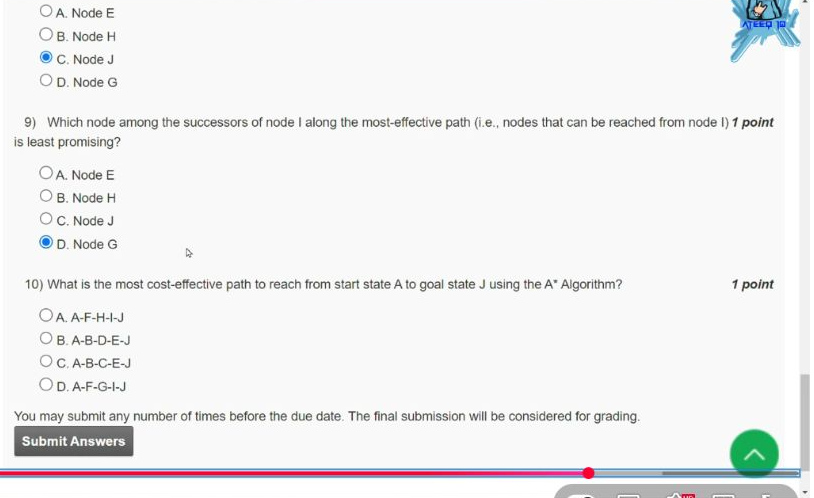

[Source video at 3:40](https://www.youtube.com/watch?v=ZwCa_iuvKwM&t=220s)

#### 2023 Q9

**Question recap:** Which successor of I is least promising?

**Answer:** A — E under the usual closed-node convention; the video selects D — G.

**Why:** E has evaluation 15, compared with H at 12 and J at 10. G is already closed with cost 4; returning from I would worsen that cost to 10. If every outgoing path is nevertheless scored afresh, both E and G have $f=15$, so G is not uniquely worst by that rule either. Looking only at $h(G)=5$ would instead use a greedy comparison. The prompt omits the revisit convention, so keep that ambiguity visible.

#### 2023 Q10

**Question recap:** What is the most effective A*-selected route to J?

**Answer:** D — A–F–G–I–J, with total cost 10.

**Why:** Add the actual edge costs: $3+1+3+3=10$. The repeated graph was independently checked by shortest-path search. Its displayed heuristic is inconsistent on G–I, since $h(G)=5>3+h(I)=4$; finding the optimum on this instance does not prove that the heuristic is consistent.

[Back to year index](#2023) · [All weeks](README.md)

---

## 2022

Public 2022 question-and-answer webpage. Its answer key contains errors; read the checks below.

[Source](https://uniquejankari.in/fundamentals-of-artificial-intelligence-assignment-2-answers/)

Jump to discussion: [Q1](#2022-q1) · [Q2](#2022-q2) · [Q3](#2022-q3) · [Q4](#2022-q4) · [Q5](#2022-q5) · [Q6](#2022-q6) · [Q7](#2022-q7) · [Q8](#2022-q8) · [Q9](#2022-q9) · [Q10](#2022-q10)

### 2022 — Page 01

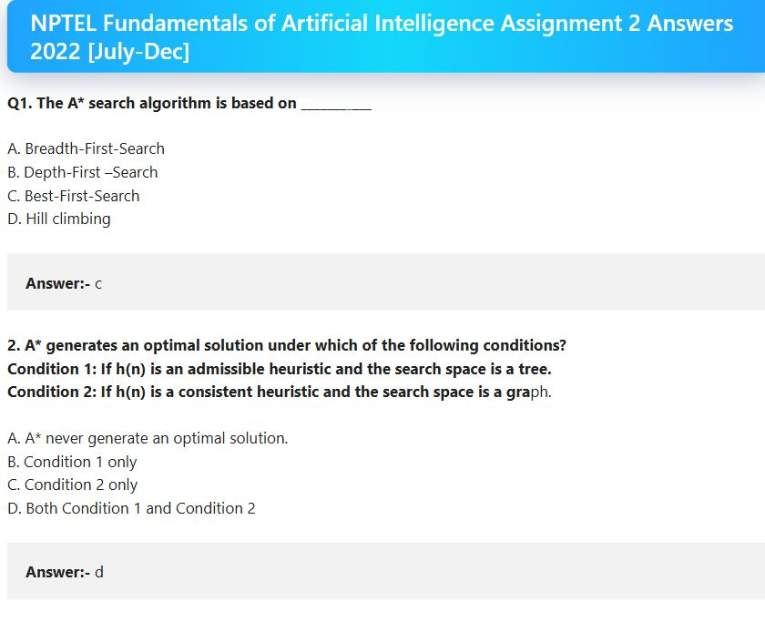

#### 2022 Q1

**Question recap:** Which search family includes A*?

**Answer:** C — Best-first search.

**Why:** It orders the frontier by $f(n)=g(n)+h(n)$. The priority is estimated total path cost rather than depth alone.

#### 2022 Q2

**Question recap:** Which A* optimality conditions hold?

**Answer:** D — Both conditions.

**Why:** Admissible heuristics support tree search, while consistent heuristics support graph search without reopening. Note that the option letter differs from the otherwise similar 2019 and 2025 questions.

### 2022 — Page 02

#### 2022 Q3

**Question recap:** Which dangers can an inadmissible heuristic cause?

**Answer:** A, B, and C in the webpage key, with a qualification.

**Why:** Overestimation can keep good solutions on the fringe and destroy the optimality guarantee. Poor ranking can also waste search; neither slowdown nor every listed behaviour occurs for every inadmissible heuristic.

#### 2022 Q4

**Question recap:** What makes a CSP solution complete and legal?

**Answer:** B — Both I and II.

**Why:** Every variable must be assigned, and every constraint must be satisfied. A non-conflicting partial assignment is not yet a solution.

### 2022 — Page 03

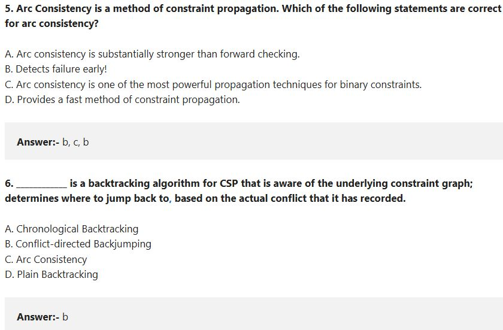

#### 2022 Q5

**Question recap:** Which arc-consistency claims should be retained?

**Answer:** A, B, C, and D under the intended introductory reading; the webpage prints the malformed key “b, c, b”.

**Why:** Arc consistency propagates binary-domain restrictions, can detect failure early, and is stronger than ordinary forward checking. Statement C is a qualitative description, not a claim that arc consistency is the strongest possible consistency notion. Do not memorise the duplicated webpage letters.

#### 2022 Q6

**Question recap:** Which CSP algorithm jumps back based on the actual conflict?

**Answer:** B — Conflict-directed backjumping.

**Why:** It records which earlier assignments caused the dead end and returns to a relevant one. This can skip decisions unrelated to the conflict.

### 2022 — Page 04

#### 2022 Q7

**Question recap:** What is the shown puzzle's Hamming distance?

**Answer:** 5.

**Why:** The misplaced numbered tiles are 2, 3, 4, 5, and 6. Do not include the blank when counting.

#### 2022 Q8

**Question recap:** What is its Manhattan distance?

**Answer:** 6.

**Why:** Tile 2 contributes two moves and tiles 3, 4, 5, and 6 contribute one each. The sum is $2+1+1+1+1=6$.

### 2022 — Page 05

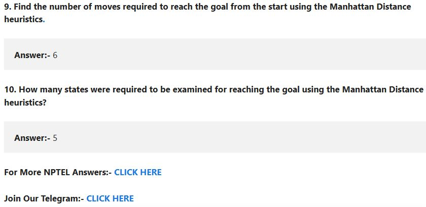

#### 2022 Q9

**Question recap:** How many moves solve this puzzle?

**Answer:** 6.

**Why:** Moving the blank down, right, up, up, left, down reaches the displayed goal. This matches the Manhattan lower bound, so the six-move solution is optimal.

#### 2022 Q10

**Question recap:** How many states must be examined?

**Answer:** 5 in the webpage key; this count is unverified and underspecified.

**Why:** The webpage prints 5 without defining its counting convention. This six-move route has seven path states including start and goal, or five intermediate states. Standard A* with the displayed Manhattan heuristic and a goal test on removal expands six non-goal states and then removes the goal. Five therefore matches intermediate states, rather than the usual A* expansion count. Keep the source key distinct from that definition.

[Back to year index](#2022) · [All weeks](README.md)

---

## 2019

Official NPTEL archive with accepted answers. Any discrepancy between a printed formula and its key is identified below.

[Source](https://archive.nptel.ac.in/content/storage2/courses/downloads_new/112103280/Week_02_Assignment_2.pdf)

Jump to discussion: [Q1](#2019-q1) · [Q2](#2019-q2) · [Q3](#2019-q3) · [Q4](#2019-q4) · [Q5](#2019-q5) · [Q6](#2019-q6) · [Q7](#2019-q7) · [Q8](#2019-q8) · [Q9](#2019-q9) · [Q10](#2019-q10)

### 2019 — Page 01

#### 2019 Q1

**Question recap:** What kind of heuristic comes from a relaxed problem?

**Answer:** C — Admissible.

**Why:** An easier problem cannot have a larger optimal cost than the original. Its optimal solution cost therefore provides a lower bound on the original remaining cost.

#### 2019 Q2

**Question recap:** Which statement is false of an inadmissible heuristic?

**Answer:** D in the source — That it underestimates the cost.

**Why:** Inadmissibility means the heuristic overestimates at least somewhere; it may still underestimate at other states. Read this option as the proposed defining guarantee, rather than as a claim about every individual estimate.

#### 2019 Q3

**Question recap:** Does consistency impose stronger restrictions?

**Answer:** B — Stricter constraints.

**Why:** With zero heuristic at goals, consistency implies admissibility and also requires $h(n)\leq c(n,n')+h(n')$ along edges. That additional local condition makes graph-search behaviour more reliable.

#### 2019 Q4

**Question recap:** What does a cooling schedule not determine?

**Answer:** C — Which successor state is proposed.

**Why:** The schedule controls temperature and how long it is maintained. A separate proposal mechanism chooses the candidate neighbour; temperature affects whether a worsening proposal is accepted.

#### 2019 Q5

**Question recap:** Which is not a property of basic hill climbing?

**Answer:** D — Backtracking.

**Why:** Basic hill climbing keeps moving to a better neighbour and stops when none is available. It does not maintain earlier alternatives to systematically revisit them.

#### 2019 Q6

**Question recap:** Which A* optimality conditions hold?

**Answer:** C — Both conditions.

**Why:** Admissibility supports tree search, and consistency supports graph search without reopening closed states. These are the standard sufficient conditions intended by the question.

#### 2019 Q7

**Question recap:** Which method combines aspects of BFS and DFS in the course wording?

**Answer:** C in the source — Best-first search.

**Why:** Best-first search keeps competing frontier branches while pursuing the most promising one. If a different question asks for BFS completeness with DFS memory use, iterative deepening is the standard answer; the wording here is broad.

#### 2019 Q8

**Question recap:** What does h(n) estimate?

**Answer:** A — The cost from n to a goal.

**Why:** The cost already incurred from the start is $g(n)$. A* combines both in $f(n)=g(n)+h(n)$.

#### 2019 Q9

**Question recap:** Which arc-consistency statement is incorrect?

**Answer:** A — Forward checking is substantially stronger.

**Why:** Maintaining arc consistency propagates constraints between remaining variables more extensively than ordinary forward checking. It can detect failures that forward checking misses.

#### 2019 Q10

**Question recap:** Which method jumps back using recorded conflicts?

**Answer:** C — Conflict-directed backjumping.

**Why:** The conflict set identifies decisions responsible for the dead end. The algorithm can bypass unrelated decisions instead of undoing only the most recent assignment.

[Back to year index](#2019) · [All weeks](README.md)

---
