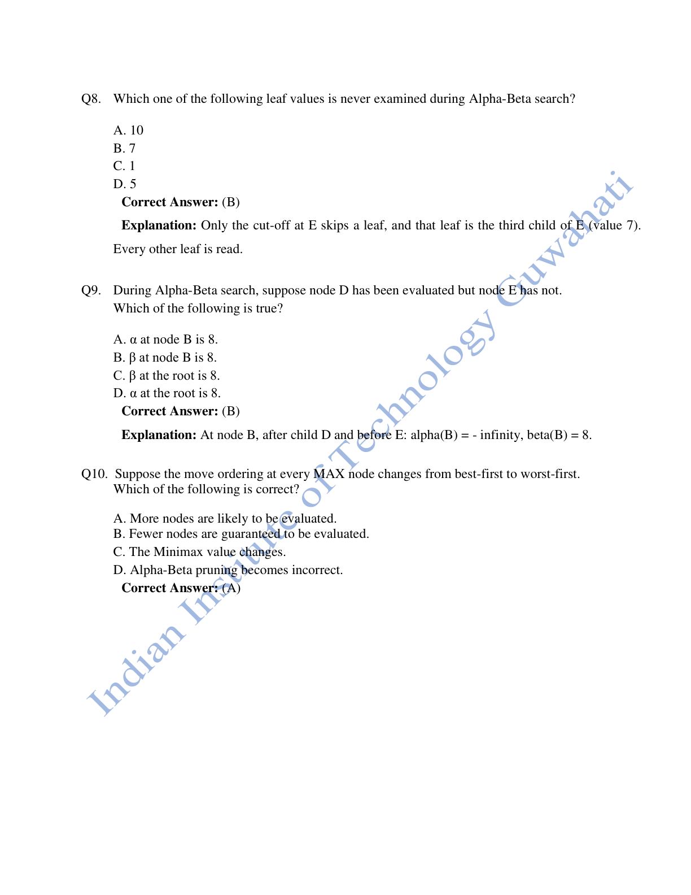
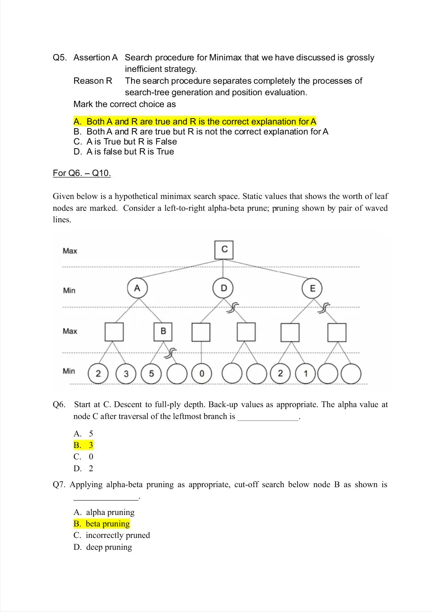
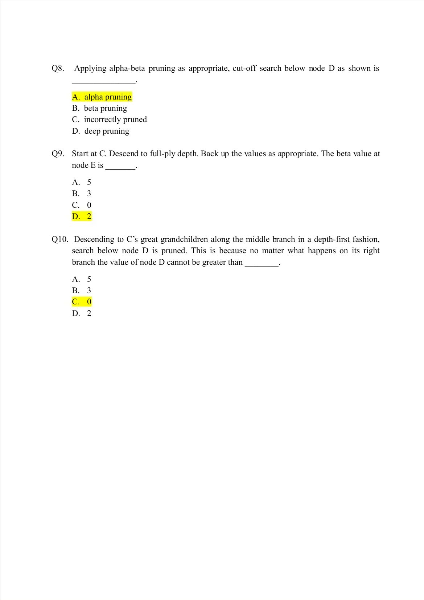

# Week 03 — Problem Solving by Search II

[All weeks](README.md) · [Previous](Week%2002.md) · [Next](Week%2004.md)

[2026](#2026) · [2025](#2025) · [2019](#2019)

Screenshots appear inline. Each question has a short recap, answer, and explanation below the relevant page.

## 2026

Official solution linked from the enrolled 2026 course; checked against the live weekly assessment.

[Source](https://drive.google.com/file/d/1pNTM6NNwJrFKqgFYSNJdcIUmByIOg_0d/view)

Jump to discussion: [Q1](#2026-q1) · [Q2](#2026-q2) · [Q3](#2026-q3) · [Q4](#2026-q4) · [Q5](#2026-q5) · [Q6](#2026-q6) · [Q7](#2026-q7) · [Q8](#2026-q8) · [Q9](#2026-q9) · [Q10](#2026-q10)

### 2026 — Page 01

#### 2026 Q1

**Question recap:** Which claim about AO* is false?

**Answer:** D — It always expands every graph node.

**Why:** AO* follows the most promising partial solution graph and updates costs backward. It can prove a solution without exploring irrelevant alternatives.

#### 2026 Q2

**Question recap:** Which successor does the shown OR node choose?

**Answer:** C — Node C.

**Why:** Compare edge cost plus remaining heuristic: A costs $2+6=8$, B costs $1+8=9$, and C costs $4+2=6$. The smallest estimate wins.

### 2026 — Page 02

#### 2026 Q3

**Question recap:** What opponent assumption does minimax make?

**Answer:** B — The opponent plays optimally.

**Why:** MAX chooses its best move while assuming MIN chooses the move worst for MAX. This makes minimax an adversarial decision rule.

#### 2026 Q4

**Question recap:** Which chess-search statements hold?

**Answer:** B — I, II, and IV.

**Why:** Exhaustive search is impractical, so depth-limited search backs up heuristic evaluations. Alpha-beta pruning preserves the minimax result at the same search depth; statement III is false.

#### 2026 Q5

**Question recap:** What is required to search an AND/OR graph?

**Answer:** A — Both I and II.

**Why:** An OR choice needs one successful alternative; an AND choice needs all required subproblems solved. The solution therefore branches into a solution subgraph.

### 2026 — Page 03

#### 2026 Q6

**Question recap:** What are the root bounds after evaluating B?

**Answer:** B — $\alpha=8,\;\beta=+\infty$.

**Why:** B backs up value 8. Since the root is MAX, its best established lower bound becomes 8; no finite upper bound has been imposed on the root.

#### 2026 Q7

**Question recap:** Where does the first alpha-beta cutoff occur?

**Answer:** B — At E.

**Why:** B already has an alternative worth 8. Once its MAX child E reaches 10, E cannot improve B's MIN choice, so E's remaining leaf is skipped.

### 2026 — Page 04

#### 2026 Q8

**Question recap:** Which leaf value is not examined?

**Answer:** B — 7.

**Why:** The cutoff at E occurs before its third leaf, whose value is 7. Pruning that leaf does not change the backed-up minimax decision.

#### 2026 Q9

**Question recap:** What bound does B have after D but before E?

**Answer:** B — $\beta(B)=8$.

**Why:** B is MIN, so its first completed child gives an upper bound of 8. This is B's local bound; the root has not yet finished evaluating B.

#### 2026 Q10

**Question recap:** What happens with worse move ordering?

**Answer:** A — More nodes are likely to be evaluated.

**Why:** Good moves establish useful bounds early. Poor ordering delays those bounds and reduces pruning, while leaving the final minimax value unchanged.

[Back to year index](#2026) · [All weeks](README.md)

---

## 2025

Public copy of 2025 assignment solutions. Highlights are preserved; corrections and wording issues are identified below.

[Source](https://www.scribd.com/document/937061874/NPTEL)

Jump to discussion: [Q1](#2025-q1) · [Q2](#2025-q2) · [Q3](#2025-q3) · [Q4](#2025-q4) · [Q5](#2025-q5) · [Q6](#2025-q6) · [Q7](#2025-q7) · [Q8](#2025-q8) · [Q9](#2025-q9) · [Q10](#2025-q10)

### 2025 — Page 01

#### 2025 Q1

**Question recap:** What are AO*'s two main operations?

**Answer:** A — Grow top-down, revise costs and solved labels bottom-up.

**Why:** Expansion adds promising subproblems. Their updated costs and solved status are then propagated to ancestors.

#### 2025 Q2

**Question recap:** What is practical in very large game trees?

**Answer:** A — Both statements.

**Why:** Exhaustive terminal search is usually impossible. A limited search estimates which first move is best and can be repeated after the next position is observed.

#### 2025 Q3

**Question recap:** What does AND/OR search require?

**Answer:** A — Both I and II.

**Why:** Best-first guidance must account for grouped AND successors. A solution may require several terminal subgoals rather than a single simple path.

#### 2025 Q4

**Question recap:** What is an entry minimal in its row and maximal in its column?

**Answer:** C — A saddle point.

**Why:** Under the stated payoff convention, it is simultaneously a best response for both opposing players. It provides a pure-strategy equilibrium in the matrix game.

### 2025 — Page 02

#### 2025 Q5

**Question recap:** Why is the naive minimax procedure inefficient?

**Answer:** A — Both statements, with the stated explanation.

**Why:** The question refers to a version that constructs the search tree separately from evaluating positions. Evaluating during depth-first search enables early bounds and pruning; inefficiency is not an unavoidable implementation property of all minimax programs.

#### 2025 Q6

**Question recap:** What alpha value reaches root C from its left branch?

**Answer:** B — 3.

**Why:** The leftmost MAX child returns $\max(2,3)=3$. Its MIN parent can select 3 instead of the sibling branch, which already reaches at least 5, so the root receives 3.

#### 2025 Q7

**Question recap:** What kind of cutoff occurs at B?

**Answer:** B — Beta pruning.

**Why:** B is MAX and reaches a value at least as large as its MIN ancestor's current upper bound. That ancestor will select its cheaper alternative, making B's remaining leaf irrelevant.

### 2025 — Page 03

#### 2025 Q8

**Question recap:** What kind of cutoff occurs at D?

**Answer:** A — Alpha pruning.

**Why:** D is MIN and obtains 0 from its first evaluated child. The root MAX already has 3, so the remaining children of D cannot make that branch attractive.

#### 2025 Q9

**Question recap:** What beta bound is obtained at E?

**Answer:** D — 2.

**Why:** E's first MAX child returns $\max(2,1)=2$. As a MIN node, E then has an upper bound of 2, below the root's existing alpha of 3.

#### 2025 Q10

**Question recap:** Why can D's unexplored branch be skipped?

**Answer:** C — D cannot exceed 0.

**Why:** A MIN node with one child already worth 0 must return at most 0, regardless of later children. The root already has a better alternative worth 3.

[Back to year index](#2025) · [All weeks](README.md)

---

## 2019

Official NPTEL archive with accepted answers. Any discrepancy between a printed formula and its key is identified below.

[Source](https://archive.nptel.ac.in/content/storage2/courses/downloads_new/112103280/Week_03_Assignment_3.pdf)

Jump to discussion: [Q1](#2019-q1) · [Q2](#2019-q2) · [Q3](#2019-q3) · [Q4](#2019-q4) · [Q5](#2019-q5) · [Q6](#2019-q6) · [Q7](#2019-q7) · [Q8](#2019-q8) · [Q9](#2019-q9) · [Q10](#2019-q10)

### 2019 — Page 01

#### 2019 Q1

**Question recap:** What is a zero-sum game?

**Answer:** B — One player's gain is the other's loss.

**Why:** The total payoff across players is zero under the chosen convention. Their objectives are directly opposed.

#### 2019 Q2

**Question recap:** What value does a MAX node back up?

**Answer:** A — The maximum of its children's values.

**Why:** MAX chooses its most favourable available move. MIN nodes instead back up their smallest child value.

#### 2019 Q3

**Question recap:** What is an AND/OR solution graph analogous to?

**Answer:** A — A path in an ordinary graph.

**Why:** It specifies the selected solution structure. AND arcs require several subsolutions, so this analogue may branch instead of forming one linear path.

#### 2019 Q4

**Question recap:** What are AO*'s two operations?

**Answer:** A — Top-down growth and bottom-up cost revision with solved labelling.

**Why:** Expand the current promising partial solution, then propagate its consequences to ancestors. Both operations are needed to update which partial solution is best.

#### 2019 Q5

**Question recap:** How many leaves are in a full b-branching depth-d tree?

**Answer:** A — $b^d$.

**Why:** Each level multiplies the number of nodes by b. This exponential growth explains why deep exhaustive game search rapidly becomes impractical.

#### 2019 Q6

**Question recap:** What cutoff occurs at a MIN node below an adequate MAX alternative?

**Answer:** A — Alpha cutoff.

**Why:** If the MIN node's upper bound is no greater than an ancestor MAX node's alpha, the ancestor will reject that branch. Equality is also sufficient in the usual algorithm.

#### 2019 Q7

**Question recap:** What cutoff occurs at a MAX node above a MIN ancestor's bound?

**Answer:** B — Beta cutoff.

**Why:** Once the MAX node's lower bound reaches or exceeds the ancestor's beta, that MIN ancestor has an alternative at least as good for it. Further expansion cannot change its choice.

#### 2019 Q8

**Question recap:** Which root value does alpha-beta preserve?

**Answer:** B — The minimax value.

**Why:** Pruning removes branches that cannot affect the backed-up decision. It reduces or preserves computation without changing the result at the same depth and evaluation function.

#### 2019 Q9

**Question recap:** What is the aim in a complex game with limited search?

**Answer:** A — Both statements.

**Why:** Estimate a good first move from a manageable part of the tree. The agent can search again after a move rather than solving the entire game to termination.

#### 2019 Q10

**Question recap:** How much deeper can ideal alpha-beta search reach?

**Answer:** B — About twice as deep for a comparable leaf budget.

**Why:** Ideal ordering reduces the leaf count from roughly $b^d$ to $b^{d/2}$. Real gains depend on move ordering and the game tree.

[Back to year index](#2019) · [All weeks](README.md)

---
