# Week 04 — Knowledge Representation and Reasoning I

[All weeks](README.md) · [Previous](Week%2003.md) · [Next](Week%2005.md)

[2026](#2026) · [2025](#2025) · [2024](#2024) · [2019](#2019)

Screenshots appear inline. Each question has a short recap, answer, and explanation below the relevant page.

## 2026

Official solution linked from the enrolled 2026 course; checked against the live weekly assessment.

[Source](https://drive.google.com/file/d/1Qj-AOuEUSvUvjK6j8nTpWkwYZXSJATO6/view)

Jump to discussion: [Q1](#2026-q1) · [Q2](#2026-q2) · [Q3](#2026-q3) · [Q4](#2026-q4) · [Q5](#2026-q5) · [Q6](#2026-q6) · [Q7](#2026-q7) · [Q8](#2026-q8) · [Q9](#2026-q9) · [Q10](#2026-q10)

### 2026 — Page 01

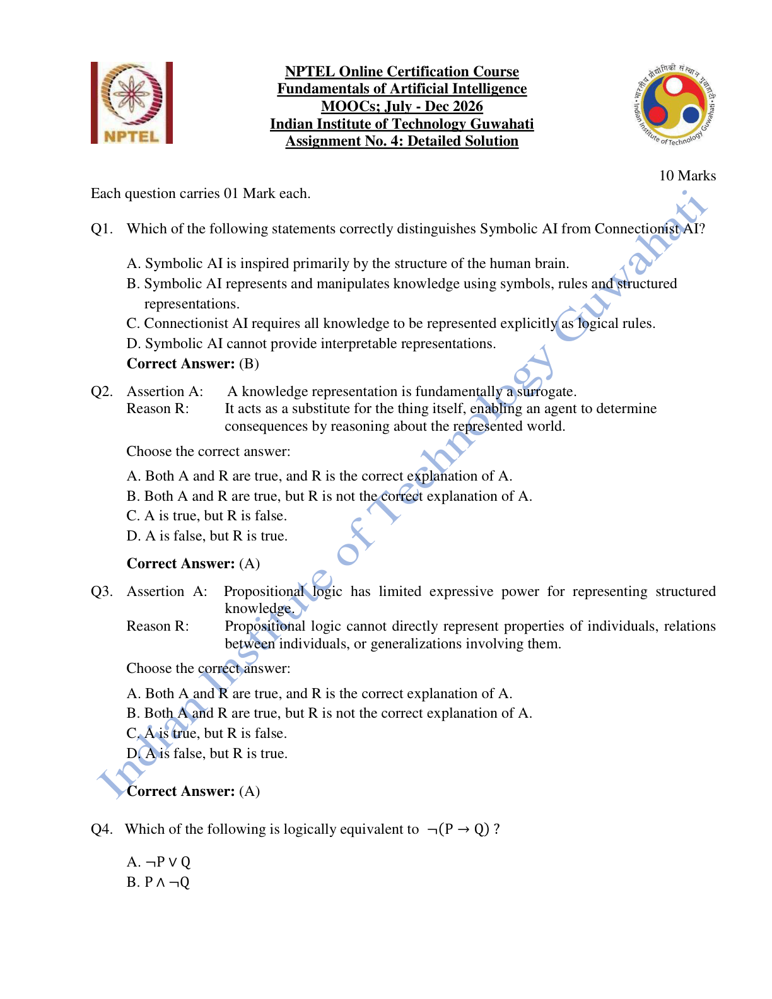

#### 2026 Q1

**Question recap:** How does symbolic AI represent knowledge?

**Answer:** B — Symbols, rules, and structured representations.

**Why:** Symbolic reasoning manipulates explicit descriptions. Connectionist systems instead encode learned structure mainly in networks and their numerical parameters.

#### 2026 Q2

**Question recap:** Why is knowledge representation a surrogate?

**Answer:** A — Both statements are true, and the reason explains the assertion.

**Why:** The representation stands in for the world. An agent can reason about consequences using that substitute instead of physically trying every action.

#### 2026 Q3

**Question recap:** Why is propositional logic limited?

**Answer:** A — Both statements are true, and the reason explains the assertion.

**Why:** Whole propositions are treated as atoms. Variables, quantification, and explicit object relations require a richer language such as first-order logic.

### 2026 — Page 02

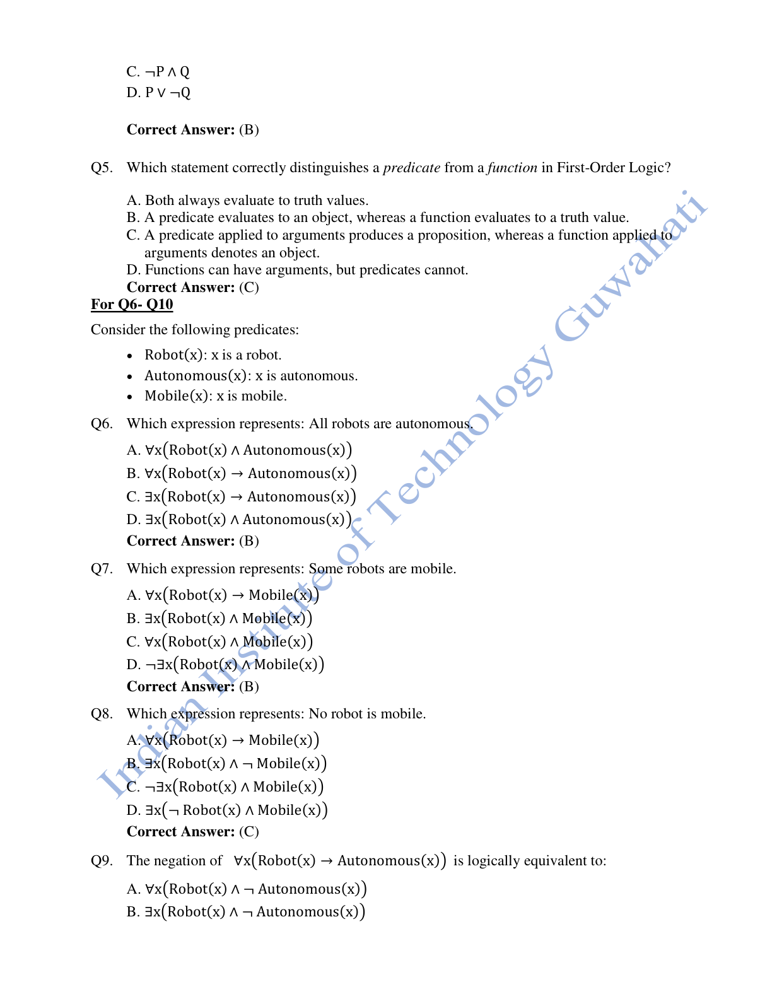

#### 2026 Q4

**Question recap:** What is the negation of an implication?

**Answer:** B — $P\land\neg Q$.

**Why:** An implication fails only when its antecedent is true and its consequent is false. Negating it selects exactly that case.

#### 2026 Q5

**Question recap:** How does a predicate differ from a function?

**Answer:** C — A predicate gives a proposition; a function denotes an object.

**Why:** For example, $Tall(x)$ can be true or false, while $Father(x)$ denotes an individual. Both may take arguments.

#### 2026 Q6

**Question recap:** How do we express that every robot is autonomous?

**Answer:** B — $\forall x\,[Robot(x)\rightarrow Autonomous(x)]$.

**Why:** The implication restricts the requirement to robots. A universal conjunction would incorrectly say that every object in the domain is a robot.

#### 2026 Q7

**Question recap:** How do we express that some robot is mobile?

**Answer:** B — $\exists x\,[Robot(x)\land Mobile(x)]$.

**Why:** The same witness must satisfy both properties. Existential implication is unsuitable because a non-robot could make it trivially true.

#### 2026 Q8

**Question recap:** How do we express that no robot is mobile?

**Answer:** C — $\neg\exists x\,[Robot(x)\land Mobile(x)]$.

**Why:** There is no individual satisfying both predicates. An equivalent form is $\forall x\,[Robot(x)\rightarrow\neg Mobile(x)]$.

### 2026 — Page 03

#### 2026 Q9

**Question recap:** How do we negate the claim that all robots are autonomous?

**Answer:** B — $\exists x\,[Robot(x)\land\neg Autonomous(x)]$.

**Why:** Negating a universal statement produces an existential counterexample: at least one robot fails the property.

#### 2026 Q10

**Question recap:** What follows from robot → autonomous → mobile?

**Answer:** A — Every robot is mobile.

**Why:** Chain the two implications for each individual. These universal statements do not by themselves establish that any robot exists.

[Back to year index](#2026) · [All weeks](README.md)

---

## 2025

Public copy of 2025 assignment solutions. Highlights are preserved; corrections and wording issues are identified below.

[Source](https://www.scribd.com/document/937061874/NPTEL)

Jump to discussion: [Q1](#2025-q1) · [Q2](#2025-q2) · [Q3](#2025-q3) · [Q4](#2025-q4) · [Q5](#2025-q5) · [Q6](#2025-q6) · [Q7](#2025-q7) · [Q8](#2025-q8) · [Q9](#2025-q9) · [Q10](#2025-q10)

### 2025 — Page 01

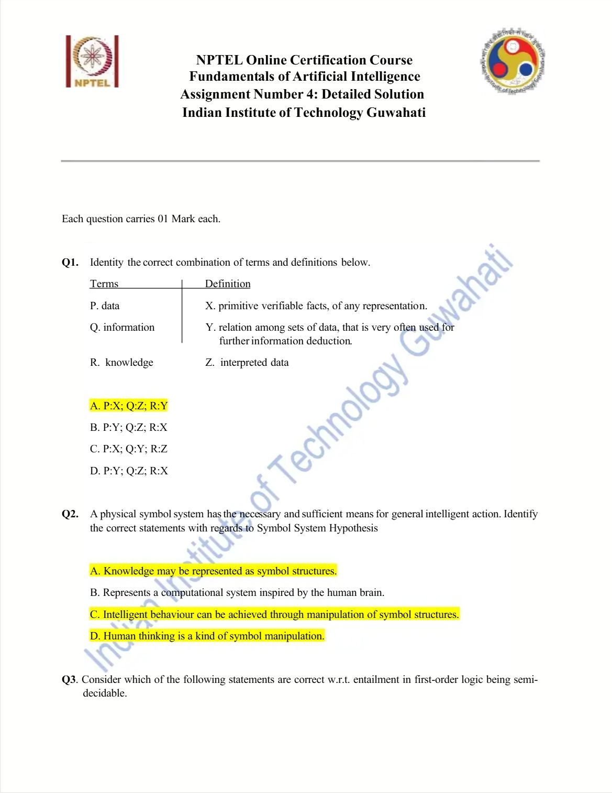

#### 2025 Q1

**Question recap:** How do data, information, and knowledge match the definitions?

**Answer:** A — Data: primitive facts; information: interpreted data; knowledge: useful relations among data.

**Why:** The progression adds interpretation and then relationships that support further inference. Match meanings rather than memorising the order of the letters.

#### 2025 Q2

**Question recap:** Which statements describe the physical-symbol-system view?

**Answer:** A, C, and D.

**Why:** Knowledge can be represented as symbols, intelligent behaviour can arise through their manipulation, and human thought is modelled as symbol processing. The brain-inspired network description belongs to connectionist AI.

### 2025 — Page 02

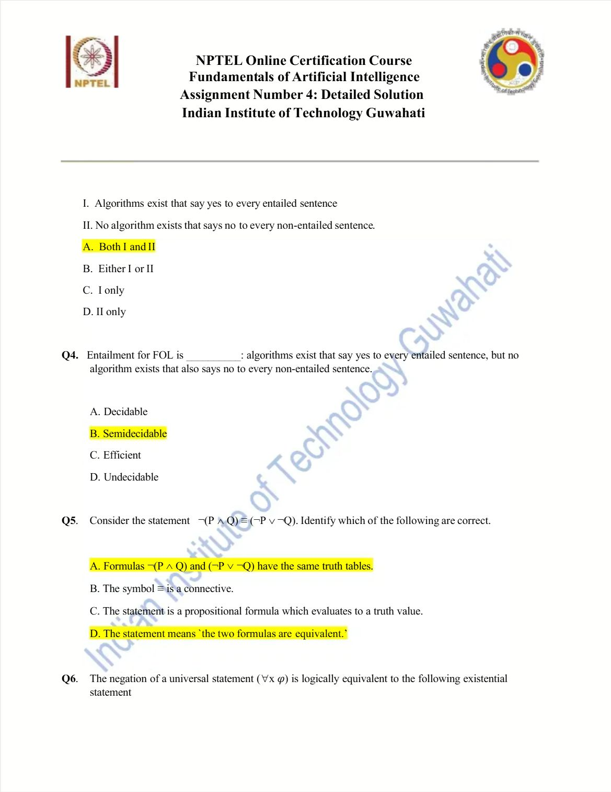

#### 2025 Q3

**Question recap:** Which claims describe FOL semidecidability?

**Answer:** A — Both I and II.

**Why:** Proof search can confirm every entailed sentence eventually. There is no general procedure that always terminates with the correct negative answer for every non-entailment. Individual negative cases may still be established; semidecidability concerns the absence of a general procedure guaranteed to decide every case.

#### 2025 Q4

**Question recap:** What is FOL entailment's decidability status?

**Answer:** B — Semidecidable.

**Why:** A proof gives a finite positive certificate when entailment holds, while failure to find one after finite time need not mean that no proof exists.

#### 2025 Q5

**Question recap:** What does the displayed De Morgan equivalence state?

**Answer:** A and D — Identical truth tables and logical equivalence.

**Why:** $\neg(P\land Q)$ and $\neg P\lor\neg Q$ agree under every valuation. The equivalence sign here is used at the metalanguage level; distinguish it from a biconditional connective inside a formula.

### 2025 — Page 03

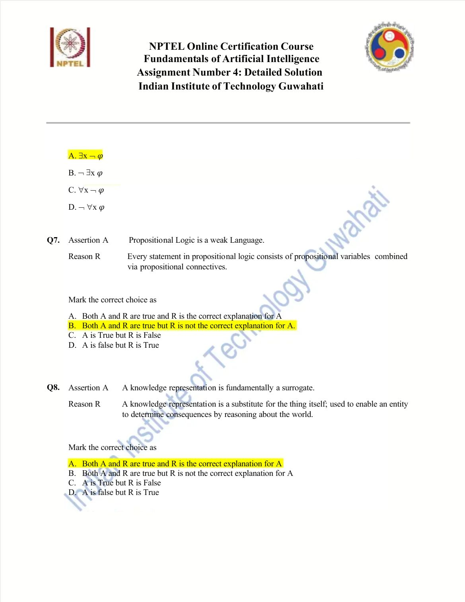

#### 2025 Q6

**Question recap:** How is a universal statement negated?

**Answer:** $\neg\forall x\,\varphi\;\equiv\;\exists x\,\neg\varphi$.

**Why:** “Not everyone has the property” means “someone lacks it.” The public copy does not display a complete option list for this question, so no option letter is invented.

#### 2025 Q7

**Question recap:** Why is propositional logic called weak?

**Answer:** B in the source — Both statements are true, but the reason is not the intended explanation.

**Why:** Combining proposition variables with connectives describes its syntax. The substantive limitation is the lack of direct representation of individuals, relations, and quantified generalisations.

#### 2025 Q8

**Question recap:** Why is a knowledge representation a surrogate?

**Answer:** A — Both statements are true, and the reason explains the assertion.

**Why:** It replaces the real object or world for reasoning purposes. Consequences can be explored symbolically rather than by performing every real action.

### 2025 — Page 04

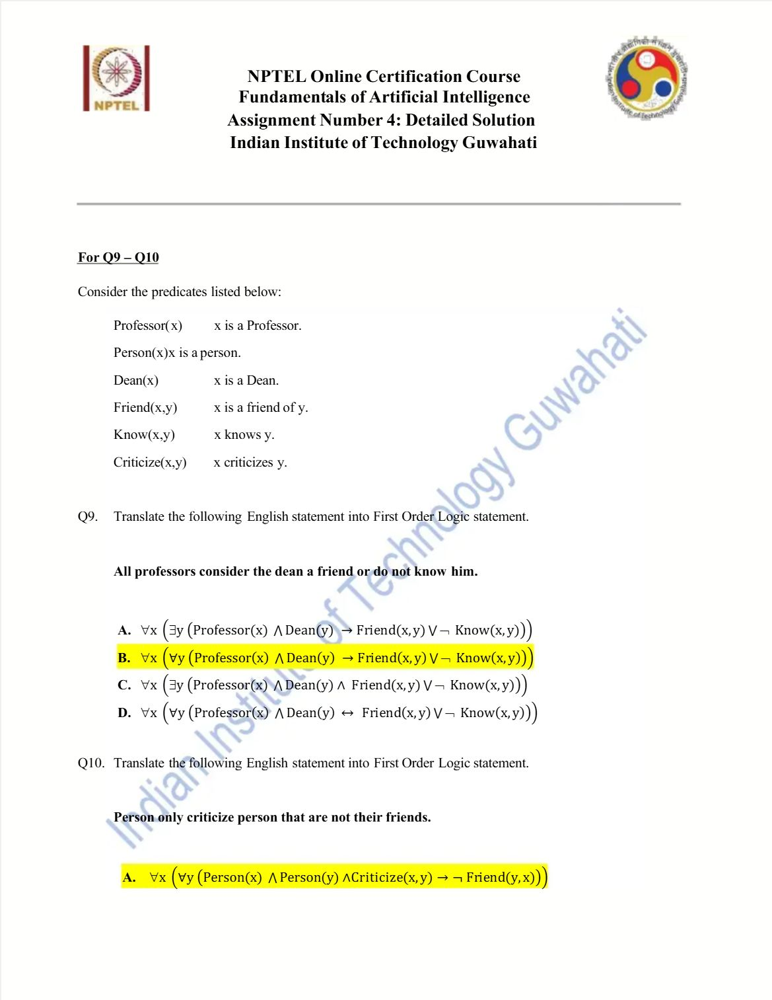

#### 2025 Q9

**Question recap:** How is the professor–dean statement represented?

**Answer:** B — $\forall x\forall y[(Professor(x)\land Dean(y))\rightarrow(Friend(x,y)\lor\neg Know(x,y))]$.

**Why:** For every relevant professor and dean, at least one of the two alternatives holds. Universal quantification avoids asserting a separate witness for each arbitrary object.

### 2025 — Page 05

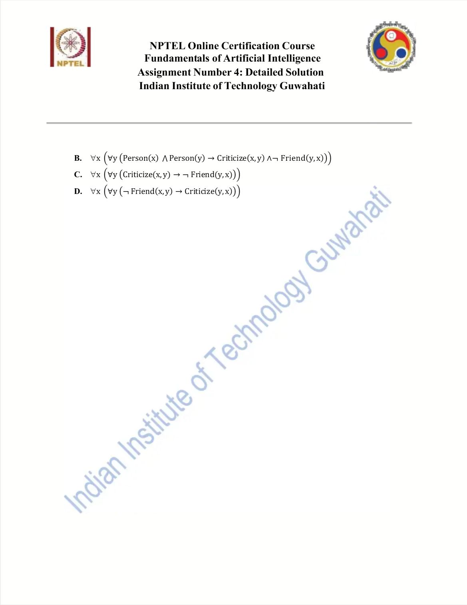

#### 2025 Q10

**Question recap:** How is the criticism restriction represented?

**Answer:** A in the source.

**Why:** The essential direction is $Criticize(x,y)\rightarrow\neg Friend(x,y)$, restricted to persons. The source writes $Friend(y,x)$ instead; this is equivalent only if friendship is assumed symmetric. With an arbitrary directed Friend predicate, the printed option reverses the relation.

[Back to year index](#2025) · [All weeks](README.md)

---

## 2024

Question screenshots captured from MY SWAYAM’s public 2024 assignment video, linked to course noc24_ge47. The uploader’s unsubmitted choices, annotations, and occasional overlay text are preserved. They are not an official answer key; corrections and ambiguous wording are discussed below.

[Source](https://www.youtube.com/watch?v=Y0k5-TBt798&t=35s)

Jump to discussion: [Q1](#2024-q1) · [Q2](#2024-q2) · [Q3](#2024-q3) · [Q4](#2024-q4) · [Q5](#2024-q5) · [Q6](#2024-q6) · [Q7](#2024-q7) · [Q8](#2024-q8) · [Q9](#2024-q9) · [Q10](#2024-q10)

### 2024 — Page 01

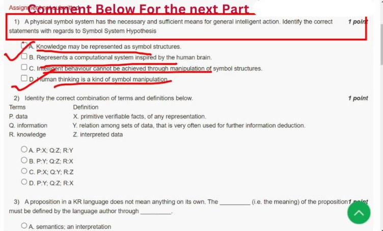

[Source video at 0:35](https://www.youtube.com/watch?v=Y0k5-TBt798&t=35s)

#### 2024 Q1

**Question recap:** Which statements describe the physical-symbol-system view?

**Answer:** A and D.

**Why:** Symbols can represent knowledge and thought is modelled as symbol processing. Here C says intelligent behaviour cannot be achieved through symbol manipulation, so C contradicts the symbolic hypothesis. The similar 2025 question says can and therefore includes C. B describes a connectionist approach. Read the negation before reusing an answer from another year.

#### 2024 Q2

**Question recap:** How do data, information, and knowledge match the definitions?

**Answer:** A — P:X, Q:Z, R:Y.

**Why:** Data are primitive facts; information is data with interpretation; knowledge includes useful relationships that support further conclusions. Match the meanings first, then select the letter. The order of definitions is deliberately shuffled.

### 2024 — Page 02

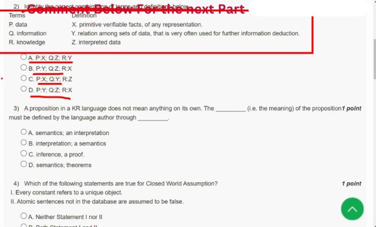

[Source video at 0:50](https://www.youtube.com/watch?v=Y0k5-TBt798&t=50s)

#### 2024 Q3

**Question recap:** How is a proposition assigned meaning?

**Answer:** A — Semantics through an interpretation.

**Why:** Syntax determines whether a sentence is well formed. An interpretation connects its symbols with domain objects, functions, and relations so truth can be evaluated. A proof uses meanings and rules to derive a conclusion; it does not itself define every symbol's meaning.

### 2024 — Page 03

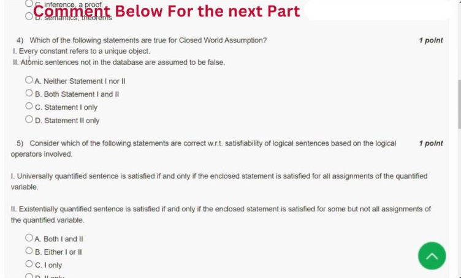

[Source video at 1:05](https://www.youtube.com/watch?v=Y0k5-TBt798&t=65s)

#### 2024 Q4

**Question recap:** Which statement is specifically the closed-world assumption?

**Answer:** D — Statement II only.

**Why:** The closed-world assumption treats an unestablished ground fact as false. Statement I concerns the separate unique-names assumption: different constant names denote different objects. Neither assumption follows automatically from ordinary first-order logic, and they should not be merged merely because databases often use both.

### 2024 — Page 04

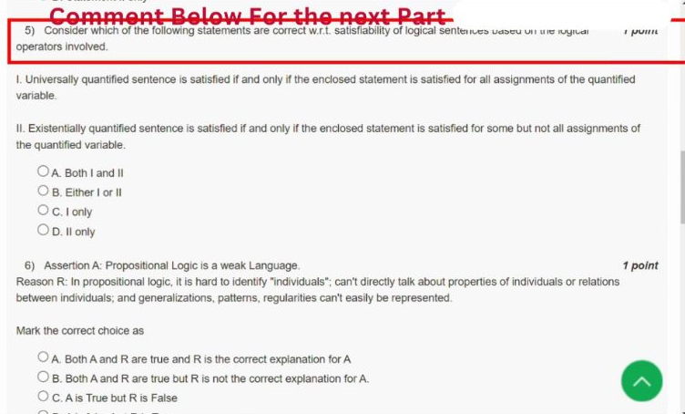

[Source video at 1:20](https://www.youtube.com/watch?v=Y0k5-TBt798&t=80s)

#### 2024 Q5

**Question recap:** Which quantifier-satisfaction statement is correct?

**Answer:** C — I only.

**Why:** A universal statement must hold for every assignment of its variable. An existential requires at least one witness and permits the property to hold for all objects as well. Statement II's extra “but not all” restriction is therefore false.

### 2024 — Page 05

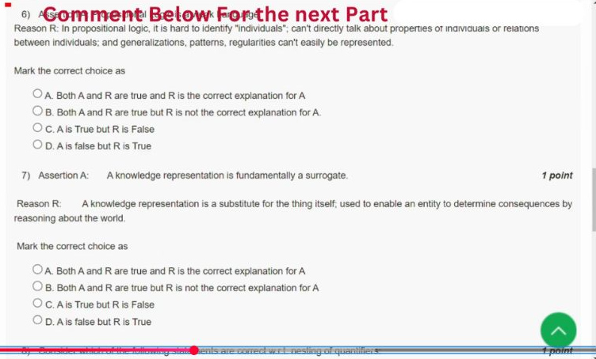

[Source video at 1:35](https://www.youtube.com/watch?v=Y0k5-TBt798&t=95s)

#### 2024 Q6

**Question recap:** Does the inability to express individuals explain propositional logic's weakness?

**Answer:** A — Both statements are true and the reason explains the assertion.

**Why:** Propositional atoms hide their internal objects and relations. Generalising over individuals then requires separate atoms rather than one quantified rule. FOL adds variables, predicates, functions, and quantifiers to express that structure directly.

### 2024 — Page 06

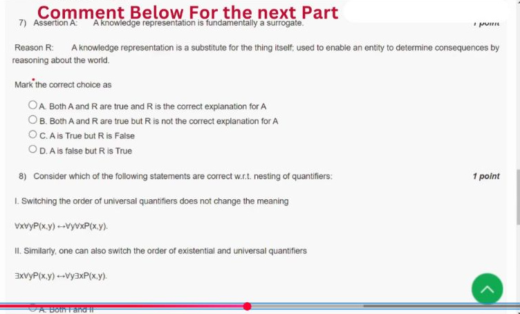

[Source video at 1:50](https://www.youtube.com/watch?v=Y0k5-TBt798&t=110s)

#### 2024 Q7

**Question recap:** Why is knowledge representation called a surrogate?

**Answer:** A — Both statements are true and the reason explains the assertion.

**Why:** The representation stands in for a real object or world. The agent can derive consequences using that substitute without executing every possible physical action. Conclusions are useful only to the extent that the representation captures the relevant aspects of reality.

### 2024 — Page 07

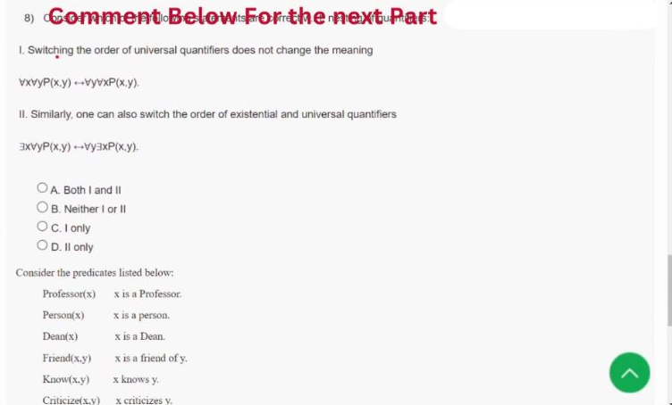

[Source video at 2:05](https://www.youtube.com/watch?v=Y0k5-TBt798&t=125s)

#### 2024 Q8

**Question recap:** Which quantifier orders can be exchanged here?

**Answer:** C — I only.

**Why:** Two universal quantifiers commute: $\forall x\forall yP(x,y)\equiv\forall y\forall xP(x,y)$. Mixed quantifiers generally do not. On the domain $\{1,2\}$ with $P(x,y)$ meaning $x=y$, $\forall y\exists xP(x,y)$ is true but $\exists x\forall yP(x,y)$ is false: there is no single x equal to both objects.

### 2024 — Page 08

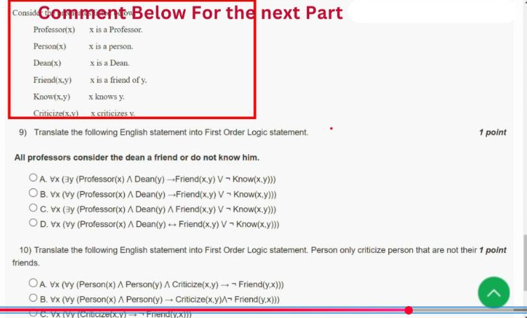

[Source video at 2:20](https://www.youtube.com/watch?v=Y0k5-TBt798&t=140s)

#### 2024 Q9

**Question recap:** How is the professor–dean statement translated?

**Answer:** B — $\forall x\forall y[(Professor(x)\land Dean(y))\rightarrow(Friend(x,y)\lor\neg Know(x,y))]$.

**Why:** Each relevant professor–dean pair must satisfy at least one alternative. Implication restricts the assertion to that pair; conjunction would incorrectly assert that arbitrary domain members are professors and deans. Keep the negation on Know.

### 2024 — Page 09

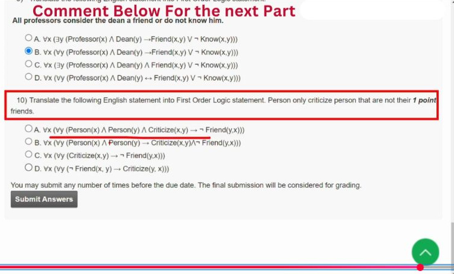

[Source video at 2:35](https://www.youtube.com/watch?v=Y0k5-TBt798&t=155s)

#### 2024 Q10

**Question recap:** How should the criticism restriction be represented?

**Answer:** The intended option is A, with the same friendship-direction caveat as the 2025 copy.

**Why:** A precise directed-relation form is $\forall x\forall y[(Person(x)\land Person(y)\land Criticize(x,y))\rightarrow\neg Friend(x,y)]$. The printed option reverses the friendship arguments to $Friend(y,x)$; that is equivalent only if friendship is assumed symmetric. “Only” makes non-friendship a necessary condition for criticism, not a reason to criticise every non-friend.

[Back to year index](#2024) · [All weeks](README.md)

---

## 2019

Official NPTEL archive with accepted answers. Any discrepancy between a printed formula and its key is identified below.

[Source](https://archive.nptel.ac.in/content/storage2/courses/downloads_new/112103280/Week_04_Assignment_4.pdf)

Jump to discussion: [Q1](#2019-q1) · [Q2](#2019-q2) · [Q3](#2019-q3) · [Q4](#2019-q4) · [Q5](#2019-q5) · [Q6](#2019-q6) · [Q7](#2019-q7) · [Q8](#2019-q8) · [Q9](#2019-q9) · [Q10](#2019-q10)

### 2019 — Page 01

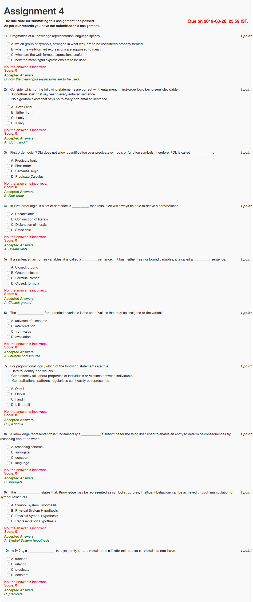

#### 2019 Q1

**Question recap:** What do a representation language's pragmatics specify?

**Answer:** D — How meaningful expressions are used.

**Why:** Syntax specifies legal forms, semantics specifies meanings, and pragmatics concerns their use. Keep these three roles separate.

#### 2019 Q2

**Question recap:** Which FOL semidecidability statements hold?

**Answer:** A — Both I and II.

**Why:** Entailed conclusions can eventually be proved by a complete procedure. Non-entailment does not generally admit a guaranteed terminating negative test. Individual negative cases may still be established; semidecidability concerns the absence of a general procedure guaranteed to decide every case.

#### 2019 Q3

**Question recap:** Why is this logic called first-order?

**Answer:** B — It quantifies over individuals, not predicates or functions.

**Why:** Predicate and function symbols have fixed interpretations. Quantifying over those symbols would move beyond ordinary first-order logic.

#### 2019 Q4

**Question recap:** What clause-set property ensures a resolution contradiction exists?

**Answer:** A — Unsatisfiability.

**Why:** If no interpretation satisfies all clauses, complete resolution search can derive the empty clause. A satisfiable set cannot soundly yield that contradiction.

#### 2019 Q5

**Question recap:** What are sentences with no free variables and with no variables called?

**Answer:** A — Closed and ground, respectively.

**Why:** A closed formula may still contain bound variables. A ground formula contains no variables at all.

#### 2019 Q6

**Question recap:** What is the set of possible variable values?

**Answer:** A — The universe of discourse.

**Why:** It supplies the objects quantified over. An interpretation also specifies what constants, functions, and predicates denote over that domain.

#### 2019 Q7

**Question recap:** Which listed weaknesses does propositional logic have?

**Answer:** D — I, II, and III.

**Why:** Its atomic propositions do not directly expose objects, their properties, or relations. Expressing general patterns therefore requires separate propositions instead of quantified rules.

#### 2019 Q8

**Question recap:** What is the world-replacing role of knowledge representation called?

**Answer:** B — A surrogate.

**Why:** The agent reasons with a representation that stands in for the real thing. The usefulness of that reasoning depends on what the representation preserves and omits.

#### 2019 Q9

**Question recap:** Which hypothesis describes intelligent symbol manipulation?

**Answer:** A — The symbol-system hypothesis.

**Why:** It treats symbol structures as representations of knowledge and their manipulation as a basis for intelligent action. This is the symbolic AI viewpoint.

#### 2019 Q10

**Question recap:** What expresses a property or relation of objects?

**Answer:** C — A predicate.

**Why:** Applied to arguments, a predicate forms a proposition that can be true or false. A function instead denotes an object.

[Back to year index](#2019) · [All weeks](README.md)

---
