# Week 05 — Knowledge Representation and Reasoning II

[All weeks](README.md) · [Previous](Week%2004.md) · [Next](Week%2006.md)

[2026](#2026) · [2025](#2025) · [2024](#2024) · [2019](#2019)

Screenshots appear inline. Each question has a short recap, answer, and explanation below the relevant page.

## 2026

Official solution linked from the enrolled 2026 course; checked against the live weekly assessment.

[Source](https://drive.google.com/file/d/1D8ded_Txao9vEfmBwBVG2LsrWdWojubM/view)

Jump to discussion: [Q1](#2026-q1) · [Q2](#2026-q2) · [Q3](#2026-q3) · [Q4](#2026-q4) · [Q5](#2026-q5) · [Q6](#2026-q6) · [Q7](#2026-q7) · [Q8](#2026-q8) · [Q9](#2026-q9) · [Q10](#2026-q10)

### 2026 — Page 01

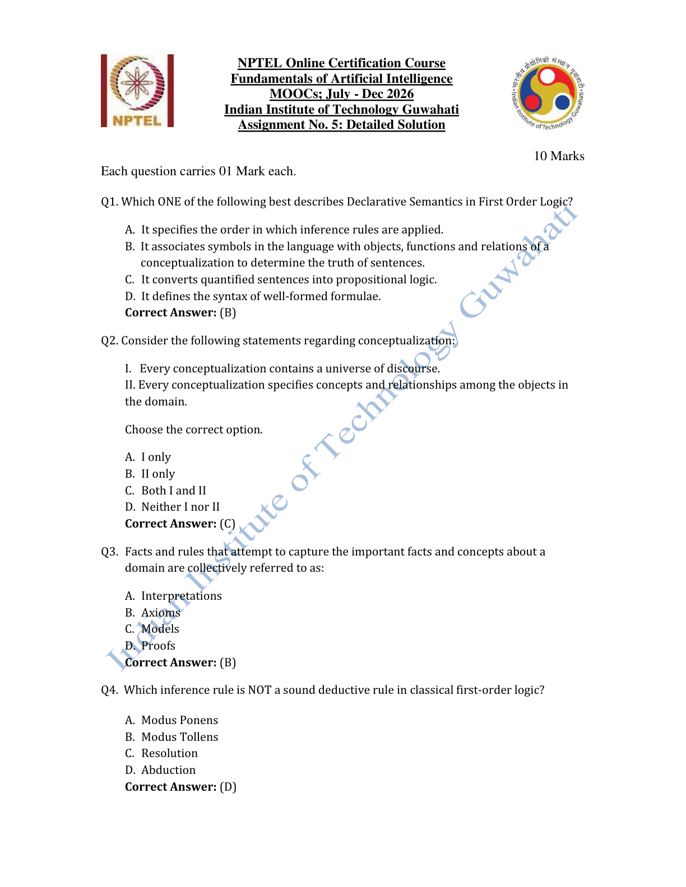

#### 2026 Q1

**Question recap:** What does declarative semantics specify?

**Answer:** B — How symbols refer to objects, functions, and relations.

**Why:** An interpretation supplies meanings so that a sentence's truth can be determined. It does not prescribe the order of inference steps.

#### 2026 Q2

**Question recap:** What does a conceptualisation contain?

**Answer:** C — Both I and II.

**Why:** It identifies a domain of objects together with the concepts and relationships used to describe them. This supplies the intended subject matter of the representation.

#### 2026 Q3

**Question recap:** What are the domain's foundational facts and rules called?

**Answer:** B — Axioms.

**Why:** They are the starting sentences accepted in the knowledge base. Further conclusions are derived from them by inference.

#### 2026 Q4

**Question recap:** Which listed method is not sound deduction?

**Answer:** D — Abduction.

**Why:** From a possible cause and an observed effect, abduction proposes an explanation. Other causes may produce the same effect, so the proposed cause is not logically guaranteed.

### 2026 — Page 02

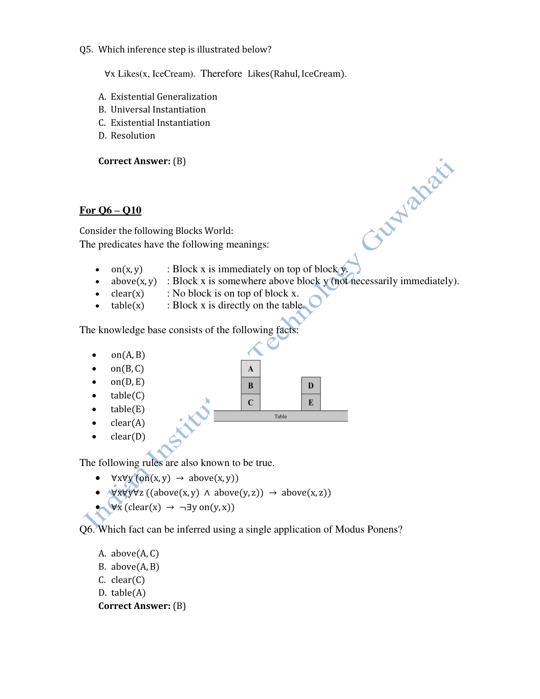

#### 2026 Q5

**Question recap:** What rule derives Likes(Rahul, IceCream) from a universal statement?

**Answer:** B — Universal instantiation.

**Why:** Replace the universally quantified variable by the particular individual Rahul. A statement true of every domain member is true of that member.

#### 2026 Q6

**Question recap:** Which relation follows in one direct step?

**Answer:** B — $above(A,B)$.

**Why:** Combine $on(A,B)$ with $on(x,y)\rightarrow above(x,y)$. No intermediate derived relation is needed.

### 2026 — Page 03

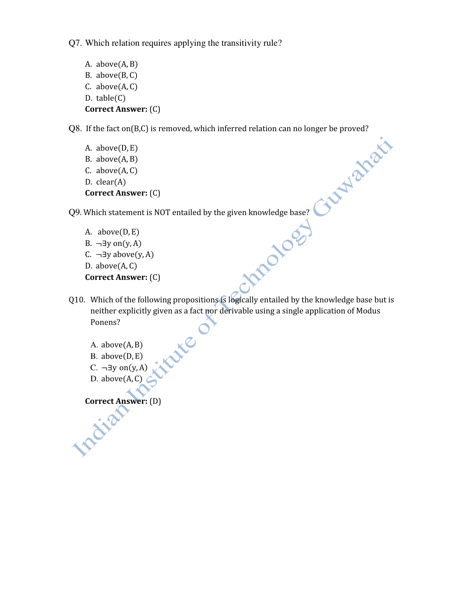

#### 2026 Q7

**Question recap:** Which relation requires transitivity?

**Answer:** C — $above(A,C)$.

**Why:** First establish $above(A,B)$ and $above(B,C)$, then combine them using the transitivity rule.

#### 2026 Q8

**Question recap:** What loses its proof when on(B,C) is removed?

**Answer:** C — $above(A,C)$.

**Why:** The chain through B is broken. The separate stack involving D and E and the direct relation between A and B remain supported.

#### 2026 Q9

**Question recap:** Which negative statement is not entailed?

**Answer:** C — Nothing is above A.

**Why:** The rule for $clear(A)$ excludes an immediate $on(y,A)$ relation. It does not define every possible $above$ relation or justify a closed-world assumption.

#### 2026 Q10

**Question recap:** Which consequence needs more than one inference step?

**Answer:** D — $above(A,C)$.

**Why:** It is not an explicit fact. Derive two direct above-relations and then apply transitivity to obtain the indirect relation.

[Back to year index](#2026) · [All weeks](README.md)

---

## 2025

Public copy of 2025 assignment solutions. Highlights are preserved; corrections and wording issues are identified below.

[Source](https://www.scribd.com/document/937061874/NPTEL)

Jump to discussion: [Q1](#2025-q1) · [Q2](#2025-q2) · [Q3](#2025-q3) · [Q4](#2025-q4) · [Q5](#2025-q5) · [Q6](#2025-q6) · [Q7](#2025-q7) · [Q8](#2025-q8) · [Q9](#2025-q9) · [Q10](#2025-q10)

### 2025 — Page 01

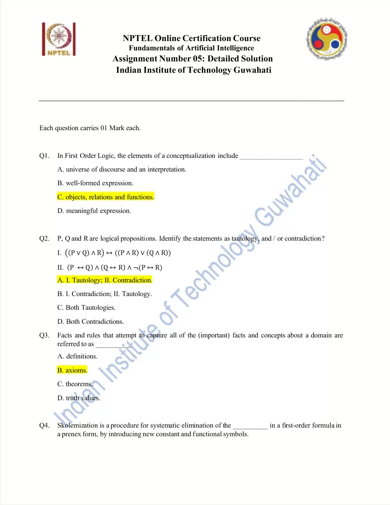

#### 2025 Q1

**Question recap:** What belongs to a FOL conceptualisation?

**Answer:** C — Objects, relations, and functions.

**Why:** These describe what exists in the domain and how its objects are related. An interpretation subsequently connects the language's symbols to those meanings.

#### 2025 Q2

**Question recap:** Which displayed formula is a tautology and which a contradiction?

**Answer:** A — I is a tautology; II is a contradiction.

**Why:** Formula I is distributivity. In II, if P agrees with Q and Q agrees with R, P must agree with R, contradicting its final negation.

#### 2025 Q3

**Question recap:** What are the domain's asserted facts and rules called?

**Answer:** B — Axioms.

**Why:** They supply the premises accepted by the system. A theorem is something derived from premises, rather than another name for every starting premise.

### 2025 — Page 02

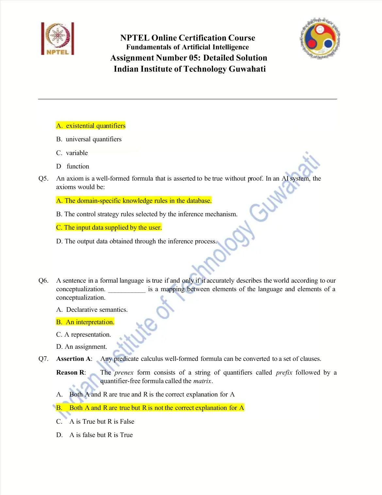

#### 2025 Q4

**Question recap:** What does Skolemisation eliminate?

**Answer:** A — Existential quantifiers.

**Why:** Skolemisation replaces existential witnesses with fresh symbols. An independent witness in $\exists yP(y)$ uses a constant c; a witness in $\forall x\exists yP(x,y)$ uses $f(x)$ because it can depend on x. The resulting clause problem preserves satisfiability in an expanded language, rather than literal equivalence in the original vocabulary.

#### 2025 Q5

**Question recap:** Which AI-system items can act as axioms?

**Answer:** A and C — Domain rules and asserted input facts.

**Why:** They are premises available to the inference process. Control-strategy rules describe how to search for inferences, and outputs are generally conclusions.

#### 2025 Q6

**Question recap:** What maps language elements to conceptual meanings?

**Answer:** B — An interpretation.

**Why:** Constants denote objects, functions denote domain functions, and predicates denote relations. This mapping makes truth evaluation possible.

#### 2025 Q7

**Question recap:** Do clause conversion and prenex form have the stated relationship?

**Answer:** B — Both statements are true, but the reason alone does not explain conversion.

**Why:** Prenex form puts quantifiers before a quantifier-free matrix. Clause conversion also needs steps such as eliminating implications, Skolemisation, and distribution.

### 2025 — Page 03

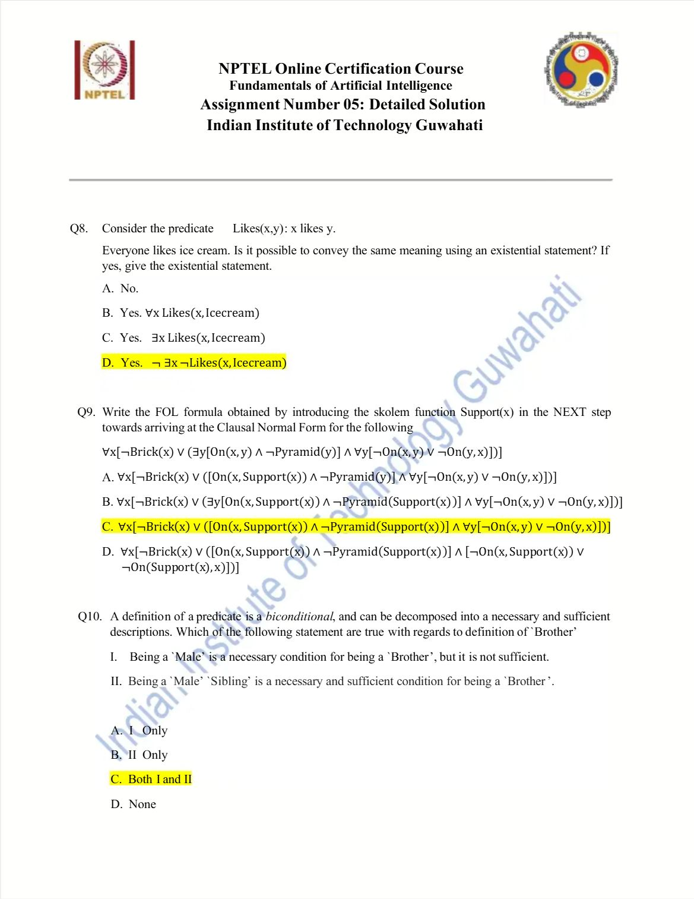

#### 2025 Q8

**Question recap:** Can “everyone likes ice cream” use an existential formulation?

**Answer:** D — $\neg\exists x\,\neg Likes(x,IceCream)$.

**Why:** There is no counterexample who dislikes ice cream. The outer negation is essential; $\exists x\,Likes(x,IceCream)$ only says someone likes it.

#### 2025 Q9

**Question recap:** What changes when Support(x) is introduced?

**Answer:** C — Replace the existential support witness consistently by Support(x).

**Why:** Substitute it in both On and Pyramid, then remove that existential quantifier. Keep the separate universally quantified y in the other subformula; it is a different bound variable.

#### 2025 Q10

**Question recap:** Which brother-definition statements hold?

**Answer:** C — Both I and II.

**Why:** Being male is necessary but not sufficient. Under the given family predicates, being both male and a sibling supplies the necessary and sufficient condition.

[Back to year index](#2025) · [All weeks](README.md)

---

## 2024

Question screenshots captured from MY SWAYAM’s public 2024 assignment video, linked to course noc24_ge47. The uploader’s unsubmitted choices, annotations, and occasional overlay text are preserved. They are not an official answer key; corrections and ambiguous wording are discussed below.

[Source](https://www.youtube.com/watch?v=pWBjsD2Btko&t=30s)

Jump to discussion: [Q1](#2024-q1) · [Q2](#2024-q2) · [Q3](#2024-q3) · [Q4](#2024-q4) · [Q5](#2024-q5) · [Q6](#2024-q6) · [Q7](#2024-q7) · [Q8](#2024-q8) · [Q9](#2024-q9) · [Q10](#2024-q10)

### 2024 — Page 01

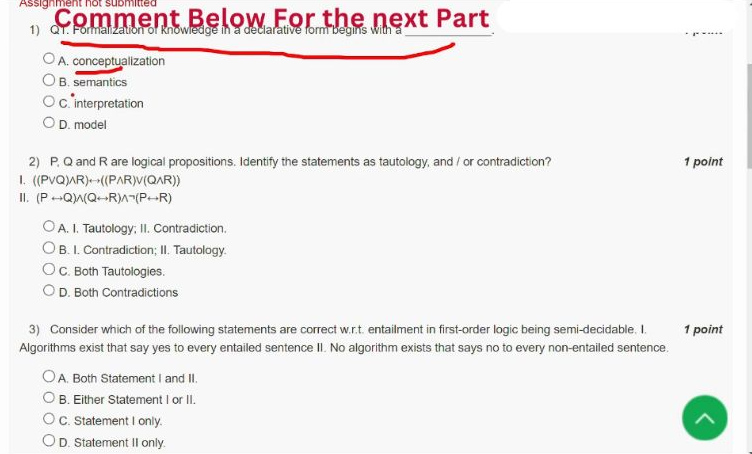

[Source video at 0:30](https://www.youtube.com/watch?v=pWBjsD2Btko&t=30s)

#### 2024 Q1

**Question recap:** What is the relationship between a declarative formulation and a conceptualisation?

**Answer:** C — An interpretation.

**Why:** An interpretation assigns meanings to the language's constants, predicates, and functions in the conceptualised domain. Syntax governs permitted expressions, while the interpretation supplies the meanings needed to evaluate them. A model is an interpretation that satisfies the sentences under consideration.

### 2024 — Page 02

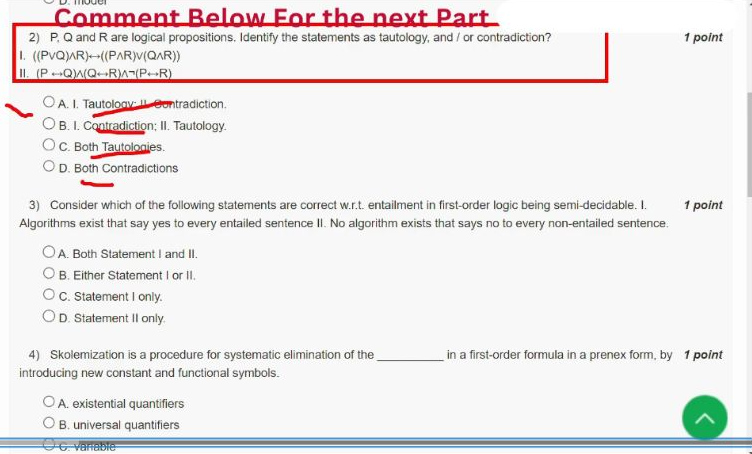

[Source video at 0:45](https://www.youtube.com/watch?v=pWBjsD2Btko&t=45s)

#### 2024 Q2

**Question recap:** Which displayed formula is a tautology and which a contradiction?

**Answer:** A — I is a tautology; II is a contradiction.

**Why:** I expresses a distributive equivalence, so both sides agree under every valuation. In II, $P\leftrightarrow Q$ and $Q\leftrightarrow R$ force $P\leftrightarrow R$; conjoining its negation makes the whole formula false for every valuation. Truth-table enumeration independently confirms both classifications.

#### 2024 Q3

**Question recap:** Which statements describe FOL semidecidability?

**Answer:** A — Both I and II, in the course's intended sense.

**Why:** A complete proof search eventually confirms an entailed sentence. There is no general sound-and-complete decision procedure guaranteed to terminate on all non-entailments as well. This does not say that individual negative cases can never be established; many particular cases are decidable or have a countermodel.

### 2024 — Page 03

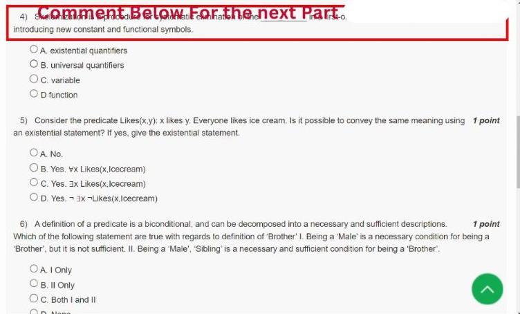

[Source video at 1:00](https://www.youtube.com/watch?v=pWBjsD2Btko&t=60s)

#### 2024 Q4

**Question recap:** What does Skolemisation eliminate?

**Answer:** A — Existential quantifiers.

**Why:** In $\exists yP(y)$, use a fresh constant c. In $\forall x\exists yP(x,y)$, use a fresh function $f(x)$ because the witness may depend on x. Skolemisation preserves satisfiability in an expanded language; it is not equivalence in the original vocabulary.

#### 2024 Q5

**Question recap:** Can everyone liking ice cream be expressed using an existential quantifier?

**Answer:** D — $\neg\exists x\,\neg Likes(x,IceCream)$.

**Why:** “Everyone likes it” means there is no individual who fails to like it. Applying quantifier negation gives $\forall xL(x)\equiv\neg\exists x\neg L(x)$. Omitting either negation changes the meaning to a much weaker or entirely different claim.

### 2024 — Page 04

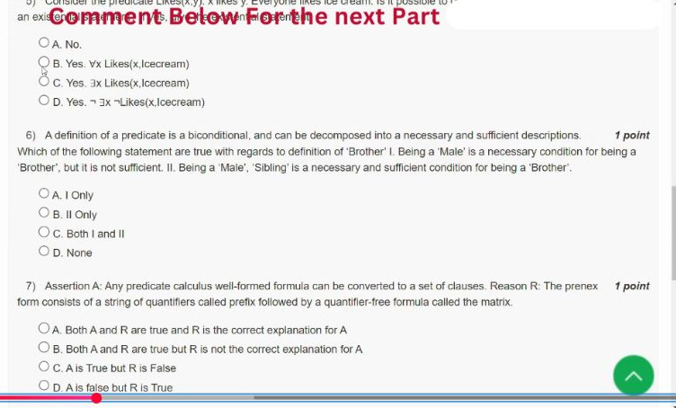

[Source video at 1:10](https://www.youtube.com/watch?v=pWBjsD2Btko&t=70s)

#### 2024 Q6

**Question recap:** Which brother-definition statements hold?

**Answer:** C — Both I and II.

**Why:** Under the given family predicates, $Brother(x,y)\leftrightarrow Male(x)\land Sibling(x,y)$. Being male is necessary but does not by itself establish brotherhood. Being both male and a sibling supplies the necessary and sufficient condition in this definition.

### 2024 — Page 05

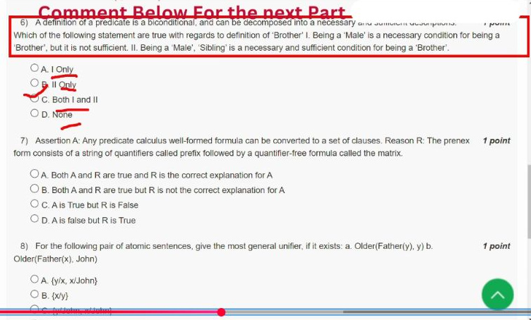

[Source video at 1:35](https://www.youtube.com/watch?v=pWBjsD2Btko&t=95s)

#### 2024 Q7

**Question recap:** Does the prenex-form definition alone explain clause conversion?

**Answer:** B — Both statements are true, but the reason is not the explanation.

**Why:** Prenex form has a quantifier prefix and a quantifier-free matrix. Conversion to clauses also requires steps such as implication removal, negation movement, Skolemisation, and distribution into CNF. In the presence of Skolemisation the relevant preservation property is satisfiability, not literal equivalence in the old language.

### 2024 — Page 06

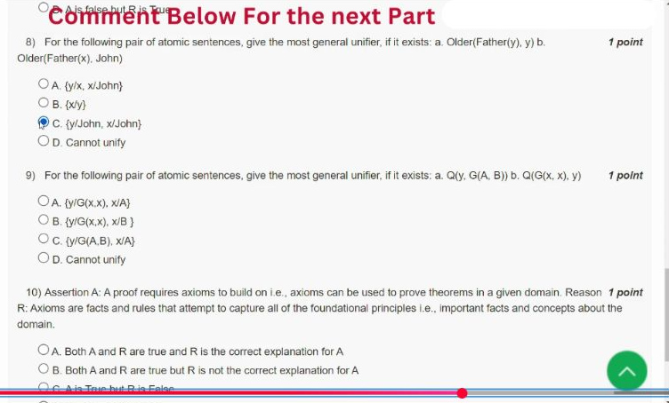

[Source video at 2:00](https://www.youtube.com/watch?v=pWBjsD2Btko&t=120s)

#### 2024 Q8

**Question recap:** What unifies the two Older atoms?

**Answer:** C — $\{y\mapsto John,\;x\mapsto John\}$.

**Why:** Matching the second arguments first forces $y=John$. Matching $Father(y)$ with $Father(x)$ then forces $x=John$. Applying the substitution makes both atoms $Older(Father(John),John)$. This normalised substitution avoids ambiguity about sequentially composing variable replacements.

#### 2024 Q9

**Question recap:** Can Q(y,G(A,B)) and Q(G(x,x),y) unify?

**Answer:** D — Cannot unify; the public video selects C.

**Why:** The argument equations require $y=G(x,x)$ and $y=G(A,B)$, hence both $x=A$ and $x=B$. Distinct constant symbols A and B cannot be identified by syntactic unification. The video's substitution $y\mapsto G(A,B),x\mapsto A$ leaves $G(A,B)$ versus $G(A,A)$, so it fails when checked.

### 2024 — Page 07

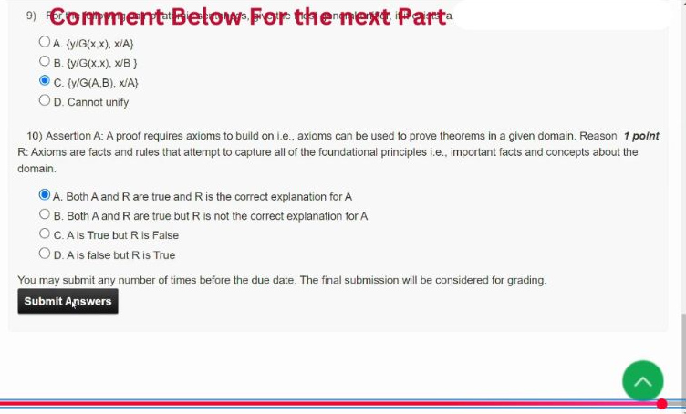

[Source video at 2:25](https://www.youtube.com/watch?v=pWBjsD2Btko&t=145s)

#### 2024 Q10

**Question recap:** Why do proofs rely on axioms?

**Answer:** A — Both statements are true and the reason explains the assertion.

**Why:** Axioms supply the domain facts and rules accepted as premises; inference rules derive further statements from them. A theorem is justified relative to those premises. The inference procedure does not independently establish that every chosen domain axiom accurately describes the real world.

[Back to year index](#2024) · [All weeks](README.md)

---

## 2019

Official NPTEL archive with accepted answers. Any discrepancy between a printed formula and its key is identified below.

[Source](https://archive.nptel.ac.in/content/storage2/courses/downloads_new/112103280/Week_05_Assignment_5.pdf)

Jump to discussion: [Q1](#2019-q1) · [Q2](#2019-q2) · [Q3](#2019-q3) · [Q4](#2019-q4) · [Q5](#2019-q5) · [Q6](#2019-q6) · [Q7](#2019-q7) · [Q8](#2019-q8) · [Q9](#2019-q9) · [Q10](#2019-q10)

### 2019 — Page 01

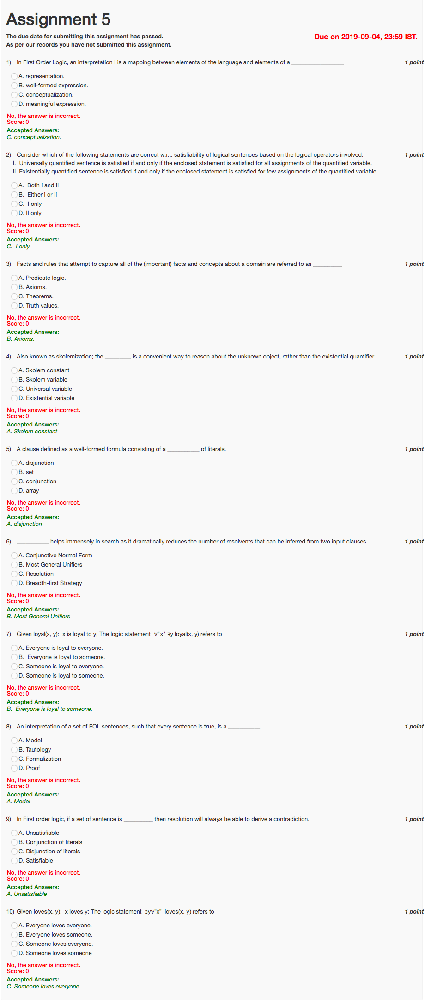

#### 2019 Q1

**Question recap:** What does an interpretation map language elements to?

**Answer:** C — A conceptualisation.

**Why:** Symbols acquire meanings as objects, functions, and relations in the domain. This makes it possible to evaluate whether sentences are true.

#### 2019 Q2

**Question recap:** Which quantifier-satisfaction statement is correct?

**Answer:** C — I only, as the source phrases it.

**Why:** A universal must hold for every assignment. An existential needs at least one witness, not an unspecified requirement that it hold for “few” assignments; it may hold for all of them.

#### 2019 Q3

**Question recap:** What are asserted domain facts and rules called?

**Answer:** B — Axioms.

**Why:** They are the accepted starting premises. Conclusions obtained from them through proof are theorems.

#### 2019 Q4

**Question recap:** What names a fresh independent existential witness?

**Answer:** A — A Skolem constant.

**Why:** A new constant stands for some object known to exist without claiming which existing named object it is. Witnesses depending on universal variables require Skolem functions instead.

#### 2019 Q5

**Question recap:** What is a clause?

**Answer:** A — A disjunction of literals.

**Why:** A literal is an atomic formula or its negation. A clause set in conjunctive normal form is a conjunction of such disjunctions.

#### 2019 Q6

**Question recap:** What keeps unification-based resolution general?

**Answer:** B — Most general unifiers.

**Why:** An MGU makes the selected literals match without committing to unnecessary specific values. More specialised substitutions are instances of that general solution.

#### 2019 Q7

**Question recap:** What does every x being loyal to some y mean?

**Answer:** B — Everyone is loyal to someone.

**Why:** The existential witness may depend on the individual x. It does not require one common person to whom everyone is loyal.

#### 2019 Q8

**Question recap:** What is an interpretation satisfying every sentence called?

**Answer:** A — A model.

**Why:** It is a particular assignment of meanings under which the complete sentence set is true. A tautology instead is true under every relevant interpretation.

#### 2019 Q9

**Question recap:** When can resolution derive a contradiction?

**Answer:** A — When the set is unsatisfiable.

**Why:** Add the negated query to the knowledge base and search for an empty clause. A refutation then proves the original query follows from the knowledge base.

#### 2019 Q10

**Question recap:** What does the displayed loves formula mean?

**Answer:** C in the source, but the printed formula and key disagree.

**Why:** With $Loves(x,y)$ meaning x loves y, $\exists y\forall x\,Loves(x,y)$ means there is someone whom everyone loves. “Someone loves everyone” instead requires $\exists x\forall y\,Loves(x,y)$. The exact meaning of the printed formula is absent from the options.

[Back to year index](#2019) · [All weeks](README.md)

---
