# Week 06 — Knowledge Representation and Reasoning III

[All weeks](README.md) · [Previous](Week%2005.md) · [Next](Week%2007.md)

[2026](#2026) · [2025](#2025) · [2024](#2024) · [2019](#2019)

Screenshots appear inline. Each question has a short recap, answer, and explanation below the relevant page.

## 2026

Official solution linked from the enrolled 2026 course; checked against the live weekly assessment.

[Source](https://drive.google.com/file/d/1m-VI_NFjjutdhKzojyng4P5C_J0LLmK5/view)

Jump to discussion: [Q1](#2026-q1) · [Q2](#2026-q2) · [Q3](#2026-q3) · [Q4](#2026-q4) · [Q5](#2026-q5) · [Q6](#2026-q6) · [Q7](#2026-q7) · [Q8](#2026-q8) · [Q9](#2026-q9) · [Q10](#2026-q10)

### 2026 — Page 01

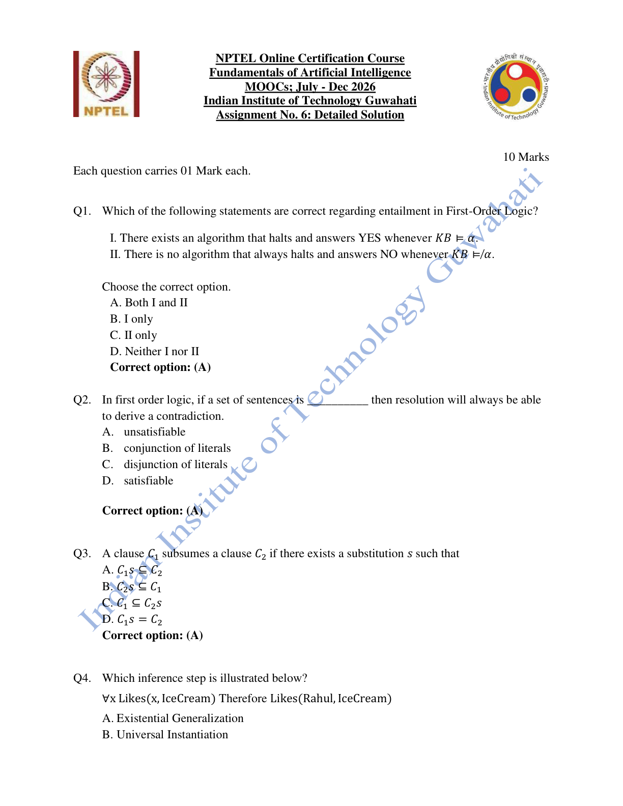

#### 2026 Q1

**Question recap:** Why is FOL entailment semidecidable?

**Answer:** A — Both I and II.

**Why:** A complete proof search eventually finds a proof when one exists. For a non-entailed conclusion, that search may continue forever; a general terminating yes/no procedure is unavailable. Individual negative cases may still be established; semidecidability concerns the absence of a general procedure guaranteed to decide every case.

#### 2026 Q2

**Question recap:** When is resolution guaranteed to derive a contradiction?

**Answer:** A — For an unsatisfiable clause set.

**Why:** Refutation completeness means that fair resolution search can derive the empty clause when the premises cannot all be true. Convert the statements to the appropriate clause form first.

#### 2026 Q3

**Question recap:** When does one clause subsume another?

**Answer:** A — Some substitution makes $C_1s\subseteq C_2$.

**Why:** The first clause can be instantiated so that all its literals occur in the second. The second is then redundant relative to the more general first clause.

### 2026 — Page 02

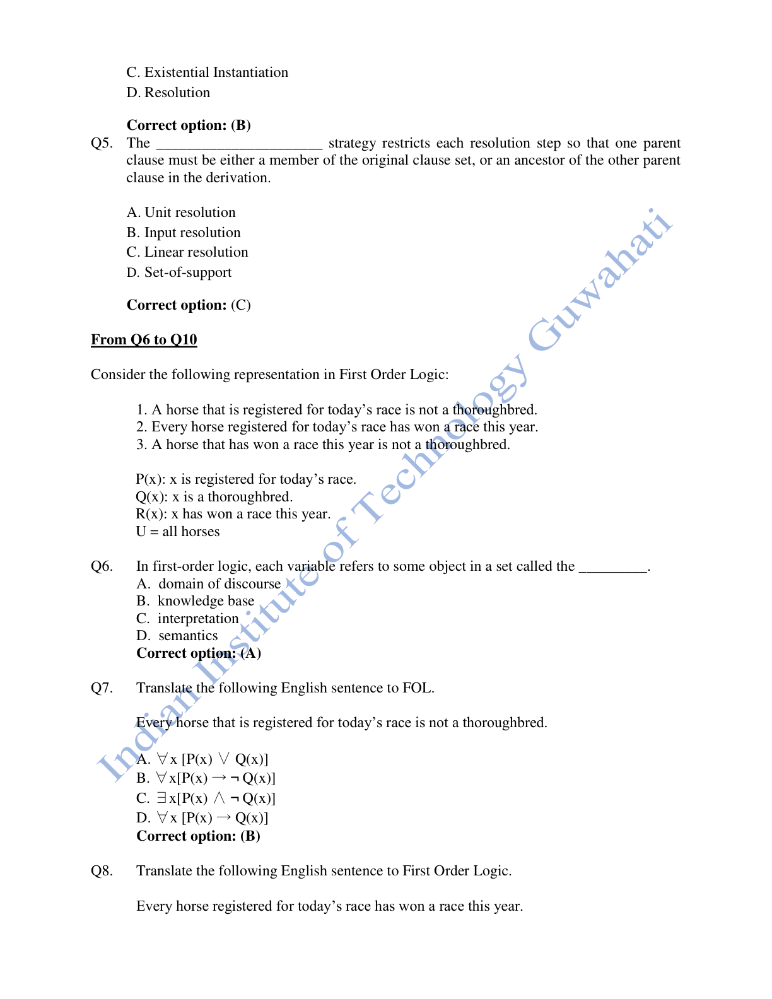

#### 2026 Q4

**Question recap:** What rule replaces a universal variable by Rahul?

**Answer:** B — Universal instantiation.

**Why:** This is the same all-to-one inference as Week 5 Q5. The replacement names a particular object without claiming that only that object has the property.

#### 2026 Q5

**Question recap:** Which strategy permits an original clause or an ancestor as a parent?

**Answer:** C — Linear resolution.

**Why:** The derivation follows a linear chain with an allowed side parent. Input resolution is narrower: a parent must come from the original input set.

#### 2026 Q6

**Question recap:** What set do FOL variables range over?

**Answer:** A — The domain of discourse.

**Why:** Here the domain is all horses, so a horse predicate need not be repeated in each formula. A different domain would require an explicit horse condition.

#### 2026 Q7

**Question recap:** How is registered → not thoroughbred represented?

**Answer:** B — $\forall x\,[P(x)\rightarrow\neg Q(x)]$.

**Why:** Every registered horse must lack the thoroughbred property. The universal implication does not assert that a registered horse exists.

### 2026 — Page 03

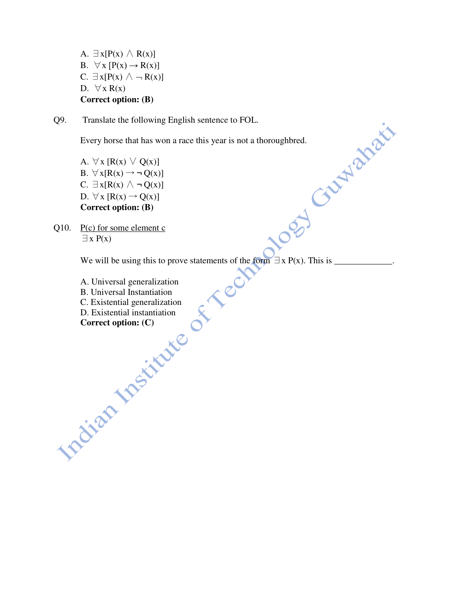

#### 2026 Q8

**Question recap:** How is registered → won a race represented?

**Answer:** B — $\forall x\,[P(x)\rightarrow R(x)]$.

**Why:** Registration is the antecedent and having won is the consequent. Replacing implication by conjunction would incorrectly assert that every horse is registered.

#### 2026 Q9

**Question recap:** How is won a race → not thoroughbred represented?

**Answer:** B — $\forall x\,[R(x)\rightarrow\neg Q(x)]$.

**Why:** The antecedent is having won a race, so the supplied English sentence becomes $\forall x[R(x)\rightarrow\neg Q(x)]$. Here it is a sentence to translate. It would not follow from only $P\rightarrow\neg Q$ and $P\rightarrow R$: an unregistered thoroughbred winner is a counterexample to that inference. The older 2024 copy uses misleading “therefore” wording.

#### 2026 Q10

**Question recap:** What rule derives existence from P(c)?

**Answer:** C — Existential generalisation.

**Why:** A known witness c is enough to conclude $\exists x\,P(x)$. Existential instantiation goes in the other direction and introduces a fresh witness.

[Back to year index](#2026) · [All weeks](README.md)

---

## 2025

Public copy of 2025 assignment solutions. Highlights are preserved; corrections and wording issues are identified below.

[Source](https://www.scribd.com/document/937061874/NPTEL)

Jump to discussion: [Q1](#2025-q1) · [Q2](#2025-q2) · [Q3](#2025-q3) · [Q4](#2025-q4) · [Q5](#2025-q5) · [Q6](#2025-q6) · [Q7](#2025-q7) · [Q8](#2025-q8) · [Q9](#2025-q9) · [Q10](#2025-q10)

### 2025 — Page 01

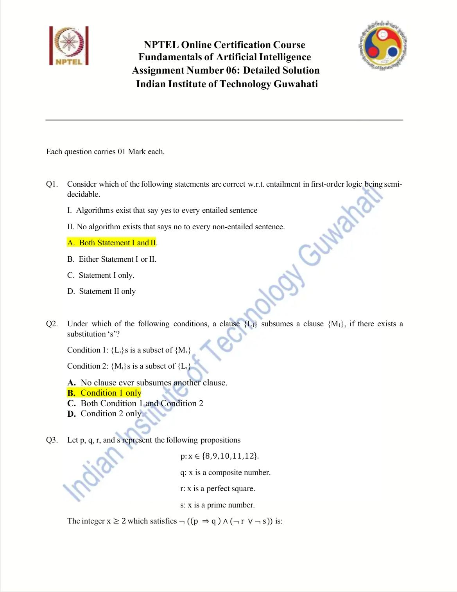

#### 2025 Q1

**Question recap:** Which semidecidability statements are correct?

**Answer:** A — Both I and II.

**Why:** A complete proof procedure eventually verifies entailments. It cannot generally guarantee a terminating negative answer when entailment fails. Individual negative cases may still be established; semidecidability concerns the absence of a general procedure guaranteed to decide every case.

#### 2025 Q2

**Question recap:** When does the first clause subsume the second?

**Answer:** B — Condition 1 only.

**Why:** Some substitution must make the first clause's literal set a subset of the second. Reversing the subset relation changes which clause is more general.

### 2025 — Page 02

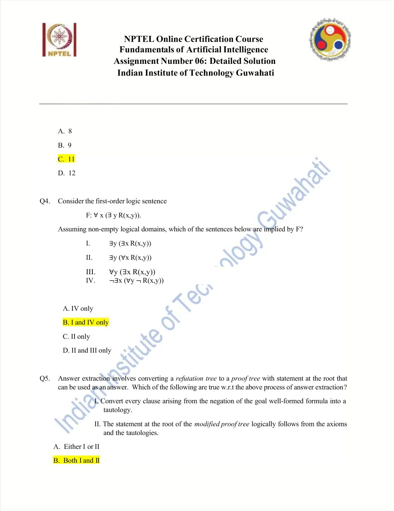

#### 2025 Q3

**Question recap:** Which candidate integer satisfies the negated formula?

**Answer:** C — 11.

**Why:** For 11, p is true and composite-number q is false, so $p\rightarrow q$ is false. Its conjunction is false and the outer negation is true. The other listed numbers make the unnegated conjunction true.

#### 2025 Q4

**Question recap:** What follows from every x having some related y?

**Answer:** B — I and IV only.

**Why:** For a nonempty domain, $\forall x\exists yR(x,y)$ entails an existing related pair and its quantifier-negated restatement IV. It does not require one common y: equality on $\{a,b\}$ is a counterexample. Nor must every y receive a relation: taking $R(x,y)$ to mean $y=a$ satisfies the premise but leaves b without an incoming relation. These are two separate counterexamples.

### 2025 — Page 03

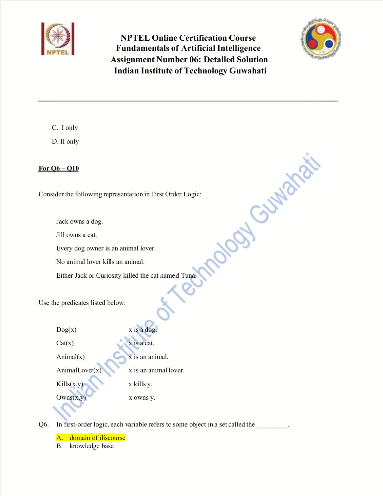

#### 2025 Q5

**Question recap:** Which answer-extraction statements hold?

**Answer:** B — Both I and II.

**Why:** In the stated construction, goal-derived clauses are turned into tautologies and answer information is propagated through the modified proof. Its resulting root statement follows from the axioms rather than from an inconsistent negated goal.

### 2025 — Page 04

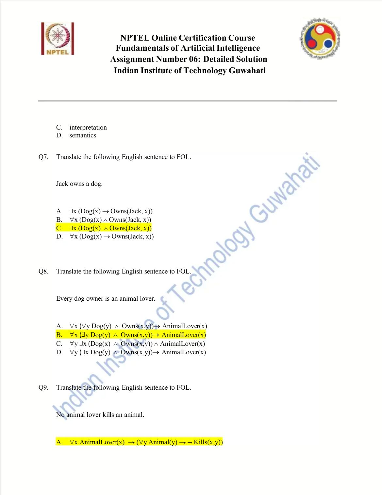

#### 2025 Q6

**Question recap:** What do variables range over?

**Answer:** A — The domain of discourse.

**Why:** A variable denotes an object from the chosen domain. The knowledge base is a set of sentences about those objects, rather than the set of possible values itself.

#### 2025 Q7

**Question recap:** How is Jack's dog ownership expressed?

**Answer:** C — $\exists x[Dog(x)\land Owns(Jack,x)]$.

**Why:** One witness must be a dog and be owned by Jack. An implication under an existential quantifier could hold merely because its witness is not a dog.

#### 2025 Q8

**Question recap:** How is every dog owner being an animal lover expressed?

**Answer:** B — $\forall x[(\exists y(Dog(y)\land Owns(x,y)))\rightarrow AnimalLover(x)]$.

**Why:** The existence of at least one owned dog triggers the conclusion. It does not require owning all dogs.

### 2025 — Page 05

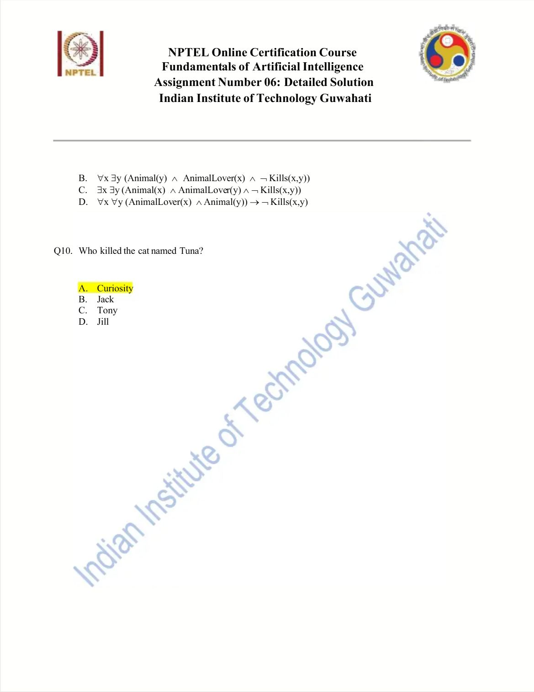

#### 2025 Q9

**Question recap:** How is the prohibition on animal lovers killing animals expressed?

**Answer:** A in the source — Nested universal implications.

**Why:** A clear equivalent is $\forall x\forall y[(AnimalLover(x)\land Animal(y))\rightarrow\neg Kills(x,y)]$. Preserve the scope of both quantifiers and the conditional restriction.

#### 2025 Q10

**Question recap:** Who killed Tuna in the intended puzzle?

**Answer:** A — Curiosity.

**Why:** Jack owns a dog, hence is an animal lover and cannot be the animal-killer. The either-Jack-or-Curiosity premise then leaves Curiosity. This relies on the intended background fact that a cat is an animal; the abbreviated list should include that fact explicitly.

[Back to year index](#2025) · [All weeks](README.md)

---

## 2024

Public copy of the 2024 assignment. Selected radio buttons are unsubmitted choices, not an official answer key.

[Source](https://www.scribd.com/document/996718078/Fundamentals-of-Artificial-Intelligence-Unit-9-Week-6-Knowledge-Representation-and-Reasoning-III)

Jump to discussion: [Q1](#2024-q1) · [Q2](#2024-q2) · [Q3](#2024-q3) · [Q4](#2024-q4) · [Q5](#2024-q5) · [Q6](#2024-q6) · [Q7](#2024-q7) · [Q8](#2024-q8) · [Q9](#2024-q9) · [Q10](#2024-q10)

### 2024 — Page 01

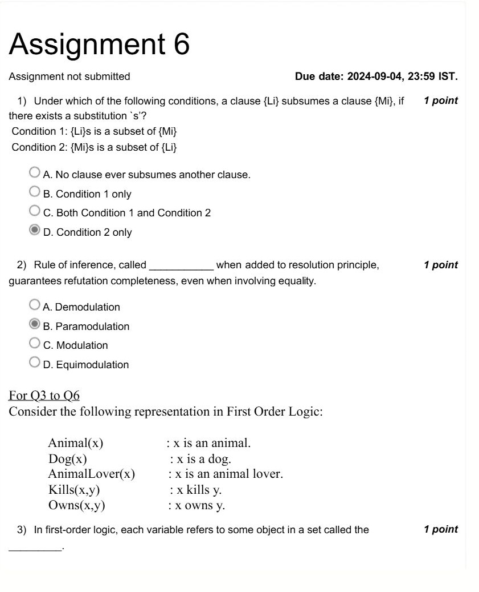

#### 2024 Q1

**Question recap:** Which subsumption condition is correct?

**Answer:** B — Condition 1 only.

**Why:** A substitution must make the first clause's literals a subset of the second clause's literals. This expresses that the first clause is at least as general.

#### 2024 Q2

**Question recap:** Which equality rule complements resolution?

**Answer:** B — Paramodulation.

**Why:** It permits replacement using equalities inside clauses. This supports complete refutation procedures for first-order reasoning that includes equality.

### 2024 — Page 02

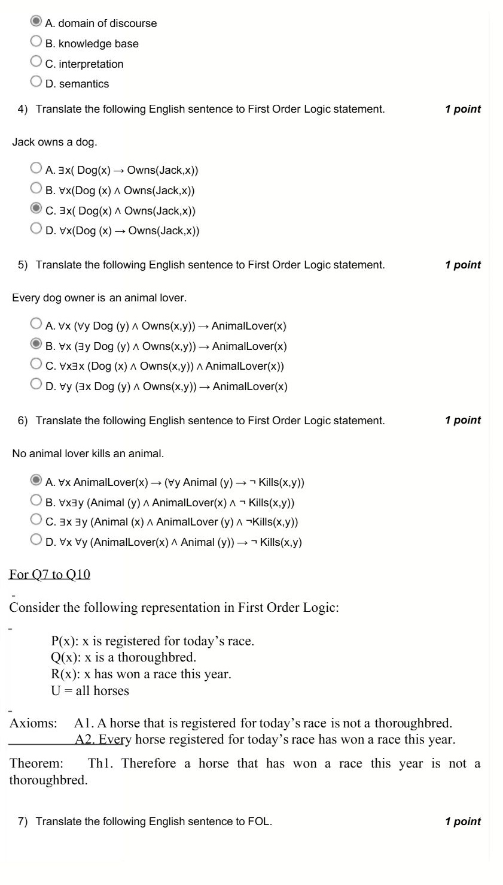

#### 2024 Q3

**Question recap:** What is the range of variable values called?

**Answer:** A — The domain of discourse.

**Why:** The domain supplies the objects that quantifiers range over. Predicates then specify properties or relationships of those objects.

#### 2024 Q4

**Question recap:** How is Jack owning a dog expressed?

**Answer:** C — $\exists x[Dog(x)\land Owns(Jack,x)]$.

**Why:** The same witness must satisfy both doghood and ownership by Jack. A universal conjunction would incorrectly say every object is Jack's dog.

#### 2024 Q5

**Question recap:** How is every dog owner being an animal lover expressed?

**Answer:** B — $\forall x[(\exists y(Dog(y)\land Owns(x,y)))\rightarrow AnimalLover(x)]$.

**Why:** Owning at least one dog is sufficient for the conclusion. This does not require ownership of every dog.

#### 2024 Q6

**Question recap:** How is the animal-killing prohibition expressed?

**Answer:** A — Nested universal implications, with the intended scope.

**Why:** A clear form is $\forall x\forall y[(AnimalLover(x)\land Animal(y))\rightarrow\neg Kills(x,y)]$. Both being an animal lover and the victim being an animal are conditions on the prohibition.

### 2024 — Page 03

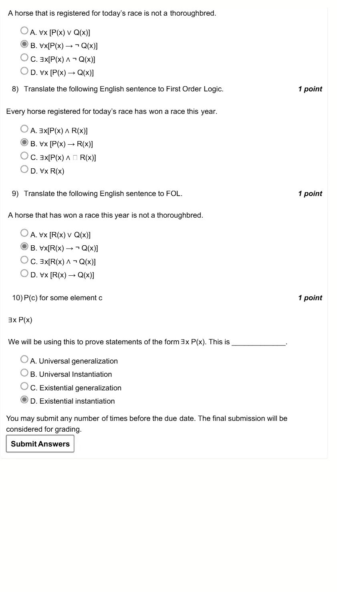

#### 2024 Q7

**Question recap:** How is registered → not thoroughbred translated?

**Answer:** B — $\forall x[P(x)\rightarrow\neg Q(x)]$.

**Why:** Since the domain is all horses, no additional Horse predicate is necessary. The formula is a general rule rather than an existential assertion.

#### 2024 Q8

**Question recap:** How is registered → won a race translated?

**Answer:** B — $\forall x[P(x)\rightarrow R(x)]$.

**Why:** The antecedent identifies registered horses. Do not reverse the implication: winners need not all be registered for today's race.

#### 2024 Q9

**Question recap:** How is won a race → not thoroughbred translated?

**Answer:** B — $\forall x[R(x)\rightarrow\neg Q(x)]$.

**Why:** This correctly translates the sentence, but it does not follow from the two preceding axioms alone. An unregistered thoroughbred could have won a race without violating either axiom; the source's “therefore” is not justified.

#### 2024 Q10

**Question recap:** Which inference concludes existence from a witness?

**Answer:** C — Existential generalisation.

**Why:** From $P(c)$ infer $\exists xP(x)$. The screenshot selects D, but existential instantiation goes from an existential premise to a fresh witness, so that selection is incorrect.

[Back to year index](#2024) · [All weeks](README.md)

---

## 2019

Official NPTEL archive with accepted answers. Any discrepancy between a printed formula and its key is identified below.

[Source](https://archive.nptel.ac.in/content/storage2/courses/downloads_new/112103280/Week_06_Assignment_6.pdf)

Jump to discussion: [Q1](#2019-q1) · [Q2](#2019-q2) · [Q3](#2019-q3) · [Q4](#2019-q4) · [Q5](#2019-q5) · [Q6](#2019-q6) · [Q7](#2019-q7) · [Q8](#2019-q8) · [Q9](#2019-q9) · [Q10](#2019-q10)

### 2019 — Page 01

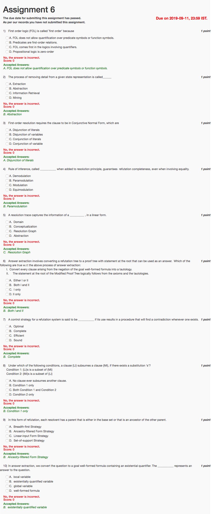

#### 2019 Q1

**Question recap:** Why is FOL first-order?

**Answer:** A — No quantification over predicate or function symbols.

**Why:** Its quantifiers range over domain objects. This differs from higher-order formalisms that can quantify over relations or functions.

#### 2019 Q2

**Question recap:** What is removing detail from a state representation called?

**Answer:** B — Abstraction.

**Why:** It retains features needed for a particular reasoning task while ignoring others. A simpler representation can reduce search, but omitted details may later matter for refinement.

#### 2019 Q3

**Question recap:** What does each CNF clause contain?

**Answer:** A — A disjunction of literals.

**Why:** The whole CNF sentence is a conjunction of these clauses. Do not confuse the OR inside each clause with the AND between clauses.

#### 2019 Q4

**Question recap:** Which equality inference rule augments resolution?

**Answer:** B — Paramodulation.

**Why:** It uses equalities to replace matching terms inside other clauses. This allows reasoning with equality beyond ordinary syntactic matching.

#### 2019 Q5

**Question recap:** What does a resolution trace linearise?

**Answer:** C — A resolution graph.

**Why:** It records the sequence of parent clauses, substitutions, and resolvents. That sequence preserves the derivation information in a readable linear record.

#### 2019 Q6

**Question recap:** Which answer-extraction statements hold?

**Answer:** B — Both I and II.

**Why:** The stated construction turns the goal-derived clauses into tautologies and propagates answer information. The modified proof's root is then justified by the axioms and those tautologies.

#### 2019 Q7

**Question recap:** What property guarantees that a refutation will be found when one exists?

**Answer:** B — Completeness.

**Why:** Soundness prevents invalid conclusions; completeness ensures the procedure does not miss a required valid refutation. Efficiency and optimality are different properties.

#### 2019 Q8

**Question recap:** Which subsumption condition holds?

**Answer:** B — Condition 1 only.

**Why:** Instantiate the first clause so that its literals are a subset of the second clause's literals. The reverse condition would describe the opposite generality relationship.

#### 2019 Q9

**Question recap:** Which strategy permits a base clause or an ancestor as a parent?

**Answer:** B — Ancestry-filtered form strategy.

**Why:** The permitted ancestry relationship restricts the resolution search while following a derivation chain. The stricter linear-input form requires an original input clause as one parent.

#### 2019 Q10

**Question recap:** Which variable's binding supplies an extracted answer?

**Answer:** B — The existentially quantified variable.

**Why:** It marks the unknown object requested by the question. The proof determines a witness or substitution that makes the goal hold.

[Back to year index](#2019) · [All weeks](README.md)

---
