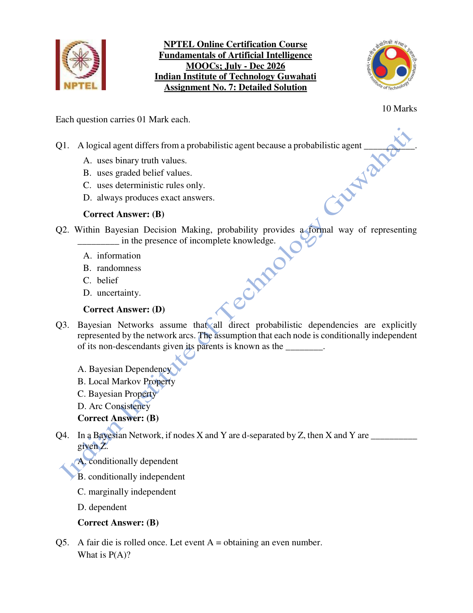
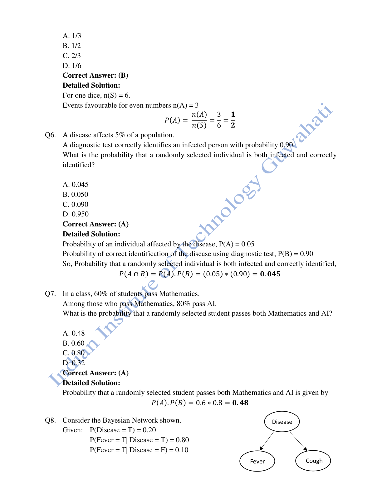
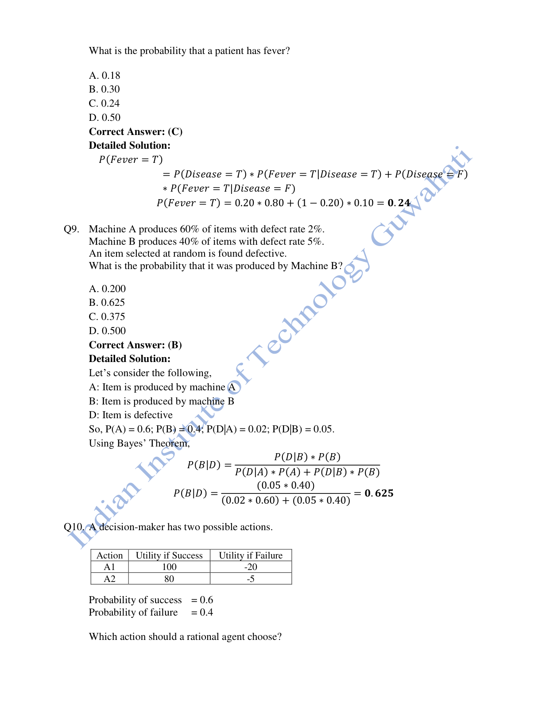
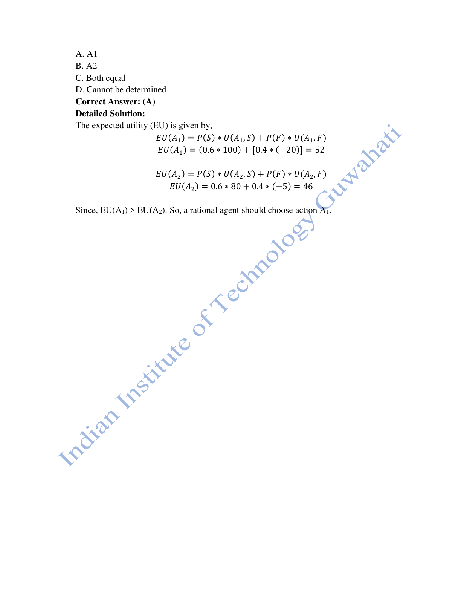
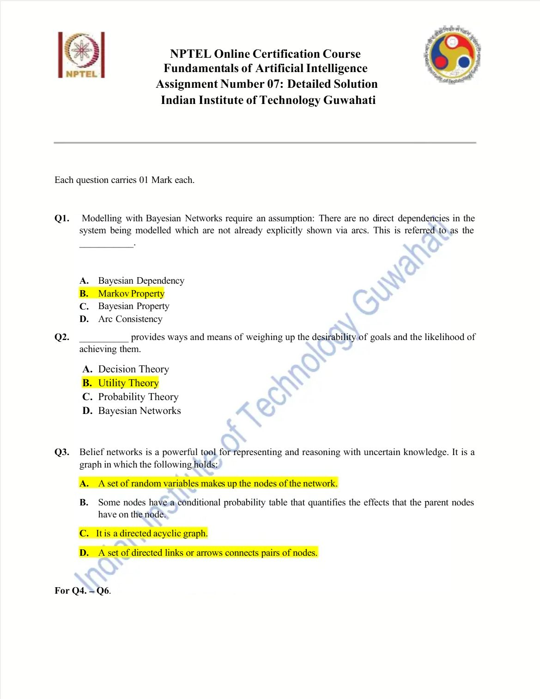
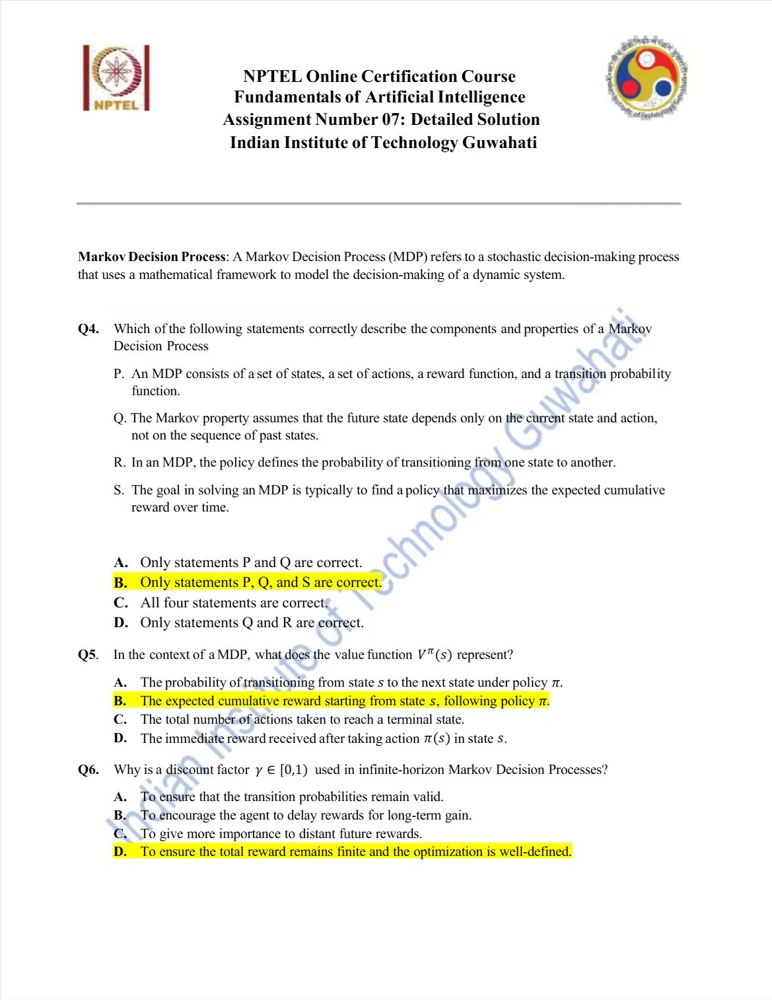
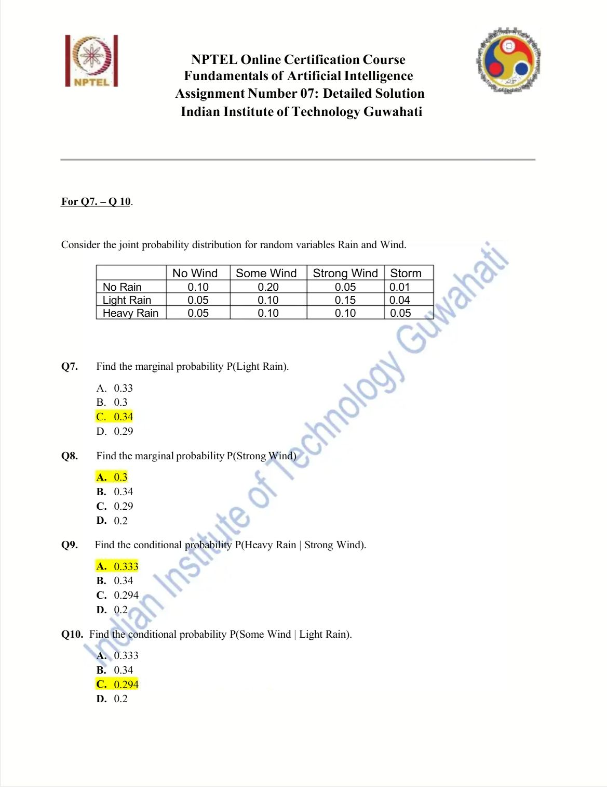
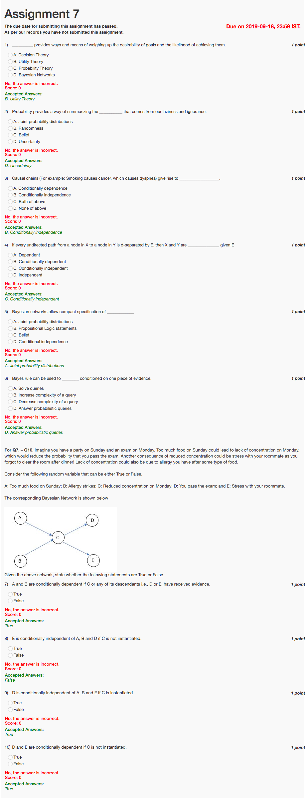

# Week 07 — Reasoning under Uncertainty

[All weeks](README.md) · [Previous](Week%2006.md) · [Next](Week%2008.md)

[2026](#2026) · [2025](#2025) · [2019](#2019)

Screenshots appear inline. Each question has a short recap, answer, and explanation below the relevant page.

## 2026

Official solution linked from the enrolled 2026 course; checked against the live weekly assessment.

[Source](https://drive.google.com/file/d/1_5Z-gfbQuYIMXqKKuugv0mk98tLZoweY/view)

Jump to discussion: [Q1](#2026-q1) · [Q2](#2026-q2) · [Q3](#2026-q3) · [Q4](#2026-q4) · [Q5](#2026-q5) · [Q6](#2026-q6) · [Q7](#2026-q7) · [Q8](#2026-q8) · [Q9](#2026-q9) · [Q10](#2026-q10)

### 2026 — Page 01

#### 2026 Q1

**Question recap:** How does a probabilistic agent represent belief?

**Answer:** B — With graded values.

**Why:** Instead of assigning only true or false, it can assign probabilities that express uncertainty. A probability is a degree of belief under the model, not a guarantee of correctness.

#### 2026 Q2

**Question recap:** What does probability represent in Bayesian decisions?

**Answer:** D — Uncertainty.

**Why:** It allows incomplete knowledge and noisy evidence to be handled quantitatively. Utilities are separately needed to decide which outcomes the agent prefers.

#### 2026 Q3

**Question recap:** What is the local Markov property of a Bayesian network?

**Answer:** B — A node is conditionally independent of its non-descendants given its parents.

**Why:** Once its direct causes in the graph are known, those non-descendant variables supply no further information about that node under the network model.

#### 2026 Q4

**Question recap:** What follows from d-separation?

**Answer:** B — Conditional independence given Z.

**Why:** Blocking all relevant paths between X and Y with Z yields a conditional-independence implication of the graph. It does not necessarily imply marginal independence.

### 2026 — Page 02

#### 2026 Q5

**Question recap:** What is the chance of an even result on a fair die?

**Answer:** B — $1/2$.

**Why:** Outcomes 2, 4, and 6 are favourable among six equally likely outcomes, giving $3/6$.

#### 2026 Q6

**Question recap:** What is the probability of infection and correct detection?

**Answer:** A — 0.045.

**Why:** Use the conditional multiplication rule: $P(I\cap T)=P(I)P(T\mid I)=0.05\times0.90$. The test sensitivity is conditional; independence is not assumed.

#### 2026 Q7

**Question recap:** What is the probability of passing both subjects?

**Answer:** A — 0.48.

**Why:** $P(M\cap AI)=P(M)P(AI\mid M)=0.6\times0.8$. The phrase “among those who pass Mathematics” supplies the conditional probability.

### 2026 — Page 03

#### 2026 Q8

**Question recap:** What is the marginal probability of fever?

**Answer:** C — 0.24.

**Why:** Sum the two disease cases: $0.2\times0.8+0.8\times0.1=0.24$. The second term includes people without the disease who still have fever.

#### 2026 Q9

**Question recap:** Which machine probably made a defective item?

**Answer:** B — $P(B\mid D)=0.625$.

**Why:** Machine B contributes $0.4\times0.05=0.020$ defective probability; total defective probability is $0.012+0.020=0.032$. Their ratio is $0.020/0.032$.

### 2026 — Page 04

#### 2026 Q10

**Question recap:** Which action maximises expected utility?

**Answer:** A — A1.

**Why:** $EU(A1)=0.6(100)+0.4(-20)=52$, while $EU(A2)=0.6(80)+0.4(-5)=46$. Include failure losses when comparing actions.

[Back to year index](#2026) · [All weeks](README.md)

---

## 2025

Public copy of 2025 assignment solutions. Highlights are preserved; corrections and wording issues are identified below.

[Source](https://www.scribd.com/document/937061874/NPTEL)

Jump to discussion: [Q1](#2025-q1) · [Q2](#2025-q2) · [Q3](#2025-q3) · [Q4](#2025-q4) · [Q5](#2025-q5) · [Q6](#2025-q6) · [Q7](#2025-q7) · [Q8](#2025-q8) · [Q9](#2025-q9) · [Q10](#2025-q10)

### 2025 — Page 01

#### 2025 Q1

**Question recap:** What network assumption is being described?

**Answer:** B — The Markov property.

**Why:** The graph encodes conditional independences: a node is independent of its non-descendants given its parents. Missing direct arcs are therefore meaningful within the assumed model.

#### 2025 Q2

**Question recap:** Which theory is named for weighing goals and their likelihood?

**Answer:** B — Utility theory in the source key; the wording is loose.

**Why:** Utility quantifies desirability, probability quantifies likelihood, and decision theory combines both. For this repeated course wording, distinguish the printed key from the broader technical description.

#### 2025 Q3

**Question recap:** Which listed Bayesian-network properties are correct?

**Answer:** A, C, and D.

**Why:** Random variables are nodes, directed arcs connect them, and the graph is acyclic. Every node needs a conditional distribution, including a prior for a parentless node; “some nodes” is the intended flaw in option B.

### 2025 — Page 02

#### 2025 Q4

**Question recap:** Which MDP statements are correct?

**Answer:** B — P, Q, and S.

**Why:** An MDP includes states, actions, transition probabilities, and rewards; its goal is a policy maximising cumulative reward. A policy chooses actions, while the transition model describes next-state probabilities.

#### 2025 Q5

**Question recap:** What does the policy value function represent?

**Answer:** B — Expected cumulative return from a state under that policy.

**Why:** It averages over trajectories generated while following the policy. It is neither the immediate reward nor a transition probability.

#### 2025 Q6

**Question recap:** Why use a discount factor below one?

**Answer:** D — To keep the infinite-horizon return finite and well-defined, for bounded rewards.

**Why:** The geometric series converges when $0\leq\gamma<1$. More distant rewards receive less weight, not more.

### 2025 — Page 03

#### 2025 Q7

**Question recap:** What is the marginal probability of light rain?

**Answer:** C — 0.34.

**Why:** Sum the light-rain row: $0.05+0.10+0.15+0.04=0.34$. Marginalisation sums over all possible wind conditions.

#### 2025 Q8

**Question recap:** What is the marginal probability of strong wind?

**Answer:** A — 0.30.

**Why:** Sum the strong-wind column: $0.05+0.15+0.10=0.30$. Do not use only the heavy-rain cell.

#### 2025 Q9

**Question recap:** What is P(heavy rain given strong wind)?

**Answer:** A — Approximately 0.333.

**Why:** Divide the joint cell by the conditioning marginal: $0.10/0.30=1/3$.

#### 2025 Q10

**Question recap:** What is P(some wind given light rain)?

**Answer:** C — Approximately 0.294.

**Why:** Divide $P(SomeWind,LightRain)=0.10$ by $P(LightRain)=0.34$. The denominator must correspond to the event after the conditioning bar.

[Back to year index](#2025) · [All weeks](README.md)

---

## 2019

Official NPTEL archive with accepted answers. Any discrepancy between a printed formula and its key is identified below.

[Source](https://archive.nptel.ac.in/content/storage2/courses/downloads_new/112103280/Week_07_Assignment_7.pdf)

Jump to discussion: [Q1](#2019-q1) · [Q2](#2019-q2) · [Q3](#2019-q3) · [Q4](#2019-q4) · [Q5](#2019-q5) · [Q6](#2019-q6) · [Q7](#2019-q7) · [Q8](#2019-q8) · [Q9](#2019-q9) · [Q10](#2019-q10)

### 2019 — Page 01

#### 2019 Q1

**Question recap:** Which theory is highlighted for goals and their likelihood?

**Answer:** B — Utility theory in the official archive key.

**Why:** Utility measures desirability; probability measures likelihood; decision theory combines them. The course uses this loose wording repeatedly, so preserve its expected key while remembering the distinction.

#### 2019 Q2

**Question recap:** What does probability summarise about incomplete knowledge?

**Answer:** D — Uncertainty.

**Why:** It represents graded beliefs when detailed causes or facts are unavailable. “Laziness and ignorance” refers to limited modelling effort and missing information, rather than a mathematical fault of probability.

#### 2019 Q3

**Question recap:** What independence occurs in a causal chain?

**Answer:** B — Conditional independence of the endpoints given the middle node.

**Why:** In $X\rightarrow Y\rightarrow Z$, observing Y blocks the path from X to Z under the network assumptions. The endpoints can still be marginally dependent.

#### 2019 Q4

**Question recap:** What does d-separation by E imply?

**Answer:** C — Conditional independence given E.

**Why:** If every path is blocked under the d-separation rules, evidence about one set supplies no additional information about the other once E is known.

#### 2019 Q5

**Question recap:** What distribution can a Bayesian network specify compactly?

**Answer:** A — A joint probability distribution.

**Why:** Factor it as the product of each node's conditional distribution given its parents. Conditional independence can make this much smaller than a full joint table.

#### 2019 Q6

**Question recap:** What does Bayes' rule answer?

**Answer:** D — Probabilistic queries conditioned on evidence.

**Why:** It updates a prior using the likelihood of the observed evidence and normalises the result. Conditioning must use the correct event in the denominator.

#### 2019 Q7

**Question recap:** Does observing C or a descendant activate the A–C–B collider?

**Answer:** True, in the intended network interpretation.

**Why:** A and B both influence C. Evidence about their common effect, or its descendants, can make the causes dependent through explaining away.

#### 2019 Q8

**Question recap:** Is E independent of A, B, and D without observing C?

**Answer:** False.

**Why:** Paths through the unobserved concentration variable C remain open. In particular, C is a common cause connecting D and E.

#### 2019 Q9

**Question recap:** Is D independent of A, B, and E after observing C?

**Answer:** True.

**Why:** Conditioning on C blocks the chains and fork paths connecting D to those other variables in the displayed graph.

#### 2019 Q10

**Question recap:** Can D and E be dependent while C is unobserved?

**Answer:** True.

**Why:** They share the common cause C. Learning about one can change beliefs about C and therefore about the other; observing C blocks that connection.

[Back to year index](#2019) · [All weeks](README.md)

---
