# Week 08 — Planning

[All weeks](README.md) · [Previous](Week%2007.md) · [Next](Week%2009.md)

[2026](#2026) · [2025](#2025) · [2024](#2024) · [2019](#2019)

Screenshots appear inline. Each question has a short recap, answer, and explanation below the relevant page.

## 2026

Official solution linked from the enrolled 2026 course; checked against the live weekly assessment.

[Source](https://drive.google.com/file/d/1dGROso4Eesu3GyD61EybRmq8zb8Ekjgz/view)

Jump to discussion: [Q1](#2026-q1) · [Q2](#2026-q2) · [Q3](#2026-q3) · [Q4](#2026-q4) · [Q5](#2026-q5) · [Q6](#2026-q6) · [Q7](#2026-q7) · [Q8](#2026-q8) · [Q9](#2026-q9) · [Q10](#2026-q10)

### 2026 — Page 01

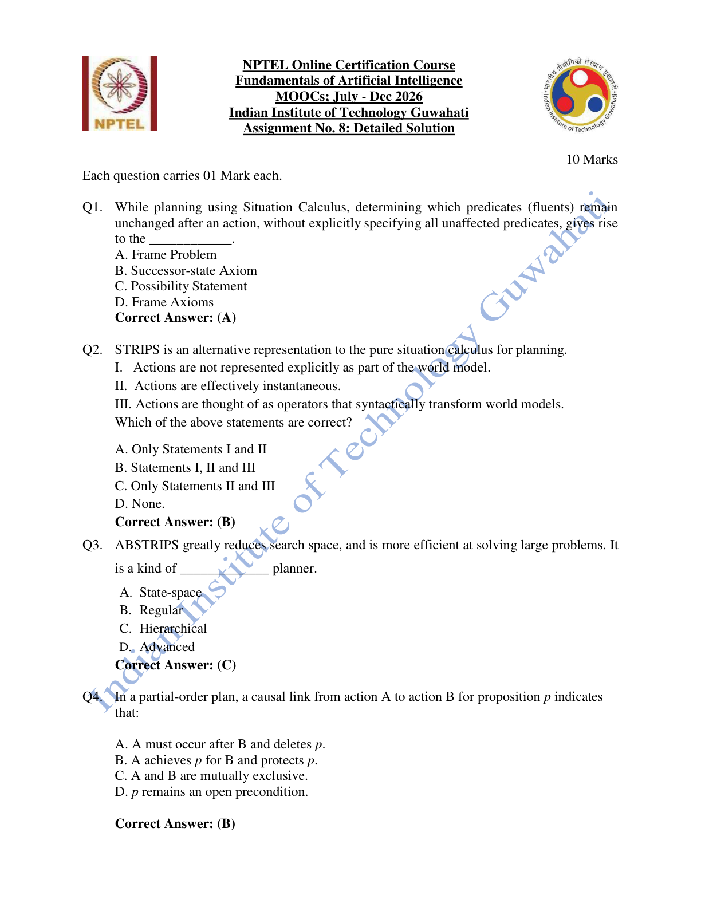

#### 2026 Q1

**Question recap:** What is the frame problem?

**Answer:** A — Specifying what remains unchanged after an action.

**Why:** Listing only effects is easy; representing all unaffected facts compactly is the difficulty. Frame axioms and successor-state axioms are ways to address it.

#### 2026 Q2

**Question recap:** Which STRIPS statements are intended to hold?

**Answer:** B — I, II, and III.

**Why:** In the course's formulation, actions are operators outside the represented world-state facts, are treated as instantaneous, and transform states through preconditions and add/delete effects. Statement I does not mean that STRIPS has no explicit action descriptions.

#### 2026 Q3

**Question recap:** What kind of planner is ABSTRIPS?

**Answer:** C — Hierarchical.

**Why:** It first reasons at an abstract level and then adds detail. Ignoring lower-priority conditions initially can reduce the early search space.

#### 2026 Q4

**Question recap:** What does a causal link A —p→ B mean?

**Answer:** B — A supplies p needed by B, and p must be protected in between.

**Why:** A threatening action could delete p before B uses it. The plan therefore constrains such actions to preserve the link.

### 2026 — Page 02

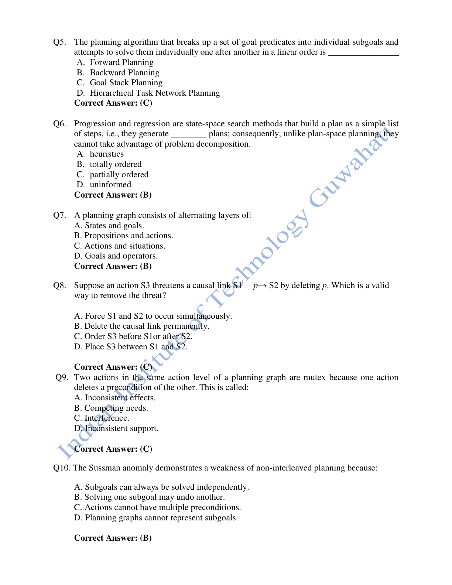

#### 2026 Q5

**Question recap:** Which method handles subgoals using a stack?

**Answer:** C — Goal-stack planning.

**Why:** It pushes required goals, preconditions, and actions onto a stack and resolves them in sequence. Interacting goals can expose limitations of a rigid ordering.

#### 2026 Q6

**Question recap:** What kind of plan do basic progression and regression produce?

**Answer:** B — Totally ordered plans.

**Why:** Their state-space search constructs a single sequence of actions. Plan-space methods can leave unrelated actions unordered and exploit that flexibility.

#### 2026 Q7

**Question recap:** What layers alternate in a planning graph?

**Answer:** B — Propositions and actions.

**Why:** An action layer contains applicable actions, and the next proposition layer contains their possible effects. Mutex information records incompatibilities.

#### 2026 Q8

**Question recap:** How can a deleting threat be removed?

**Answer:** C — Put S3 before S1 or after S2.

**Why:** A deletion threatens p only between the action that establishes it and the action that consumes it. Ordering S3 outside that interval protects the causal link.

#### 2026 Q9

**Question recap:** What is deletion of another action's precondition called?

**Answer:** C — Interference.

**Why:** One action prevents the other from being applicable. Inconsistent effects instead involve opposing effects; competing needs involve mutex preconditions.

#### 2026 Q10

**Question recap:** What does the Sussman anomaly demonstrate?

**Answer:** B — Solving one subgoal can undo another.

**Why:** Blocks-world goals can interact, requiring their action sequences to be interleaved. Finishing each subgoal independently can force unnecessary undoing.

[Back to year index](#2026) · [All weeks](README.md)

---

## 2025

Public copy of 2025 assignment solutions. Highlights are preserved; corrections and wording issues are identified below.

[Source](https://www.scribd.com/document/937061874/NPTEL)

Jump to discussion: [Q1](#2025-q1) · [Q2](#2025-q2) · [Q3](#2025-q3) · [Q4](#2025-q4) · [Q5](#2025-q5) · [Q6](#2025-q6) · [Q7](#2025-q7) · [Q8](#2025-q8) · [Q9](#2025-q9) · [Q10](#2025-q10)

### 2025 — Page 01

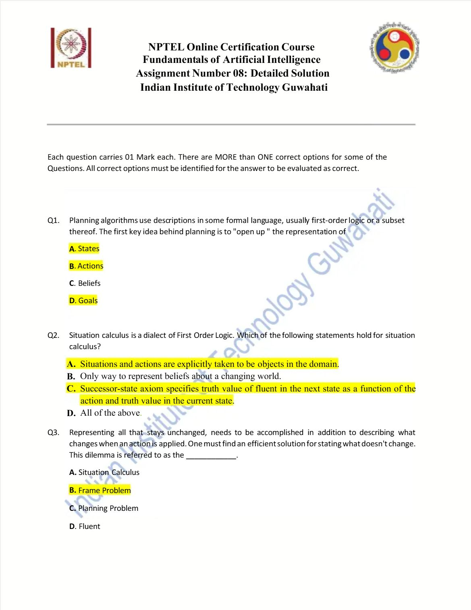

#### 2025 Q1

**Question recap:** Which representations does planning open up?

**Answer:** A, B, and D — States, actions, and goals.

**Why:** Their internal logical structure lets a planner reason about relevant conditions and effects. Treating them as opaque search labels loses that advantage.

#### 2025 Q2

**Question recap:** Which situation-calculus claims hold?

**Answer:** A and C.

**Why:** Situations and actions are domain objects, and successor-state axioms describe fluent values after actions. Situation calculus is one representation of changing worlds, not the only possible one.

#### 2025 Q3

**Question recap:** What is the unchanged-facts dilemma called?

**Answer:** B — The frame problem.

**Why:** An action changes a few facts while leaving many others unaffected. The challenge is to represent those persistent facts without listing every non-effect separately.

### 2025 — Page 02

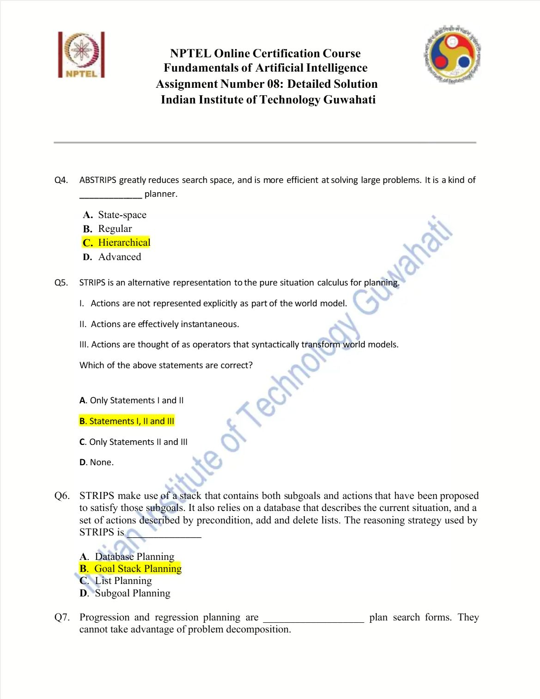

#### 2025 Q4

**Question recap:** What type of planner is ABSTRIPS?

**Answer:** C — Hierarchical.

**Why:** It plans with abstractions and progressively restores detail. This can reduce the initial search burden on large problems.

#### 2025 Q5

**Question recap:** Which STRIPS statements are intended to hold?

**Answer:** B — I, II, and III.

**Why:** Actions are instantaneous operators that transform the world-state description. Saying they are outside the world model refers to state facts, not to an absence of explicit operator definitions.

#### 2025 Q6

**Question recap:** What stack-based strategy is used in the stated STRIPS procedure?

**Answer:** B — Goal-stack planning.

**Why:** The stack contains goals, subgoals, and proposed actions. Preconditions are resolved before the associated action is executed.

### 2025 — Page 03

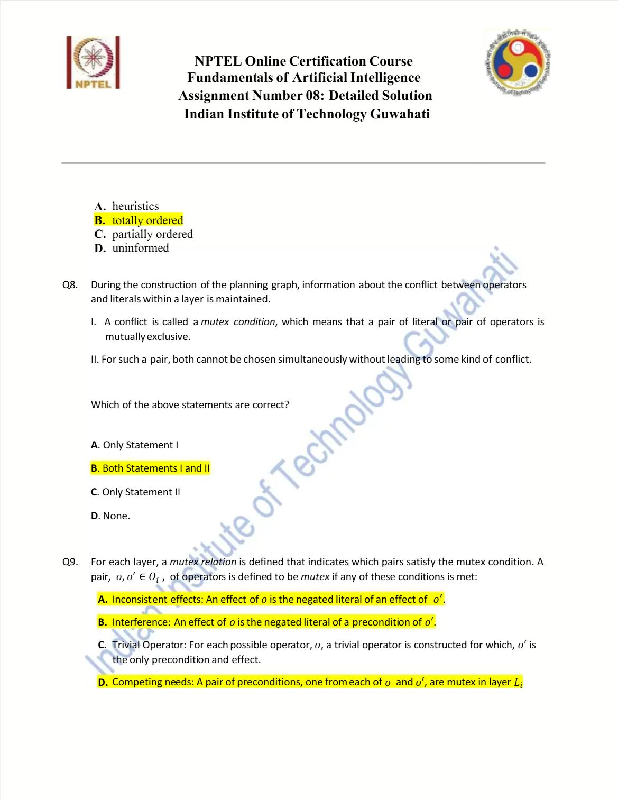

#### 2025 Q7

**Question recap:** What order do progression and regression impose?

**Answer:** B — Total ordering.

**Why:** Basic state-space planning produces a sequence of steps. Partial-order planning instead constrains only necessary action orderings.

#### 2025 Q8

**Question recap:** What does a mutex relation mean?

**Answer:** B — Both I and II.

**Why:** It records a pair of actions or literals that cannot jointly be chosen at that layer without conflict. Mutex information helps exclude impossible combinations.

#### 2025 Q9

**Question recap:** Which conditions make actions mutex?

**Answer:** A, B, and D.

**Why:** Inconsistent effects, interference, and competing needs can prevent simultaneous execution. A persistence or no-op operator carries a fact forward and is not itself a general mutex condition.

### 2025 — Page 04

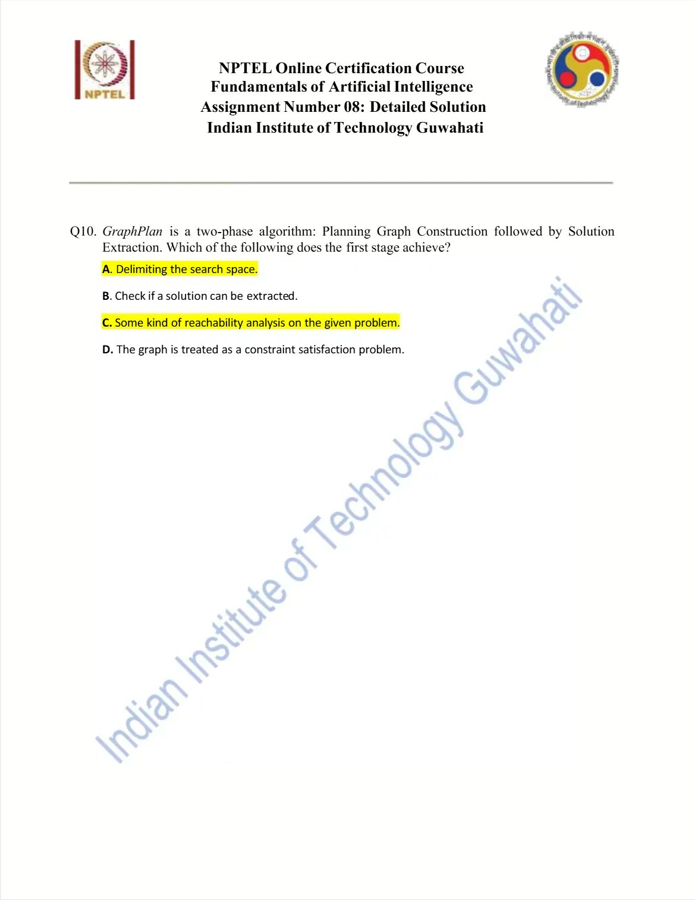

#### 2025 Q10

**Question recap:** What does GraphPlan's construction phase do?

**Answer:** A and C.

**Why:** It bounds the search space and performs reachability analysis with mutex constraints. Extracting a consistent plan is the later backward-search phase.

[Back to year index](#2025) · [All weeks](README.md)

---

## 2024

Question screenshots captured from MY SWAYAM’s public 2024 assignment video, linked to course noc24_ge47. The uploader’s unsubmitted choices, annotations, and occasional overlay text are preserved. They are not an official answer key; corrections and ambiguous wording are discussed below.

[Source](https://www.youtube.com/watch?v=fXetpMOrwzQ&t=35s)

Jump to discussion: [Q1](#2024-q1) · [Q2](#2024-q2) · [Q3](#2024-q3) · [Q4](#2024-q4) · [Q5](#2024-q5) · [Q6](#2024-q6) · [Q7](#2024-q7) · [Q8](#2024-q8) · [Q9](#2024-q9) · [Q10](#2024-q10)

### 2024 — Page 01

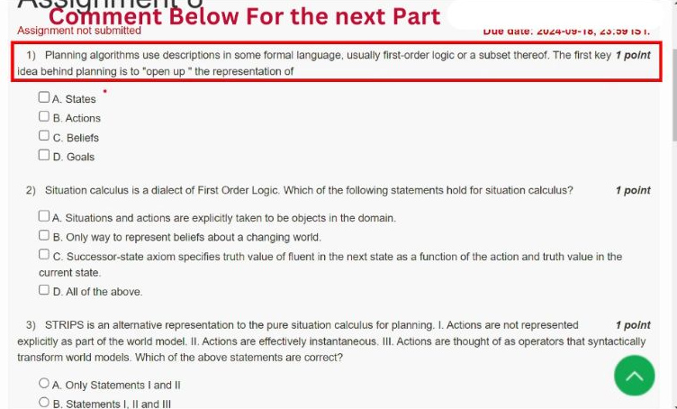

[Source video at 0:35](https://www.youtube.com/watch?v=fXetpMOrwzQ&t=35s)

#### 2024 Q1

**Question recap:** Which internal structures does planning exploit?

**Answer:** A, B, and D — States, actions, and goals.

**Why:** A logical description lets a planner inspect preconditions, effects, and goal components instead of treating states as opaque labels. This supports relevance reasoning and partial plans. Rules can be part of a planning representation, but they are not the three items named in this particular comparison.

### 2024 — Page 02

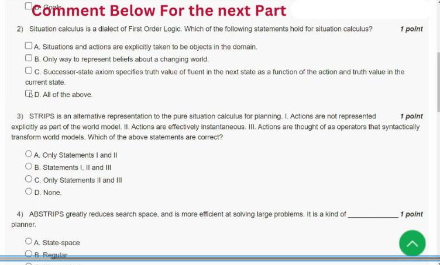

[Source video at 0:55](https://www.youtube.com/watch?v=fXetpMOrwzQ&t=55s)

#### 2024 Q2

**Question recap:** Which situation-calculus statements hold?

**Answer:** A and C.

**Why:** Actions and situations are objects in the formal domain, and successor-state axioms describe fluent truth after an action. Situation calculus is one way to represent change, not the only possible representation. A fluent is a property whose value can depend on the situation.

#### 2024 Q3

**Question recap:** Which STRIPS statements are intended?

**Answer:** B — I, II, and III.

**Why:** In basic STRIPS, actions are instantaneous operators that transform state descriptions through preconditions and add/delete effects. Saying actions are outside the world model concerns the state facts; the operators are still explicitly defined. This is a modelling assumption, not a claim that real actions take no time.

### 2024 — Page 03

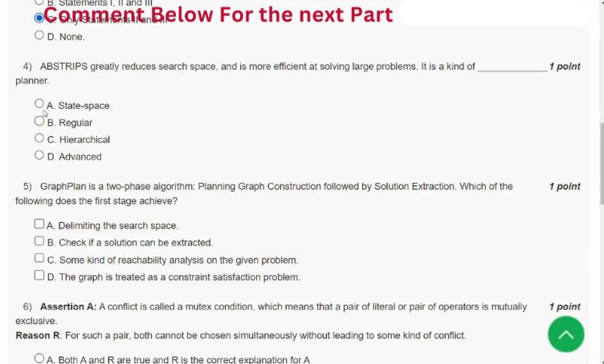

[Source video at 1:10](https://www.youtube.com/watch?v=fXetpMOrwzQ&t=70s)

#### 2024 Q4

**Question recap:** What type of planner is ABSTRIPS?

**Answer:** C — Hierarchical.

**Why:** ABSTRIPS first plans at an abstract level and progressively restores lower-priority details. That can reduce the initial search space. An abstract plan may still require refinement and checking when ignored conditions are brought back.

### 2024 — Page 04

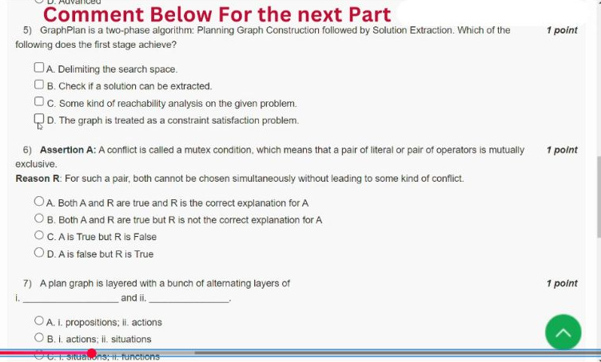

[Source video at 1:25](https://www.youtube.com/watch?v=fXetpMOrwzQ&t=85s)

#### 2024 Q5

**Question recap:** What does GraphPlan's construction stage accomplish?

**Answer:** A and C — Delimiting search and reachability analysis.

**Why:** Build alternating proposition/action layers and record mutex relations. An absent or mutually exclusive goal combination rules out a plan at that level. Finding a consistent set of actions is the later solution-extraction search, rather than the construction stage itself.

#### 2024 Q6

**Question recap:** Does the stated conflict explain a mutex condition?

**Answer:** A — Both statements are true and the reason explains the assertion.

**Why:** A mutex pair cannot be jointly selected at the relevant layer without conflict. For actions, conflicting effects, deleted preconditions, or mutex preconditions can establish this. Proposition mutex relations also restrict compatible goal combinations.

### 2024 — Page 05

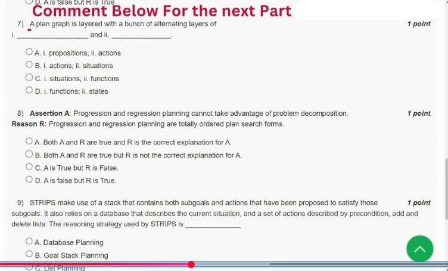

[Source video at 1:55](https://www.youtube.com/watch?v=fXetpMOrwzQ&t=115s)

#### 2024 Q7

**Question recap:** What layers alternate in a planning graph?

**Answer:** A — Propositions and actions.

**Why:** Start with facts, add currently possible actions, then collect their effects as the next fact layer. Persistence actions carry an unchanged fact forward. Mutex information records combinations that cannot occur together at a particular layer.

#### 2024 Q8

**Question recap:** Why does the course contrast progression/regression with decomposition?

**Answer:** A — The intended assertion–reason answer for basic state-space planning.

**Why:** Basic progression and regression search commit to a totally ordered action sequence. A partial-order planner can leave unrelated steps unordered and avoid choosing every interleaving early. This is the course's comparison of basic algorithms; it is not a theorem that every extended progression planner is incapable of using decomposition or helpful heuristics.

### 2024 — Page 06

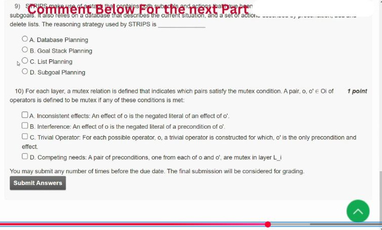

[Source video at 2:25](https://www.youtube.com/watch?v=fXetpMOrwzQ&t=145s)

#### 2024 Q9

**Question recap:** Which strategy uses a stack of goals and proposed actions?

**Answer:** B — Goal-stack planning.

**Why:** To achieve a goal, push a relevant action and its preconditions; resolve those preconditions before executing the action. Update the state through add/delete effects. Interacting goals can require undoing work or interleaving actions, which is why independent goal completion can fail.

#### 2024 Q10

**Question recap:** Which conditions make two actions mutex?

**Answer:** A, B, and D.

**Why:** Inconsistent effects produce opposite literals; interference deletes a required precondition; competing needs arise from mutex preconditions. A persistence/no-op operator simply carries a fact forward and is not itself a fourth general conflict condition. Check the relationship between the two actions, not merely whether either is a no-op.

[Back to year index](#2024) · [All weeks](README.md)

---

## 2019

Official NPTEL archive with accepted answers. Any discrepancy between a printed formula and its key is identified below.

[Source](https://archive.nptel.ac.in/content/storage2/courses/downloads_new/112103280/Week_08_Assignment_8.pdf)

Jump to discussion: [Q1](#2019-q1) · [Q2](#2019-q2) · [Q3](#2019-q3) · [Q4](#2019-q4) · [Q5](#2019-q5) · [Q6](#2019-q6) · [Q7](#2019-q7) · [Q8](#2019-q8) · [Q9](#2019-q9) · [Q10](#2019-q10)

### 2019 — Page 01

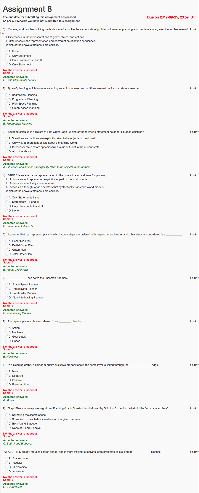

#### 2019 Q1

**Question recap:** Which representation differences distinguish planning from basic search?

**Answer:** C — Both I and II.

**Why:** Planning exposes the logical structure of goals, states, and actions and can manipulate partially specified action sequences. Basic problem solving often treats states more opaquely.

#### 2019 Q2

**Question recap:** Which planner applies currently applicable actions forward?

**Answer:** B — Progression planning.

**Why:** Start at the initial state, select an action whose preconditions hold, and compute its successor. Regression instead reasons backward from goals.

#### 2019 Q3

**Question recap:** Which situation-calculus statement is correct?

**Answer:** A — Actions and situations are domain objects.

**Why:** This permits explicit reasoning about change. Successor-state axioms describe the next situation, so the option limited to the current state is not the correct definition.

#### 2019 Q4

**Question recap:** Which STRIPS statements are intended to hold?

**Answer:** B — I, II, and III.

**Why:** Operators are external to the world-state facts, act instantaneously in the basic model, and modify those facts through effects. The formalism still explicitly defines each operator.

#### 2019 Q5

**Question recap:** What plan leaves unrelated actions unordered?

**Answer:** B — A partial-order plan.

**Why:** It records only required precedence constraints. Multiple total sequences may be consistent with the same partial-order plan.

#### 2019 Q6

**Question recap:** Which planner handles the Sussman anomaly?

**Answer:** B — An interleaving planner.

**Why:** Interacting subgoals may need actions from their solution sequences mixed together. Completing each subgoal independently can undo earlier progress.

#### 2019 Q7

**Question recap:** What is another name for plan-space planning?

**Answer:** B — Nonlinear planning.

**Why:** The search refines a partial plan rather than extending only one fixed action sequence. “Nonlinear” here concerns plan ordering, not algebraic equations.

#### 2019 Q8

**Question recap:** What edge records incompatible propositions?

**Answer:** A — A mutex edge.

**Why:** The linked propositions cannot both be established together at that planning-graph layer. The relation is used when checking possible goal combinations.

#### 2019 Q9

**Question recap:** What does GraphPlan construction achieve?

**Answer:** C — Both delimiting search and reachability analysis.

**Why:** It builds successive action and proposition layers with mutex information. A separate extraction phase searches backward for a consistent plan.

#### 2019 Q10

**Question recap:** What kind of planner is ABSTRIPS?

**Answer:** C — Hierarchical.

**Why:** It starts with abstract conditions and later refines details. The hierarchy can reduce early search effort.

[Back to year index](#2019) · [All weeks](README.md)

---
