# Week 09 — Planning and Decision Making

[All weeks](README.md) · [Previous](Week%2008.md) · [Next](Week%2010.md)

[2026](#2026) · [2025](#2025) · [2024](#2024) · [2019](#2019)

Screenshots appear inline. Each question has a short recap, answer, and explanation below the relevant page.

## 2026

Official solution linked from the enrolled 2026 course; checked against the live weekly assessment.

[Source](https://drive.google.com/file/d/1i4e6Z00U2ABvomTC5jDoeEigMWUJfUU5/view)

Jump to discussion: [Q1](#2026-q1) · [Q2](#2026-q2) · [Q3](#2026-q3) · [Q4](#2026-q4) · [Q5](#2026-q5) · [Q6](#2026-q6) · [Q7](#2026-q7) · [Q8](#2026-q8) · [Q9](#2026-q9) · [Q10](#2026-q10)

### 2026 — Page 01

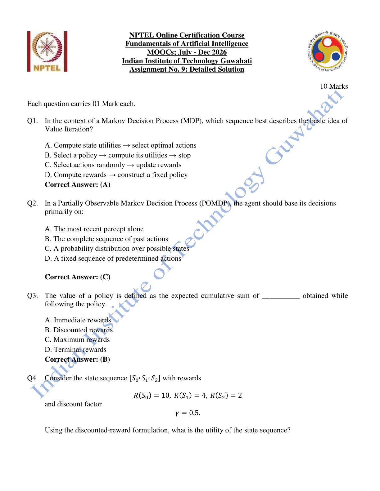

#### 2026 Q1

**Question recap:** What is the basic value-iteration sequence?

**Answer:** A — Compute utilities, then choose optimal actions.

**Why:** Repeated Bellman backups improve state-value estimates. A policy is then extracted by choosing the action with greatest expected backed-up value.

#### 2026 Q2

**Question recap:** What information guides a POMDP agent?

**Answer:** C — A probability distribution over states.

**Why:** This belief state summarises uncertainty after previous actions and observations. A single most recent percept generally does not contain all relevant information.

#### 2026 Q3

**Question recap:** What does policy value accumulate?

**Answer:** B — Discounted rewards.

**Why:** Future rewards are weighted by successive powers of the discount factor and averaged over possible trajectories under that policy.

### 2026 — Page 02

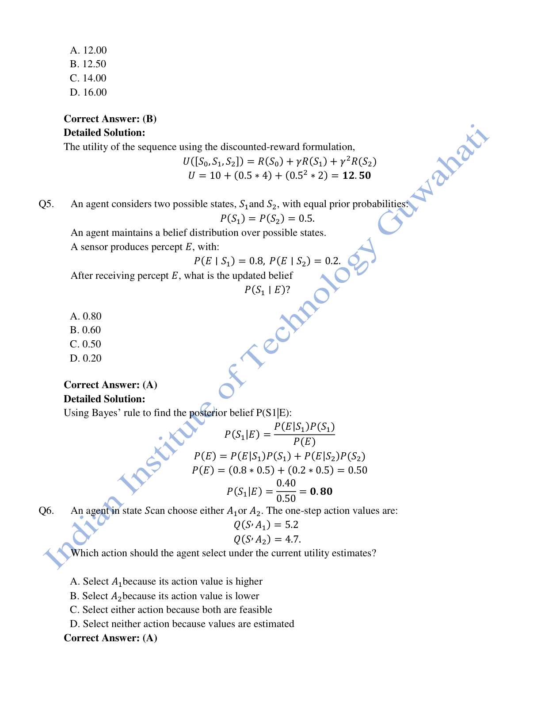

#### 2026 Q4

**Question recap:** What is the discounted return of the stated sequence?

**Answer:** B — 12.50.

**Why:** Compute $10+0.5(4)+0.5^2(2)=12.5$. The first reward has discount power zero; the third has power two.

#### 2026 Q5

**Question recap:** What is the updated belief after percept E?

**Answer:** A — 0.80.

**Why:** Bayes' rule gives $0.8(0.5)/[0.8(0.5)+0.2(0.5)]=0.8$. Normalise the weighted likelihoods so the posterior probabilities sum to one.

#### 2026 Q6

**Question recap:** Which action is chosen when Q-values are 5.2 and 4.7?

**Answer:** A — A1.

**Why:** A greedy choice takes the larger estimated action value. Estimated values can still guide action selection before they have converged.

### 2026 — Page 03

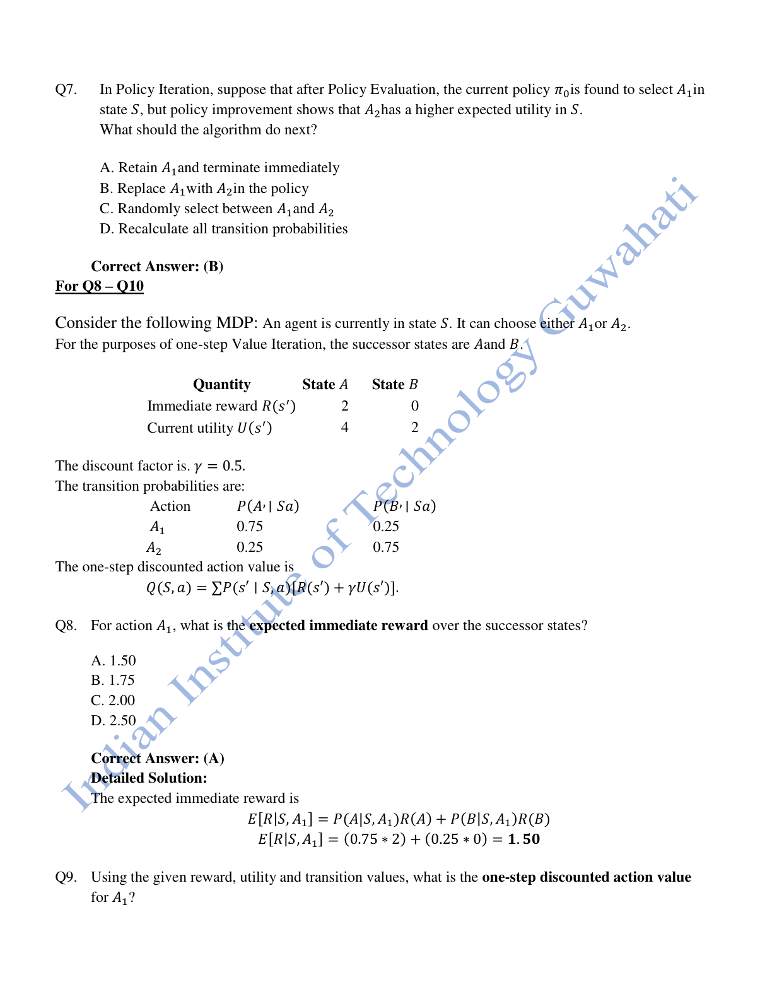

#### 2026 Q7

**Question recap:** How does policy improvement handle a better action?

**Answer:** B — Replace A1 with A2 in that state.

**Why:** Policy evaluation estimates the current policy's value; improvement then chooses actions that increase expected return. Evaluation and improvement repeat until the policy stabilises.

#### 2026 Q8

**Question recap:** What is A1's expected immediate reward?

**Answer:** A — 1.50.

**Why:** Average only the immediate successor rewards: $0.75(2)+0.25(0)=1.5$. Do not yet add the discounted utility term.

### 2026 — Page 04

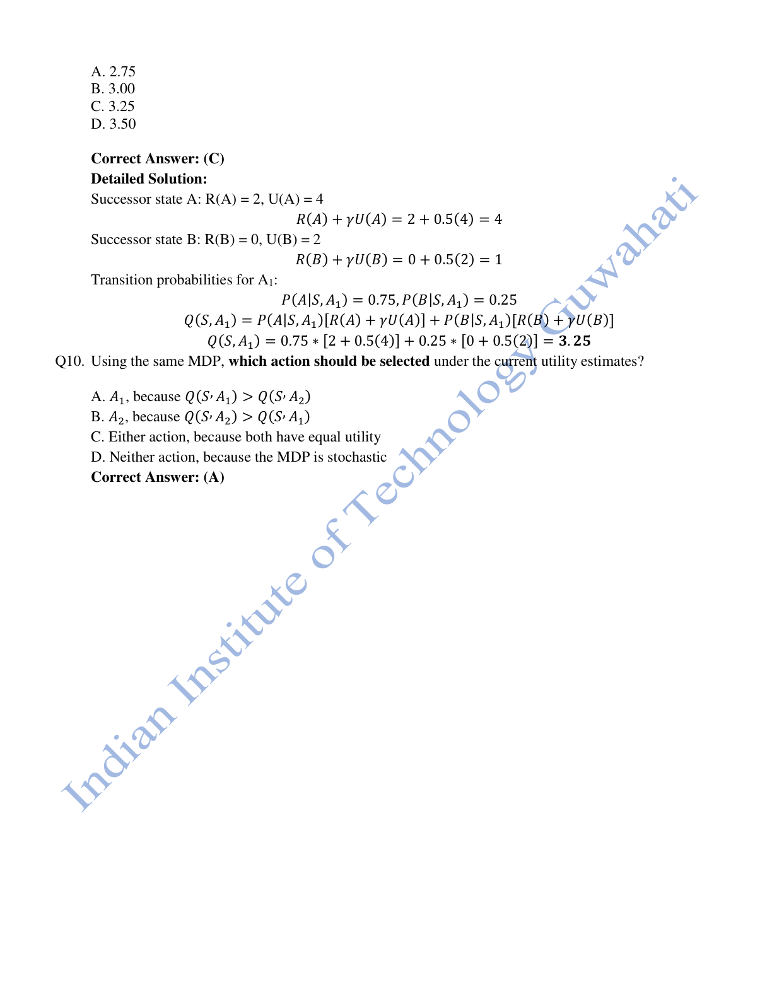

#### 2026 Q9

**Question recap:** What is A1's full one-step backed-up value?

**Answer:** C — 3.25.

**Why:** Successor contributions are $2+0.5(4)=4$ and $0+0.5(2)=1$. Weight them: $0.75(4)+0.25(1)=3.25$.

#### 2026 Q10

**Question recap:** Which action wins in the displayed MDP?

**Answer:** A — A1.

**Why:** $Q(S,A1)=3.25$, whereas $Q(S,A2)=0.25(4)+0.75(1)=1.75$. Choose the greater expected value, rather than the most likely successor alone.

[Back to year index](#2026) · [All weeks](README.md)

---

## 2025

Public copy of 2025 assignment solutions. Highlights are preserved; corrections and wording issues are identified below.

[Source](https://www.scribd.com/document/937061874/NPTEL)

Jump to discussion: [Q1](#2025-q1) · [Q2](#2025-q2) · [Q3](#2025-q3) · [Q4](#2025-q4) · [Q5](#2025-q5) · [Q6](#2025-q6) · [Q7](#2025-q7) · [Q8](#2025-q8) · [Q9](#2025-q9) · [Q10](#2025-q10)

### 2025 — Page 01

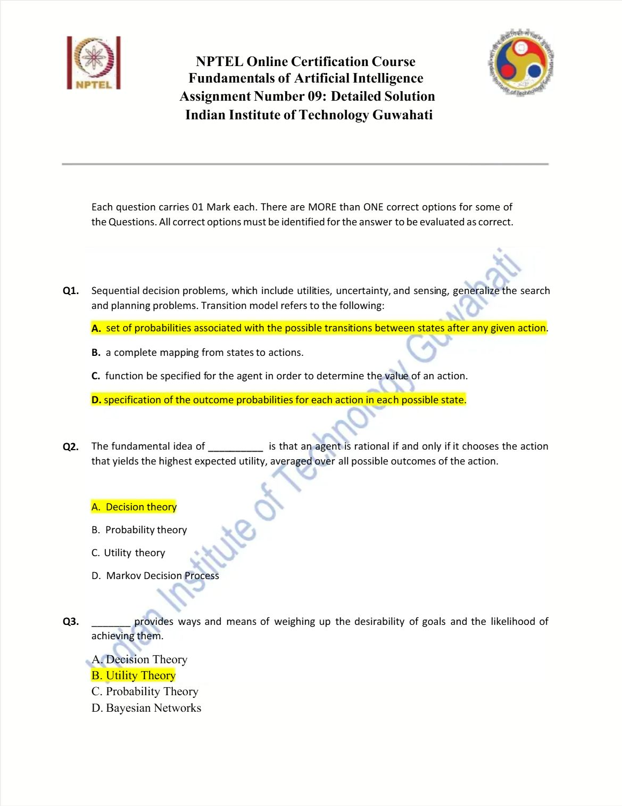

#### 2025 Q1

**Question recap:** Which descriptions define the transition model?

**Answer:** A and D.

**Why:** Both describe probabilities of outcomes for a state and action. A state-to-action mapping instead describes a policy.

#### 2025 Q2

**Question recap:** Which theory chooses actions by maximum expected utility?

**Answer:** A — Decision theory.

**Why:** It combines probabilities of outcomes with their utilities. The rational choice maximises the weighted average utility rather than the most attractive possible outcome alone.

#### 2025 Q3

**Question recap:** Which theory is highlighted for goals and likelihoods?

**Answer:** B — Utility theory in the source key.

**Why:** Utilities represent desirability, while the complete desirability-plus-probability calculation belongs to decision theory. This is the same loose wording as Week 7 Q2; retain that distinction while revising.

### 2025 — Page 02

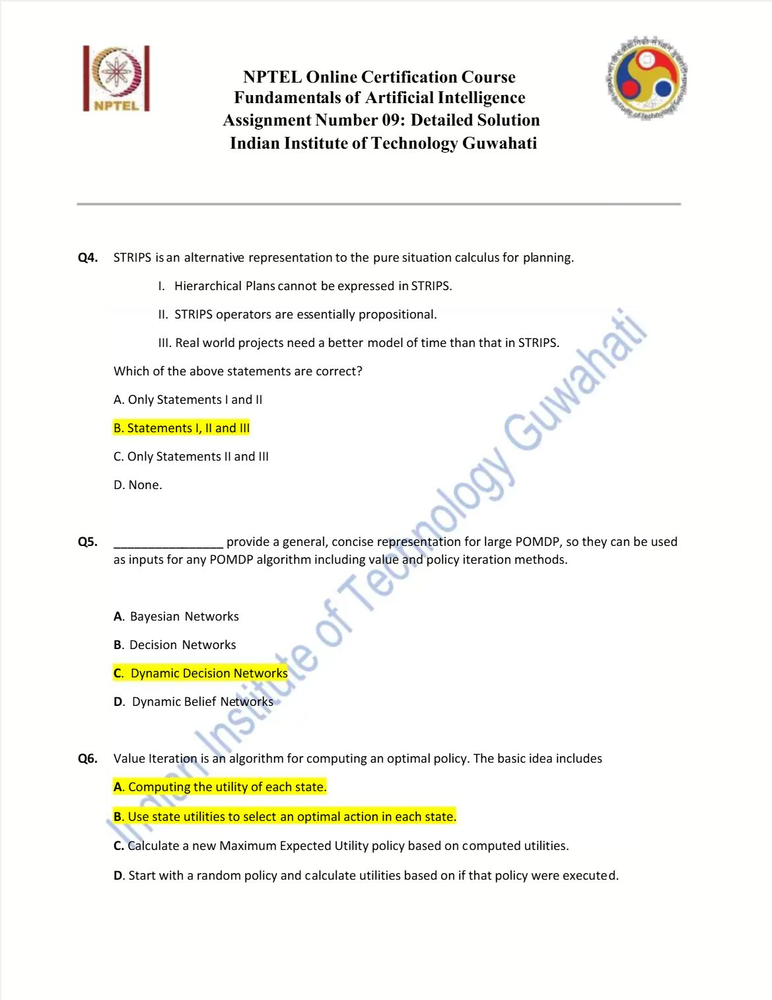

#### 2025 Q4

**Question recap:** Which limitations apply to basic STRIPS?

**Answer:** B — I, II, and III in the intended basic formalism.

**Why:** Basic STRIPS does not itself express hierarchical task decomposition or realistic action duration and scheduling. Its grounded operators describe state conditions and effects; richer planning languages add these capabilities.

#### 2025 Q5

**Question recap:** What compactly represents large POMDPs?

**Answer:** C — Dynamic decision networks.

**Why:** They combine temporally linked state and observation variables with action and utility structure. Factoring these relationships avoids enumerating every transition explicitly.

#### 2025 Q6

**Question recap:** Which steps describe value iteration?

**Answer:** A and B.

**Why:** Repeatedly compute state utilities and use them to choose optimal actions. Starting from a policy and evaluating it belongs to policy iteration.

### 2025 — Page 03

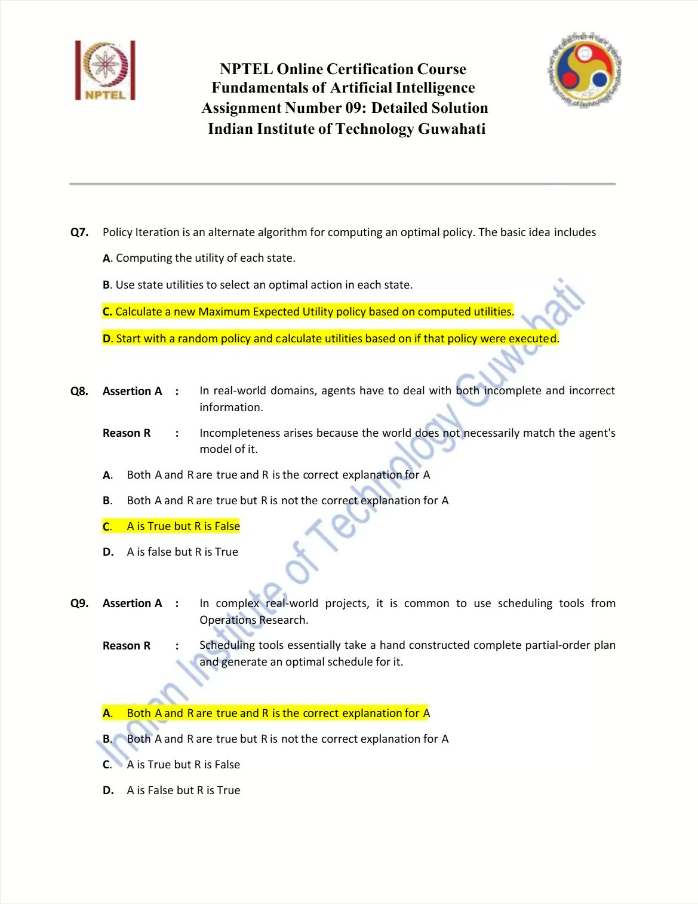

#### 2025 Q7

**Question recap:** Which steps describe policy iteration?

**Answer:** C and D.

**Why:** Start with a policy, evaluate its state utilities, and improve action choices using expected utility. Repeat until improvement no longer changes the policy.

#### 2025 Q8

**Question recap:** Does model mismatch explain incomplete information?

**Answer:** C — The assertion is true, but the stated reason is false in this distinction.

**Why:** Limited sensing and missing facts cause incompleteness. A mismatch between the world and the agent's model is instead a source of incorrect information.

#### 2025 Q9

**Question recap:** Why use operations-research scheduling after planning?

**Answer:** A — Both statements, with the stated explanation.

**Why:** A completed partial-order plan supplies actions and precedence constraints. Scheduling assigns times and resources while optimising the chosen objective, subject to the scheduler's assumptions and computational limits.

### 2025 — Page 04

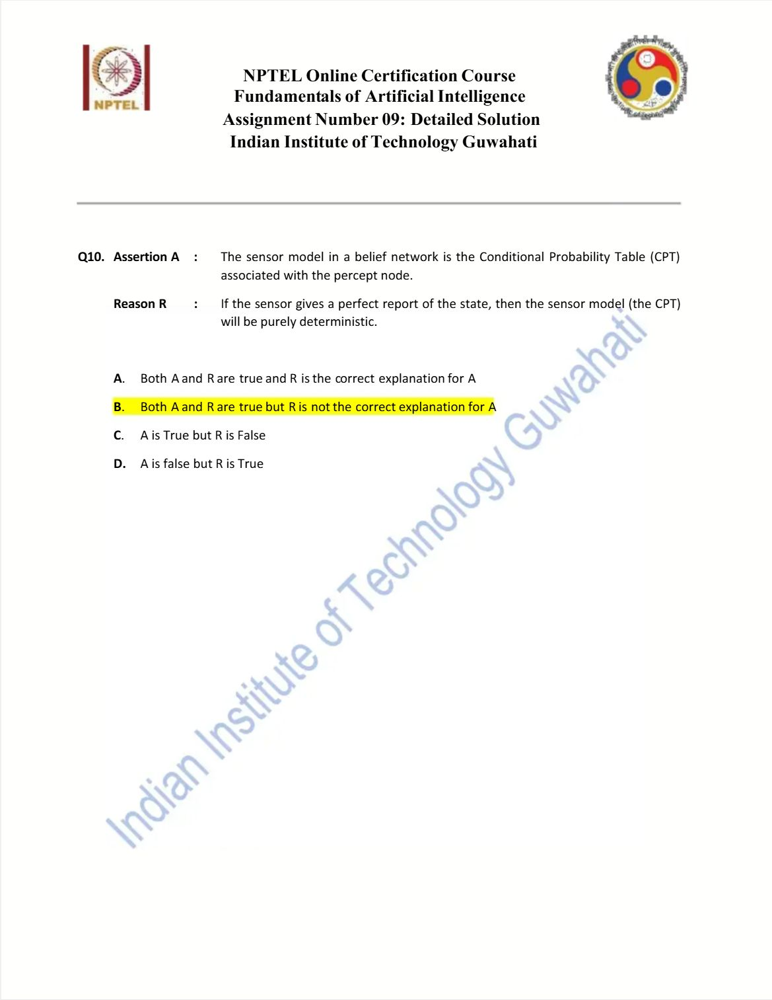

#### 2025 Q10

**Question recap:** Do deterministic perfect sensors explain the general sensor-model definition?

**Answer:** B — Both statements are true, but the reason is not the explanation.

**Why:** A sensor model is a conditional distribution for percepts given state. A perfect sensor is only its deterministic special case, not the reason all sensor models have that form.

[Back to year index](#2025) · [All weeks](README.md)

---

## 2024

Question screenshots captured from MY SWAYAM’s public 2024 assignment video, linked to course noc24_ge47. The uploader’s unsubmitted choices, annotations, and occasional overlay text are preserved. They are not an official answer key; corrections and ambiguous wording are discussed below.

[Source](https://www.youtube.com/watch?v=k9R_mt1A6t0&t=35s)

Jump to discussion: [Q1](#2024-q1) · [Q2](#2024-q2) · [Q3](#2024-q3) · [Q4](#2024-q4) · [Q5](#2024-q5) · [Q6](#2024-q6) · [Q7](#2024-q7) · [Q8](#2024-q8) · [Q9](#2024-q9) · [Q10](#2024-q10)

### 2024 — Page 01

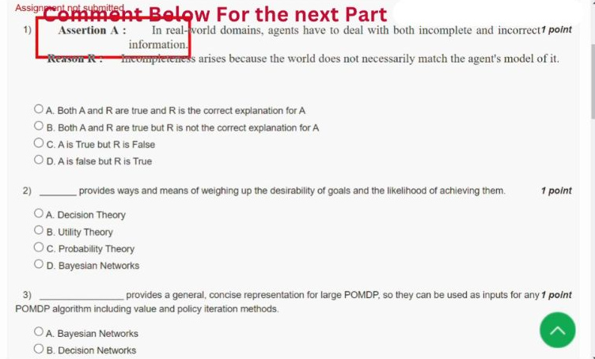

[Source video at 0:35](https://www.youtube.com/watch?v=k9R_mt1A6t0&t=35s)

#### 2024 Q1

**Question recap:** Does the stated model mismatch explain incomplete information?

**Answer:** C — The assertion is true, but the reason describes incorrect information.

**Why:** Limited sensing and missing facts cause incompleteness. A world that differs from the agent's model instead makes that model inaccurate. Both matter in practice, but the reason does not correctly name the source of incompleteness in this distinction.

### 2024 — Page 02

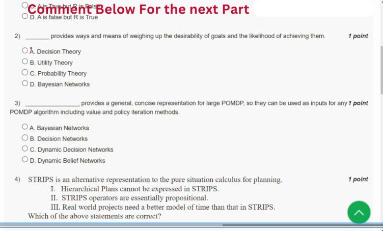

[Source video at 0:55](https://www.youtube.com/watch?v=k9R_mt1A6t0&t=55s)

#### 2024 Q2

**Question recap:** Which theory does the goals-and-likelihoods wording expect?

**Answer:** B — Utility theory in the repeated course key.

**Why:** Utilities measure desirability; probabilities measure likelihood; decision theory combines them. Expected utility uses $EU(a)=\sum_sP(s\mid a)U(s)$. This explains why a separate question explicitly asking which theory maximises expected utility has Decision theory as its answer.

#### 2024 Q3

**Question recap:** What compactly represents a large POMDP?

**Answer:** C — Dynamic decision networks.

**Why:** A factored representation connects changing state variables, observations, decisions, and utilities over time. It can describe a large problem without listing every complete-state combination explicitly. A belief state summarises the agent's uncertainty about the underlying state.

### 2024 — Page 03

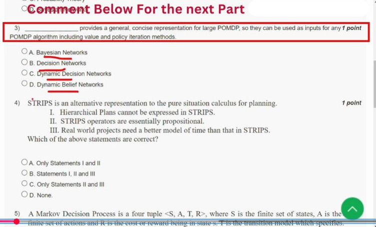

[Source video at 1:25](https://www.youtube.com/watch?v=k9R_mt1A6t0&t=85s)

#### 2024 Q4

**Question recap:** Which limitations belong to basic STRIPS?

**Answer:** B — I, II, and III.

**Why:** Basic STRIPS has no built-in hierarchical task decomposition or rich duration/resource model. Its grounded operators describe state conditions and effects in propositional form. Extensions such as temporal or hierarchical planning formalisms address those limits; they are not features guaranteed by the basic representation.

### 2024 — Page 04

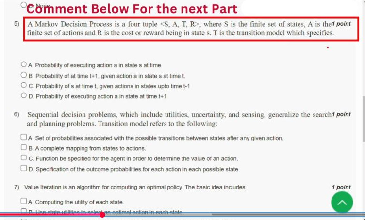

[Source video at 1:55](https://www.youtube.com/watch?v=k9R_mt1A6t0&t=115s)

#### 2024 Q5

**Question recap:** What does an MDP's transition model specify?

**Answer:** B — $P(s_{t+1}\mid s_t,a_t)$.

**Why:** Fix the present state and chosen action, then assign probabilities to possible next states. The probabilities over successors sum to one. A policy chooses the action; the transition model describes what the environment may do after that action.

#### 2024 Q6

**Question recap:** Which listed descriptions define the transition model?

**Answer:** A and D.

**Why:** Both describe probabilities of outcomes after actions in states. A complete state-to-action mapping is a policy instead. A value or utility function evaluates expected return, so it must also be kept distinct from the transition probabilities.

### 2024 — Page 05

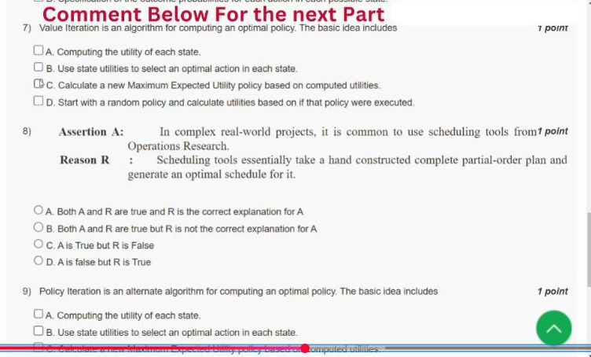

[Source video at 2:25](https://www.youtube.com/watch?v=k9R_mt1A6t0&t=145s)

#### 2024 Q7

**Question recap:** Which steps describe value iteration?

**Answer:** A and B.

**Why:** Compute state values by Bellman backups and select actions that maximise the resulting expected return. For a discounted MDP, $V_{k+1}(s)=\max_a\sum_{s'}P(s'\mid s,a)[r(s,a,s')+\gamma V_k(s')]$. Starting from and evaluating a fixed policy describes policy iteration instead.

#### 2024 Q8

**Question recap:** Why can scheduling follow a partial-order plan?

**Answer:** A — Both statements are true and the reason gives the intended explanation.

**Why:** A complete partial-order plan provides actions and precedence constraints. A scheduler assigns times and resources while optimising its objective subject to those constraints. “Optimal” depends on the scheduling formulation and solution method; it is not a guarantee for every practical scheduling tool.

### 2024 — Page 06

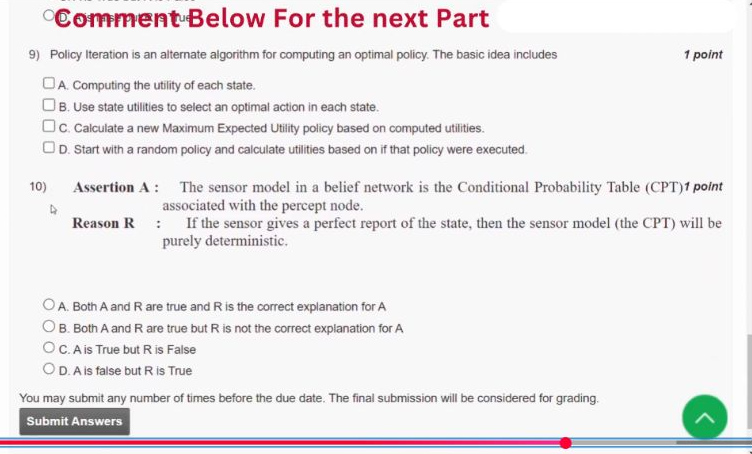

[Source video at 2:55](https://www.youtube.com/watch?v=k9R_mt1A6t0&t=175s)

#### 2024 Q9

**Question recap:** Which steps describe policy iteration?

**Answer:** C and D.

**Why:** Begin with a policy, evaluate its expected return, and improve each state's action using the evaluated values. Repeat evaluation and improvement until the policy is stable. The answer letters describe the same two operations in reverse presentation order; evaluation must precede the corresponding improvement step.

#### 2024 Q10

**Question recap:** Does the perfect-sensor case explain the general sensor-model definition?

**Answer:** B — Both statements are true, but the reason is not the explanation.

**Why:** A sensor model gives $P(observation\mid state)$, represented by a percept node's CPT. A perfect sensor makes that distribution deterministic. This is a special case of the definition, rather than the reason that noisy sensor models are conditional distributions.

[Back to year index](#2024) · [All weeks](README.md)

---

## 2019

Official NPTEL archive with accepted answers. Any discrepancy between a printed formula and its key is identified below.

[Source](https://archive.nptel.ac.in/content/storage2/courses/downloads_new/112103280/Week_09_Assignment_9.pdf)

Jump to discussion: [Q1](#2019-q1) · [Q2](#2019-q2) · [Q3](#2019-q3) · [Q4](#2019-q4) · [Q5](#2019-q5) · [Q6](#2019-q6) · [Q7](#2019-q7) · [Q8](#2019-q8) · [Q9](#2019-q9) · [Q10](#2019-q10)

### 2019 — Page 01

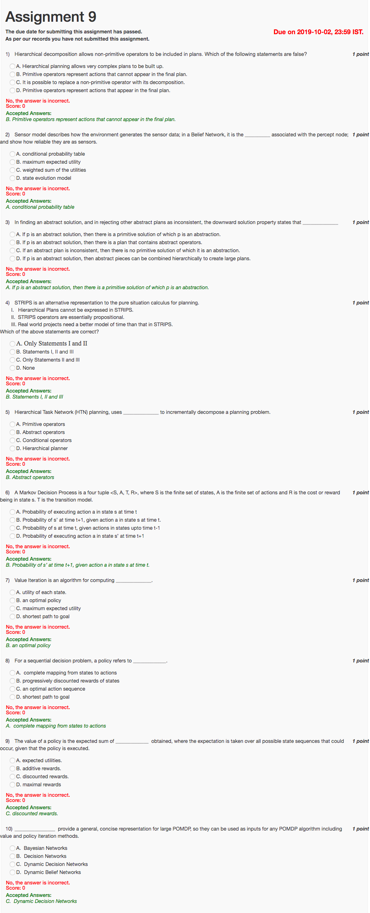

#### 2019 Q1

**Question recap:** Which statement about primitive operators is false?

**Answer:** B — They cannot appear in the final plan.

**Why:** Primitive actions are precisely the executable steps that do appear in a fully refined plan. Abstract actions are replaced by their decompositions.

#### 2019 Q2

**Question recap:** How is a sensor model stored in a belief network?

**Answer:** A — A conditional probability table for the percept node.

**Why:** It specifies how likely each observation is for each relevant state. This expresses reliability and noise in the sensor.

#### 2019 Q3

**Question recap:** What does the downward-solution property assert?

**Answer:** A — Every abstract solution has a corresponding primitive refinement.

**Why:** This is a property a particular abstraction may possess, rather than a guarantee for every arbitrary abstract plan. It justifies trusting an abstract solution as refinable.

#### 2019 Q4

**Question recap:** Which basic STRIPS limitations are listed?

**Answer:** B — I, II, and III.

**Why:** Basic STRIPS lacks hierarchical task structure and a rich time model. Its grounded state-transforming operators need extensions for many real projects.

#### 2019 Q5

**Question recap:** What does HTN planning decompose?

**Answer:** B — Abstract operators or tasks.

**Why:** Methods replace a high-level task with an ordered or partially ordered collection of subtasks. Repeating this process eventually yields primitive actions.

#### 2019 Q6

**Question recap:** What does the MDP transition model give?

**Answer:** B — $P(s_{t+1}\mid s_t,a_t)$.

**Why:** It specifies possible successor states and their probabilities after an action. A policy instead specifies which action the agent chooses.

#### 2019 Q7

**Question recap:** What is value iteration used to obtain in this question?

**Answer:** B — An optimal policy.

**Why:** It first computes optimal state values and then extracts optimal actions. This wording asks for the overall purpose; 2026 Week 12 Q2 instead asks for the quantity directly computed, state utility.

#### 2019 Q8

**Question recap:** What is a policy in sequential decision making?

**Answer:** A — A mapping from states to actions.

**Why:** It prescribes behaviour for every state, including states reached through different random outcomes. A fixed action sequence is less general.

#### 2019 Q9

**Question recap:** What return defines policy value?

**Answer:** C — Expected discounted rewards.

**Why:** Average the discounted cumulative reward over the possible state sequences generated by the policy. Do not replace that expectation with a single best trajectory.

#### 2019 Q10

**Question recap:** Which networks compactly represent large POMDPs?

**Answer:** C — Dynamic decision networks.

**Why:** Temporal probabilistic dependencies, decisions, and utilities can be represented in a factored form. This supports model-based value and policy calculations.

[Back to year index](#2019) · [All weeks](README.md)

---
