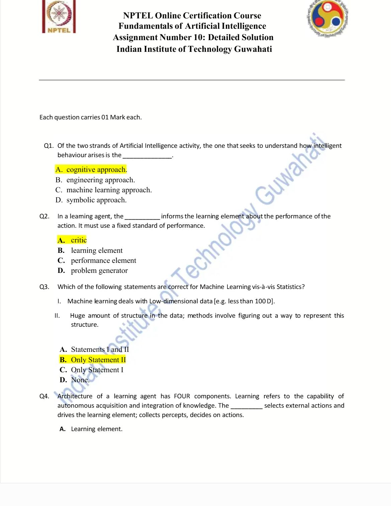
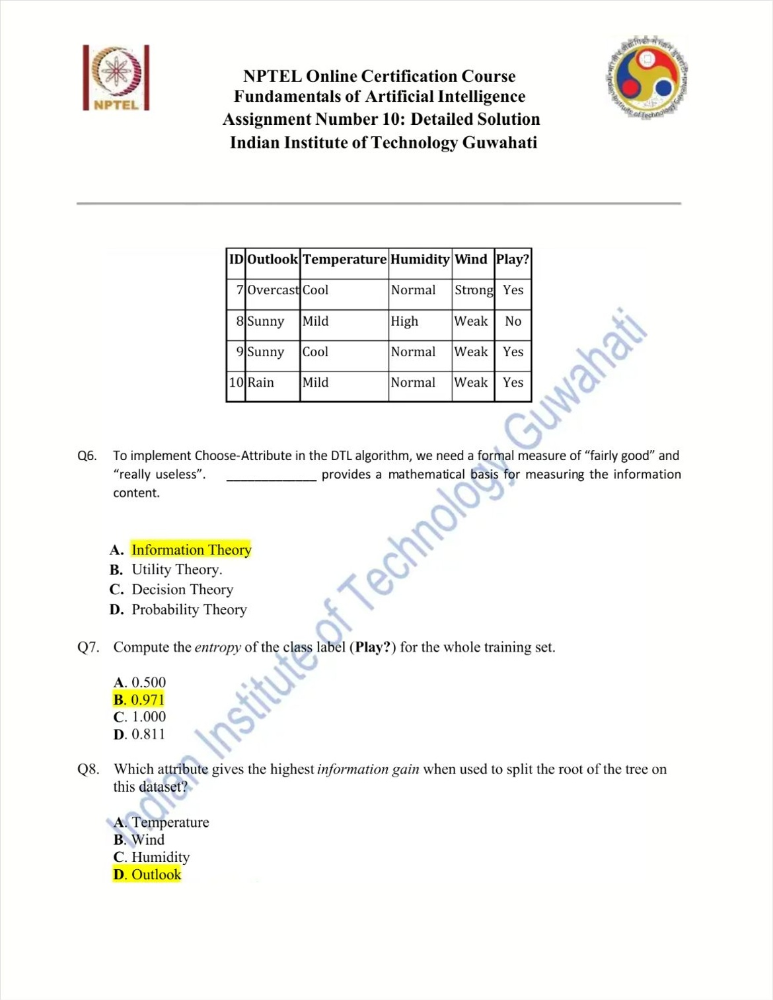

# Week 10 — Machine Learning I

[All weeks](README.md) · [Previous](Week%2009.md) · [Next](Week%2011.md)

[2026](#2026) · [2025](#2025) · [2019](#2019)

Screenshots appear inline. Each question has a short recap, answer, and explanation below the relevant page.

## 2026

Official solution linked from the enrolled 2026 course; checked against the live weekly assessment.

[Source](https://drive.google.com/file/d/1SqhIBLzh1NAvLINBYaq8gghXxIKsQUdr/view)

Jump to discussion: [Q1](#2026-q1) · [Q2](#2026-q2) · [Q3](#2026-q3) · [Q4](#2026-q4) · [Q5](#2026-q5) · [Q6](#2026-q6) · [Q7](#2026-q7) · [Q8](#2026-q8) · [Q9](#2026-q9) · [Q10](#2026-q10)

### 2026 — Page 01

#### 2026 Q1

**Question recap:** Which AI approach seeks to understand intelligent behaviour?

**Answer:** A — The cognitive approach.

**Why:** Its emphasis is explaining how intelligence arises. The engineering approach emphasises building systems that perform useful intelligent tasks.

#### 2026 Q2

**Question recap:** Which learning-agent component makes improvements?

**Answer:** B — The learning element.

**Why:** The critic evaluates behaviour, the performance element selects actions, and the problem generator encourages informative exploration. The learning element uses feedback to modify performance.

#### 2026 Q3

**Question recap:** Why evaluate a classifier on unseen examples?

**Answer:** B — To assess accuracy on new data.

**Why:** Training performance can be inflated by memorisation. Held-out examples test generalisation to cases that were not used to fit the model.

### 2026 — Page 02

#### 2026 Q4

**Question recap:** Which descriptions of statistics and ML are appropriate?

**Answer:** A — Both I and II.

**Why:** These are typical emphases, not rigid boundaries: statistics often focuses on inference and uncertainty, while ML often focuses on prediction and generalisation.

#### 2026 Q5

**Question recap:** What is the learned function h called?

**Answer:** B — A hypothesis.

**Why:** It is the learner's proposed approximation to the unknown target function. Its quality must be judged on data beyond the fitting examples.

#### 2026 Q6

**Question recap:** What is the initial class entropy?

**Answer:** D — 1 bit.

**Why:** Four Yes and four No examples give $H=-0.5\log_2 0.5-0.5\log_2 0.5=1$. Equal binary proportions have maximum entropy.

### 2026 — Page 03

#### 2026 Q7

**Question recap:** What is the entropy after splitting on Outlook?

**Answer:** B — 0.500 bits.

**Why:** Sunny and Overcast are pure, so their entropies are zero. Rain has four equally split examples, giving weighted entropy $(4/8)(1)=0.5$.

#### 2026 Q8

**Question recap:** What information gain does Outlook provide?

**Answer:** B — 0.500 bits.

**Why:** Gain is parent entropy minus weighted child entropy: $1-0.5=0.5$. Do not confuse gain with the remaining uncertainty.

#### 2026 Q9

**Question recap:** Which Outlook branches are pure?

**Answer:** C — Sunny and Overcast.

**Why:** Sunny contains only No and Overcast contains only Yes. Rain contains both classes and requires another split.

#### 2026 Q10

**Question recap:** What does Rain with Weak wind predict?

**Answer:** A — Yes.

**Why:** Follow the Outlook=Rain branch, then Wind=Weak. Both matching training records have the Yes label.

[Back to year index](#2026) · [All weeks](README.md)

---

## 2025

Public copy of 2025 assignment solutions. Highlights are preserved; corrections and wording issues are identified below.

[Source](https://www.scribd.com/document/937061874/NPTEL)

Jump to discussion: [Q1](#2025-q1) · [Q2](#2025-q2) · [Q3](#2025-q3) · [Q4](#2025-q4) · [Q5](#2025-q5) · [Q6](#2025-q6) · [Q7](#2025-q7) · [Q8](#2025-q8) · [Q9](#2025-q9) · [Q10](#2025-q10)

### 2025 — Page 01

#### 2025 Q1

**Question recap:** Which AI strand studies how intelligence arises?

**Answer:** A — The cognitive approach.

**Why:** Its aim is understanding the mechanisms behind intelligent behaviour. An engineering approach focuses on building systems that achieve intelligent performance.

#### 2025 Q2

**Question recap:** Which component reports performance to the learner?

**Answer:** A — The critic.

**Why:** It compares observed behaviour with a performance standard. The learning element then uses that feedback to make improvements.

#### 2025 Q3

**Question recap:** Which ML-versus-statistics statements hold?

**Answer:** B — Statement II only.

**Why:** ML commonly handles high-dimensional structured data and representation learning. The claim that it is confined to low-dimensional data is false.

### 2025 — Page 02

#### 2025 Q4

**Question recap:** Which component selects external actions?

**Answer:** B — The performance element.

**Why:** It maps percepts and internal information to behaviour. The critic assesses that behaviour, while the learning element changes how it is produced.

#### 2025 Q5

**Question recap:** What is the inductively learned approximation called?

**Answer:** B — A hypothesis.

**Why:** It is the candidate function inferred from examples. Its fit to training data does not alone establish good performance on unseen cases.

### 2025 — Page 03

#### 2025 Q6

**Question recap:** What theory measures information content for attribute selection?

**Answer:** A — Information theory.

**Why:** Entropy measures class uncertainty and information gain measures its reduction after a split. These provide a quantitative basis for choosing tree attributes.

#### 2025 Q7

**Question recap:** What is the ten-example dataset's class entropy?

**Answer:** B — Approximately 0.971 bits.

**Why:** There are six Yes and four No examples, so $H=-0.6\log_2 0.6-0.4\log_2 0.4\approx0.971$.

#### 2025 Q8

**Question recap:** Which attribute gives the greatest root information gain?

**Answer:** D — Outlook.

**Why:** Its weighted child entropy is approximately 0.649, giving gain $0.971-0.649\approx0.322$. This exceeds the gains of Humidity, Temperature, and Wind for the displayed ten rows.

### 2025 — Page 04

#### 2025 Q9

**Question recap:** Which Outlook branch is pure?

**Answer:** C — Overcast.

**Why:** Every Overcast record is Yes. Sunny and Rain each contain both labels, so neither is a pure subset.

#### 2025 Q10

**Question recap:** What commonly reduces decision-tree overfitting?

**Answer:** B — Pruning.

**Why:** Removing splits supported mainly by noise can improve generalisation. Increasing depth without a stopping rule usually gives the tree more opportunity to memorise the sample.

[Back to year index](#2025) · [All weeks](README.md)

---

## 2019

Official NPTEL archive with accepted answers. Any discrepancy between a printed formula and its key is identified below.

[Source](https://archive.nptel.ac.in/content/storage2/courses/downloads_new/112103280/Week_10_Assignment_10.pdf)

Jump to discussion: [Q1](#2019-q1) · [Q2](#2019-q2) · [Q3](#2019-q3) · [Q4](#2019-q4) · [Q5](#2019-q5) · [Q6](#2019-q6) · [Q7](#2019-q7) · [Q8](#2019-q8) · [Q9](#2019-q9) · [Q10](#2019-q10)

### 2019 — Page 01

#### 2019 Q1

**Question recap:** Who is associated with the checkers-learning program?

**Answer:** B — Arthur Samuel.

**Why:** Samuel's checkers work is a landmark early machine-learning example. This is the person intended by the course's historical wording.

#### 2019 Q2

**Question recap:** What models a numerical dependent variable from predictors?

**Answer:** A — Regression.

**Why:** The output is a numerical quantity. Classification instead predicts a discrete category, while clustering groups similar observations without target labels.

#### 2019 Q3

**Question recap:** Which AI approach studies how intelligence arises?

**Answer:** A — The cognitive approach.

**Why:** It aims to explain intelligent processes. The engineering strand emphasises making useful systems exhibit intelligent behaviour.

#### 2019 Q4

**Question recap:** Which ML-versus-statistics statement holds?

**Answer:** B — II only.

**Why:** Learning methods can discover structure and representations in complex high-dimensional data. ML is not generally restricted to fewer than 100 input dimensions.

#### 2019 Q5

**Question recap:** What predicts a categorical output?

**Answer:** A — Classification.

**Why:** Its labels may be binary or multiclass. Regression concerns numerical targets, and clustering does not start with supplied class labels.

#### 2019 Q6

**Question recap:** What is average information content called?

**Answer:** B — Entropy.

**Why:** For probabilities $p_i$, entropy is $-\sum_i p_i\log_2 p_i$ in bits. A more uncertain outcome distribution has greater entropy.

#### 2019 Q7

**Question recap:** What is an inductively learned function called?

**Answer:** B — A hypothesis.

**Why:** It approximates the unknown target function from examples. Good generalisation requires more than a perfect fit to the observed sample.

#### 2019 Q8

**Question recap:** Which theory underlies information-based tree splitting?

**Answer:** A — Information theory.

**Why:** Entropy measures uncertainty, and information gain measures how much a candidate attribute reduces it. The attribute-selection step compares these reductions.

#### 2019 Q9

**Question recap:** Which agent component encourages exploration?

**Answer:** C — The problem generator.

**Why:** It suggests actions that can produce useful new experiences. Such actions may improve future learning even if their immediate payoff is not best.

#### 2019 Q10

**Question recap:** Which component chooses actions from percepts?

**Answer:** B — The performance element.

**Why:** It produces the agent's external behaviour. The learning element improves it using feedback from the critic.

[Back to year index](#2019) · [All weeks](README.md)

---
