# Week 10 — Machine Learning I

[All weeks](README.md) · [Previous](Week%2009.md) · [Next](Week%2011.md)

[2026](#2026) · [2025](#2025) · [2024](#2024) · [2019](#2019)

Screenshots appear inline. Each question has a short recap, answer, and explanation below the relevant page.

## 2026

Official solution linked from the enrolled 2026 course; checked against the live weekly assessment.

[Source](https://drive.google.com/file/d/1SqhIBLzh1NAvLINBYaq8gghXxIKsQUdr/view)

Jump to discussion: [Q1](#2026-q1) · [Q2](#2026-q2) · [Q3](#2026-q3) · [Q4](#2026-q4) · [Q5](#2026-q5) · [Q6](#2026-q6) · [Q7](#2026-q7) · [Q8](#2026-q8) · [Q9](#2026-q9) · [Q10](#2026-q10)

### 2026 — Page 01

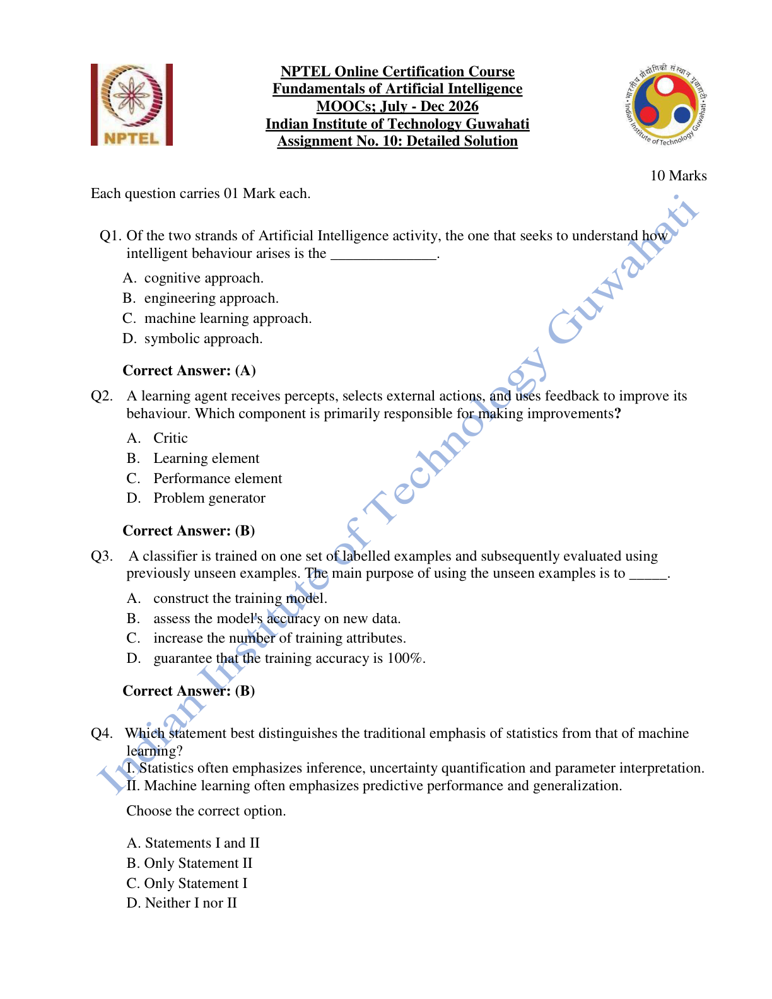

#### 2026 Q1

**Question recap:** Which AI approach seeks to understand intelligent behaviour?

**Answer:** A — The cognitive approach.

**Why:** Its emphasis is explaining how intelligence arises. The engineering approach emphasises building systems that perform useful intelligent tasks.

#### 2026 Q2

**Question recap:** Which learning-agent component makes improvements?

**Answer:** B — The learning element.

**Why:** The critic evaluates behaviour, the performance element selects actions, and the problem generator encourages informative exploration. The learning element uses feedback to modify performance.

#### 2026 Q3

**Question recap:** Why evaluate a classifier on unseen examples?

**Answer:** B — To assess accuracy on new data.

**Why:** Training performance can be inflated by memorisation. Held-out examples test generalisation to cases that were not used to fit the model.

### 2026 — Page 02

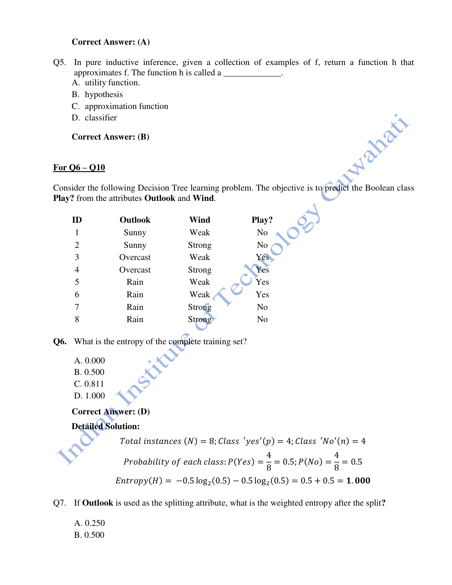

#### 2026 Q4

**Question recap:** Which descriptions of statistics and ML are appropriate?

**Answer:** A — Both I and II.

**Why:** These are typical emphases, not rigid boundaries: statistics often focuses on inference and uncertainty, while ML often focuses on prediction and generalisation.

#### 2026 Q5

**Question recap:** What is the learned function h called?

**Answer:** B — A hypothesis.

**Why:** It is the learner's proposed approximation to the unknown target function. Its quality must be judged on data beyond the fitting examples.

#### 2026 Q6

**Question recap:** What is the initial class entropy?

**Answer:** D — 1 bit.

**Why:** Four Yes and four No examples give $H=-0.5\log_2 0.5-0.5\log_2 0.5=1$. Equal binary proportions have maximum entropy.

### 2026 — Page 03

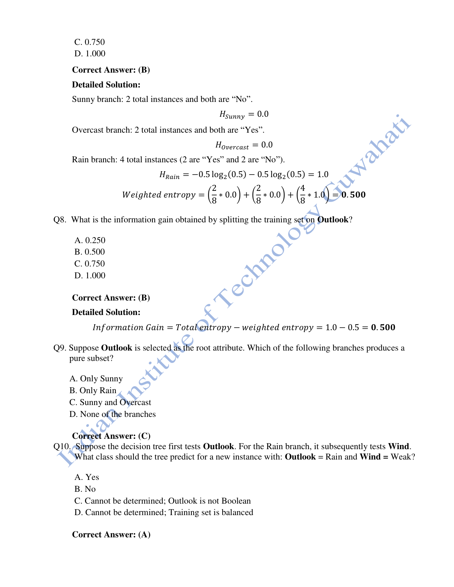

#### 2026 Q7

**Question recap:** What is the entropy after splitting on Outlook?

**Answer:** B — 0.500 bits.

**Why:** Sunny and Overcast are pure, so their entropies are zero. Rain has four equally split examples, giving weighted entropy $(4/8)(1)=0.5$.

#### 2026 Q8

**Question recap:** What information gain does Outlook provide?

**Answer:** B — 0.500 bits.

**Why:** Gain is parent entropy minus weighted child entropy: $1-0.5=0.5$. Do not confuse gain with the remaining uncertainty.

#### 2026 Q9

**Question recap:** Which Outlook branches are pure?

**Answer:** C — Sunny and Overcast.

**Why:** Sunny contains only No and Overcast contains only Yes. Rain contains both classes and requires another split.

#### 2026 Q10

**Question recap:** What does Rain with Weak wind predict?

**Answer:** A — Yes.

**Why:** Follow the Outlook=Rain branch, then Wind=Weak. Both matching training records have the Yes label.

[Back to year index](#2026) · [All weeks](README.md)

---

## 2025

Public copy of 2025 assignment solutions. Highlights are preserved; corrections and wording issues are identified below.

[Source](https://www.scribd.com/document/937061874/NPTEL)

Jump to discussion: [Q1](#2025-q1) · [Q2](#2025-q2) · [Q3](#2025-q3) · [Q4](#2025-q4) · [Q5](#2025-q5) · [Q6](#2025-q6) · [Q7](#2025-q7) · [Q8](#2025-q8) · [Q9](#2025-q9) · [Q10](#2025-q10)

### 2025 — Page 01

#### 2025 Q1

**Question recap:** Which AI strand studies how intelligence arises?

**Answer:** A — The cognitive approach.

**Why:** Its aim is understanding the mechanisms behind intelligent behaviour. An engineering approach focuses on building systems that achieve intelligent performance.

#### 2025 Q2

**Question recap:** Which component reports performance to the learner?

**Answer:** A — The critic.

**Why:** It compares observed behaviour with a performance standard. The learning element then uses that feedback to make improvements.

#### 2025 Q3

**Question recap:** Which ML-versus-statistics statements hold?

**Answer:** B — Statement II only.

**Why:** ML commonly handles high-dimensional structured data and representation learning. The claim that it is confined to low-dimensional data is false.

### 2025 — Page 02

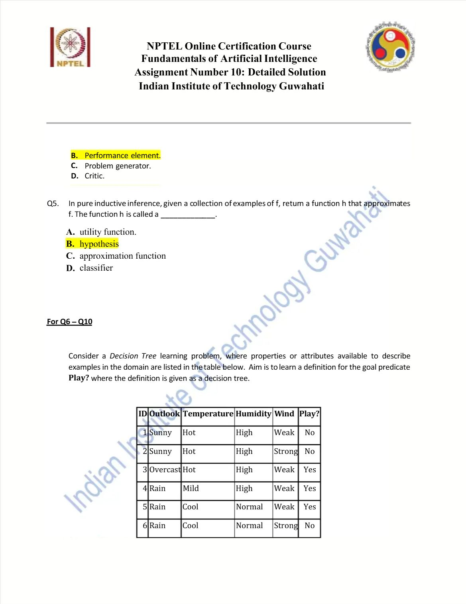

#### 2025 Q4

**Question recap:** Which component selects external actions?

**Answer:** B — The performance element.

**Why:** It maps percepts and internal information to behaviour. The critic assesses that behaviour, while the learning element changes how it is produced.

#### 2025 Q5

**Question recap:** What is the inductively learned approximation called?

**Answer:** B — A hypothesis.

**Why:** It is the candidate function inferred from examples. Its fit to training data does not alone establish good performance on unseen cases.

### 2025 — Page 03

#### 2025 Q6

**Question recap:** What theory measures information content for attribute selection?

**Answer:** A — Information theory.

**Why:** Entropy measures class uncertainty and information gain measures its reduction after a split. These provide a quantitative basis for choosing tree attributes.

#### 2025 Q7

**Question recap:** What is the ten-example dataset's class entropy?

**Answer:** B — Approximately 0.971 bits.

**Why:** There are six Yes and four No labels in the ten rows: $H=-0.6\log_2(0.6)-0.4\log_2(0.4)=0.970951$ bits. A pure subset has entropy zero; an evenly split binary subset has one bit. Do not transfer the 2026 answer of one bit to this different class distribution.

#### 2025 Q8

**Question recap:** Which attribute gives the greatest root information gain?

**Answer:** D — Outlook.

**Why:** Sunny has one Yes and three No, Overcast has two Yes, and Rain has three Yes and one No. Their entropies are approximately 0.8113, 0, and 0.8113. Weighted remainder is $(4/10)(0.8113)+(2/10)(0)+(4/10)(0.8113)=0.6490$, so Outlook gain is $0.9710-0.6490=0.3219$. Temperature, Humidity, and Wind give only about 0.0955, 0.1245, and 0.0913 respectively.

### 2025 — Page 04

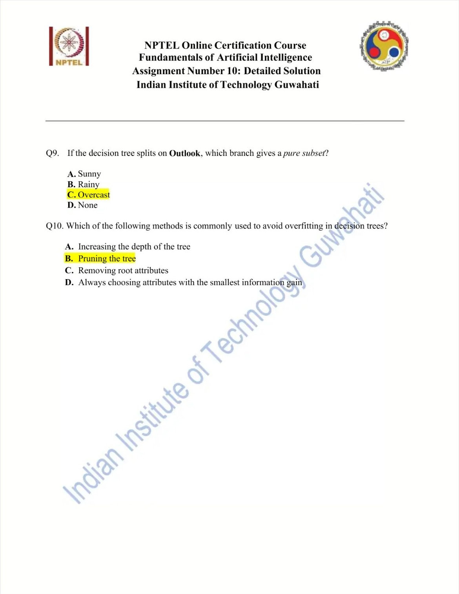

#### 2025 Q9

**Question recap:** Which Outlook branch is pure?

**Answer:** C — Overcast.

**Why:** Every Overcast record is Yes. Sunny and Rain each contain both labels, so neither is a pure subset.

#### 2025 Q10

**Question recap:** What commonly reduces decision-tree overfitting?

**Answer:** B — Pruning.

**Why:** Removing splits supported mainly by noise can improve generalisation. Increasing depth without a stopping rule usually gives the tree more opportunity to memorise the sample.

[Back to year index](#2025) · [All weeks](README.md)

---

## 2024

Question screenshots captured from MY SWAYAM’s public 2024 assignment video, linked to course noc24_ge47. The uploader’s unsubmitted choices, annotations, and occasional overlay text are preserved. They are not an official answer key; corrections and ambiguous wording are discussed below.

[Source](https://www.youtube.com/watch?v=7y9Asf2yBy8&t=27s)

Jump to discussion: [Q1](#2024-q1) · [Q2](#2024-q2) · [Q3](#2024-q3) · [Q4](#2024-q4) · [Q5](#2024-q5) · [Q6](#2024-q6) · [Q7](#2024-q7) · [Q8](#2024-q8) · [Q9](#2024-q9) · [Q10](#2024-q10)

### 2024 — Page 01

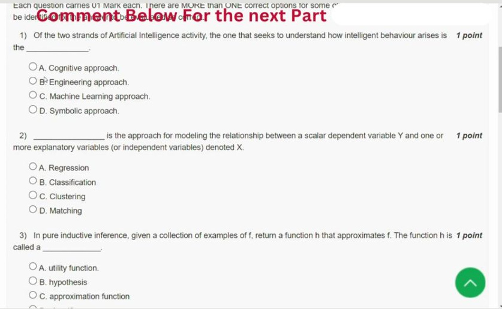

[Source video at 0:27](https://www.youtube.com/watch?v=7y9Asf2yBy8&t=27s)

#### 2024 Q1

**Question recap:** Which AI strand studies how intelligent behaviour arises?

**Answer:** A — The cognitive approach.

**Why:** The objective is to understand the mechanisms of intelligence. The engineering approach focuses on constructing effective intelligent systems. These aims can inform one another, but the question asks which strand emphasises understanding.

#### 2024 Q2

**Question recap:** What predicts a numerical dependent variable from explanatory variables?

**Answer:** A — Regression.

**Why:** A regression model maps predictors to a numerical response, such as price or temperature. Classification predicts a category, while clustering groups observations without a supplied target label. The output type is the useful distinction for this question.

### 2024 — Page 02

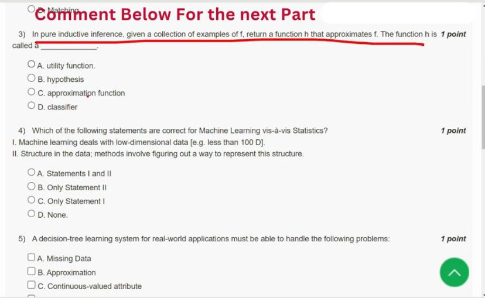

[Source video at 0:57](https://www.youtube.com/watch?v=7y9Asf2yBy8&t=57s)

#### 2024 Q3

**Question recap:** What is the learned approximation h called?

**Answer:** B — A hypothesis.

**Why:** The learner infers h from examples of an unknown target function f. Matching the training examples is not enough: the hypothesis should also work on new examples. The term applies to regression functions as well as classifiers.

#### 2024 Q4

**Question recap:** Which ML-versus-statistics statements hold?

**Answer:** B — II only.

**Why:** ML can handle high-dimensional data and learn useful representations of their structure. Statement I incorrectly confines it to low-dimensional inputs. These are broad disciplinary emphases, not a strict rule separating all statistics from all machine learning.

### 2024 — Page 03

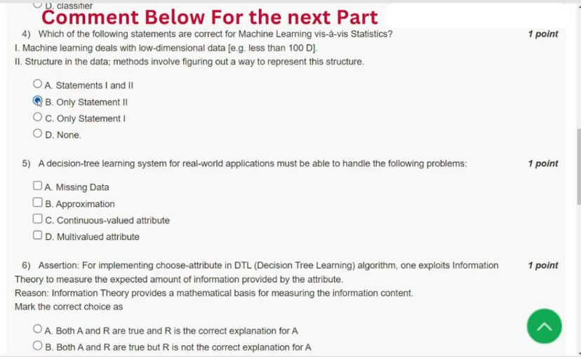

[Source video at 1:17](https://www.youtube.com/watch?v=7y9Asf2yBy8&t=77s)

#### 2024 Q5

**Question recap:** Which practical decision-tree issues are listed?

**Answer:** A, C, and D — Missing data, continuous-valued features, and multivalued features.

**Why:** Missing values need a handling rule, continuous features need split thresholds, and high-cardinality features can make some split scores misleading. “Approximation” is a general learning idea rather than the specific issue named by these options. These choices match the concrete implementation concerns in the question.

### 2024 — Page 04

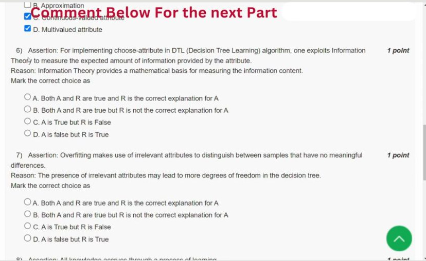

[Source video at 1:37](https://www.youtube.com/watch?v=7y9Asf2yBy8&t=97s)

#### 2024 Q6

**Question recap:** Why use information theory for attribute selection?

**Answer:** A — Both statements are true and the reason explains the assertion.

**Why:** Entropy quantifies class uncertainty, and information gain is parent entropy minus weighted child entropy. A split is useful when it leaves less uncertainty about the label. Weight child entropies by their subset sizes rather than averaging branches equally.

#### 2024 Q7

**Question recap:** How can irrelevant attributes contribute to tree overfitting?

**Answer:** A — Both statements are true and the reason explains the assertion.

**Why:** Extra candidate splits give the tree more ways to distinguish accidental details of the training sample. A deep tree can then fit noise rather than reusable structure. Pruning, minimum leaf sizes, and held-out validation can help control this behaviour.

### 2024 — Page 05

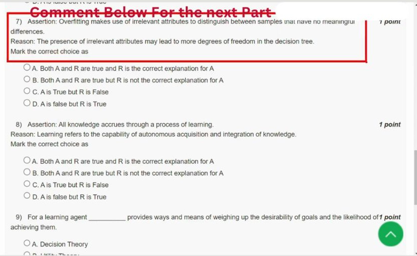

[Source video at 1:57](https://www.youtube.com/watch?v=7y9Asf2yBy8&t=117s)

#### 2024 Q8

**Question recap:** How does the course connect knowledge acquisition with learning?

**Answer:** A — The intended answer under the question's broad definition.

**Why:** Learning is described as acquisition and integration of knowledge, which explains the assertion in that pedagogical sense. This does not mean every AI system must learn all its own knowledge: a programmer can also supply facts and rules. Keep the definition separate from a claim about every implementation.

### 2024 — Page 06

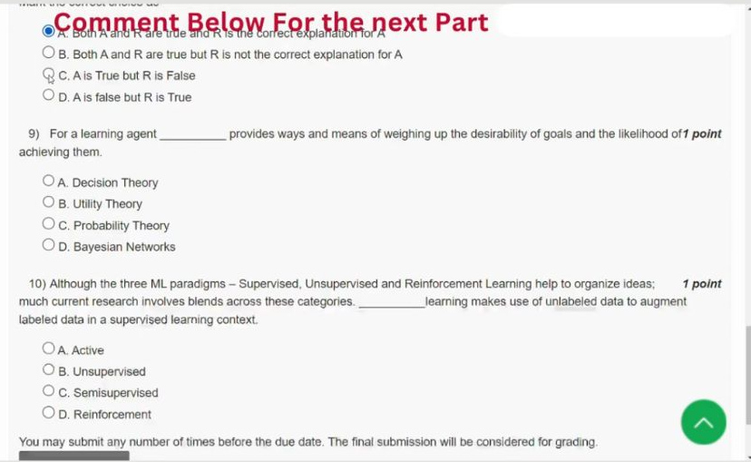

[Source video at 2:17](https://www.youtube.com/watch?v=7y9Asf2yBy8&t=137s)

#### 2024 Q9

**Question recap:** Which theory is named for a learning agent's goals and likelihoods?

**Answer:** B — Utility theory in the course's repeated key; technically decision theory combines utilities and probabilities.

**Why:** Utility represents how desirable an outcome is, while probability represents its likelihood. Expected utility combines both to compare actions. The same wording occurs in the official 2019 archive, so its expected letter should not be confused with the more precise conceptual distinction.

#### 2024 Q10

**Question recap:** What learning uses unlabelled data to supplement labelled examples?

**Answer:** C — Semisupervised learning.

**Why:** The method combines a small labelled set with additional unlabelled examples in a supervised task. Unsupervised learning has no supplied target labels, while active learning selects which examples to ask an annotator to label. Reinforcement learning learns from interaction and rewards.

[Back to year index](#2024) · [All weeks](README.md)

---

## 2019

Official NPTEL archive with accepted answers. Any discrepancy between a printed formula and its key is identified below.

[Source](https://archive.nptel.ac.in/content/storage2/courses/downloads_new/112103280/Week_10_Assignment_10.pdf)

Jump to discussion: [Q1](#2019-q1) · [Q2](#2019-q2) · [Q3](#2019-q3) · [Q4](#2019-q4) · [Q5](#2019-q5) · [Q6](#2019-q6) · [Q7](#2019-q7) · [Q8](#2019-q8) · [Q9](#2019-q9) · [Q10](#2019-q10)

### 2019 — Page 01

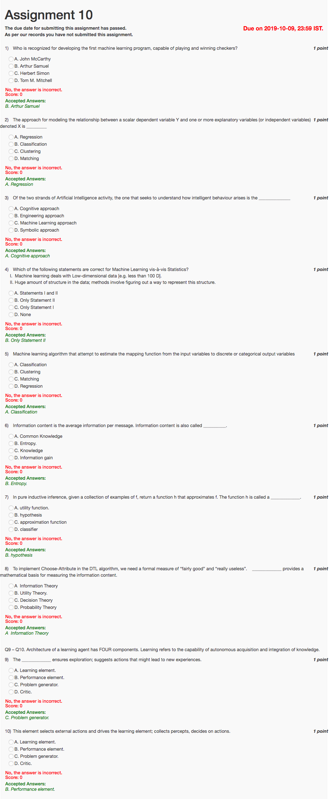

#### 2019 Q1

**Question recap:** Who is associated with the checkers-learning program?

**Answer:** B — Arthur Samuel.

**Why:** Samuel's checkers work is a landmark early machine-learning example. This is the person intended by the course's historical wording.

#### 2019 Q2

**Question recap:** What models a numerical dependent variable from predictors?

**Answer:** A — Regression.

**Why:** The output is a numerical quantity. Classification instead predicts a discrete category, while clustering groups similar observations without target labels.

#### 2019 Q3

**Question recap:** Which AI approach studies how intelligence arises?

**Answer:** A — The cognitive approach.

**Why:** It aims to explain intelligent processes. The engineering strand emphasises making useful systems exhibit intelligent behaviour.

#### 2019 Q4

**Question recap:** Which ML-versus-statistics statement holds?

**Answer:** B — II only.

**Why:** Learning methods can discover structure and representations in complex high-dimensional data. ML is not generally restricted to fewer than 100 input dimensions.

#### 2019 Q5

**Question recap:** What predicts a categorical output?

**Answer:** A — Classification.

**Why:** Its labels may be binary or multiclass. Regression concerns numerical targets, and clustering does not start with supplied class labels.

#### 2019 Q6

**Question recap:** What is average information content called?

**Answer:** B — Entropy.

**Why:** For probabilities $p_i$, entropy is $-\sum_i p_i\log_2 p_i$ in bits. A more uncertain outcome distribution has greater entropy.

#### 2019 Q7

**Question recap:** What is an inductively learned function called?

**Answer:** B — A hypothesis.

**Why:** It approximates the unknown target function from examples. Good generalisation requires more than a perfect fit to the observed sample.

#### 2019 Q8

**Question recap:** Which theory underlies information-based tree splitting?

**Answer:** A — Information theory.

**Why:** Entropy measures uncertainty, and information gain measures how much a candidate attribute reduces it. The attribute-selection step compares these reductions.

#### 2019 Q9

**Question recap:** Which agent component encourages exploration?

**Answer:** C — The problem generator.

**Why:** It suggests actions that can produce useful new experiences. Such actions may improve future learning even if their immediate payoff is not best.

#### 2019 Q10

**Question recap:** Which component chooses actions from percepts?

**Answer:** B — The performance element.

**Why:** It produces the agent's external behaviour. The learning element improves it using feedback from the critic.

[Back to year index](#2019) · [All weeks](README.md)

---
