# Week 11 — Machine Learning II

[All weeks](README.md) · [Previous](Week%2010.md) · [Next](Week%2012.md)

[2026](#2026) · [2025](#2025) · [2024](#2024) · [2019](#2019)

Screenshots appear inline. Each question has a short recap, answer, and explanation below the relevant page.

## 2026

Official solution linked from the enrolled 2026 course; checked against the live weekly assessment.

[Source](https://drive.google.com/file/d/1Sh_hQomV-gEUXIjHWyHx0sUNSmiHba0a/view)

Jump to discussion: [Q1](#2026-q1) · [Q2](#2026-q2) · [Q3](#2026-q3) · [Q4](#2026-q4) · [Q5](#2026-q5) · [Q6](#2026-q6) · [Q7](#2026-q7) · [Q8](#2026-q8) · [Q9](#2026-q9) · [Q10](#2026-q10)

### 2026 — Page 01

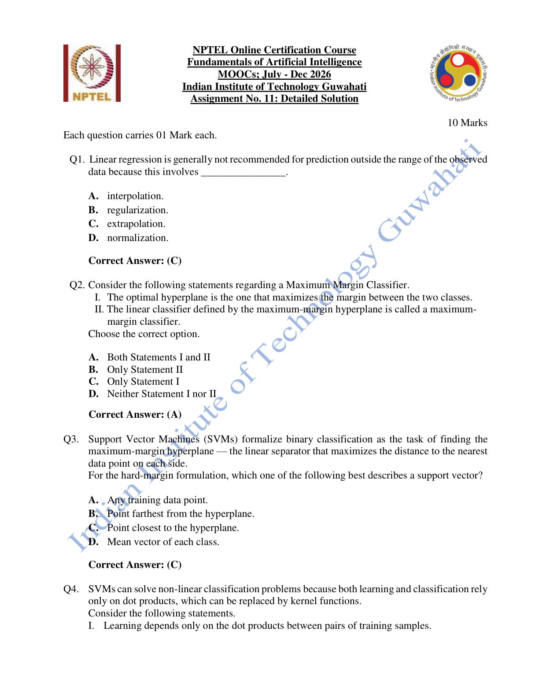

#### 2026 Q1

**Question recap:** Why avoid predictions far beyond observed regression data?

**Answer:** C — Extrapolation.

**Why:** A trend fitted inside the observed range need not continue outside it. Interpolation stays within the observed range and makes a weaker assumption.

#### 2026 Q2

**Question recap:** What characterises the maximum-margin classifier?

**Answer:** A — Both I and II.

**Why:** It selects the separating hyperplane with the greatest distance to the nearest training points on either side. That distance provides the margin.

#### 2026 Q3

**Question recap:** Which points are support vectors in the hard-margin case?

**Answer:** C — The closest points to the separating hyperplane.

**Why:** These points lie on the margin boundaries and constrain the optimal separator. Moving a distant point usually does not change that boundary.

### 2026 — Page 02

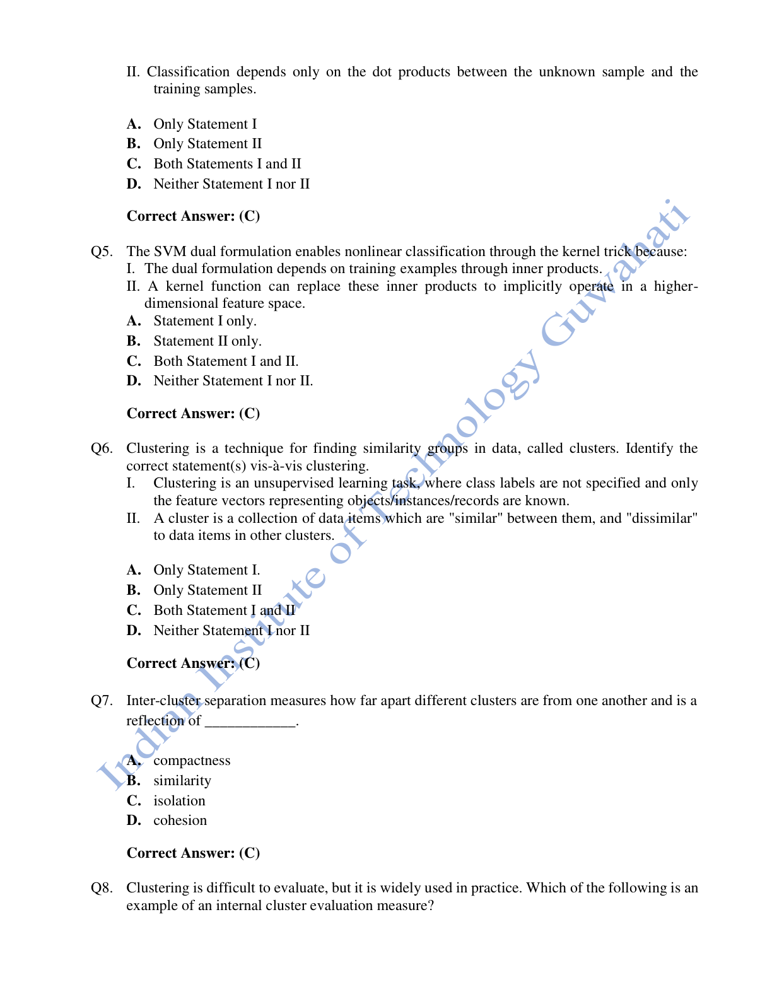

#### 2026 Q4

**Question recap:** Which dot products matter to SVMs?

**Answer:** C — Both training-training and test-training products.

**Why:** The dual training problem uses pairwise training inner products, and prediction uses products with support vectors. Kernel functions can replace these products.

#### 2026 Q5

**Question recap:** Why does the kernel trick work in the dual formulation?

**Answer:** C — Both I and II.

**Why:** A valid kernel evaluates an inner product in an implicit feature space. This can produce a nonlinear boundary in the original input space without explicitly constructing every feature.

#### 2026 Q6

**Question recap:** Which clustering statements are correct?

**Answer:** C — Both I and II.

**Why:** Clustering normally starts without class labels and groups similar observations. A useful clustering has strong similarity within groups and separation between them.

#### 2026 Q7

**Question recap:** What does inter-cluster separation measure?

**Answer:** C — Isolation.

**Why:** It measures how far distinct groups are from each other. Compactness or cohesion concerns how tightly packed the members of one group are.

### 2026 — Page 03

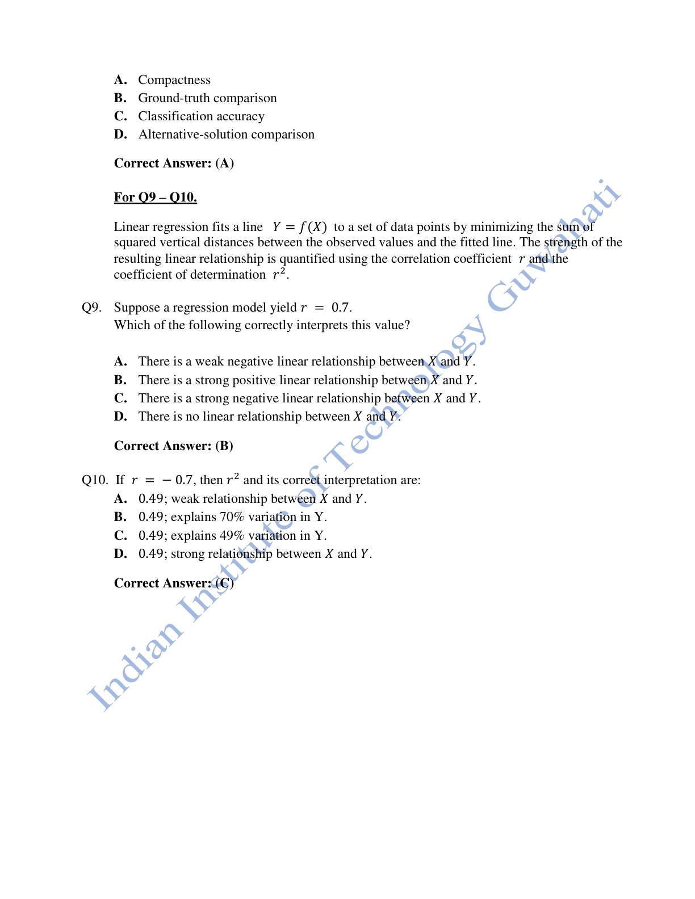

#### 2026 Q8

**Question recap:** Which evaluation measure is internal?

**Answer:** A — Compactness.

**Why:** It can be computed from the data and cluster assignments alone. Ground-truth comparison needs external labels and is therefore an external evaluation.

#### 2026 Q9

**Question recap:** How should r=0.7 be interpreted here?

**Answer:** B — A strong positive linear relationship.

**Why:** The positive sign means both variables tend to increase together, and the magnitude indicates substantial linear association. Labels such as “strong” depend on context; this is the course's intended option.

#### 2026 Q10

**Question recap:** What does r=-0.7 imply for explained variation?

**Answer:** C — $r^2=0.49$, or 49%.

**Why:** Squaring removes the sign. In ordinary simple linear regression with an intercept, this is the fraction of response variance explained by the fitted linear model, not 70%.

[Back to year index](#2026) · [All weeks](README.md)

---

## 2025

Public copy of 2025 assignment solutions. Highlights are preserved; corrections and wording issues are identified below.

[Source](https://www.scribd.com/document/937061874/NPTEL)

Jump to discussion: [Q1](#2025-q1) · [Q2](#2025-q2) · [Q3](#2025-q3) · [Q4](#2025-q4) · [Q5](#2025-q5) · [Q6](#2025-q6) · [Q7](#2025-q7) · [Q8](#2025-q8) · [Q9](#2025-q9) · [Q10](#2025-q10)

### 2025 — Page 01

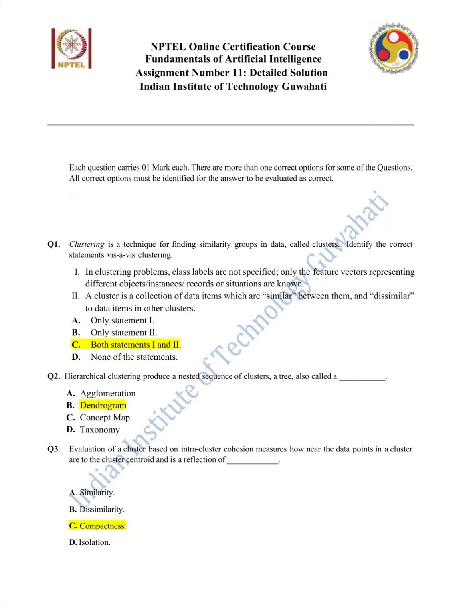

#### 2025 Q1

**Question recap:** Which clustering statements hold?

**Answer:** C — Both I and II.

**Why:** Clustering uses unlabelled feature vectors and aims for similar members within a group and dissimilar members across groups. The choice of similarity measure matters.

#### 2025 Q2

**Question recap:** What is the hierarchical clustering tree called?

**Answer:** B — A dendrogram.

**Why:** Its branches show nested merges or divisions at different similarity levels. Cutting it at a chosen height gives a particular clustering.

#### 2025 Q3

**Question recap:** What does intra-cluster cohesion reflect?

**Answer:** C — Compactness.

**Why:** It measures how close members are to one another or to their cluster representative. Smaller within-cluster dispersion indicates greater compactness.

### 2025 — Page 02

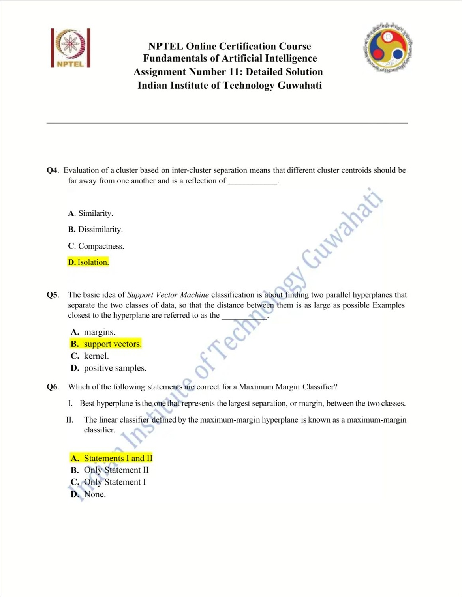

#### 2025 Q4

**Question recap:** What does inter-cluster separation reflect?

**Answer:** D — Isolation.

**Why:** Well-separated clusters have distant centres or boundaries. This is different from keeping each individual cluster internally tight.

#### 2025 Q5

**Question recap:** What are the nearest SVM training points called?

**Answer:** B — Support vectors.

**Why:** They determine the margin and constrain the separator. For a hard-margin SVM they lie on the two supporting margin hyperplanes.

#### 2025 Q6

**Question recap:** Which maximum-margin statements hold?

**Answer:** A — Both I and II.

**Why:** The best separating hyperplane maximises its margin. The resulting linear rule is therefore called a maximum-margin classifier.

### 2025 — Page 03

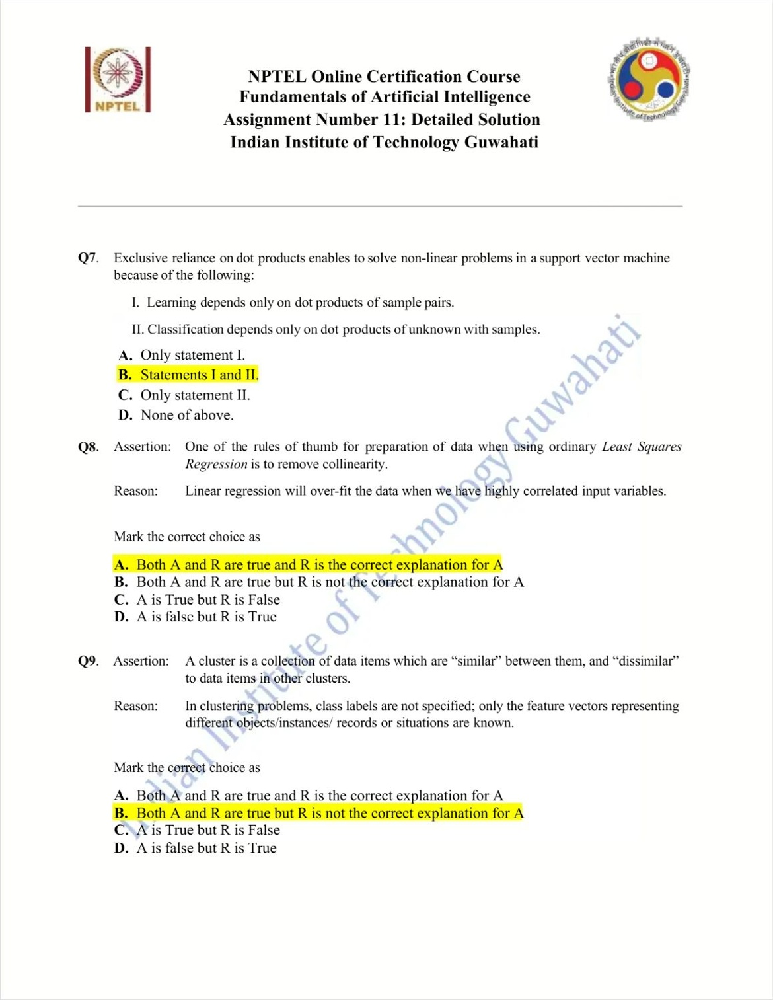

#### 2025 Q7

**Question recap:** Why can dot-product formulations use kernels?

**Answer:** B — Both I and II.

**Why:** Training and prediction depend on inner products, which can be replaced by valid kernels. This implicitly changes the feature space and can yield nonlinear boundaries in the input space.

#### 2025 Q8

**Question recap:** Does collinearity necessarily make OLS overfit?

**Answer:** A in the source key, but its explanation is overstated.

**Why:** Correlated predictors can inflate coefficient variance and make estimates unstable; they do not by themselves guarantee overfitting or poor prediction. For the technical distinction see [Stanford's regression notes](https://web.stanford.edu/class/stats202/notes/Linear-regression/Multiple-linear-regression.html).

#### 2025 Q9

**Question recap:** Does the absence of labels explain the cluster-similarity definition?

**Answer:** B — Both statements are true, but the reason is not the explanation.

**Why:** Unsupervised learning describes the available supervision. Similarity within clusters describes the grouping objective; one statement does not logically explain the other.

### 2025 — Page 04

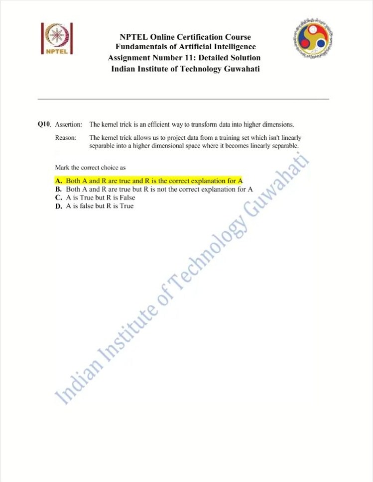

#### 2025 Q10

**Question recap:** Why is the kernel trick useful?

**Answer:** A — Both statements are true, with the intended explanation.

**Why:** A valid kernel computes feature-space inner products without explicitly constructing the transformed vectors. This can support nonlinear separation; an arbitrary higher-dimensional mapping does not guarantee separability for every dataset.

[Back to year index](#2025) · [All weeks](README.md)

---

## 2024

Question screenshots captured from MY SWAYAM’s public 2024 assignment video, linked to course noc24_ge47. The uploader’s unsubmitted choices, annotations, and occasional overlay text are preserved. They are not an official answer key; corrections and ambiguous wording are discussed below.

[Source](https://www.youtube.com/watch?v=amQ9vWBS2AM&t=25s)

Jump to discussion: [Q1](#2024-q1) · [Q2](#2024-q2) · [Q3](#2024-q3) · [Q4](#2024-q4) · [Q5](#2024-q5) · [Q6](#2024-q6) · [Q7](#2024-q7) · [Q8](#2024-q8) · [Q9](#2024-q9) · [Q10](#2024-q10)

### 2024 — Page 01

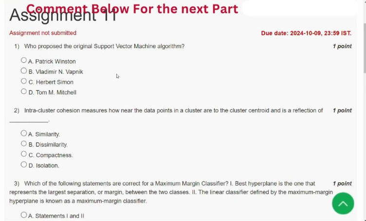

[Source video at 0:25](https://www.youtube.com/watch?v=amQ9vWBS2AM&t=25s)

#### 2024 Q1

**Question recap:** Which listed researcher is associated with the original SVM algorithm?

**Answer:** B — Vladimir N. Vapnik.

**Why:** Vapnik is the intended single-name answer among these options. SVM development also involved collaborators, so this is the course's attribution rather than a complete history. Associate the method with margin maximisation and support vectors.

#### 2024 Q2

**Question recap:** What does intra-cluster cohesion measure?

**Answer:** C — Compactness.

**Why:** It measures how close members of a cluster are to one another or their representative. Lower within-cluster dispersion means greater compactness under that measure. Isolation instead concerns separation between different clusters.

### 2024 — Page 02

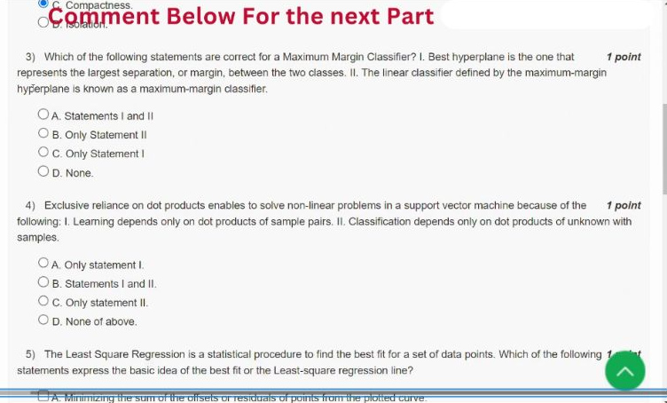

[Source video at 0:55](https://www.youtube.com/watch?v=amQ9vWBS2AM&t=55s)

#### 2024 Q3

**Question recap:** Which maximum-margin descriptions hold?

**Answer:** A — Both I and II.

**Why:** Choose the separating hyperplane with the greatest margin from the nearest training observations. For a hard-margin SVM, the supporting points lie on the margin boundaries. Maximising that distance distinguishes the maximum-margin separator from an arbitrary separating line.

#### 2024 Q4

**Question recap:** Which dot products support the kernel formulation?

**Answer:** B — Both I and II.

**Why:** Training uses inner products between training examples; prediction uses inner products between the new example and support vectors. A valid kernel supplies those products in an implicit feature space. The transformed boundary can be nonlinear in the original inputs.

### 2024 — Page 03

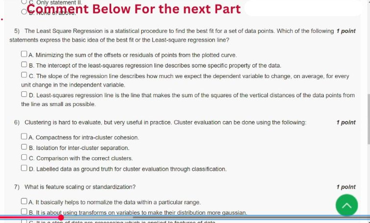

[Source video at 1:25](https://www.youtube.com/watch?v=amQ9vWBS2AM&t=85s)

#### 2024 Q5

**Question recap:** Which statements capture the least-squares criterion and slope interpretation?

**Answer:** C and D are the substantive statements; D defines the fitting criterion.

**Why:** Least squares minimises $\sum_i(y_i-\hat y_i)^2$, the squared vertical residuals. The slope gives the fitted change in y per unit change in x. Minimising the unsquared residual sum is not the least-squares objective. The intercept is the predicted y at x=0; option B's vague wording is not a definition of the fitting criterion.

### 2024 — Page 04

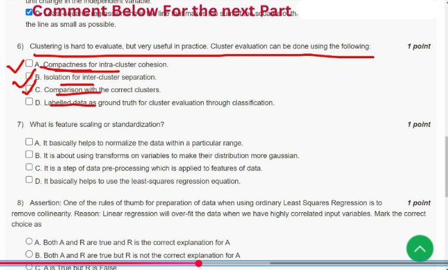

[Source video at 1:55](https://www.youtube.com/watch?v=amQ9vWBS2AM&t=115s)

#### 2024 Q6

**Question recap:** Which cluster-evaluation methods are clearly described?

**Answer:** A, B, and C; D is ambiguously worded.

**Why:** Compactness and separation are internal measures. Comparing clusters with known reference groups is external evaluation and can use labels as ground truth. Therefore labels can validly evaluate clustering, but calling that process “classification” does not make clustering a supervised classifier. The public source is not an official multi-answer key.

#### 2024 Q7

**Question recap:** What is the distinction between scaling and standardisation?

**Answer:** A describes range normalisation; C correctly identifies preprocessing. The question merges two related terms.

**Why:** Min–max scaling gives $(x-x_{min})/(x_{max}-x_{min})$, often in $[0,1]$. Standardisation uses $(x-\mu)/\sigma$, giving zero mean and unit variance for a nonconstant training feature; it does not guarantee a Gaussian distribution or a fixed range. See the [official preprocessing documentation](https://scikit-learn.org/stable/modules/preprocessing.html).

### 2024 — Page 05

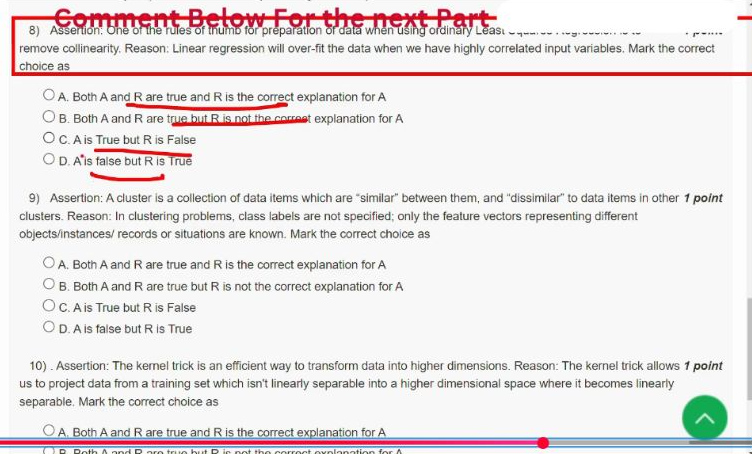

[Source video at 2:25](https://www.youtube.com/watch?v=amQ9vWBS2AM&t=145s)

#### 2024 Q8

**Question recap:** Does collinearity guarantee that OLS overfits?

**Answer:** C under a literal reading; the public video selects A.

**Why:** Removing severe collinearity is a useful rule of thumb for stable coefficient interpretation, but correlated predictors do not invariably cause overfitting. They can inflate coefficient variance, and perfect collinearity makes coefficients non-unique. Prediction can still be good. The reason's unconditional “will over-fit” claim is too strong; see [Stanford's regression notes](https://web.stanford.edu/class/stats202/notes/Linear-regression/Multiple-linear-regression.html).

#### 2024 Q9

**Question recap:** Does the absence of labels explain the cluster-similarity definition?

**Answer:** B — Both statements are true, but the reason is not the explanation; the video selects A.

**Why:** Similarity within groups and dissimilarity between groups describe the clustering objective. The absence of class labels describes the available supervision. A definition of what makes a useful cluster does not follow merely from withholding labels.

### 2024 — Page 06

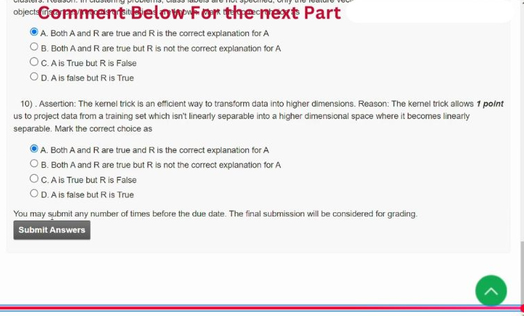

[Source video at 2:55](https://www.youtube.com/watch?v=amQ9vWBS2AM&t=175s)

#### 2024 Q10

**Question recap:** Why is the kernel trick useful?

**Answer:** A — The course's intended answer, with a qualification.

**Why:** A valid kernel evaluates an inner product in a feature space without explicitly constructing all transformed coordinates. This can permit nonlinear separation in the original inputs. An arbitrary higher-dimensional mapping does not guarantee separability for every dataset; the reason should be read as describing a suitable representation rather than an unconditional promise.

[Back to year index](#2024) · [All weeks](README.md)

---

## 2019

Official NPTEL archive with accepted answers. Any discrepancy between a printed formula and its key is identified below.

[Source](https://archive.nptel.ac.in/content/storage2/courses/downloads_new/112103280/Week_11_Assignment_11.pdf)

Jump to discussion: [Q1](#2019-q1) · [Q2](#2019-q2) · [Q3](#2019-q3) · [Q4](#2019-q4) · [Q5](#2019-q5) · [Q6](#2019-q6) · [Q7](#2019-q7) · [Q8](#2019-q8) · [Q9](#2019-q9) · [Q10](#2019-q10)

### 2019 — Page 01

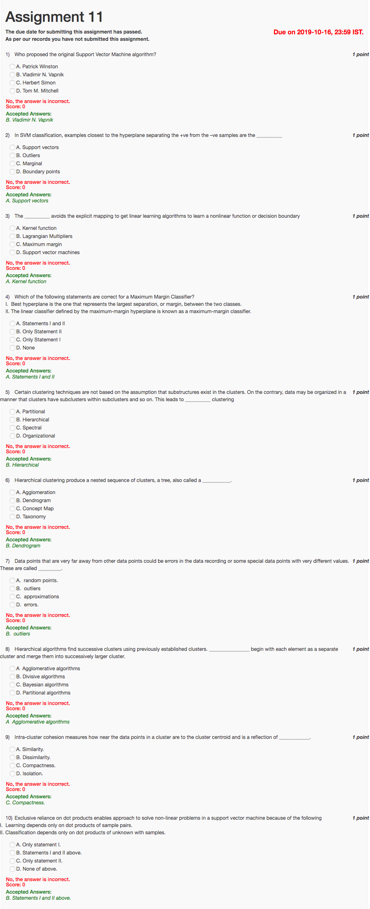

#### 2019 Q1

**Question recap:** Which listed researcher is associated with SVMs?

**Answer:** B — Vladimir N. Vapnik.

**Why:** This is the course's intended attribution. SVM development also involved collaborators; the single-name option should not be read as a complete history.

#### 2019 Q2

**Question recap:** What are the closest separating-boundary examples called?

**Answer:** A — Support vectors.

**Why:** They constrain the margin. In the hard-margin case, the relevant examples lie on the supporting hyperplanes nearest the decision boundary.

#### 2019 Q3

**Question recap:** What avoids explicit feature-space construction?

**Answer:** A — A kernel function.

**Why:** It computes an inner product in the transformed space directly. A linear method there can correspond to a nonlinear boundary in the original input space.

#### 2019 Q4

**Question recap:** Which maximum-margin statements hold?

**Answer:** A — Both I and II.

**Why:** The separator maximises the margin between classes, and the resulting rule is a maximum-margin classifier. The nearest examples determine that margin.

#### 2019 Q5

**Question recap:** What clustering type supports nested subclusters?

**Answer:** B — Hierarchical clustering.

**Why:** It represents groups at multiple levels of granularity. A flat partition instead gives a single grouping level.

#### 2019 Q6

**Question recap:** What is the resulting nested-cluster tree called?

**Answer:** B — A dendrogram.

**Why:** Branch heights reflect the merge or split structure. Different cuts through the tree produce different numbers of clusters.

#### 2019 Q7

**Question recap:** What are unusually distant observations called?

**Answer:** B — Outliers.

**Why:** They may be measurement errors or meaningful rare observations. Being far from other data alone does not establish that a point should be deleted.

#### 2019 Q8

**Question recap:** Which method starts with singleton clusters and merges them?

**Answer:** A — Agglomerative clustering.

**Why:** It builds the hierarchy from the bottom up. Divisive clustering starts with a large group and splits it.

#### 2019 Q9

**Question recap:** What does intra-cluster cohesion reflect?

**Answer:** C — Compactness.

**Why:** It measures how tightly members concentrate within a cluster, often relative to a centroid. Isolation concerns separation between different clusters.

#### 2019 Q10

**Question recap:** Which SVM dot-product statements hold?

**Answer:** B — Both I and II.

**Why:** Training depends on training-sample inner products, and prediction uses inner products with the relevant samples. Replacing them by valid kernels enables implicit nonlinear feature maps.

[Back to year index](#2019) · [All weeks](README.md)

---
