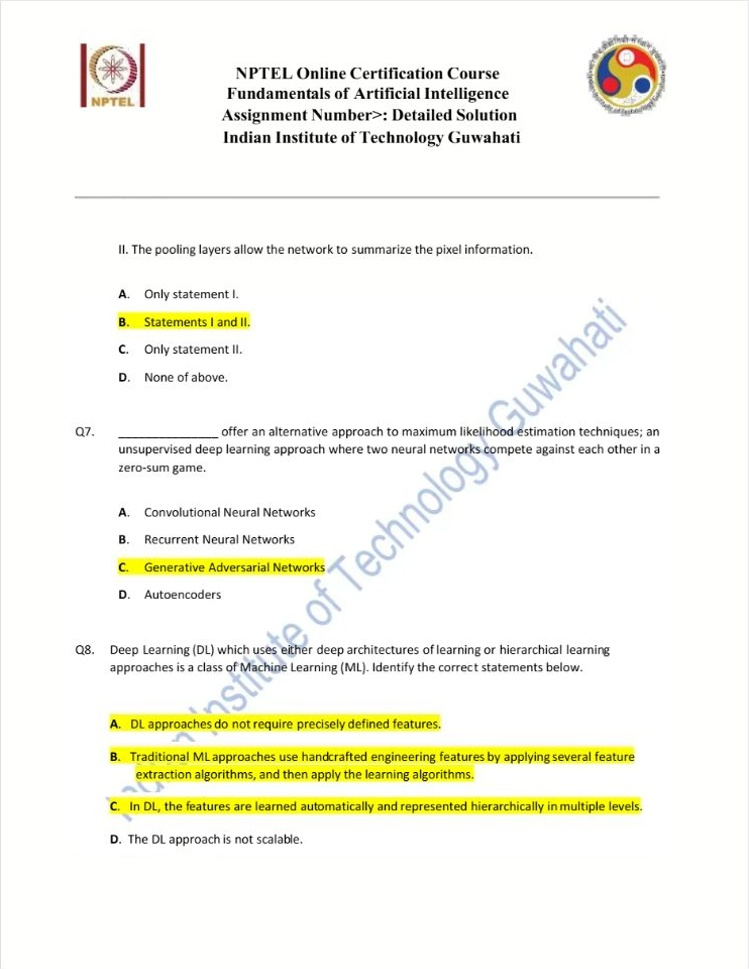
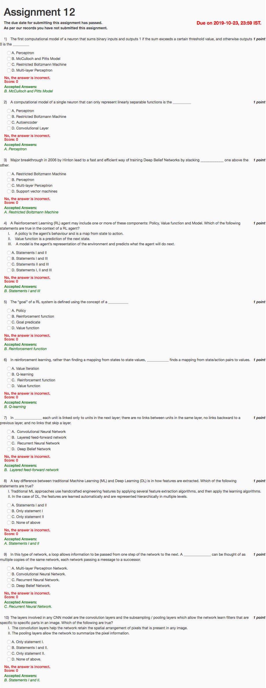

# Week 12 — Machine Learning III

[All weeks](README.md) · [Previous](Week%2011.md)

[2026](#2026) · [2025](#2025) · [2019](#2019)

Screenshots appear inline. Each question has a short recap, answer, and explanation below the relevant page.

## 2026

Official solution linked from the enrolled 2026 course; checked against the live weekly assessment.

[Source](https://drive.google.com/file/d/1EPkaDW-lCTOrTuCvkFABDO8yS3oimB5L/view)

Jump to discussion: [Q1](#2026-q1) · [Q2](#2026-q2) · [Q3](#2026-q3) · [Q4](#2026-q4) · [Q5](#2026-q5) · [Q6](#2026-q6) · [Q7](#2026-q7) · [Q8](#2026-q8) · [Q9](#2026-q9) · [Q10](#2026-q10)

### 2026 — Page 01

#### 2026 Q1

**Question recap:** What is the approximating function in induction called?

**Answer:** B — A hypothesis.

**Why:** Examples constrain possible target functions, and the learner selects one candidate approximation. A hypothesis need not be a classifier; the target can also be numerical.

#### 2026 Q2

**Question recap:** What does value iteration primarily compute?

**Answer:** A — Optimal state utilities.

**Why:** Bellman updates estimate the best achievable return from each state. The optimal policy can subsequently be obtained by maximising expected successor value.

#### 2026 Q3

**Question recap:** What rewards determine a policy's value?

**Answer:** B — Discounted rewards.

**Why:** Value is expected cumulative return while following the policy. Immediate reward alone ignores consequences of actions on later states.

#### 2026 Q4

**Question recap:** What is a key advantage of Q-learning?

**Answer:** B — It learns action values without an explicit transition model.

**Why:** Sample transitions and rewards update Q-values directly. Standard value iteration instead assumes a model for calculating expected backups.

### 2026 — Page 02

#### 2026 Q5

**Question recap:** What distinguishes deep feature learning?

**Answer:** C — Automatically learned hierarchical features.

**Why:** Successive network layers learn increasingly abstract representations. Traditional pipelines often rely more heavily on manually chosen features, although the boundary is not absolute.

#### 2026 Q6

**Question recap:** What is the reward hypothesis?

**Answer:** B — Maximise expected cumulative reward.

**Why:** The objective includes future outcomes and expectation over randomness. Maximising only the next reward can select an action with poor long-term consequences.

#### 2026 Q7

**Question recap:** What is a policy?

**Answer:** B — A mapping from states to actions.

**Why:** A deterministic policy selects one action; a stochastic policy assigns action probabilities. It describes behaviour, while a value function evaluates expected return.

#### 2026 Q8

**Question recap:** What property makes the next outcome independent of earlier history?

**Answer:** A — The Markov property for the stated state.

**Why:** Given the present state and action, earlier history adds no predictive information. The next outcome may still be random; Markov does not mean deterministic.

### 2026 — Page 03

#### 2026 Q9

**Question recap:** Why choose a lower-valued action?

**Answer:** B — Exploration, such as epsilon-greedy.

**Why:** An exploratory choice gathers information about less-tried actions and can improve future estimates. A greedy exploitation step would select the higher Q-value.

#### 2026 Q10

**Question recap:** What does the reward function specify?

**Answer:** B — Rewards associated with states or transitions.

**Why:** It defines the scalar feedback signal for the task. A transition model predicts outcomes, and a policy chooses actions; these are separate components.

[Back to year index](#2026) · [All weeks](README.md)

---

## 2025

Public copy of 2025 assignment solutions. Highlights are preserved; corrections and wording issues are identified below.

[Source](https://www.scribd.com/document/937061874/NPTEL)

Jump to discussion: [Q1](#2025-q1) · [Q2](#2025-q2) · [Q3](#2025-q3) · [Q4](#2025-q4) · [Q5](#2025-q5) · [Q6](#2025-q6) · [Q7](#2025-q7) · [Q8](#2025-q8) · [Q9](#2025-q9) · [Q10](#2025-q10)

### 2025 — Page 01

#### 2025 Q1

**Question recap:** Which RL-component statements are correct?

**Answer:** B in the source — I and III, with a wording error in III.

**Why:** A policy chooses actions and a value function predicts return. An environment model predicts the environment's next state and reward, rather than choosing what the agent does. As literally printed, only I is correct and that option is absent. See [Sutton and Barto](https://www.incompleteideas.net/book/bookdraft2018mar21.pdf).

#### 2025 Q2

**Question recap:** What learns values for state–action pairs?

**Answer:** B — Q-learning.

**Why:** It estimates $Q(s,a)$ rather than only a state value $V(s)$. Comparing action values allows a policy to be selected from the learned estimates.

### 2025 — Page 02

#### 2025 Q3

**Question recap:** Which steps describe value iteration?

**Answer:** A and B.

**Why:** Compute state utilities through Bellman backups, then select the best action in each state. This differs from explicitly alternating policy evaluation and policy improvement.

#### 2025 Q4

**Question recap:** Which steps describe policy iteration?

**Answer:** C and D.

**Why:** Evaluate a current policy and then replace its actions with better ones. Repeat those two phases until the policy stops changing.

#### 2025 Q5

**Question recap:** Which backpropagation statements hold?

**Answer:** A, C, and D.

**Why:** Backpropagation computes how each weight contributes to the output error, enabling gradient-based training of multilayer networks. Mapping state–action pairs to returns describes Q-learning, not backpropagation itself.

### 2025 — Page 03

#### 2025 Q6

**Question recap:** What do convolution and pooling contribute?

**Answer:** B — Both I and II.

**Why:** Convolution uses local spatial structure and shared filters. Pooling summarises local responses and can reduce spatial resolution and sensitivity to small shifts.

#### 2025 Q7

**Question recap:** Which architecture trains two competing networks?

**Answer:** C — A generative adversarial network.

**Why:** A generator creates samples and a discriminator tries to distinguish them from real data. Their adversarial objectives drive the learning process.

#### 2025 Q8

**Question recap:** Which deep-learning feature statements hold?

**Answer:** A, B, and C.

**Why:** Deep models can learn layered representations directly from data, reducing reliance on manually designed features. They still need suitable inputs, training objectives, data, and computation; the claim that they are inherently unscalable is false.

### 2025 — Page 04

#### 2025 Q9

**Question recap:** Why do many deep supervised models need substantial data and computation?

**Answer:** A — Both statements are true, with the course's intended explanation.

**Why:** Fitting many layers and parameters can require many examples and operations. This is a common tendency, not a universal need for newly labelled data; transfer learning and self-supervised learning are important exceptions.

#### 2025 Q10

**Question recap:** Why did early work emphasise single-layer perceptrons?

**Answer:** A — Both statements are true, with the stated explanation.

**Why:** Effective credit assignment to hidden-layer weights was a major difficulty. Backpropagation supplies gradients through those hidden layers and enables systematic multilayer training.

[Back to year index](#2025) · [All weeks](README.md)

---

## 2019

Official NPTEL archive with accepted answers. Any discrepancy between a printed formula and its key is identified below.

[Source](https://archive.nptel.ac.in/content/storage2/courses/downloads_new/112103280/Week_12_Assignment_12.pdf)

Jump to discussion: [Q1](#2019-q1) · [Q2](#2019-q2) · [Q3](#2019-q3) · [Q4](#2019-q4) · [Q5](#2019-q5) · [Q6](#2019-q6) · [Q7](#2019-q7) · [Q8](#2019-q8) · [Q9](#2019-q9) · [Q10](#2019-q10)

### 2019 — Page 01

#### 2019 Q1

**Question recap:** What is the early binary threshold neuron model?

**Answer:** B — The McCulloch–Pitts model.

**Why:** It sums binary inputs and applies a threshold to produce a binary output. The perceptron adds a trainable weighted decision rule.

#### 2019 Q2

**Question recap:** Which single-neuron model represents only linearly separable functions?

**Answer:** A — The perceptron.

**Why:** Its thresholded weighted sum defines a linear decision boundary. A single perceptron cannot implement XOR without an additional feature transformation or hidden layer.

#### 2019 Q3

**Question recap:** What building blocks were stacked for deep-belief-network training?

**Answer:** A — Restricted Boltzmann machines.

**Why:** Layer-wise pretraining fitted successive latent representations. This was an important historical approach to training deeper networks.

#### 2019 Q4

**Question recap:** Which RL-component option does the archive accept?

**Answer:** B — I and III, but III contains a wording error.

**Why:** A policy maps states to actions; a value function predicts return. A model predicts what the environment will do, not what action the agent will choose. Taken literally, only I is correct and the matching option is missing. See [Sutton and Barto](https://www.incompleteideas.net/book/bookdraft2018mar21.pdf).

#### 2019 Q5

**Question recap:** What defines an RL system's goal through feedback?

**Answer:** B — A reinforcement or reward function.

**Why:** It specifies the reward signal whose cumulative value the learner seeks to maximise. A policy describes behaviour rather than defining which outcomes are desirable.

#### 2019 Q6

**Question recap:** What learns state–action values?

**Answer:** B — Q-learning.

**Why:** It estimates the expected return of taking an action in a state and then acting optimally. This permits action comparisons without first learning a transition model.

#### 2019 Q7

**Question recap:** What network has only successive forward layer connections?

**Answer:** B — A layered feed-forward network.

**Why:** Information moves from input toward output without recurrent feedback. The question describes the simple adjacent-layer architecture; modern feed-forward networks may also include skip connections.

#### 2019 Q8

**Question recap:** Which feature-extraction statements hold?

**Answer:** A — Both I and II.

**Why:** Traditional pipelines often use engineered features, while deep models learn hierarchical representations. This is a useful broad distinction, not a claim that every traditional learner lacks representation learning.

#### 2019 Q9

**Question recap:** Which network passes a hidden state through successive steps?

**Answer:** C — A recurrent neural network.

**Why:** Reusing the same transition across time is equivalent to unrolling copies with shared parameters. Its hidden state can summarise earlier sequence information.

#### 2019 Q10

**Question recap:** Which convolution-and-pooling statements hold?

**Answer:** B — Both I and II.

**Why:** Convolution exploits local spatial arrangements; pooling summarises local responses. Pooling can reduce detail while making features less sensitive to small shifts.

[Back to year index](#2019) · [All weeks](README.md)

---
