# Week 12 — Machine Learning III

[All weeks](README.md) · [Previous](Week%2011.md)

[2026](#2026) · [2025](#2025) · [2024](#2024) · [2023](#2023) · [2019](#2019)

Screenshots appear inline. Each question has a short recap, answer, and explanation below the relevant page.

## 2026

Official solution linked from the enrolled 2026 course; checked against the live weekly assessment.

[Source](https://drive.google.com/file/d/1EPkaDW-lCTOrTuCvkFABDO8yS3oimB5L/view)

Jump to discussion: [Q1](#2026-q1) · [Q2](#2026-q2) · [Q3](#2026-q3) · [Q4](#2026-q4) · [Q5](#2026-q5) · [Q6](#2026-q6) · [Q7](#2026-q7) · [Q8](#2026-q8) · [Q9](#2026-q9) · [Q10](#2026-q10)

### 2026 — Page 01

#### 2026 Q1

**Question recap:** What is the approximating function in induction called?

**Answer:** B — A hypothesis.

**Why:** Examples constrain possible target functions, and the learner selects one candidate approximation. A hypothesis need not be a classifier; the target can also be numerical.

#### 2026 Q2

**Question recap:** What does value iteration primarily compute?

**Answer:** A — Optimal state utilities.

**Why:** Bellman updates estimate the best achievable return from each state. The optimal policy can subsequently be obtained by maximising expected successor value.

#### 2026 Q3

**Question recap:** What rewards determine a policy's value?

**Answer:** B — Discounted rewards.

**Why:** Value is expected cumulative return while following the policy. Immediate reward alone ignores consequences of actions on later states.

#### 2026 Q4

**Question recap:** What is a key advantage of Q-learning?

**Answer:** B — It learns action values without an explicit transition model.

**Why:** Sample transitions and rewards update Q-values directly. Standard value iteration instead assumes a model for calculating expected backups.

### 2026 — Page 02

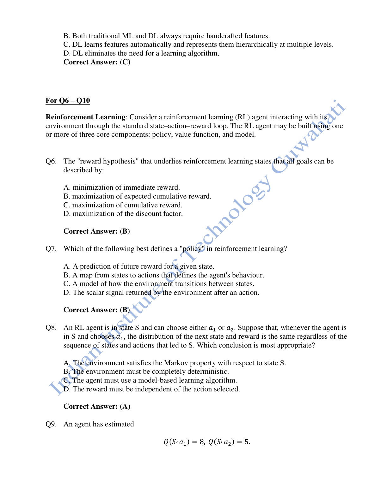

#### 2026 Q5

**Question recap:** What distinguishes deep feature learning?

**Answer:** C — Automatically learned hierarchical features.

**Why:** Successive network layers learn increasingly abstract representations. Traditional pipelines often rely more heavily on manually chosen features, although the boundary is not absolute.

#### 2026 Q6

**Question recap:** What is the reward hypothesis?

**Answer:** B — Maximise expected cumulative reward.

**Why:** The objective includes future outcomes and expectation over randomness. Maximising only the next reward can select an action with poor long-term consequences.

#### 2026 Q7

**Question recap:** What is a policy?

**Answer:** B — A mapping from states to actions.

**Why:** A deterministic policy selects one action; a stochastic policy assigns action probabilities. It describes behaviour, while a value function evaluates expected return.

#### 2026 Q8

**Question recap:** What property makes the next outcome independent of earlier history?

**Answer:** A — The Markov property for the stated state.

**Why:** Given the present state and action, earlier history adds no predictive information. The next outcome may still be random; Markov does not mean deterministic.

### 2026 — Page 03

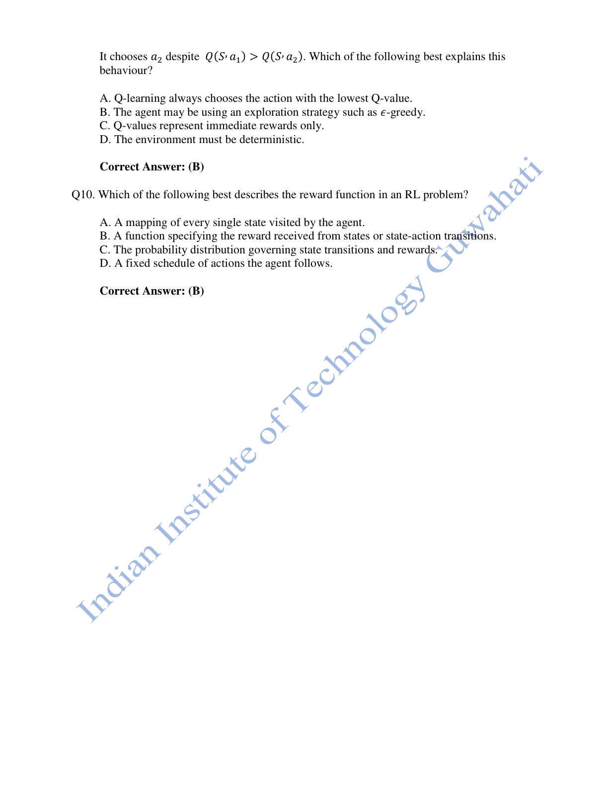

#### 2026 Q9

**Question recap:** Why choose a lower-valued action?

**Answer:** B — Exploration, such as epsilon-greedy.

**Why:** An exploratory choice gathers information about less-tried actions and can improve future estimates. A greedy exploitation step would select the higher Q-value.

#### 2026 Q10

**Question recap:** What does the reward function specify?

**Answer:** B — Rewards associated with states or transitions.

**Why:** It defines the scalar feedback signal for the task. A transition model predicts outcomes, and a policy chooses actions; these are separate components.

[Back to year index](#2026) · [All weeks](README.md)

---

## 2025

Public copy of 2025 assignment solutions. Highlights are preserved; corrections and wording issues are identified below.

[Source](https://www.scribd.com/document/937061874/NPTEL)

Jump to discussion: [Q1](#2025-q1) · [Q2](#2025-q2) · [Q3](#2025-q3) · [Q4](#2025-q4) · [Q5](#2025-q5) · [Q6](#2025-q6) · [Q7](#2025-q7) · [Q8](#2025-q8) · [Q9](#2025-q9) · [Q10](#2025-q10)

### 2025 — Page 01

#### 2025 Q1

**Question recap:** Which RL-component statements are correct?

**Answer:** B in the source — I and III, with a wording error in III.

**Why:** A policy chooses actions and a value function predicts return. An environment model predicts the environment's next state and reward, rather than choosing what the agent does. As literally printed, only I is correct and that option is absent. See [Sutton and Barto](https://www.incompleteideas.net/book/bookdraft2018mar21.pdf).

#### 2025 Q2

**Question recap:** What learns values for state–action pairs?

**Answer:** B — Q-learning.

**Why:** Q-learning estimates $Q(s,a)$, the return associated with a state–action pair. Its sampled target is $r+\gamma\max_{a\prime}Q(s\prime,a\prime)$. For old value 2, reward 1, discount 0.9, best next value 4, and learning rate 0.5, the update gives $2+0.5[1+0.9(4)-2]=3.3$. A state value $V(s)$ has no action argument.

### 2025 — Page 02

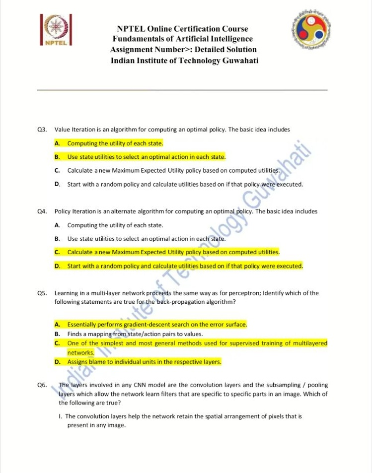

#### 2025 Q3

**Question recap:** Which steps describe value iteration?

**Answer:** A and B.

**Why:** Compute state utilities through Bellman backups, then select the best action in each state. This differs from explicitly alternating policy evaluation and policy improvement.

#### 2025 Q4

**Question recap:** Which steps describe policy iteration?

**Answer:** C and D.

**Why:** Evaluate a current policy and then replace its actions with better ones. Repeat those two phases until the policy stops changing.

#### 2025 Q5

**Question recap:** Which backpropagation statements hold?

**Answer:** A, C, and D.

**Why:** Backpropagation computes how each weight contributes to the output error, enabling gradient-based training of multilayer networks. Mapping state–action pairs to returns describes Q-learning, not backpropagation itself.

### 2025 — Page 03

#### 2025 Q6

**Question recap:** What do convolution and pooling contribute?

**Answer:** B — Both I and II.

**Why:** Convolution uses local spatial structure and shared filters. Pooling summarises local responses and can reduce spatial resolution and sensitivity to small shifts.

#### 2025 Q7

**Question recap:** Which architecture trains two competing networks?

**Answer:** C — A generative adversarial network.

**Why:** A generator creates samples and a discriminator tries to distinguish them from real data. Their adversarial objectives drive the learning process.

#### 2025 Q8

**Question recap:** Which deep-learning feature statements hold?

**Answer:** A, B, and C.

**Why:** Deep models can learn layered representations directly from data, reducing reliance on manually designed features. They still need suitable inputs, training objectives, data, and computation; the claim that they are inherently unscalable is false.

### 2025 — Page 04

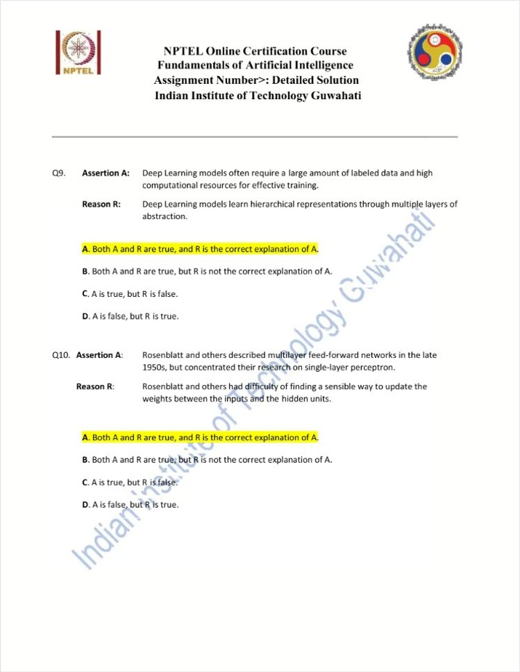

#### 2025 Q9

**Question recap:** Why do many deep supervised models need substantial data and computation?

**Answer:** A — Both statements are true, with the course's intended explanation.

**Why:** Fitting many layers and parameters can require many examples and operations. This is a common tendency, not a universal need for newly labelled data; transfer learning and self-supervised learning are important exceptions.

#### 2025 Q10

**Question recap:** Why did early work emphasise single-layer perceptrons?

**Answer:** A — Both statements are true, with the stated explanation.

**Why:** Effective credit assignment to hidden-layer weights was a major difficulty. Backpropagation supplies gradients through those hidden layers and enables systematic multilayer training.

[Back to year index](#2025) · [All weeks](README.md)

---

## 2024

Question screenshots captured from MY SWAYAM’s public 2024 assignment video, linked to course noc24_ge47. The uploader’s unsubmitted choices, annotations, and occasional overlay text are preserved. They are not an official answer key; corrections and ambiguous wording are discussed below.

[Source](https://www.youtube.com/watch?v=53OMynl4OMc&t=30s)

Jump to discussion: [Q1](#2024-q1) · [Q2](#2024-q2) · [Q3](#2024-q3) · [Q4](#2024-q4) · [Q5](#2024-q5) · [Q6](#2024-q6) · [Q7](#2024-q7) · [Q8](#2024-q8) · [Q9](#2024-q9) · [Q10](#2024-q10)

### 2024 — Page 01

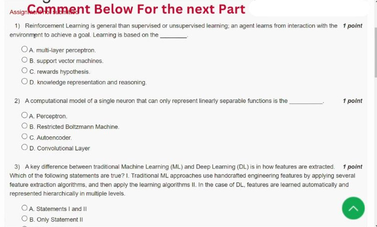

[Source video at 0:30](https://www.youtube.com/watch?v=53OMynl4OMc&t=30s)

#### 2024 Q1

**Question recap:** What hypothesis underlies the RL objective?

**Answer:** C — The reward hypothesis.

**Why:** The goal is to maximise expected cumulative reward from interaction with the environment. Future rewards matter, so the highest immediate reward need not identify the best action. A policy is the behaviour used to pursue that objective, while a value function estimates return.

#### 2024 Q2

**Question recap:** Which single-neuron model represents only linearly separable functions?

**Answer:** A — The perceptron.

**Why:** A thresholded weighted sum defines a linear boundary. For XOR, the positive examples occupy opposite corners and no single straight line separates them from the negatives. A hidden layer or suitable feature transformation can overcome this limitation; a single untransformed perceptron cannot.

### 2024 — Page 02

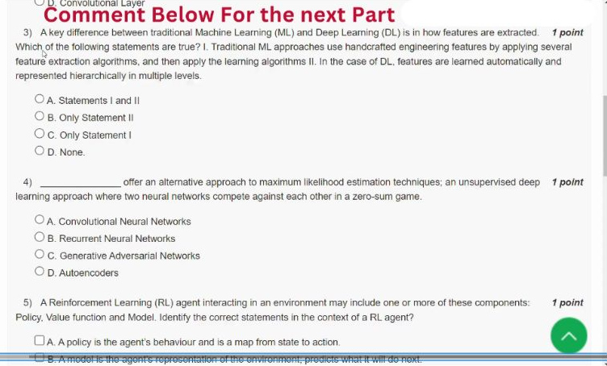

[Source video at 0:55](https://www.youtube.com/watch?v=53OMynl4OMc&t=55s)

#### 2024 Q3

**Question recap:** Which traditional-ML versus deep-learning feature statements hold?

**Answer:** A — Both I and II.

**Why:** Traditional pipelines often use engineered features, whereas deep models learn layered representations from data. This is a broad contrast rather than an absolute boundary between all methods. Good training objectives, data, and input preparation remain necessary for learned representations.

#### 2024 Q4

**Question recap:** Which architecture trains competing generator and discriminator networks?

**Answer:** C — A generative adversarial network.

**Why:** The generator produces samples and the discriminator tries to distinguish them from real data. Adversarial objectives train both components. A GAN is a generative modelling method; its defining property is the two-network competition described here.

### 2024 — Page 03

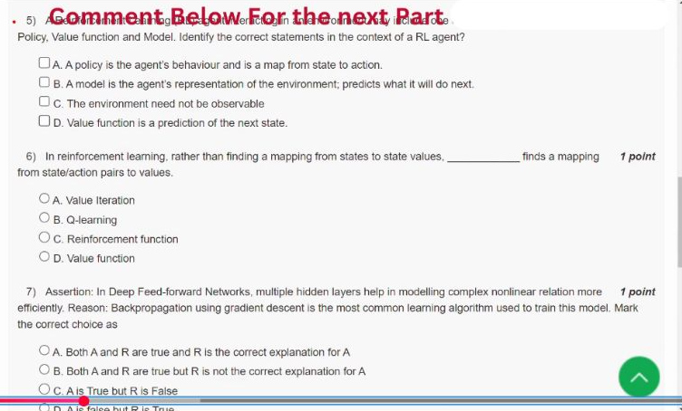

[Source video at 1:25](https://www.youtube.com/watch?v=53OMynl4OMc&t=85s)

#### 2024 Q5

**Question recap:** Which RL-component statements are defensible?

**Answer:** A, B, and C; D is false.

**Why:** A policy maps states to actions. An environment model predicts environmental outcomes; in B, “it” must refer to the environment. General RL can also involve partial observability, although a standard fully observed MDP assumes an observable state. A value function predicts expected cumulative return, not the next state. Compare the explicitly incorrect agent wording in Q8.

#### 2024 Q6

**Question recap:** What learns values for state–action pairs?

**Answer:** B — Q-learning.

**Why:** It estimates $Q(s,a)$ rather than only $V(s)$. A standard update is $Q(s,a)\leftarrow Q(s,a)+\alpha[r+\gamma\max_{a'}Q(s',a')-Q(s,a)]$. The reward plus discounted best next-action estimate is the target, and the bracketed difference is the temporal-difference error.

### 2024 — Page 04

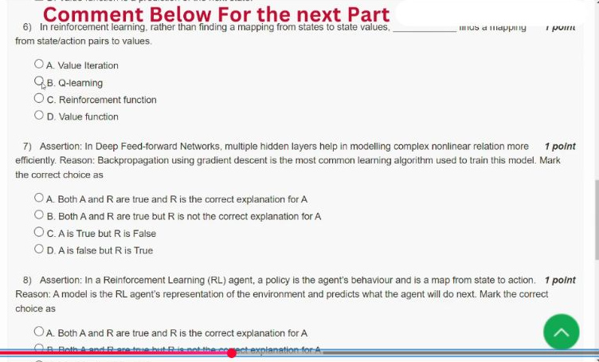

[Source video at 1:55](https://www.youtube.com/watch?v=53OMynl4OMc&t=115s)

#### 2024 Q7

**Question recap:** Does the use of backpropagation explain the representational benefit of depth?

**Answer:** B — Both statements are true, but the reason is not the explanation.

**Why:** Hidden layers with nonlinear activations can build useful intermediate representations. Backpropagation computes parameter gradients and is commonly used to train such networks. Naming the training algorithm does not by itself explain why multiple layers can represent some functions efficiently.

### 2024 — Page 05

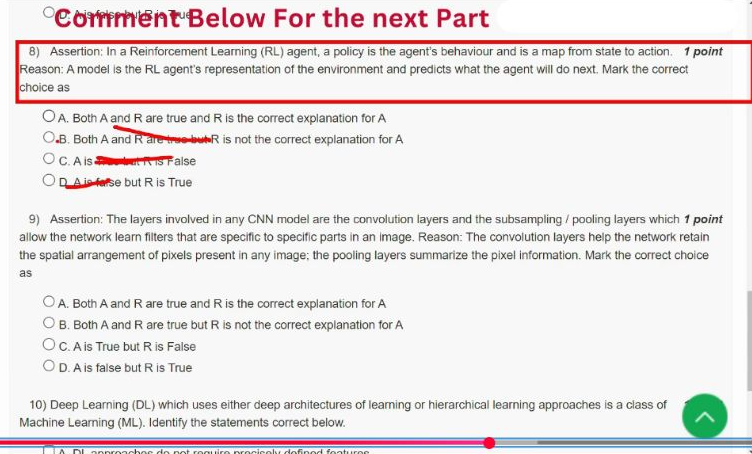

[Source video at 2:25](https://www.youtube.com/watch?v=53OMynl4OMc&t=145s)

#### 2024 Q8

**Question recap:** Does a model predict what the agent will do next?

**Answer:** C — The assertion is true, but the stated reason is false.

**Why:** A policy describes action choice. An environment model predicts the next environmental state and reward after an action, not the agent's next decision. Replacing “agent” with “environment” would repair the reason; it would still describe a separate RL component. See [Sutton and Barto](https://www.incompleteideas.net/book/bookdraft2018mar21.pdf).

#### 2024 Q9

**Question recap:** How do convolution and pooling support CNN representations?

**Answer:** A — The intended assertion–reason answer for the typical architecture.

**Why:** Convolution uses local spatial relationships and shared filters; pooling summarises local responses and can reduce resolution and sensitivity to small shifts. Pooling is common but optional in modern CNNs, and early filters are shared across locations rather than unique to one fixed image region.

### 2024 — Page 06

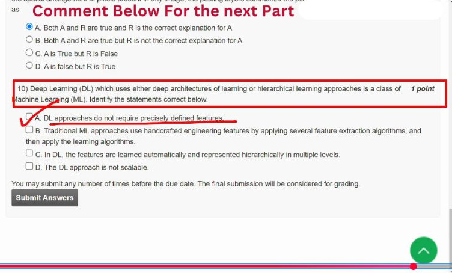

[Source video at 2:55](https://www.youtube.com/watch?v=53OMynl4OMc&t=175s)

#### 2024 Q10

**Question recap:** Which listed deep-learning feature statements hold?

**Answer:** A, B, and C.

**Why:** Deep models can learn hierarchical features, while many traditional pipelines use engineered feature extraction. They still need suitable raw inputs and training choices; “no precisely defined features” refers to avoiding hand-design of every intermediate feature. The claim that deep learning is inherently unscalable is false.

[Back to year index](#2024) · [All weeks](README.md)

---

## 2023

Public 2023 assignment-video frames from JANAK TRIVEDI, showing Assignment 12 due 18 October 2023. The uploader explicitly labels the answers as their own understanding. Submitted choices and text selections are preserved; they are not course grading feedback.

[Source](https://www.youtube.com/watch?v=wROecvpizh8&t=20s)

Jump to discussion: [Q1](#2023-q1) · [Q2](#2023-q2) · [Q3](#2023-q3) · [Q4](#2023-q4) · [Q5](#2023-q5) · [Q6](#2023-q6) · [Q7](#2023-q7) · [Q8](#2023-q8) · [Q9](#2023-q9) · [Q10](#2023-q10)

### 2023 — Page 01

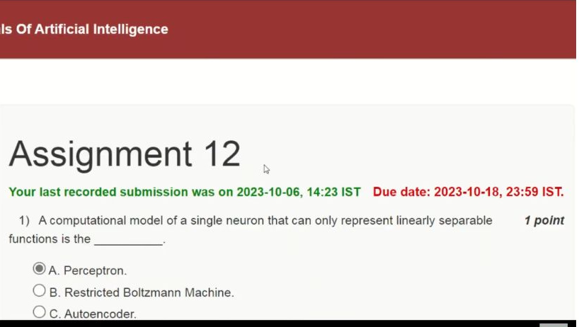

[Source video at 0:20](https://www.youtube.com/watch?v=wROecvpizh8&t=20s)

The dated assignment header and Q1 begin here. Its remaining choices appear in the next frame.

### 2023 — Page 02

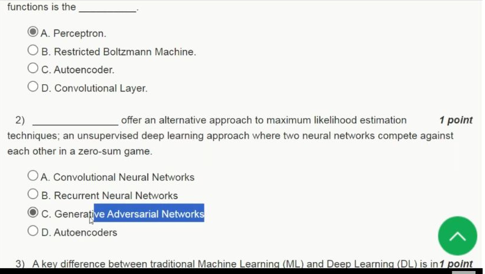

[Source video at 0:55](https://www.youtube.com/watch?v=wROecvpizh8&t=55s)

#### 2023 Q1

**Question recap:** Which single-neuron model represents linearly separable functions?

**Answer:** A — The perceptron.

**Why:** A thresholded weighted sum separates the input space with a linear boundary. XOR cannot be separated by one line in its original two-dimensional input representation. Hidden layers or a suitable feature transformation can represent patterns that one untransformed perceptron cannot.

#### 2023 Q2

**Question recap:** Which architecture trains two competing networks?

**Answer:** C — Generative adversarial networks.

**Why:** A generator produces samples while a discriminator learns to distinguish generated examples from real ones. Their adversarial objectives define the GAN setup. A CNN, RNN, or autoencoder is not defined by this two-player competition.

### 2023 — Page 03

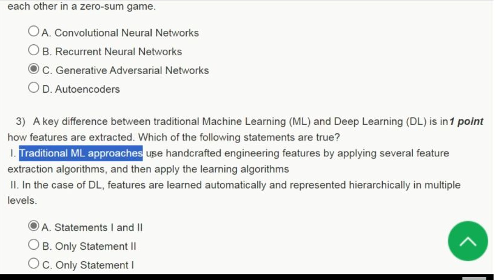

[Source video at 1:15](https://www.youtube.com/watch?v=wROecvpizh8&t=75s)

Q3 begins here; its final answer choice appears in the following frame.

### 2023 — Page 04

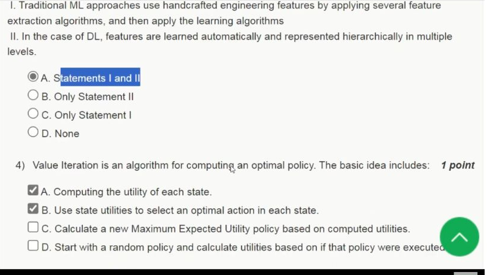

[Source video at 1:35](https://www.youtube.com/watch?v=wROecvpizh8&t=95s)

#### 2023 Q3

**Question recap:** Which feature-extraction statements are intended to hold?

**Answer:** A — Both I and II.

**Why:** Traditional ML pipelines often use engineered features, while deep models can learn hierarchical internal representations. This is a broad course comparison, not a claim that every traditional method requires manual features or that deep models require no input preparation. The screenshot's statement concerns the intermediate features learned by the network.

#### 2023 Q4

**Question recap:** Which listed operations describe value iteration?

**Answer:** A and B.

**Why:** Bellman backups update state utilities; a greedy policy then selects the action with the greatest expected return under those values. For a discounted MDP, $V_{k+1}(s)=\max_a\sum_{s'}P(s'\mid s,a)[r(s,a,s')+\gamma V_k(s')]$. Starting with and evaluating a fixed policy belongs to policy iteration instead.

### 2023 — Page 05

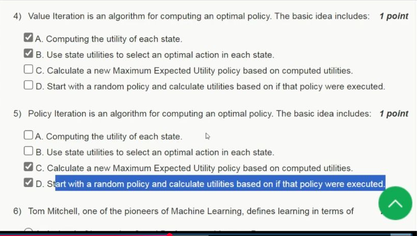

[Source video at 2:15](https://www.youtube.com/watch?v=wROecvpizh8&t=135s)

#### 2023 Q5

**Question recap:** Which listed operations describe policy iteration?

**Answer:** C and D.

**Why:** Start with a policy and evaluate its state values, then improve each state's action using those values. Repeat evaluation and improvement until the policy is stable. The source lists these operations in the opposite presentation order; the corresponding evaluation still precedes improvement. These two planning questions are part of this dated Week 12 assignment and are kept here as printed.

### 2023 — Page 06

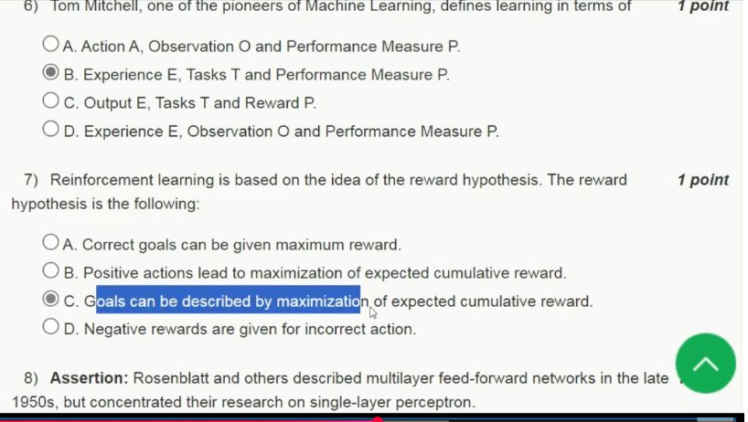

[Source video at 2:35](https://www.youtube.com/watch?v=wROecvpizh8&t=155s)

#### 2023 Q6

**Question recap:** What three elements appear in Mitchell's definition of learning?

**Answer:** B — Experience E, tasks T, and performance measure P.

**Why:** A program learns when its measured performance on the specified tasks improves with experience. For spam detection, the task is classification, labelled emails can supply experience, and accuracy on held-out messages can measure performance. Merely storing more examples does not establish improvement. See [Mitchell's original text](https://www.cs.cmu.edu/~tom/files/MachineLearningTomMitchell.pdf).

#### 2023 Q7

**Question recap:** What does the reward hypothesis say?

**Answer:** C — Goals can be described by maximising expected cumulative reward.

**Why:** The objective combines rewards over time and averages over possible outcomes. It is not simply the largest immediate reward or a claim that every positive action must help. An action can sacrifice immediate reward to reach a more valuable later state.

### 2023 — Page 07

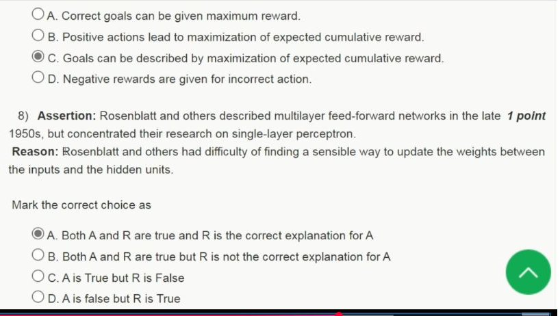

[Source video at 2:55](https://www.youtube.com/watch?v=wROecvpizh8&t=175s)

#### 2023 Q8

**Question recap:** Why did early perceptron work concentrate on single-layer models?

**Answer:** A — The course's intended historical assertion–reason answer.

**Why:** Hidden units have no directly supplied target outputs, so the simple perceptron error rule does not directly specify how to adjust their incoming weights. Difficulty assigning credit to hidden layers helps explain the focus on trainable single-layer models. Backpropagation supplies gradients through intermediate layers. The [AIMA historical discussion](https://aima.cs.berkeley.edu/newchap20.pdf) describes the early lack of effective multilayer learning algorithms.

### 2023 — Page 08

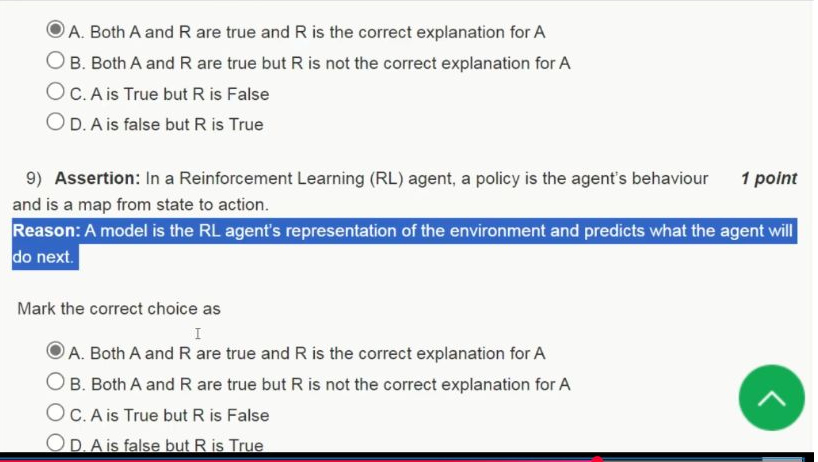

[Source video at 3:20](https://www.youtube.com/watch?v=wROecvpizh8&t=200s)

#### 2023 Q9

**Question recap:** Does an environment model predict the agent's next behaviour?

**Answer:** C — The assertion is true, but the reason is false; the video selects A.

**Why:** A policy specifies action choice. An environment model predicts environmental outcomes, such as the next state and reward after an action. The printed reason substitutes the agent's future behaviour for that environmental prediction. Repairing that word would describe another RL component, rather than explain the policy definition; compare [Sutton and Barto](https://www.incompleteideas.net/book/bookdraft2018mar21.pdf).

### 2023 — Page 09

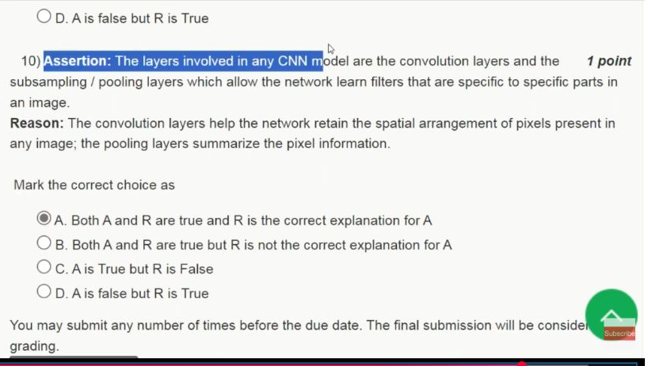

[Source video at 3:35](https://www.youtube.com/watch?v=wROecvpizh8&t=215s)

#### 2023 Q10

**Question recap:** How do convolution and pooling contribute to a CNN?

**Answer:** A — The intended assertion–reason answer for the typical architecture.

**Why:** Convolutions use local spatial relationships and shared filters. Pooling summarises local responses and often reduces resolution and sensitivity to small shifts. Filters are shared across positions, rather than being exclusive to one fixed part of an image. Pooling is common but optional; it is not a requirement of every modern CNN.

[Back to year index](#2023) · [All weeks](README.md)

---

## 2019

Official NPTEL archive with accepted answers. Any discrepancy between a printed formula and its key is identified below.

[Source](https://archive.nptel.ac.in/content/storage2/courses/downloads_new/112103280/Week_12_Assignment_12.pdf)

Jump to discussion: [Q1](#2019-q1) · [Q2](#2019-q2) · [Q3](#2019-q3) · [Q4](#2019-q4) · [Q5](#2019-q5) · [Q6](#2019-q6) · [Q7](#2019-q7) · [Q8](#2019-q8) · [Q9](#2019-q9) · [Q10](#2019-q10)

### 2019 — Page 01

#### 2019 Q1

**Question recap:** What is the early binary threshold neuron model?

**Answer:** B — The McCulloch–Pitts model.

**Why:** It sums binary inputs and applies a threshold to produce a binary output. The perceptron adds a trainable weighted decision rule.

#### 2019 Q2

**Question recap:** Which single-neuron model represents only linearly separable functions?

**Answer:** A — The perceptron.

**Why:** Its thresholded weighted sum defines a linear decision boundary. A single perceptron cannot implement XOR without an additional feature transformation or hidden layer.

#### 2019 Q3

**Question recap:** What building blocks were stacked for deep-belief-network training?

**Answer:** A — Restricted Boltzmann machines.

**Why:** Layer-wise pretraining fitted successive latent representations. This was an important historical approach to training deeper networks.

#### 2019 Q4

**Question recap:** Which RL-component option does the archive accept?

**Answer:** B — I and III, but III contains a wording error.

**Why:** A policy maps states to actions; a value function predicts return. A model predicts what the environment will do, not what action the agent will choose. Taken literally, only I is correct and the matching option is missing. See [Sutton and Barto](https://www.incompleteideas.net/book/bookdraft2018mar21.pdf).

#### 2019 Q5

**Question recap:** What defines an RL system's goal through feedback?

**Answer:** B — A reinforcement or reward function.

**Why:** It specifies the reward signal whose cumulative value the learner seeks to maximise. A policy describes behaviour rather than defining which outcomes are desirable.

#### 2019 Q6

**Question recap:** What learns state–action values?

**Answer:** B — Q-learning.

**Why:** It estimates the expected return of taking an action in a state and then acting optimally. This permits action comparisons without first learning a transition model.

#### 2019 Q7

**Question recap:** What network has only successive forward layer connections?

**Answer:** B — A layered feed-forward network.

**Why:** Information moves from input toward output without recurrent feedback. The question describes the simple adjacent-layer architecture; modern feed-forward networks may also include skip connections.

#### 2019 Q8

**Question recap:** Which feature-extraction statements hold?

**Answer:** A — Both I and II.

**Why:** Traditional pipelines often use engineered features, while deep models learn hierarchical representations. This is a useful broad distinction, not a claim that every traditional learner lacks representation learning.

#### 2019 Q9

**Question recap:** Which network passes a hidden state through successive steps?

**Answer:** C — A recurrent neural network.

**Why:** Reusing the same transition across time is equivalent to unrolling copies with shared parameters. Its hidden state can summarise earlier sequence information.

#### 2019 Q10

**Question recap:** Which convolution-and-pooling statements hold?

**Answer:** B — Both I and II.

**Why:** Convolution exploits local spatial arrangements; pooling summarises local responses. Pooling can reduce detail while making features less sensitive to small shifts.

[Back to year index](#2019) · [All weeks](README.md)

---
